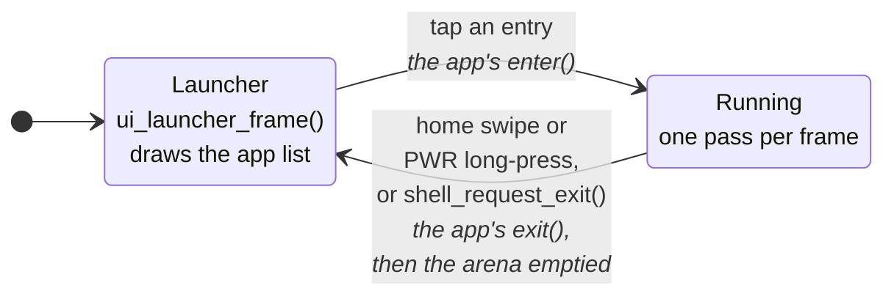
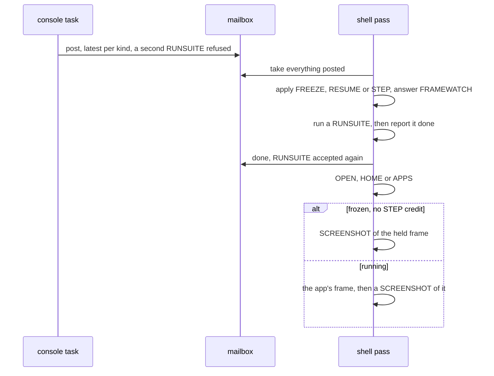

# The Frame Loop

The shell is a two-state machine. `current == NULL` means the launcher is
showing; anything else is the running app.

An app gets exactly one way home by gesture: the home swipe when it sets
`app_t.home_gesture`, the power button's long press when it does not, so an
app that uses swipes or a short PWR press for itself keeps them. What the
shell does on each transition is in
[Building-an-App.md](../Building-an-App.md#lifecycle), and one pass of the loop
with and without `update()` is
[its own section](../Building-an-App.md#one-pass-of-the-frame-loop).

An app that sets `app_t.update` has the previous frame sent on core 1 while
`update()` runs on core 0; the split present underneath is in
[Gfx-and-Presentation.md](../gfx/Present.md#present-who-runs-it).

A caller draws a mesh with `raster_draw()` from `update()` this way, on both
cores: [Mesh-Rendering.md](../render/Mesh-Rendering.md#on-both-cores). An app that
loads a scene and activates its camera needs none of that: while a camera is
active the shell draws it in the same overlap window and upscales it into the
framebuffer before `frame()`, whether or not the app has an `update()`
([Scene-Manager.md](../render/Scene-Manager.md#each-frame)). The render context
owns one raster scratch block, including the census list before the picture
attachments. Dynamic resolution reserves the finest step's block, so choosing
a render size preserves the census without a separate allocation.

## Console requests

In development builds a console verb that needs the frame loop (OPEN, HOME,
APPS, RUNSUITE, FRAMEWATCH, SCREENSHOT, FREEZE, RESUME, STEP) only posts a
request to one mailbox (`console/console_frame_request.h`); the console task
never draws. Each pass takes everything posted, once, and applies what an
early return would skip before anything can return:

## Engine systems

Engine machinery the loop drives every pass is a **system**: a
`shell_system_t` (`shell/shell_system.h`) of phase callbacks, registered with
`SHELL_SYSTEM_REGISTER()` the way an app is. The loop never names a system;
it calls each phase over all of them, lowest `order` first, and skips a
system whose callback for that phase is NULL.

| Phase | When the loop calls it |
|---|---|
| `update(dt_ms)` | after the app's `update()`, while the last frame is still being sent; touches no framebuffer |
| `compose(dt_ms)` | once the send is done, before the app's `frame()` draws over it |
| `app_exit()` | right after the app's `exit()` |
| `overlaps_present()` | a query, not a phase: true makes the app's frame present a pass late, so `update` has a send to overlap |

`update` and `compose` run only on a pass that overlaps the present: the app
has an `update()`, or a system's `overlaps_present()` says so. Every `order`
is a `SHELL_ORDER_*` constant in that one header, so a new system is placed
against the others rather than guessed; ties run by name. A system's own
folder sits below the shell and cannot include its header, so it is
registered from a file in `shell/`: `shell/scene_system.c` registers the scene
manager at `SHELL_ORDER_SCENE`.

## Full redraw

`gfx_request_full_redraw()` marks everything dirty and latches a pending
flag ([Gfx-and-Presentation.md](../gfx/Dirty-Tracking.md#repaint-controls)).
gfx has no idea what anyone caches above it, so the shell answers the flag
at the top of a pass, before anything draws: a running app gets its
`invalidate()` and the launcher gets `ui_invalidate()`. Clearing the flag
before the draw rather than after is what lets a request made inside that
very `frame()` reach the next pass. The app's side is in
[Building-an-App.md](../Building-an-App.md#full-redraw).
