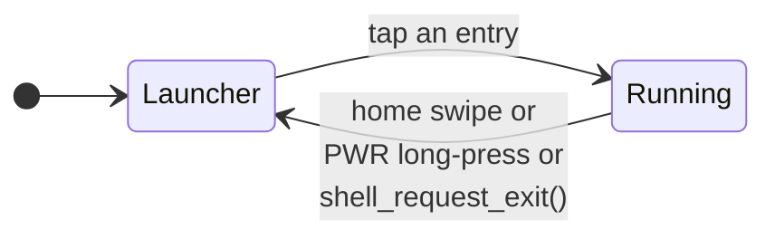
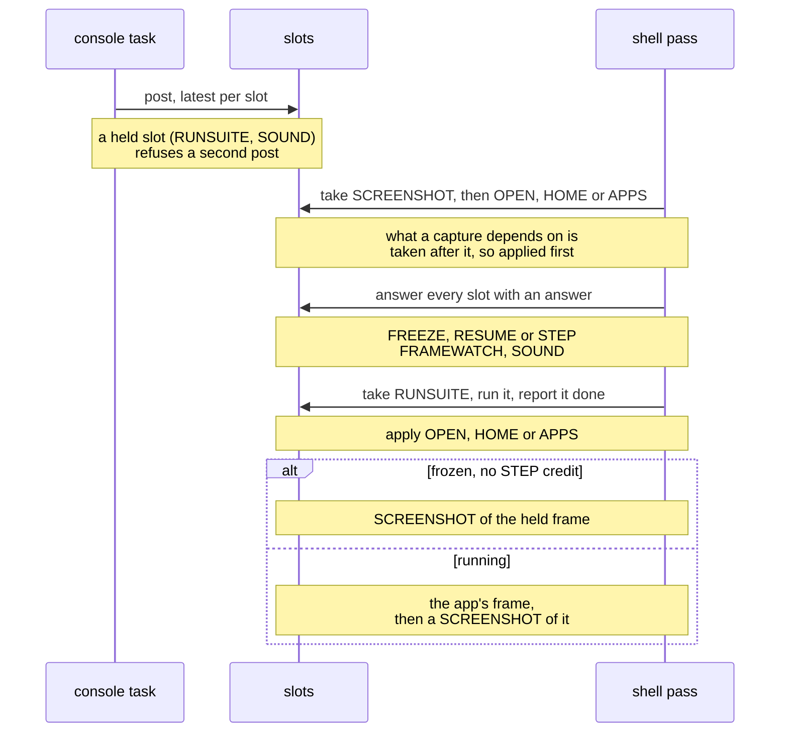

# The Frame Loop

The shell is a two-state machine. `current == NULL` means the launcher is
showing; anything else is the running app.

| | Launcher | Running |
|---|---|---|
| Each pass | `ui_launcher_frame()` draws the app list | one pass of the loop |
| On entry | the app's `exit()`, then the arena emptied | the app's `enter()` |

An app gets exactly one way home by gesture: the home swipe when it sets
`app_t.home_gesture`, the power button's long press when it does not. An app that
uses swipes or a short PWR press for itself keeps them.

| Topic | Where |
|---|---|
| what the shell does on each transition | [Building-an-App.md](Building-an-App.md#lifecycle) |
| one pass of the loop, with and without `update()` | [Building-an-App.md](Building-an-App.md#one-pass-of-the-frame-loop) |
| the split present: with `app_t.update`, the previous frame is sent on core 1 while `update()` runs on core 0 | [Gfx: who runs the present](../gfx/Present.md#present-who-runs-it) |
| drawing a mesh with `raster_draw()` from `update()`, on both cores | [Mesh-Rendering.md](../render/Mesh-Rendering.md#on-both-cores) |
| an app with an active scene camera | [Scene-Manager.md](../render/scene/Scene-Manager.md#each-frame) |

While a scene camera is active the shell draws it in the same overlap window and
upscales it into the framebuffer before `frame()`, with or without an `update()`.

The render context owns one raster scratch block, including the census list before
the picture attachments. Dynamic resolution reserves the finest step's block, so a
render size keeps the census without a separate allocation.

## Console requests

In development builds a console verb that needs the frame loop (OPEN, HOME, APPS,
RUNSUITE, FRAMEWATCH, SOUND, SCREENSHOT, FREEZE, RESUME, STEP) only posts into its
own slot (`console/console_frame_request.h`); the console task never draws. A slot
with an answer is answered by the pass; one without is taken where the shell acts.

## Engine systems

Engine machinery the loop drives every pass is a **system**: a `shell_system_t`
(`shell/shell_system.h`) of phase callbacks, registered with
`SHELL_SYSTEM_REGISTER()` like an app. The loop never names a system. It calls each
phase over all of them, lowest `order` first, and skips a NULL callback.

| Phase | When the loop calls it |
|---|---|
| `update(dt_ms)` | after the app's `update()`, while the last frame is still being sent; touches no framebuffer |
| `compose(dt_ms)` | once the send is done, before the app's `frame()` draws over it |
| `poll(dt_ms)` | every running-app pass, including priming, immediately before `frame()`; advances pending work and delivers completions |
| `app_exit()` | right after the app's `exit()` |
| `overlaps_present()` | a query, not a phase: true makes the app's frame present a pass late, so `update` has a send to overlap |

`poll` runs on core 0, including passes without overlap.

`update` and `compose` run only on a pass that overlaps the present: the app has
an `update()`, or a system's `overlaps_present()` says so.

- Every `order` is a `SHELL_ORDER_*` constant in that one header, so a new system
  is placed against the others rather than guessed; ties run by name.
- A system's folder sits below the shell and cannot include its header, so it is
  registered from a file in `shell/`: `shell/scene_system.c` registers the scene
  manager at `SHELL_ORDER_SCENE`.

## Full redraw

`gfx_request_full_redraw()` marks everything dirty and latches a pending flag
([Repaint controls](../gfx/Dirty-Tracking.md#repaint-controls)). gfx cannot know
what anyone caches above it, so the shell answers the flag at the top of a pass,
before anything draws:

- a running app gets its `invalidate()`;
- the launcher gets `ui_invalidate()`.

The flag is cleared before the draw, not after, so a request made inside that very
`frame()` reaches the next pass. The app's side:
[Building-an-App.md](Building-an-App.md#full-redraw).
