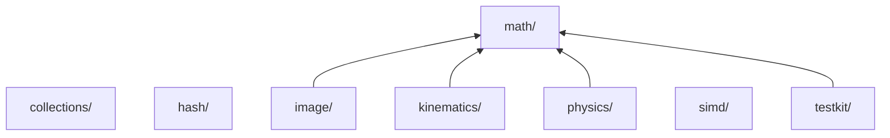

# Layers

Each row may include any lower row, never a higher row or another folder in its
own row.

- Project apps under `apps/` and system apps under `shell/apps/` share the apps
  tier; other folders use their first path component.
- `main.c` starts the board and calls `shell_run()`; the shell reaches apps through
  `app/app.h` callbacks.
- The inventory is `launcher/main/`; the include gate's order is `LAYER_ROWS` in
  `scripts/gates/check_style_audit.py`.
- Folders that touch hardware are marked.

```mermaid
flowchart TB
    classDef hw fill:#8a3d3d,color:#fff

    subgraph System["system"]
        subgraph R1["apps"]
            Apps["apps/ and shell/apps/<br/><i>one folder per app; system apps stay in the core</i>"]
        end
        subgraph R2["the runtime"]
            Shell["shell/<br/><i>frame loop, app switching, system screens in shell/ui/</i>"]
        end
        subgraph R3["boot and self test"]
            Boot["boot/<br/><i>the startup animation</i>"]
            Selftest["selftest/<br/><i>power-on self test, the on-board suite runner</i>"]:::hw
        end
        subgraph R4["the app contract"]
            App["app/<br/><i>callbacks, the app list, the app arena</i>"]
        end
    end
    subgraph Engine["engine"]
        subgraph R5["UI and scenes"]
            Ui["ui/<br/><i>the UI toolkit, microui behind its face</i>"]
            Scene["scene/<br/><i>entities, components, the active camera</i>"]
        end
        subgraph R6["rendering"]
            Render["render/<br/><i>3D transform, clip, projection, rasterizer</i>"]
        end
        subgraph R7["drawing, animation and sound"]
            Draw["draw/<br/><i>shapes, text, images, palettes into a target</i>"]
            Sound["sound/<br/><i>stored sounds and sample cursors</i>"]
            Anim["anim/<br/><i>keyed tracks sampled over time, tweens</i>"]
        end
        subgraph R8["content"]
            Asset["asset/<br/><i>content packs, read in place</i>"]:::hw
        end
    end
    subgraph Platform["platform"]
        subgraph R9["input and audio"]
            Input["input/<br/><i>touch/, motion/, buttons/, mapping/</i>"]:::hw
            Audio["audio/<br/><i>codec, PCM output, microphone capture</i>"]:::hw
        end
        subgraph PowerRow["power"]
            Power["power/<br/><i>PMU keys, battery snapshots</i>"]:::hw
        end
        subgraph R10["display"]
            Display["display/<br/><i>viewport, orientation, panel clock</i>"]:::hw
        end
        subgraph R11["presentation"]
            Gfx["gfx/<br/><i>target types, the framebuffer, present/</i>"]:::hw
        end
        subgraph R12["device services"]
            Services["services/<br/><i>settings, build id</i>"]:::hw
        end
        subgraph R13["frame measurement"]
            Profile["profile/<br/><i>frame cost, frame watch</i>"]:::hw
        end
        subgraph ConsoleRow["the serial console"]
            Console["console/<br/><i>transport, verb registry, frame slots; dev builds</i>"]:::hw
        end
        subgraph R14["the platform core"]
            Core["core/<br/><i>two-core jobs, memory placement, time, tunables</i>"]:::hw
        end
        subgraph R15["board"]
            Board["board/<br/><i>pins, peripherals, panel link</i>"]:::hw
        end
        subgraph R16["the build switch"]
            Build["build/<br/><i>which build variant this is</i>"]
        end
    end
    subgraph R17["packages"]
        Packages["launcher/packages/<br/><i>first-party libraries, the graph below</i>"]
    end

    R1 --> R2 --> R3 --> R4 --> R5 --> R6 --> R7 --> R8 --> R9 --> PowerRow --> R10 --> R11 --> R12 --> R13 --> ConsoleRow --> R14 --> R15 --> R16 --> R17
    Shell -.->|"calls through app/app.h"| Apps
```



- Power: [the PMU owner](../../launcher/main/power/README.md); `power/` sits below
  `input/` and `audio/`.
- Console: [the serial console](../../launcher/main/console/README.md) sits just
  above `core/`; a module's verbs live in a `console/` folder beside it.
- Audio: [audio docs](../audio/README.md). The engine sound layer owns [the mixer,
  voices and buses](../audio/Sound-Mixer.md) as well as stored sounds and sample
  cursors.

| Rule | What it means | Enforced by |
|---|---|---|
| Includes are layer-qualified | `"gfx/gfx.h"`, not `"gfx.h"`, even inside one folder, so an app reaching past `ui` into `gfx` shows at the line that does it | the style audit |
| Apps use the engine, the platform and the app contract | an app under `apps/` includes nothing else of the system band; a system app under `shell/apps/` is part of the shell | SYSTEM-BAND |
| The UI backend stays inside `ui/` | outside it, no firmware source includes microui or a header that reaches it, so a screen sees only `ui/ui.h` and a backend swap touches `ui/` alone | UI-BACKEND |
| `core/`, `build/` and the packages are the base | see [the base](#the-base) | PACKAGE-INCLUDE, PACKAGE-REQUIRES, PACKAGE-CONFIG |
| Every drawing path ends in gfx | nothing else allocates pixels; how a draw call becomes panel pixels is [Gfx](../gfx/README.md#the-path), and `render/` sits above `gfx/` because it draws into gfx's [render targets](../gfx/Targets-and-Modes.md#render-targets) | the layer order |
| Drivers are split from the logic they feed | `power_device.c`, `touch.c`, `buttons.c` and `imu.c` touch hardware; `power_decode`, `power_cache`, `touch_fsm`, `button_fsm`, `gesture` and `tilt` are pure and tested on a laptop; the split runs through every folder and is what the [Testing-Guide.md](../testing/README.md) relies on | review |
| The shell names no vendor firmware | `main.c` and `shell/` reach vendor code only through [the modules that own it](#vendor-owners); a module's device half lives in a `*_device.c` beside it, compiled for the board only, so host builds stay pure | `check_shell_firmware.py`: an ESP-IDF, FreeRTOS, NVS or BSP include or call fails, logging (`esp_log.h`, `ESP_LOG[A-Z]`) excepted |
| The vendor clock, pause and heap have one owner each, and the board support package is `board/`'s | see [vendor owners](#vendor-owners) | the same gate |
| Generated sources are checked in | beside the code that uses them, each with a banner naming its regenerate command, which [a gate](../tools/Generated-Files.md) reruns to prove the file current; the rules are in [tools/gen/README.md](../../launcher/tools/gen/README.md) | the generated-files gate |

## The base

Every layer above `core/` builds on it:

| Module | Owns |
|---|---|
| `core/job.h` | hands one copied job at a time to core 1; runs it inline when core 1 is busy or on a host |
| `core/memory.h` | places memory by kind |
| `core/timing.h` | reads time |
| `core/tune.h` | declares a tunable where it is used: a live variable on a development build, a constant on a release build |
| `build/build_variant.h` | says which build this is |

Below every folder of `main/`, `board/` included, sit the packages: first-party
libraries in `launcher/packages/<name>/`, each its own ESP-IDF component with an
`include/` root, `src/` and `tests/`;
[math](../../launcher/packages/math/README.md), [kinematics](../../launcher/packages/kinematics/README.md)
and [physics](../../launcher/packages/physics/README.md) are three.
Each arrow below is a declared dependency, written by
[`package_requires.py`](../../launcher/tools/build/package_requires.py) from the declarations:

<!-- generated: package-requires-diagram check: python launcher/tools/build/package_requires.py --check -->

<!-- /generated: package-requires-diagram -->

A package includes nothing outside itself but the C library, the build config and the
packages it declares, so the firmware, the host tests and the tools all build it.
It declares them on one line of its own `CMakeLists.txt`, which both builds read:

```cmake
set(physics_requires math)
include("${CMAKE_CURRENT_LIST_DIR}/../testkit/cmake/Package.cmake")
package_add()   # REQUIRES for ESP-IDF, target_link_libraries for plain CMake
```

A package with no `src/*.c` is header-only: an `INTERFACE` library.
The declaration is one unindented line of bare names; PACKAGE-REQUIRES refuses any other spelling.

| Rule | Checks |
|---|---|
| PACKAGE-INCLUDE | a package reaching into the firmware or into a package it does not declare (directly or through a declared one); `launcher/test/check_packages_alone.sh` compiles each package file with only those include roots |
| PACKAGE-REQUIRES | each declared name is another package (it has an `include/`), and none reaches back to the declaring package: dependencies run one way |
| PACKAGE-CONFIG | `CONFIG_<PACKAGE>_` settings in C/H sources, `CMakeLists.txt` and `Kconfig`, and `<PACKAGE>_` names for Kconfig entries, folder name uppercased; comments are ignored |

## Vendor owners

The shell's modules for vendor code:

| Need | Module |
|---|---|
| input | `input/input_shell.h`: `input_start`, `input_poll`, `input_read_acceleration` |
| display | `display/display_shell.h`: `display_start`, `display_sample_orientation`; `display/display.h`: the system panel clock |
| time, memory | `core/timing.h`, `core/memory.h` |
| settings | `services/settings.h` |

The shell calls this firmware's own drivers (`imu_read`, `touch_read`) directly.

The clock, the pause and the heap have one owner each:

| What | Call | Owner |
|---|---|---|
| time | `timing_now_us()`, inlined to the hardware timer's own call | `core/timing.h` |
| pause | `timing_sleep_ms()`, `timing_yield()` | `core/timing.h` |
| memory by kind | `MEMORY_INTERNAL`, `MEMORY_8BIT`, `MEMORY_DMA`, `MEMORY_PSRAM` | `core/memory.h`, whose header says which heap is beneath it on each platform |

In the firmware, its suites and its tools the gate fails any `esp_timer_*`,
`vTaskDelay`, `heap_caps_*`, `MALLOC_CAP_*`, `multi_heap_*`, `esp_psram_*` or
`esp_get_*heap_size` name outside those two modules, `board/` and a driver's
`*_device.c`.

The board support package describes one board, so `board/` alone uses it,
drivers included. Drivers reach the board through `board/board.h`, for
example `board_i2c_bus()`, `board_touch_open()` and `board_sd_probe()`. The
gate fails a `bsp/` include or a `bsp_`, `BSP_` or `CONFIG_BSP_` name
anywhere else.

`launcher/test/` outside `suites/` (the host heap model, the stubs and the harness
both platforms build) is not checked.
