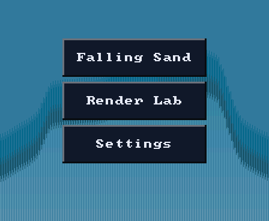

# Firmware

How the shell, the apps and the screen fit together, and why ownership is
arranged this way. Read this before changing the frame loop, the layering or
the UI integration. To write an app, start at
[Building-an-App.md](Building-an-App.md); to build a screen, at
[Building-a-Screen.md](../ui/Building-a-Screen.md).

The board boots, shows the launcher, starts the selected app, and returns
home when the app exits. Each frame has one owner per step:

| Step | Owner | Job |
|---|---|---|
| Read touch and motion | shell (`shell/`) | Make one `input_t` for the frame. |
| Update and draw | current app, or the launcher | Draw into the shared framebuffer, or regenerate dirty band rows, then return. |
| Present | shell and `gfx/` | Send changed pixels to the panel. |

*The launcher on a host render: fixture entries over the ridge backdrop
(`shell/ui/ui_ridge.c`).*

**Three words that are not interchangeable**, because the code uses all three
and means something different by each:

| | |
|---|---|
| **shell** | the frame loop and the app switching: `shell/`, whose log tag, shared with `main.c`'s boot lines, is `shell`; `main.c` starts the board and calls `shell_run()` |
| **launcher** | the home screen the shell draws when no app is running: `shell/ui/ui_launcher.c` |
| **boot** | what runs once before the loop exists: `main.c`'s startup and the animation in `boot/`. The power-on self test and the suite runner in `selftest/` run then too, and an app may run either again later |

The top-level folder `launcher/` is the whole firmware, not the home
screen.

| Read | For |
|---|---|
| [Layers.md](Layers.md) | which folder may include which, and the gate behind each rule |
| [Design-Rules.md](Design-Rules.md) | one framebuffer, one frame loop, apps as callbacks, results read on the frame |
| [Startup.md](Startup.md) | what `app_main()` runs, in order, and why |
| [Frame-Loop.md](Frame-Loop.md) | the shell's two states, console requests, engine systems, full redraw |
| [Frame-Watch.md](Frame-Watch.md) | the runtime check for allocating or logging every frame |
| [Apps-in-the-Build.md](Apps-in-the-Build.md) | how apps join the build, and the app arena |
| [UI.md](UI.md) | microui under `ui/`: dirty bands, canvases, the scrim, why not LVGL, touch |

## Related

- [notes/README.md](../notes/README.md): the hardware underneath: memory
  budget, panel behaviour, flashing and recovery.
- [input/README.md](../input/README.md): touch, buttons, motion axes and
  calibration, tilt and gravity.
- [render/README.md](../render/README.md), `render/`: drawing a baked mesh (cameras,
  the span rasterizer, the two-core frame), making one from a source model, and
  describing a scene of objects.
- [Animation-Tracks.md](../render/animation/Animation-Tracks.md), `anim/`: glTF keyed values
  sampled over time, and how a scene's properties are animated.
- [assets/README.md](../assets/README.md), `asset/`: the binary pack of content the
  firmware maps from a flash partition, its format and how it is flashed.
- [Text-and-Fonts.md](../gfx/Text-and-Fonts.md): what a font is, the role
  accessor, text at more than one size.
- [tools/Frame-Cost.md](../tools/Frame-Cost.md): where a frame's time goes, by
  stage.
- [Testing-Guide.md](../testing/README.md): how to test any of it.
- [Build-Variants.md](../tools/Build-Variants.md): what release, development and
  diagnostics builds each carry.
