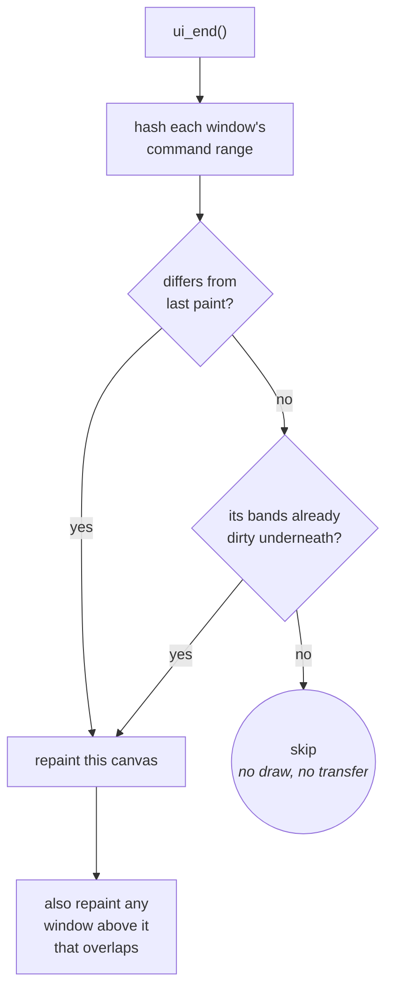
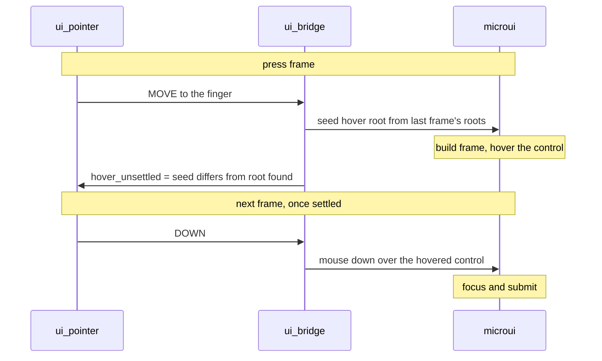

# UI

`ui/ui.c` owns the microui integration; the launcher is a caller like any
app. The controls are catalogued in [UI-Toolkit.md](../ui/README.md), and a
screen is put together as in [Building-a-Screen.md](../ui/Building-a-Screen.md).
This page is how the integration underneath works.

## Immediate mode versus dirty bands

Immediate mode and dirty bands fight. Immediate mode clears and repaints every frame, which marks every
band dirty and forces a full transfer, discarding what partial updates save.

An immediate-mode UI is **rebuilt** every frame but not necessarily **changed**.
microui's command list describes the output completely, so two frames that hash
the same are the same picture.

A retained-mode engine knows what changed because changing is an explicit act.
Here the signal is recovered from the other end: compare output where an engine
compares intent.

## One window is one canvas

microui groups commands by root container, each with its own rect. Each
window is hashed, repainted and band-marked on its own, so a live readout
does not repaint a static toolbar in another window.

Band mode has no framebuffer to hash against, so it hashes shapes by row
range, per band (`ui_band_hash`, `ui/ui.c`).

| Rule | Why |
|---|---|
| Painter's order: repainting a window repaints any window above it that overlaps | windows draw back to front, or the repaint erases what was on top |
| `ui_invalidate()` after anything that replaces the screen unseen, such as returning to the launcher from an app | otherwise the UI compares an unchanged command list, skips, and leaves the app's last frame on screen |

A screen whose command list does not change paints and sends nothing.
`test/suites/suite_ui.c` changes one of two windows and asserts the other's
bands stay clean.

## The scrim: the one thing drawn outside the command list

A panel over a paused screen dims what is behind it with one full-screen
`draw_rect_blend()`. It is a pixel write, not a command, because a blend
reads the pixel it writes: the command list is re-emitted on every repaint,
so a scrim in it would walk the frozen backdrop toward black.

- It is applied **once per repaint of what is underneath**: when the panel
  opens, and whenever the backdrop is redrawn (a full-redraw request, a turn).
- That holds while panels are opaque and still. A translucent or moving panel
  needs the general form: whoever repaints a region restores the backdrop under
  it, re-scrims that region, then draws.
- [suite_image_pixel.c](../../launcher/packages/image/tests/suite_image_pixel.c) pins the arithmetic; the app recipe is
  [a panel over a paused app](../ui/Building-a-Screen.md#a-panel-over-a-paused-app).

## Why microui, not LVGL

The Waveshare BSP lives in `components/esp32_s3_touch_amoled_1_8/` with its
LVGL interface removed; LVGL is not built. `board/board_panel.c` brings the
panel up, `gfx/present/gfx_present.c` sends to it, and `board/` wraps the BSP for
board services and touch setup.

| Constraint | Why it points to microui |
|---|---|
| Internal heap is tight, even with the framebuffer in PSRAM | a widget tree and style system are a standing tax on internal SRAM; microui is one fixed-size context, cut down once in its header ([patched header](#the-vendored-header-is-patched)) |
| Apps own their whole frame | an app draws straight to the framebuffer on its own schedule; a retained toolkit wants the display and the refresh cycle, a command list asks for nothing |
| The pipeline skips unchanged frames, because a full transfer is bus-bound | a command list is the shape that needs ([dirty bands](#immediate-mode-versus-dirty-bands)); LVGL would add a second damage tracker to reconcile |

**The cost:** microui encodes a mouse (point, then click) and a touchscreen
cannot produce the "point". The shell synthesizes it, at a frame of latency on
every tap ([hover frame](#touch-needs-one-synthesized-hover-frame)). A
touch-native toolkit would not pay that.

## Two things to know before touching it

### The vendored header is patched

Upstream sizes `mu_Context` for a desktop, with a 256 KiB command list alone.

The sizes are reduced in `components/microui/include/microui.h`, upstream values in
trailing comments, rather than overridden from our side: they fix the struct's
layout, and two translation units disagreeing would corrupt it silently.

### Touch needs one synthesized hover frame

A control is hovered only on a frame where the button is *not* held, and
submits only once focused, so a press needs a frame with the finger present and
no DOWN before the DOWN. Hover also needs `hover_root`, which `mu_begin()` copies
from the *previous* frame.

| Step | Owner | Does |
|---|---|---|
| seed | `ui/input/ui_bridge.c` | on the press frame, `mu_seed_hover_root()` sets it from the roots the last frame left in `root_list` |
| compare | `ui_bridge.c` | after the frame, compares the seed with the root microui found and records `hover_unsettled` |
| send | `ui/input/ui_pointer.c` | sends the DOWN only once `hover_unsettled` is clear |

- A screen switch, a list closing or a window's first build leaves the seed
  different from the root found; the DOWN waits frame by frame and the tap is
  never lost.
- Without the hover frame nothing takes focus: every button draws pressed while
  returning 0. A press and release inside one frame on an unsettled root is lost.
- A repaint-only frame (`ui_begin(NULL)`, the boot backdrop) feeds no input and
  does not step the pointer. It runs before `input_start()`, with no touch.
- `ui_pointer.c` also holds the `DOWN` a slider needs to track a drag, and the
  UP owed when a lift never reached the UI (`ui/input/ui_pointer.h`).
- A press or lift within `snap.reach` of a control is aimed at its nearest edge;
  the raw press stays the drag origin and later motion stays raw.

The rule applies to every control that reacts to a press, so reworking input
handling must preserve it. `suite_ui_pointer_microui.c` and
`suite_ui_widgets.c` pin it against real microui: hover is microui's own state,
which event-list tests cannot see.
