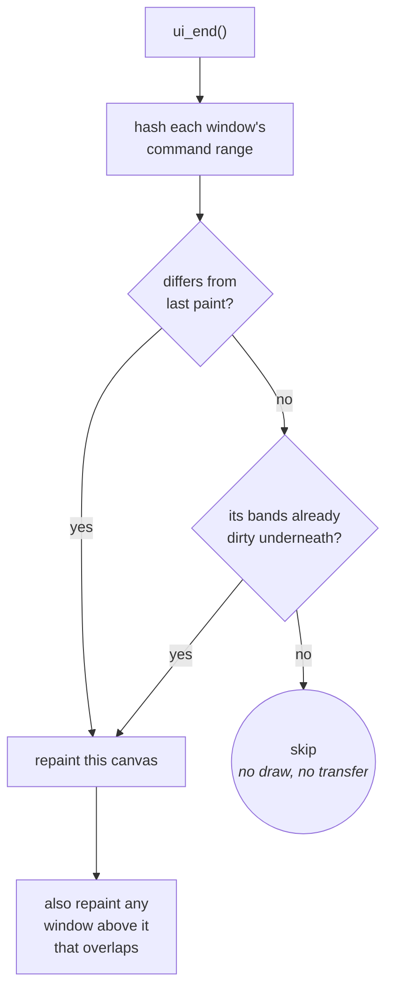
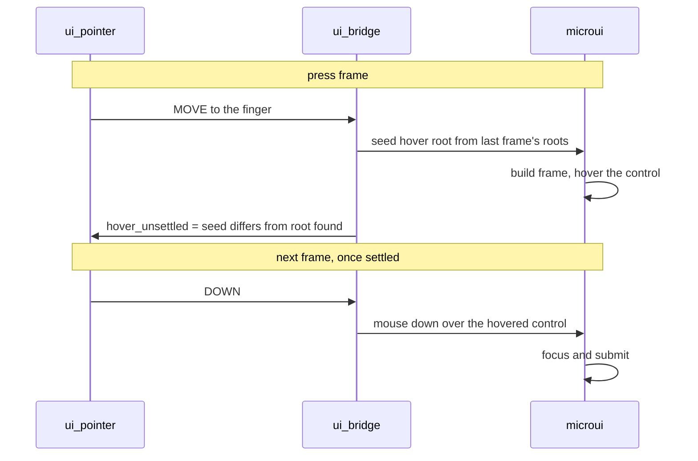

# UI

## Drawing a UI, in the shell or in an app

`ui/ui.c` owns the microui integration; the launcher is a caller like any
app. The controls and helpers are catalogued in
[UI-Toolkit.md](../UI-Toolkit.md), and how to put a screen together is
[Building-a-Screen.md](../Building-a-Screen.md). What follows is how the
integration underneath them works.

## Immediate mode versus dirty bands

These fight. Immediate mode rebuilds and repaints the UI every frame, which
means clearing every frame, which marks every band dirty and forces a full
transfer, discarding the saving partial updates exist to provide.

The resolution: an immediate-mode UI is **rebuilt** every frame but not
necessarily **changed**. microui's command list is a complete description
of the output, so two frames that hash the same *are* the same picture. A
retained-mode engine knows what changed because changing it is an explicit
act; immediate mode throws that signal away, so it is recovered from the
other end: compare output where an engine compares intent.

## One window is one canvas

microui already groups commands by root container, each with its own rect,
so each window is hashed, repainted and band-marked on its own. A live
readout in one window does not force a static toolbar in another to repaint.

Band mode has no framebuffer to hash canvases against, so it hashes shapes
by row range instead, per band (`ui_band_hash`, `ui/ui.c`).

Two rules follow:

- **Painter's order.** Windows are drawn back to front, so repainting one
  means repainting anything above it that overlaps, or the repaint erases
  what was on top.
- **`ui_invalidate()`.** If something replaced the screen in a way `ui_end()`
  cannot detect, returning to the launcher after an app, the UI must be
  told its pixels are gone, or it compares an unchanged command list, skips,
  and leaves the app's last frame on screen.

A screen whose command list does not change paints and sends nothing at all.
`test/suites/suite_ui.c` builds two windows, changes one, and asserts the
other's bands stay clean.

## The scrim: the one thing drawn outside the command list

A panel over a paused screen dims what is behind it with one full-screen
`draw_rect_blend()`. That is a pixel write, not a command, and it has to
be: everything in the command list is re-emitted on every repaint, and a
blend fill reads the pixel it writes, so a scrim repeated per repaint walks
the frozen backdrop toward black. It is applied **once per repaint of what is
underneath**: when the panel opens, and again whenever the backdrop itself
is redrawn (a full-redraw request, a turn).
`suite_gfx_color.c` pins the arithmetic; the recipe for an app is in
[Building-a-Screen.md](../Building-a-Screen.md#a-panel-over-a-paused-app).

That shortcut holds while panels are opaque and do not move. A translucent
or moving panel needs the general form: whoever repaints a region restores
the backdrop under it, re-scrims that region, then draws.

## Why microui, not LVGL

The Waveshare BSP lives in `components/esp32_s3_touch_amoled_1_8/` with its
LVGL interface removed; LVGL is not built. `board/board_panel.c` brings the
panel up and `gfx/present/gfx_present.c` sends to it directly; the BSP
supplies board services and touch setup. Three
constraints point the same way:

**Internal heap is tight even with the framebuffer in PSRAM.** A persistent
widget tree and style system are a standing tax on internal SRAM for the
life of the process. microui's cost is a fixed-size context, cut down once in
its header (below).

**Apps own their whole frame.** An app draws straight to the framebuffer on
its own schedule, with no widget tree in between. A retained-mode toolkit wants to own
the display and the refresh cycle; microui's command list asks for nothing;
whoever is drawing paints it whenever and into whatever they like.

**The render pipeline is built around skipping unchanged frames**, because a
full transfer is bus-bound and costs most of a frame. A command list is
exactly the shape that needs ([above](#immediate-mode-versus-dirty-bands)).
LVGL brings its own invalidation system; adopting it would mean reconciling
two damage trackers.

**The cost, for balance:** microui encodes a mouse (point, then click), and
a touchscreen cannot produce the "point" half. The shell synthesizes it, at
a frame of latency on every tap; see below. A
touch-native toolkit would not pay that.

## Two things to know before touching it

**The vendored header is patched.** Upstream sizes `mu_Context` for a
desktop, with a 256 KiB command list alone. Sizes are reduced in
`components/microui/include/microui.h`, with upstream values in trailing
comments, rather than overridden from our side, because they determine the
struct's layout and two translation units disagreeing would corrupt it
silently.

**Touch needs one synthesized hover frame.** `mu_update_control()` marks a
control hovered only on a frame where the button is *not* held, and a control
submits only once focused, so a press needs a frame with the finger present
and no DOWN before the DOWN. Hover also needs `hover_root`, which `mu_begin()`
copies from the *previous* frame, so on the press frame `ui/input/ui_bridge.c` seeds
it (`mu_seed_hover_root()`) from the roots the last frame left in `root_list`.
After the frame it compares the seed with the root microui then found and
records the result in `hover_unsettled`; `ui/input/ui_pointer.c` sends the DOWN
only once that is clear.

A screen switch, a list closing or a window's first build leaves the seed
different from the root found; the DOWN then waits, frame by frame, and the
tap is never lost. Ship the press with no hover frame and nothing takes focus:
every button draws its pressed look while returning 0. A press and release
inside one frame resolves at once, so on an unsettled root it is lost.
A repaint-only frame (`ui_begin(NULL)`, the boot backdrop) feeds no input
and neither steps nor reports to the pointer. It runs before `input_start()`,
with no touch in progress. `ui/input/ui_pointer.c` also owns the held `DOWN` a
slider needs to track a drag and the UP owed when a lift never reached the UI
(`ui/input/ui_pointer.h`); `suite_ui_pointer_microui.c` and `suite_ui_widgets.c` pin
it against real microui, since hover is microui's own state and event-list
tests cannot see it. It applies to every control that reacts to a press, so
reworking input handling means preserving it. A press or a lift within `snap.reach` of a
control is aimed at its nearest edge; the raw press position remains the drag
origin, and later motion stays raw.
