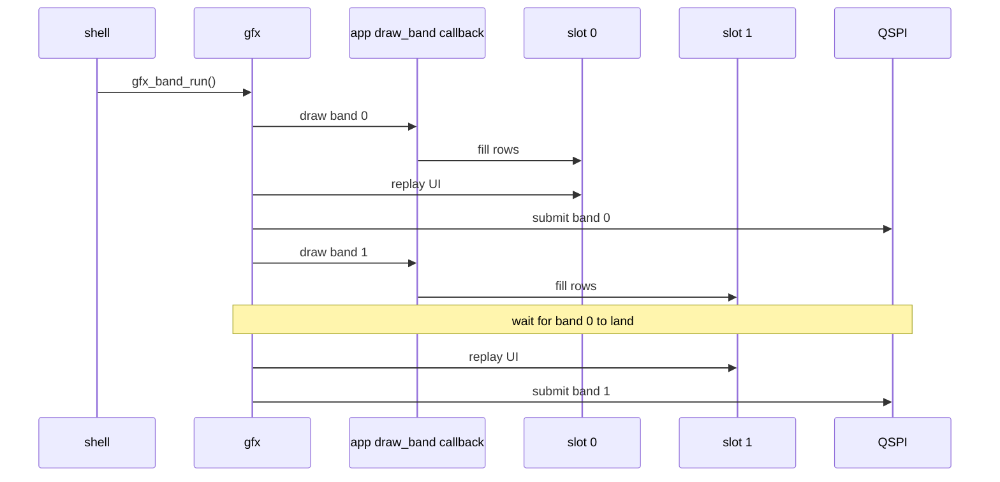

# The Band Ring

The ring overlaps drawing and sending, so frame time approaches the larger of
render cost and transfer cost, plus setup and slot waits, rather than their sum.
Only device timing establishes the overlap; host state-machine tests do not
measure the panel bus.

A picture is either **persistent** or **transient**:

| | Persistent | Transient |
|---|---|---|
| What | a framebuffer or index image | an app's `draw_band` callback |
| Read or called | by gfx on core 1 after `frame()` | by gfx once per dirty band |
| App asks for | `GFX_LAYOUT_FULL_FB` or `GFX_LAYOUT_INDEXED` | `GFX_LAYOUT_BANDS` in `enter()`, plus `draw_band` |

gfx owns every send. For a transient picture it calls `draw_band`, replays the UI
over the band, then submits it. An app without `draw_band` keeps its persistent
path.

Two slots, so band k+1 renders while band k is on the wire:

- `gfx_band_run()` waits for a slot only when it comes round again.
- The ring state machine is `gfx_band.h`, pure and host-tested.
- The first frame after `gfx_mode_enter()`, and any frame after `gfx_invalidate()`,
  forces every band.
- Each dirty band goes out whole: one `esp_lcd_panel_draw_bitmap()` per band,
  straight from the buffer the app drew. The transfer takes no source stride, so
  sending fewer columns would mean repacking the rows first.

A UI over a band renderer is built once and replayed per dirty band:

- `ui_end()` bins the command list by rows in band mode.
- The shell passes `ui_replay_band()` to `gfx_band_run()` as its overlay, which
  draws a band's share after the app's content.
- The shell queues its home hint with `ui_queue_band_overlay_rect()` before
  `frame()`, because the app's `ui_end()` inside `frame()` bins it.
