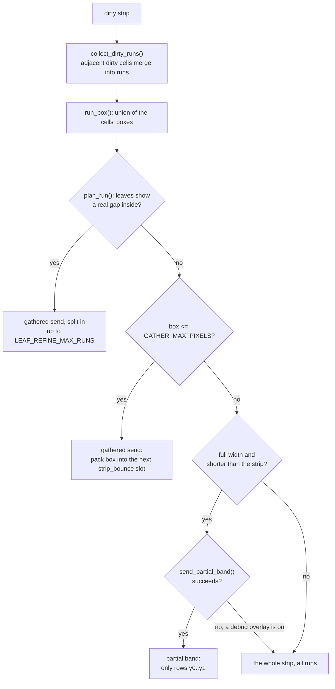
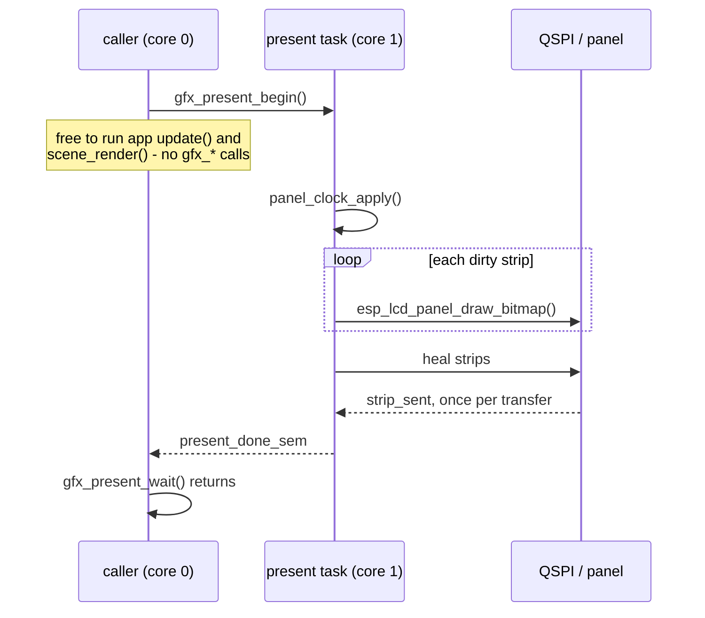
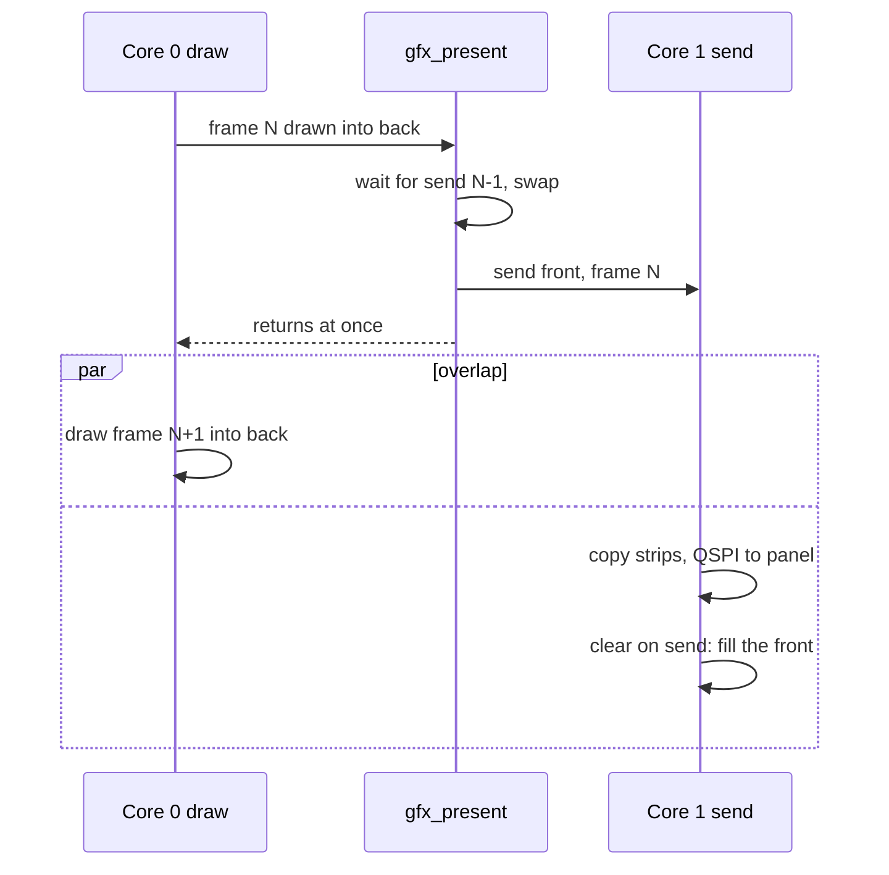

# Present

## Present: what gets sent

`run_present_normal()` walks the 7 strips. A clean strip is skipped. A dirty
one goes through `send_one_row()`:

| Send path | Source | Cost |
|---|---|---|
| gathered | rows packed into the next of `STRIP_BOUNCE_SLOTS` (2), at most `GATHER_MAX_PIXELS` (8192 px) | queued back to back |
| partial band / full strip | `send_fb_rows()` copies into the next of `STRIP_BOUNCE_SLOTS` (2) | queued back to back |

- Every window is rounded out to **even edges**: the panel controller leaves
  stale corners on an odd one.
- Full-width sends bounce through internal DMA RAM because DMA reading PSRAM
  in place drops data past 40 MHz.
- A rejected transfer marks the whole screen dirty, so the next present
  repairs it.
- Indexed mode skips the run logic: `run_present_strips()` expands each dirty
  strip whole through the LUT, straight into a bounce slot.

## Present: who runs it

The present task is pinned to core 1 and owns panel bring-up, so the
strip-sent interrupt lands there too.

| Call | Does |
|---|---|
| `gfx_present()` | `gfx_present_begin()` then `gfx_present_wait()` |
| `gfx_present_begin()` | hands the target to core 1, returns at once. A no-op in band-ring mode. In double mode it first drains the previous send and swaps front and back. Each call also ends a frame for the frame watch (`profile/frame_watch.h`). |
| `gfx_present_wait()` | blocks until everything queued has landed. Double mode: returns at once. |
| `gfx_set_present_async()` | `false` sends on the caller's core instead, for A/B timing |
| `gfx_set_clear_on_send()` | double mode only: core 1 fills each frame with a colour once it is sent, so `draw_clear()` of that colour on it is skipped (`gfx_framebuffer_holds()`). Readback is unavailable until a send that keeps its frame. |

Outside double mode the wait is mandatory: DMA is still reading the buffer until it returns.

Single-buffer presentation runs from IRAM (`main/linker.lf`,
`CONFIG_SPI_MASTER_IN_IRAM`) to avoid instruction-cache misses.
Double-mode setup and the raw full-frame loop run from flash.

suite_gfx
`test_narrow_present_counters` measures it warm, with the instruction cache
cold, and sent from the caller's core.

## Presentation memory policy

Prefer reading PSRAM to writing it in bulk. A retained framebuffer is read by core 1 into internal DMA
buffers while core 0 updates app state; drawing waits for that read to finish.

| Layout or option | Memory cost |
|---|---|
| single-buffer layouts | retain their contents; a catch-up copy between PSRAM framebuffers would cost 6–15 ms per frame |
| `GFX_LAYOUT_DOUBLE_FB` | needs a full redraw and makes no catch-up copy; its draw runs slower while the front is sent, as both buffers are in PSRAM |
| clear on send | moves the full-frame fill from core 0 to core 1: the same bytes, now sharing the bus with the draw |
| the mesh raster | a measured exception: its colour and depth targets and upscaled framebuffer are written in PSRAM |

See [Board and Memory](../notes/Board-and-Memory.md#psram-throughput) for
memory throughput and placement.

## Panel clock and heal

| | `GFX_PANEL_CLOCK_SLOW_HZ` (40 MHz) | `GFX_PANEL_CLOCK_FAST_HZ` (80 MHz) |
|---|---|---|
| Full-frame bus time | 16.5 ms | 8.2 ms |
| Panel rating (50 MHz) | inside | **past it** |
| Failure mode | none | a stray pixel or line that stays until that region is sent again |
| Heal | does nothing | active if the app opted in |

`gfx_set_panel_clock_hz()` takes effect before the next present, never
mid-send. gfx keeps whatever it was last told; the shell owns the choice and
restores it on every app switch.

Heal (`gfx_heal.h`, pure) re-sends marked rows as full-width strips of
`GFX_HEAL_STRIP_ROWS` (32) whose alignment shifts every present, because the
same window sent again fails the same way.

| Call | Does |
|---|---|
| `gfx_heal_mark()` | queue rows; `x` and `w` are ignored |
| `gfx_heal_set_budget()` | pixels of heal per present, default `GFX_HEAL_DEFAULT_BUDGET_PIXELS` |
| `gfx_heal_set_rolling()` | rows per present of a whole-screen sweep, 0 for none |
| `gfx_heal_restore_defaults()` | empty the queue, reset both; the shell calls it on every app switch |

Band mode heals nothing, the same as the slow clock: a band is gone once
sent, so gfx holds nothing to resend.
