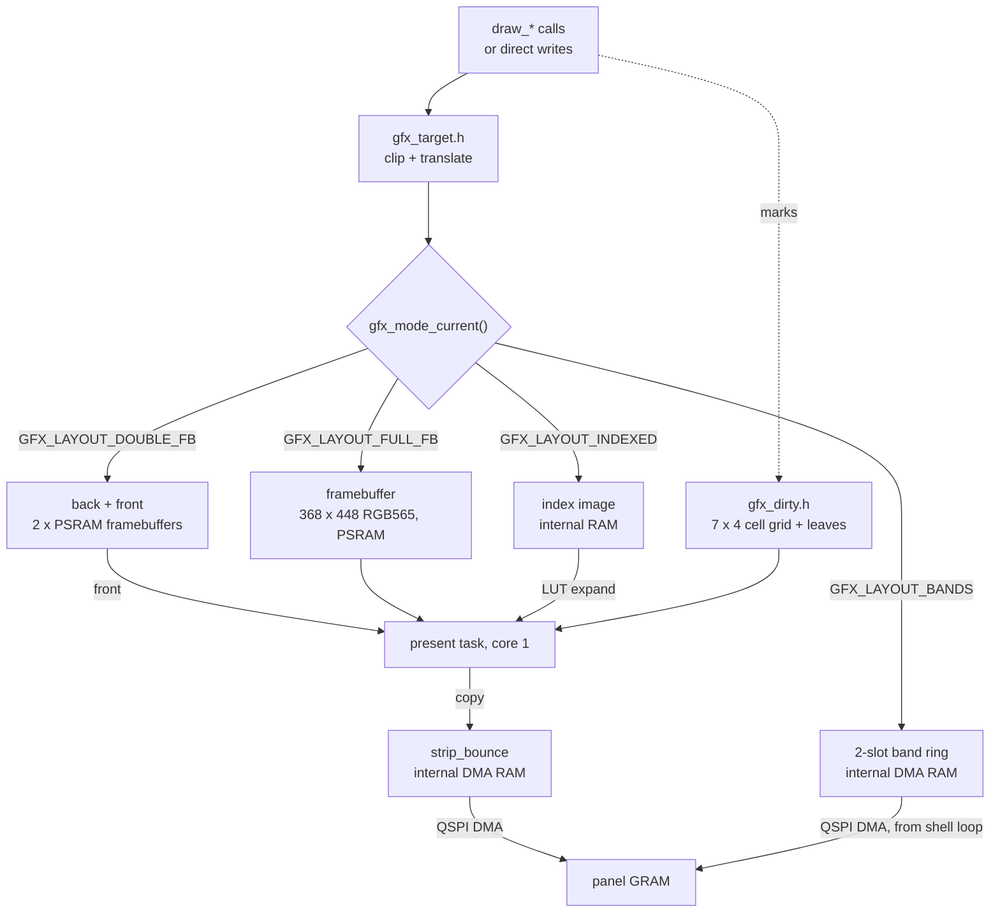

# Gfx

How a draw call becomes pixels on the panel: the three draw targets, the dirty
tracker, and the present path. Which layout and present option to pick, and
when each pays, is [Rendering Options](../render/Rendering-Options.md).
A caller includes the header for what it does:

| Header | What it declares |
| --- | --- |
| [`gfx/gfx.h`](../../launcher/main/gfx/gfx.h) | the framebuffer: its size, `gfx_init()`, `gfx_framebuffer()`; draw's surface (`gfx_draw_begin()`, `gfx_set_clip()`) and dirty marking |
| [`draw/draw.h`](../../launcher/main/draw/draw.h) | primitives, text and clipping |
| [`gfx/present/gfx_present.h`](../../launcher/main/gfx/present/gfx_present.h) | present, the panel clock, heal |
| [`gfx/present/gfx_mode.h`](../../launcher/main/gfx/present/gfx_mode.h) | modes, readback, the indexed image and its LUTs |
| [`gfx/present/gfx_debug.h`](../../launcher/main/gfx/present/gfx_debug.h) | development-build overlays and send counts |
| [`draw/draw_image.h`](../../launcher/main/draw/draw_image.h) | a picture read in place from its pack entry |

`draw/` owns primitives, images, icons, fonts, palettes and dithering.
`gfx/target/` holds pixel colour, boxes, draw targets and render-target
attachments. `gfx/present/` owns the framebuffer and presentation, with
layout values under `modes/`, send policy under `send/` and emulated panel
backends under `panel/`. `gfx_internal.h` holds state shared only by
presentation. Draw reaches presentation only
through `gfx.h`: `gfx_draw_begin()` hands it the target, clip and whether to
mark, and the `gfx_mark_*` calls record what it wrote. The panel link itself, QSPI and each revision's init
sequence, is `board/board_panel.c`. For what an app owes the shell see
[`Building-an-App.md`](../Building-an-App.md); for the panel constraints these choices obey see
[`notes/Display-and-Rendering.md`](../notes/Display-and-Rendering.md).

Two facts drive everything here. Sending is almost the whole cost of a frame
(16.5 ms of bus for a full frame at 40 MHz, 8.2 at 80), and the panel keeps
what it was last sent in its own GRAM. So the design is: send only what
changed.

## The path

A **strip** is one of the tracker's 7 full-width, 64-row bands (not the band
ring's band). A **gathered run** is a box spanning only some columns of a
strip, packed row by row into a bounce slot and sent as one transfer. A
**partial band** is a full-width box shorter than a strip, sent as the
contiguous framebuffer rows it covers. A **bounce slot** is one of two
strip-sized buffers in internal DMA RAM that every send is copied through.

Entering a band or indexed mode frees the PSRAM framebuffer and
`gfx_mode_exit()` allocates it again. Double mode adds a second one and frees it on exit.

| Read | For |
|---|---|
| [Targets-and-Modes.md](Targets-and-Modes.md) | render targets, the four layouts, their costs, expanded frames, indexed mode |
| [Dirty-Tracking.md](Dirty-Tracking.md) | the cell grid and leaves, and the repaint controls |
| [Present.md](Present.md) | what gets sent, who runs it, the memory policy, panel clock and heal |
| [Band-Ring.md](Band-Ring.md) | the band ring: draw a strip, send it, repeat |
| [Guards-Readback-Instruments.md](Guards-Readback-Instruments.md) | guards, panel readback and the development overlays |

## Related

- [`Building-an-App.md`](../Building-an-App.md): when the shell presents, and `update()`
- [`firmware/README.md`](../firmware/README.md): why one framebuffer, one frame loop
- [`notes/Display-and-Rendering.md`](../notes/Display-and-Rendering.md): the panel constraints these choices obey
- [`plans/Autana-Rendering-Roadmap.md`](../plans/Autana-Rendering-Roadmap.md): where this is going
