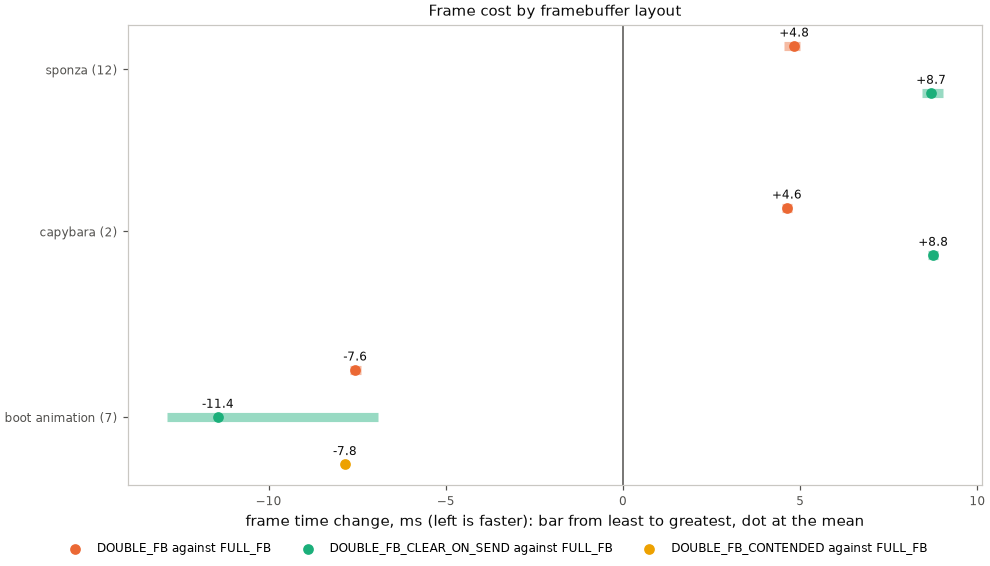

# Targets and Modes

## Render targets

[`gfx_target.h`](../../launcher/main/gfx/target/gfx_target.h) describes a picture
as `image_t` attachments: colour in `GFX_PIXEL_FORMAT`, depth in `IMAGE_U16`,
then further maps in their own formats.

Every attachment shares width and height. Each image's `pitch` is the byte
distance between row starts; `first_row` locates its first row in the picture.
A framebuffer, band or replay strip uses one colour attachment.

`gfx_target_t` has a flexible attachment array. `GFX_TARGET_STORAGE(n)` exposes
its `target` union member and stays last in an enclosing struct.
Drawing surfaces borrow a `const gfx_target_t*`.

| Function | What it does |
|---|---|
| `gfx_target_of_color()` | initialises caller storage for one colour attachment |
| `gfx_target_bytes()` | sizes the attachments, rounded to word boundaries |
| `gfx_target_carve()` | assigns each attachment pixels, dimensions and byte pitch |
| `gfx_target_window()` | copies attachment views for picture rows `[row0, row1)` |
| `gfx_target_row()`, `gfx_target_color()`, `gfx_target_depth()` | addresses an attachment's picture row |

A target can be carved from a scratch block or borrow existing buffers.
Windows copy every attachment; copying a `gfx_target_t` value loses its flexible
array. An attachment's meaning beyond its format belongs to its renderer.

## Modes

Requested with `gfx_mode_enter()` from an app's `enter()`, released with
`gfx_mode_exit()` from its `exit()`. `gfx_mode_resolve()` (`gfx_mode.h`) turns
the request into a grant and is pure; `gfx_mode_enter()` also allocates.

| | Full framebuffer | Band ring | Indexed | Double framebuffer |
|---|---|---|---|---|
| Request | the default | `GFX_LAYOUT_BANDS` | `GFX_LAYOUT_INDEXED` | `GFX_LAYOUT_DOUBLE_FB` |
| App writes | pixels, anywhere | pixels, one band at a time | palette indices, `gfx_indexed_image()` | pixels, whole frame |
| Buffer | 322 KiB, PSRAM | 2 x `GFX_BAND_HEIGHT` rows, DMA RAM | grid_w x grid_h bytes, internal RAM | 2 x `GFX_FRAMEBUFFER_BYTES`, PSRAM |
| Who sends | present task | gfx, from the shell's frame loop | present task | present task |
| Sends | dirty cells, runs or strips | dirty bands, whole | dirty strips, whole | every strip, whole |
| Content kept between frames | yes | **no**: a band is gone once sent | yes | front only; redraw every back pixel |
| For | anything that redraws part of a frame | a full-redraw renderer | a cell grid with a palette | a full-redraw renderer |
| Used by | the launcher, any microui screen | engine self-tests | a frame that is a grid of palette indices | full-frame pixel rendering |

Double mode draws into the back buffer while the front is sent.
`gfx_present_begin()` drains the preceding send and swaps them;
`gfx_present_wait()` returns at once. Dirty tracking, interlace and
half-picture expansion are disabled.

Mode exit drains the send, keeps the last presented frame as the single
framebuffer, and frees the other. Readback also drains before reading the front.

- `gfx_mode_enter()` asserts the mode is `GFX_LAYOUT_FULL_FB`: modes do not nest.
- A failed allocation grants nothing: the returned mode is still
  `GFX_LAYOUT_FULL_FB`. Check the grant's `layout`, not the request's.
- Geometry is the panel's full size. Per-axis interlace request fields are
  granted but do not alter drawing; `gfx_set_interlace()` controls strip sends.
- `GFX_BAND_HEIGHT` is 16, 32 or 64 rows by Kconfig, default 32, and always
  divides `GFX_HEIGHT`. On the device, at every band height, the two band
  buffers alias `gfx_present.c`'s strip-bounce slots rather than allocating; a host
  build mallocs them.

### Layout costs

Each picture's frame cost on the board, from one build, in `FULL_FB`,
`DOUBLE_FB` and two `DOUBLE_FB` variants. In `_CLEAR_ON_SEND` core 1 clears
each sent frame, so the draw skips its clear; in `_CONTENDED` a send runs
during the whole draw, so both share PSRAM. Not run: the suite has no such pass.

A layout costs about the same ms whatever the picture, so each scene's bars below
are narrow in ms while their percentages spread. The r3d scenes draw in `update()`
and pay for the second framebuffer; the boot animation draws a full frame in
`frame()` and saves about as much.

<!-- generated: gfx-layout-costs sha256=9621101186a45b409f6e414d543eebb09d668fcaf498356f9242fc30a3844211 -->

| Scene | Pictures | Draws | Best layout | Gain against `FULL_FB` | Others |
|---|---|---|---|---|---|
| sponza | 12 | `update()`, the frame before sent meanwhile | `FULL_FB` | — | `DOUBLE_FB` +4.8 ms (+13%), `DOUBLE_FB_CLEAR_ON_SEND` +8.7 ms (+24%) |
| capybara | 2 | `update()`, the frame before sent meanwhile | `FULL_FB` | — | `DOUBLE_FB` +4.6 ms (+33%), `DOUBLE_FB_CLEAR_ON_SEND` +8.8 ms (+62%) |
| boot animation | 7 | a full frame in `frame()` | `DOUBLE_FB_CLEAR_ON_SEND` | -11.4 ms (-33%) | `FULL_FB`, `DOUBLE_FB` -7.6 ms (-23%), `DOUBLE_FB_CONTENDED` -7.8 ms (-24%) |

Every picture

| Picture | `FULL_FB` | `DOUBLE_FB` | `DOUBLE_FB_CLEAR_ON_SEND` | `DOUBLE_FB_CONTENDED` |
|---|---|---|---|---|
| sponza-fitted-full, portrait | 43.1 | 48.1 (+12%) | 52.1 (+21%) | not run |
| sponza-fitted-full, landscape | 40.7 | 45.7 (+12%) | 49.4 (+21%) | not run |
| sponza, portrait | 42.6 | 47.6 (+12%) | 51.3 (+20%) | not run |
| sponza, landscape | 41.2 | 46.1 (+12%) | 49.7 (+21%) | not run |
| sponza-lite, portrait | 35.0 | 39.7 (+13%) | 43.6 (+24%) | not run |
| sponza-lite, landscape | 34.2 | 38.8 (+14%) | 42.6 (+25%) | not run |
| sponza-flat, portrait | 35.0 | 39.6 (+13%) | 43.7 (+25%) | not run |
| sponza-flat, landscape | 34.8 | 39.4 (+13%) | 43.4 (+24%) | not run |
| sponza-fitted, portrait | 34.0 | 39.0 (+15%) | 42.8 (+26%) | not run |
| sponza-fitted, landscape | 32.5 | 37.3 (+15%) | 41.1 (+27%) | not run |
| sponza-flat-fitted, portrait | 34.4 | 39.4 (+15%) | 43.4 (+26%) | not run |
| sponza-flat-fitted, landscape | 33.4 | 38.4 (+15%) | 42.2 (+26%) | not run |
| capybara, portrait | 13.7 | 18.4 (+35%) | 22.6 (+65%) | not run |
| capybara, landscape | 14.4 | 18.9 (+31%) | 23.0 (+60%) | not run |
| boot animation, curve_climbing_early | 31.6 | 24.2 (-23%) | 20.5 (-35%) | 23.9 (-25%) |
| boot animation, title_flying_in | 34.4 | 26.9 (-22%) | 22.3 (-35%) | 26.6 (-23%) |
| boot animation, grid_settled_pre_image | 27.1 | 19.6 (-28%) | 15.5 (-43%) | 19.2 (-29%) |
| boot animation, crossfade_start | 41.9 | 34.3 (-18%) | 29.2 (-30%) | 33.9 (-19%) |
| boot animation, crossfade_mid | 43.4 | 35.7 (-18%) | 30.5 (-30%) | 35.4 (-18%) |
| boot animation, crossfade_late | 44.0 | 36.4 (-17%) | 31.1 (-29%) | 36.1 (-18%) |
| boot animation, near_end | 22.2 | 14.5 (-35%) | 15.3 (-31%) | 14.4 (-35%) |

Board ms per frame, mean of each suite's samples. A change is against the first layout its row reports; a scene row spans its variants and orientations, and its best layout has the lowest mean.
<!-- /generated: gfx-layout-costs -->

Regenerate with
[`render_doc_images.sh`](../../launcher/tools/render/render_doc_images.sh), from
the captures in [render/data/](../render/data/).

## Expanded frames

An expanded frame holds an exact-half picture in `gfx_half_picture()`: a buffer in
gfx's own PSRAM that costs 82 KB while a full-framebuffer app runs.

- `scene_compose()` copies into it and `scene_shell_compose()` calls
  `gfx_expand_frame()`; a paused or undrawn scene keeps its last picture.
- Presentation doubles it into send strips until `gfx_present_wait()` completes.
  Raw framebuffer drawing is guarded during that interval, except in double mode,
  which has no expanded frames.
- `ui_end()` bins commands instead of drawing into it. The shell queues its home
  hint before the app builds the UI; its frame overlay then replays the bin and the
  development build mark into each strip. Readback uses the same path.

## Indexed mode

The app writes bytes into `gfx_indexed_image()`, an `IMAGE_INDEXED8` image `index_grid_w` wide,
and marks the matching panel rectangle dirty; cell (cx, cy) covers `cell_size` x
`cell_size` panel pixels. It presents with the same `gfx_present_begin()` /
`gfx_present_wait()` as the default mode.

| Call | Installs |
|---|---|
| `gfx_indexed_set_palette()` | the 256-entry palette indices expand through |
| `gfx_indexed_set_lut16()` | the (index, Bayer phase) table for dithered 16-colour mode |
| `gfx_indexed_set_dither16()` | which of the two expands; both stay installed |
| `gfx_indexed_set_dither()` | the spatial dither pattern for 16-colour mode |

All four are safe only between frames.

The palette type lives in the [image package](../../launcher/packages/image/include/image/palette/palette.h).
Entries 0-15 are reserved for UI by `DRAW_PALETTE_UI_ENTRIES` in
[draw_palette_standard.h](../../launcher/main/draw/draw_palette_standard.h).

- Curated palettes ship in `draw/draw_palette_standard.h`, chosen at runtime by name.
- Building one is the app's work.
- The two steps every palette then needs, the colour -> index map and the dither
  table, are `tools/gen/draw_palette_gen.h`: host-only, in
  OKLab[[35]](../Citations.md#ottosson-2020), never in the firmware image.
