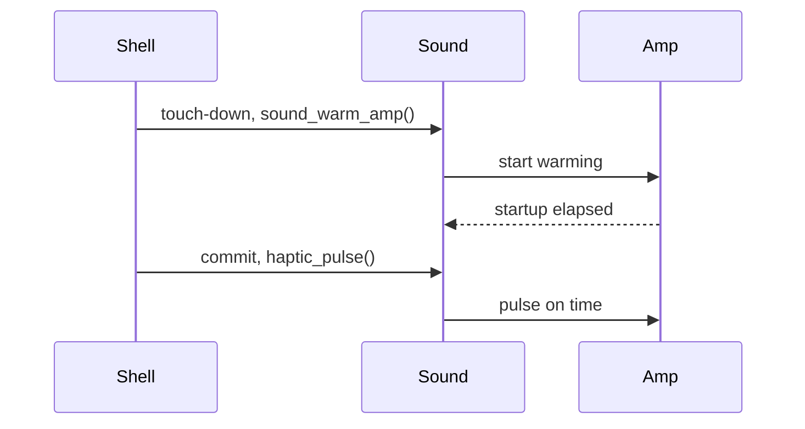

# Haptics



The speaker shakes the case. Every pulse is also a soft sound; the
[low-frequency measurements](../audio/Low-Frequency-Buzz.md) describe the
resonance and usable gains.

## API and rules

Include `haptics/haptics.h`. The API is `void haptic_pulse(haptic_t strength)`:

```c fragment
if (ui_button(ui, "Start")) {
    haptic_pulse(HAPTIC_FIRM);
}
```

| Rule | Behavior |
|---|---|
| Strength | `HAPTIC_LIGHT` uses `HAPTIC_LIGHT_GAIN_PCT` (30%); `HAPTIC_FIRM` uses `HAPTIC_FIRM_GAIN_PCT` (60%) |
| Length | `HAPTIC_LIGHT_MS` (60 ms) and `HAPTIC_FIRM_MS` (100 ms) are provisional placeholders until the short-pulse shake measurement sets them |
| Frequency | `HAPTIC_HZ` (202 Hz), the measured case resonance |
| Overlap | a new pulse stops the previous pulse and restarts its duration |
| Bus | `SOUND_BUS_HAPTIC`, independent of the SYSTEM UI volume; its gain resets on app exit |
| Mute | master mute and HAPTIC bus mute silence pulses |
| Music | pulses mix on top at `SOUND_PRIORITY_MAX`; loud music can reduce the pulse through the codec limiter |

The constants have one owner in `launcher/main/haptics/haptics.h`. Playback uses
the mixer's timed tone, bus gains and one-shot de-click tail.

## Touch-down and amplifier

The shell calls `sound_warm_amp()` after polling a touch press. The queued
request starts the normal amplifier warm-up without a voice or sound.

A commit after `AUDIO_OUT_AMP_STARTUP_MS` can play its first block immediately.
An earlier commit waits for the remaining warm-up. Activity retains the normal
`SOUND_AMP_IDLE_MS` tail; see [Amplifier](../audio/Mixer-Internals.md#amplifier).

On a development console, `haptic light` or `haptic firm` replies
`HAPTIC <strength> audible_ms=<ms>`, measured from the call until
`sound_voice_audible()`. A failed start or timeout replies with an error.

## Removable in one pass

The feature remains removable until a pulse is confirmed felt and acceptable.
Remove these pieces together:

| Piece | Location |
|---|---|
| Pulse module and development verb | `launcher/main/haptics/` and its CMake and host source entries |
| Built-in bus | `SOUND_BUS_HAPTIC`, built-in count and name in `launcher/main/sound/` |
| Warm-up request | `sound_warm_amp()`, its queue command and mixer activity flag |
| Touch-down hook | the warm-up call immediately after `input_poll()` in `shell/shell.c` |
| Registration and verification | haptics layer entry, host tests and documentation links |
