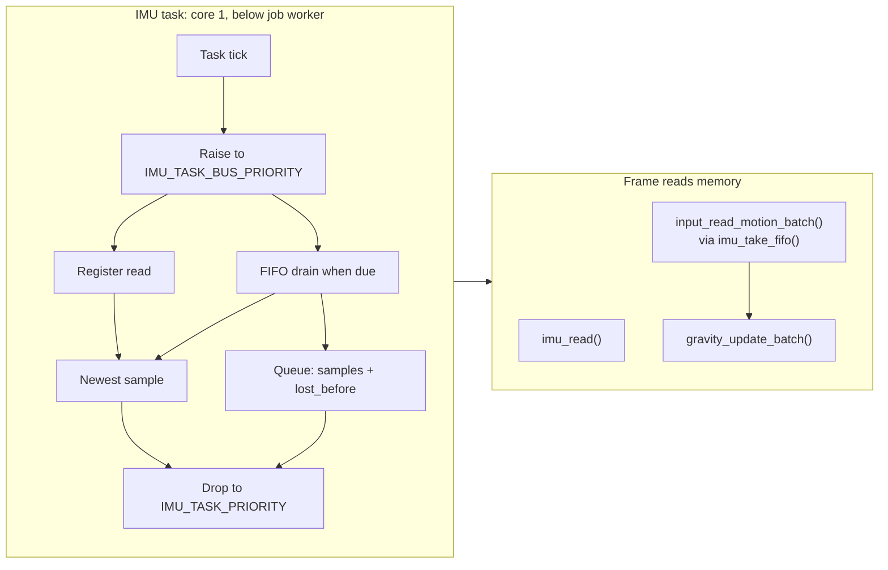
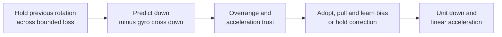
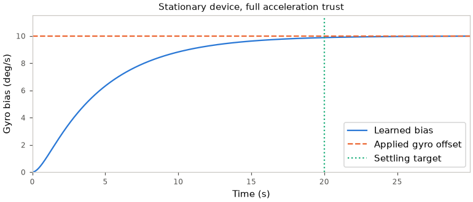

# Gravity

`gravity_t` estimates unit down, linear acceleration, gyro bias, tilt strength and free fall.
Acceleration cannot distinguish gravity from other forces.
See [axes](Motion-Axes.md) and [calibration](Motion-Calibration.md).

## Update

| Name | Value | Owner | Live tunable in development builds |
|---|---|---|---|
| `IMU_READ_HZ` | 50 Hz | `input/motion/imu.c` | `imu.read_ms` |
| `IMU_FIFO_DRAIN_HZ` | 10 Hz | `input/motion/imu.c` | `imu.drain_ms` |
| `imu.read_ms` | 20 ms default | `input/motion/imu.c` | Yes |
| `imu.drain_ms` | 100 ms default | `input/motion/imu.c` | Yes |
| `IMU_TASK_CORE` | `JOB_CORE1` | `input/motion/imu.c` | No |
| `IMU_TASK_PRIORITY` | `JOB_CORE1_PRIORITY - 1` | `input/motion/imu.c` | No |
| `IMU_TASK_BUS_PRIORITY` | `JOB_CORE1_PRIORITY + 1` | `input/motion/imu.c` | No |
| `IMU_FIFO_SAMPLES` | 128 samples | `input/motion/imu.h` | No |
| `IMU_SAMPLE_US` / `INPUT_MOTION_SAMPLE_US` | 4460 us | `input/motion/imu.h` / `input/input.h` | No |

The interval follows the QMI8658A CTRL2/CTRL3 ODR codes and SensorLib.<sup>[[80]](../Citations.md#80)</sup><sup>[[79]](../Citations.md#79)</sup>
`input_device.c` checks the interval and batch capacity against the IMU definitions.



The bus lock has no priority inheritance: a preempted drain holds the bus and the FIFO's read mode.



| Output | Meaning |
|---|---|
| Linear acceleration | Acceleration minus unit down, in g |
| Strength | In-plane share of unit down, clamped to 0..1; zero in free fall |
| Free fall | Magnitude of linear acceleration plus down below `GRAVITY_FREE_FALL_G` |

## Trust and rejection


| Condition | Effect | Constant |
|---|---|---|
| Magnitude deviation from 1 g | Full trust through FULL, linear ramp to zero at NONE (Android tolerance)<sup>[[75]](../Citations.md#75)</sup> | `GRAVITY_TRUST_FULL_G`, `GRAVITY_TRUST_NONE_G` |
| Positive trust and direction inside reject cone | Pull by `weight * dt / (tau + dt)`, normalize; angular rejection follows Fusion<sup>[[74]](../Citations.md#74)</sup> | `GRAVITY_TAU_S`, `GRAVITY_REJECT_DEG` |
| Zero acceleration | No correction or distrust counting | - |
| First nonzero acceleration after reset | Adopt direction exactly, even at zero dt | - |

## Recovery

| Condition | Effect | Constant |
|---|---|---|
| Rejection | Add dt to debt, clamp at limit; exceeding limit enters recovery (Fusion counter)<sup>[[74]](../Citations.md#74)</sup> | `GRAVITY_RECOVER_US` |
| Acceptance | Subtract `RECOVER_ACCEPT_WEIGHT * dt` from debt, floor at zero; leave recovery<sup>[[74]](../Citations.md#74)</sup> | `GRAVITY_RECOVER_ACCEPT_WEIGHT` |
| Recovery with nonzero acceleration | Full TAU gain, bypass rejection until inside cone; preserve bias, no learning or startup ramp<sup>[[74]](../Citations.md#74)</sup> | `GRAVITY_TAU_S` |
| Corrected gyro below still limit, magnitude within FULL, rejection beyond still timeout | Adopt direction, clear both timers and recovery | `GRAVITY_STILL_DPS`, `GRAVITY_TRUST_FULL_G`, `GRAVITY_STILL_RECOVER_US` |
| Motion or acceptance | Clear still timer | `GRAVITY_STILL_DPS` |
| Any raw gyro axis reaches overrange (inclusive) | Maximum debt and recovery; clipped sample still predicts, down and bias preserved. Fusion uses strict greater-than<sup>[[74]](../Citations.md#74)</sup> | `GRAVITY_GYRO_OVERRANGE_DPS` |

## Bias learning



| Condition | Effect | Constant |
|---|---|---|
| Accepted acceleration | Integrate `cross(down, direction) * weight * dt` before correction; Mahony integral, sign follows minus-cross prediction<sup>[[73]](../Citations.md#73)</sup> | `GRAVITY_BIAS_KI` |
| Bias reaches per-axis limit | Clamp in deg/s | `GRAVITY_BIAS_MAX_DPS` |
| Rejection, zero acceleration or recovery | No bias learning | - |
| Bias along gravity | Unobservable: rotation about down leaves down unchanged | - |
| Full trust | Target 2% settling for datasheet-sized offset | `GRAVITY_BIAS_SETTLE_S` |

Linearised: `theta' = b_err - theta/TAU`, `b_err' = -KI*theta`; poles satisfy `s^2 + s/TAU + KI = 0`.
`KI = 4/(TAU*SETTLE_S)` gives an overdamped loop with slow pole approximately `-KI*TAU`.

## Constants

The constants are owned by `launcher/main/input/motion/gravity.h`:

| Constant | Value | Source |
|---|---|---|
| `GRAVITY_TAU_S` | 0.5 s | Ours, tuned on the board |
| `GRAVITY_TRUST_FULL_G` | 0.1 g | Ours |
| `GRAVITY_TRUST_NONE_G` | 0.4 g | Android WindowOrientationListener acceleration tolerance, 4 m/s^2<sup>[[75]](../Citations.md#75)</sup> |
| `GRAVITY_REJECT_DEG` | 10 deg | x-io Fusion acceleration rejection<sup>[[74]](../Citations.md#74)</sup> |
| `GRAVITY_RECOVER_MS` | 5000 ms | x-io Fusion rejection timeout<sup>[[74]](../Citations.md#74)</sup> |
| `GRAVITY_RECOVER_ACCEPT_WEIGHT` | 9 | x-io Fusion accepted-sample counter drain<sup>[[74]](../Citations.md#74)</sup> |
| `GRAVITY_GYRO_OVERRANGE_RATIO` | 0.98 | x-io Fusion gyro overrange ratio<sup>[[74]](../Citations.md#74)</sup> |
| `GRAVITY_GYRO_OVERRANGE_DPS` | 0.98 × `IMU_GYRO_RANGE_DPS` | Derived from configured IMU full scale<sup>[[74]](../Citations.md#74)</sup> |
| `GRAVITY_STILL_DPS` | 3 deg/s | Board capture: rest gyro noise peaks at +/-2 deg/s |
| `GRAVITY_STILL_RECOVER_MS` | 500 ms | Ours, maintainer choice: clear fast-flip error promptly while outlasting a held swing reversal |
| `GRAVITY_GYRO_OFFSET_TOL_DPS` | 10 deg/s | QMI8658C datasheet, Table 8, board-level initial offset<sup>[[76]](../Citations.md#76)</sup> |
| `GRAVITY_GYRO_OFFSET_TCO_DPS_PER_C` | 0.05 deg/s/C | QMI8658C datasheet, Table 8<sup>[[76]](../Citations.md#76)</sup> |
| `GRAVITY_GYRO_TEMP_SPAN_C` | 60 C | 25 C reference to 85 C operating limit<sup>[[76]](../Citations.md#76)</sup> |
| `GRAVITY_BIAS_MAX_DPS` | 13 deg/s | QMI8658C datasheet, Table 8: initial offset plus temperature drift, 10 + 0.05 * 60<sup>[[76]](../Citations.md#76)</sup> |
| `GRAVITY_BIAS_SETTLE_S` | 20 s | Ours, target 2% settling for a datasheet-sized offset |
| `GRAVITY_BIAS_KI` | derived from TAU and SETTLE_S | Linearised integral loop, derived above |
| `GRAVITY_FREE_FALL_G` | 0.3 g | Acceleration magnitude below which strength is zero |
| `GRAVITY_MAX_DT_MS` | 100 ms | Maximum prediction and correction interval |

## Limits

Read-mode loss = duration / `IMU_SAMPLE_US`, carrying fractional microseconds across drains (QMI8658A section 8.7).<sup>[[79]](../Citations.md#79)</sup>

| Condition | Effect |
|---|---|
| Read-mode timing | `esp_timer`: before `CTRL9_REQ_FIFO` through `REG_FIFO_CTRL` rewrite |
| Empty drain | Carry loss to next sample |
| Loss boundary | Hold previous rotation for at most `GRAVITY_MAX_DT_US` |
| FIFO overflow, failed drain, queue overflow or loss beyond `uint8_t` | Mark gap; drop oldest on queue overflow |
| Gap | Clear pending loss and remainder; restart correction at full TAU gain, preserving down and bias |

Fixed drain periods measure read-mode cost; delivered rate follows ODR * time outside read mode.

| Drain | Delivered | Time in read mode | 224.2 Hz × (1 − share) |
|---|---|---|---|
| Every frame | 197.8 Hz | 10.8% | 200.0 Hz |
| Every 500 ms | 210.4 Hz | 6.1% | 210.5 Hz |

SCL stays at 400 kHz, the QMI8658A rating; no bus part states more, and ESP32-S3 stops at 800 kbit/s.<sup>[[79]](../Citations.md#79)</sup><sup>[[66]](../Citations.md#66)</sup>

Drain every frame, 45 s per speed:

| QMI8658 SCL | Delivered | Lost | Time per drain | Launcher `frame.rest` |
|---|---|---|---|---|
| 400 kHz | 202.6 Hz | 9.1% | 2.36 ms | 1.40 ms |
| 800 kHz | 212.6 Hz | 5.5% | 1.42 ms | 1.20 ms |
| 1 MHz | 212.0 Hz | 5.2% | 1.31 ms | - |

A clean 10 min soak at 800 kHz cannot establish reliable reads by slower parts; QMI8658A has no CRC.

Count precedes `CTRL9_REQ_FIFO` (section 8.8); CTRL9 polls without a minimum delay (section 5.10.1); every drain attempts to exit read mode, including errors.<sup>[[79]](../Citations.md#79)</sup>

## Figures

The C probe calls `gravity_update()`: trust is the relative bias-learning gain at a small tilt;
bias settling uses stationary 1 g and `GRAVITY_GYRO_OFFSET_TOL_DPS` about an observable axis.

```sh
python launcher/tools/input/gravity_figures.py --cc cc --out docs/images/input
```
