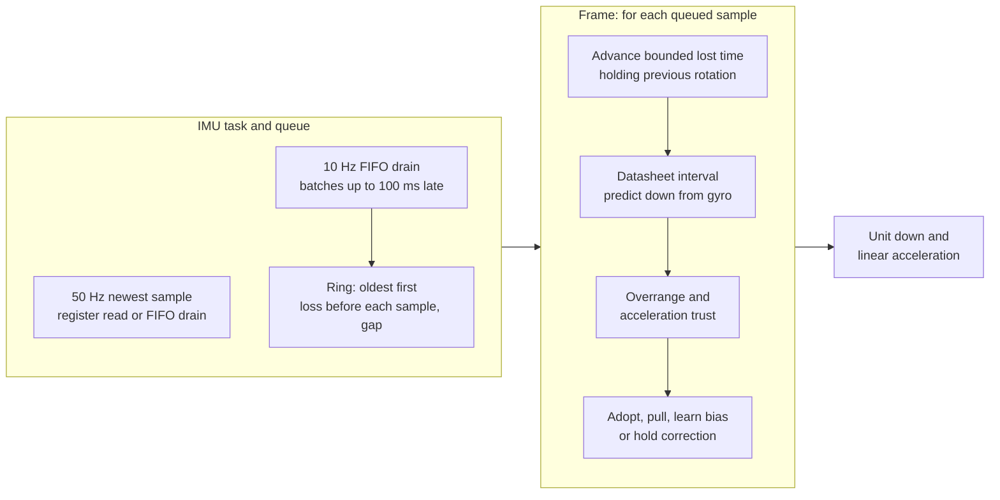

# Gravity

`gravity_t` (`input/motion/gravity.h`) estimates unit down, linear acceleration in g,
gyro bias in deg/s, tilt strength and free fall. Gyro predicts motion;
trusted acceleration corrects drift.

Acceleration cannot distinguish gravity from other forces. Axes, scales and
calibration are described in [Motion-Axes.md](Motion-Axes.md) and [Motion-Calibration.md](Motion-Calibration.md).

## Update

The IMU task drains the QMI8658 stream FIFO at 10 Hz (`IMU_FIFO_DRAIN_HZ`)
and reads the newest sample at 50 Hz (`IMU_READ_HZ` in `input/motion/imu.c`).
Development tunables `imu.drain_ms` and `imu.read_ms` set those periods.

The task runs on `JOB_CORE1` at `JOB_CORE1_PRIORITY - 1`, yielding to the core-1 job worker.

`input_read_motion_batch()` takes queued samples from memory, oldest first.
Batches arrive up to one drain period late. On drain ticks the FIFO supplies
the newest sample instead of a register read.

`gravity_update_batch()` predicts and corrects once per sample, using microseconds.
Gyro prediction is minus angular velocity crossed with down in screen axes.

The nominal ODR and interval are `IMU_ODR_HZ` and `IMU_SAMPLE_US` in `input/motion/imu.h`.
Matching CTRL2/CTRL3 codes follow QMI8658A Rev A and SensorLib.[[80]](../Citations.md#80)[[79]](../Citations.md#79)

Every delivered and lost sample integrates at `INPUT_MOTION_SAMPLE_US`.
`input_device.c` checks this datasheet interval against `IMU_SAMPLE_US`, and
batch capacity against `IMU_FIFO_SAMPLES`.

Strength is the in-plane share of the unit down vector, clamped to 0..1 and
reported as zero in free fall. Free fall means the magnitude of linear
acceleration plus down is below the free-fall threshold.

## Trust and rejection

Magnitude trust falls linearly from `GRAVITY_TRUST_FULL_G` to
`GRAVITY_TRUST_NONE_G`. The latter approximates Android's acceleration tolerance,
with a ramp instead of a hard gate.[[75]](../Citations.md#75)

Accepted acceleration pulls down by `weight * dt / (tau + dt)`, then normalizes.
Angular rejection and timed recovery follow x-io Fusion's recommendations.[[74]](../Citations.md#74)

## Recovery

### Leaky counter

Rejection adds dt to distrust; acceptance subtracts
`GRAVITY_RECOVER_ACCEPT_WEIGHT * dt`. Debt is clamped to `GRAVITY_RECOVER_US`,
equivalent to Fusion's sample counter at a fixed ODR.

Exceeding the limit enters recovery. Nonzero acceleration corrects at full
TAU gain, bypassing rejection until a reading enters the reject cone.
Recovery neither snaps nor learns bias.

### Still recovery

Still means bias-corrected gyro magnitude below `GRAVITY_STILL_DPS`, with
acceleration magnitude within `GRAVITY_TRUST_FULL_G` of one g.
Rejection longer than `GRAVITY_STILL_RECOVER_US` adopts that direction exactly.

Non-still or accepted readings clear the still timer. Adoption clears both
timers and recovery. Reset adopts the first nonzero acceleration exactly,
even at zero dt; zero acceleration skips correction and distrust counting.

### Gyro overrange

A raw axis reaching `GRAVITY_GYRO_OVERRANGE_DPS` enters recovery with maximum
distrust. The clipped reading still predicts that sample's rotation.
The threshold derives from `IMU_GYRO_RANGE_DPS` and Fusion's range ratio.

Our boundary includes equality; Fusion uses strict greater-than. Recovery
preserves down and bias and uses normal TAU gain without Fusion's startup ramp.

## Bias learning

Accepted acceleration accumulates `cross(down, direction)` before correction,
weighted by trust and elapsed seconds. The integral follows Mahony, Hamel and
Pflimlin; minus-cross prediction determines its sign.[[73]](../Citations.md#73)

Bias is in deg/s, clamped per axis to `GRAVITY_BIAS_MAX_DPS`. Rejection, zero
acceleration and recovery add no bias. The component along gravity is
unobservable because rotation about down does not change down.

The linearised loop is theta' = b_err - theta/TAU and b_err' = -KI*theta,
giving s^2 + s/TAU + KI = 0. For small KI the slow pole is approximately
-KI*TAU, so a 2% settle takes about four slow time constants.

`GRAVITY_BIAS_KI` is 4/(TAU*SETTLE_S), in 1/s^2. This gives an overdamped loop;
the settling target applies to accepted acceleration at full trust.

## Constants

The constants are owned by `launcher/main/input/motion/gravity.h`:

| Constant | Value | Source |
|---|---|---|
| `GRAVITY_TAU_S` | 0.5 s | Ours, tuned on the board |
| `GRAVITY_TRUST_FULL_G` | 0.1 g | Ours |
| `GRAVITY_TRUST_NONE_G` | 0.4 g | Android WindowOrientationListener acceleration tolerance, 4 m/s^2[[75]](../Citations.md#75) |
| `GRAVITY_REJECT_DEG` | 10 deg | x-io Fusion acceleration rejection[[74]](../Citations.md#74) |
| `GRAVITY_RECOVER_MS` | 5000 ms | x-io Fusion rejection timeout[[74]](../Citations.md#74) |
| `GRAVITY_RECOVER_ACCEPT_WEIGHT` | 9 | x-io Fusion accepted-sample counter drain[[74]](../Citations.md#74) |
| `GRAVITY_GYRO_OVERRANGE_RATIO` | 0.98 | x-io Fusion gyro overrange ratio[[74]](../Citations.md#74) |
| `GRAVITY_GYRO_OVERRANGE_DPS` | 0.98 × `IMU_GYRO_RANGE_DPS` | Derived from configured IMU full scale[[74]](../Citations.md#74) |
| `GRAVITY_STILL_DPS` | 3 deg/s | Board capture: rest gyro noise peaks at +/-2 deg/s |
| `GRAVITY_STILL_RECOVER_MS` | 500 ms | Ours, maintainer choice: clear fast-flip error promptly while outlasting a held swing reversal |
| `GRAVITY_GYRO_OFFSET_TOL_DPS` | 10 deg/s | QMI8658C datasheet, Table 8, board-level initial offset[[76]](../Citations.md#76) |
| `GRAVITY_GYRO_OFFSET_TCO_DPS_PER_C` | 0.05 deg/s/C | QMI8658C datasheet, Table 8[[76]](../Citations.md#76) |
| `GRAVITY_GYRO_TEMP_SPAN_C` | 60 C | 25 C reference to 85 C operating limit[[76]](../Citations.md#76) |
| `GRAVITY_BIAS_MAX_DPS` | 13 deg/s | QMI8658C datasheet, Table 8: initial offset plus temperature drift, 10 + 0.05 * 60[[76]](../Citations.md#76) |
| `GRAVITY_BIAS_SETTLE_S` | 20 s | Ours, target 2% settling for a datasheet-sized offset |
| `GRAVITY_BIAS_KI` | derived from TAU and SETTLE_S | Linearised integral loop, derived above |
| `GRAVITY_FREE_FALL_G` | 0.3 g | Acceleration magnitude below which strength is zero |
| `GRAVITY_MAX_DT_MS` | 100 ms | Maximum prediction and correction interval |

## Limits

FIFO and queue capacity bound the retained history. Overflow or a failed drain marks a gap;
the next batch soft-restarts correction at full TAU gain, preserving down and bias.

Sampling cannot resolve motion above the sensor bandwidth. FIFO read mode
discards arrivals (section 8.7). Loss is the read-mode duration divided by
`IMU_SAMPLE_US`, carrying fractional microseconds across drains.[[79]](../Citations.md#79)

`esp_timer` measures from just before `CTRL9_REQ_FIFO` through the `REG_FIFO_CTRL` rewrite.
The queue carries loss across empty drains to the next sample.
Prediction holds the previous rotation at each loss boundary, bounded by
`GRAVITY_MAX_DT_US`. Gaps clear pending loss and remainder.

Queue overflow drops the oldest sample and marks a gap. Loss exceeding the
`uint8_t` per-sample field also marks a gap instead of wrapping.

Board A308, QMI8658A, build 7dae68f7c9d0-dev. Delivered rate
agrees with the datasheet ODR multiplied by time outside FIFO read mode.

These measurements use the drain at the stated fixed period.

| Drain | Delivered | Time in read mode | 224.2 Hz × (1 − share) |
|---|---|---|---|
| Every frame | 197.8 Hz | 10.8% | 200.0 Hz |
| Every 500 ms | 210.4 Hz | 6.1% | 210.5 Hz |

A faster SCL shortens read mode, but SCL stays at 400 kHz, the QMI8658A's I2C rating.[[79]](../Citations.md#79)
No other part on the bus states more than 400 kHz, and the ESP32-S3 stops at 800 kbit/s.[[66]](../Citations.md#66)
Board A308, drain every frame, 45 s per speed:

| QMI8658 SCL | Delivered | Lost | Time per drain | Launcher `frame.rest` |
|---|---|---|---|---|
| 400 kHz | 202.6 Hz | 9.1% | 2.36 ms | 1.40 ms |
| 800 kHz | 212.6 Hz | 5.5% | 1.42 ms | 1.20 ms |
| 1 MHz | 212.0 Hz | 5.2% | 1.31 ms | - |

800 kHz ran a clean 10 min soak, but that cannot show the slower parts never misread its
shorter clock, and the QMI8658A has no CRC.

The count precedes `CTRL9_REQ_FIFO` (section 8.8). CTRL9 status uses consecutive I2C
reads, with no minimum polling delay (section 5.10.1). Every drain attempts to
leave read mode, including error paths.[[79]](../Citations.md#79)
