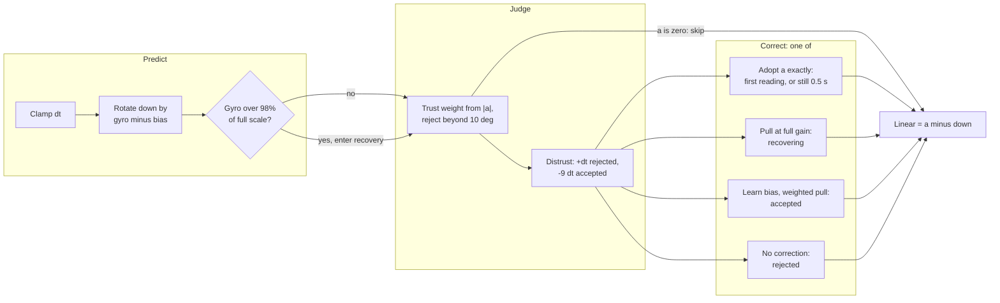

# Gravity

`gravity_t` (`launcher/main/input/gravity.h`) gives a caller a unit down vector,
linear acceleration in g, gyro bias in degrees per second, and tilt strength
and free-fall status. The gyro predicts changes in down during motion; the
accelerometer corrects accumulated drift when its reading is trusted, because
acceleration alone cannot distinguish gravity from other forces. Sensor axes,
input scales and calibration are described in [Input-and-Sensors.md](../notes/Input-and-Sensors.md#the-imus-axes-do-not-match-the-screens).

## Update

`input_read_motion_batch()` drains the polled QMI8658 stream FIFO oldest first.
`gravity_update_batch()` predicts and corrects once per sample, using microseconds.
Gyro prediction is minus angular velocity crossed with down in screen axes.

The sensor uses matching CTRL2/CTRL3 ODR code 5: 7174.4 / 32 = 224.2 Hz in
6DOF mode, with a rounded sample interval of 4460 us. The register table and FIFO
protocol follow QMI8658A Rev A and SensorLib.[[77]](../Citations.md#77)[[78]](../Citations.md#78)

Strength is the in-plane share of the unit down vector, clamped to 0..1 and
reported as zero in free fall. Free fall means the magnitude of linear
acceleration plus down is below the free-fall threshold.

## Trust and rejection

Magnitude trust falls linearly between the full-trust and no-trust thresholds.
Android's ACCELERATION_TOLERANCE of 4 m/s^2 supplies our approximate
zero-trust end (0.4 g), rather than Android's hard acceleration gate.
Accepted acceleration corrects down with alpha = weight * dt / (tau + dt),
followed by normalization. Angular rejection and timed recovery use the
thresholds recommended by Madgwick's x-io Fusion library.[[74]](../Citations.md#74)

## Recovery

### Leaky counter

Fusion's AHRS implementation derives its `rejectionTimeout` sample limit from the
sample rate and timeout in seconds. Its leaky recovery counter adds one on
rejection and subtracts nine on acceptance, clamped to that limit. Our counter
uses elapsed microseconds: rejection adds dt, acceptance subtracts
`GRAVITY_RECOVER_ACCEPT_WEIGHT * dt`, clamped to `[0, GRAVITY_RECOVER_US]`.
At a fixed rate this equals Fusion's sample counter with limit equal to rate
times `GRAVITY_RECOVER_MS` in seconds. Debt grows when more than about 90% of
sample time is rejected. Exceeding the limit enters recovery: nonzero
acceleration corrects at the normal TAU rate with full gain, bypassing angle
and magnitude rejection, until a sample is accepted inside the reject cone.
Recovery does not snap or learn bias.

### Still recovery

Still-gated early recovery is ours. Still means the magnitude of raw gyro minus learned
bias is below `GRAVITY_STILL_DPS` and acceleration magnitude departs from one g
by at most `GRAVITY_TRUST_FULL_G`. Continuous still rejection exceeding
`GRAVITY_STILL_RECOVER_MS` adopts the measured direction exactly. Non-still
samples and accepted acceleration clear the still timer; either adoption
clears both timers and recovery. The leaky trigger remains available during shaking or
swinging. Reset primes the first nonzero reading for exact adoption,
including when no time has elapsed. Zero acceleration skips correction and
distrust counting and clears the still timer, keeping prediction finite in free fall.

### Gyro overrange

Any raw gyro axis reaching `GRAVITY_GYRO_OVERRANGE_DPS` enters recovery
immediately with distrust at the limit. The clipped gyro reading still rotates
down for that sample, matching Fusion's update after its soft restart. The
threshold derives from Fusion's 0.98 times gyro range rule and the configured `IMU_GYRO_RANGE_DPS` in `input/imu.h` (512 deg/s). Our boundary
includes equality; Fusion uses a strict greater-than comparison. Fusion's
soft restart preserves its estimate and ramps startup gain from 10 down to
the configured gain over 3 s; here recovery enters at full gain using the
normal TAU rate, without a startup-gain ramp.

## Bias learning

While acceleration is accepted, the Mahony, Hamel and Pflimlin integral bias
term accumulates `cross(down, direction)` before the down correction, weighted
by magnitude trust and elapsed seconds.[[73]](../Citations.md#73)
Our minus-cross prediction determines the correction sign. The integral is
gated by magnitude trust and acceptance. The radian correction is converted
to degrees so bias stays in deg/s. Each axis is clamped to
`GRAVITY_BIAS_MAX_DPS`; the paper does not specify this clamp. Rejection,
zero acceleration and recovery add no bias. Error is perpendicular to down, so bias along
gravity is unobservable; rotation about down does not change down.

Per axis, the linearised loop is theta' = b_err - theta/TAU and
b_err' = -KI*theta, giving s^2 + s/TAU + KI = 0. When KI is small relative to
1/(4*TAU^2), the slow pole is approximately -KI*TAU. A 2% settle takes about
four slow time constants, so `GRAVITY_BIAS_KI` derives from
4/(TAU*SETTLE_S), in 1/s^2. The chosen gain gives an overdamped loop; the
settling target applies to accepted acceleration at full magnitude trust.

## Constants

The constants are owned by `launcher/main/input/gravity.h`:

| Constant | Value | Source |
|---|---|---|
| `GRAVITY_TAU_S` | 0.5 s | Ours, tuned on the board |
| `GRAVITY_TRUST_FULL_G` | 0.1 g | Ours |
| `GRAVITY_TRUST_NONE_G` | 0.4 g | Android WindowOrientationListener acceleration tolerance, 4 m/s^2[[75]](../Citations.md#75) |
| `GRAVITY_REJECT_DEG` | 10 deg | x-io Fusion acceleration rejection[[74]](../Citations.md#74) |
| `GRAVITY_RECOVER_MS` | 5000 ms | x-io Fusion rejection timeout[[74]](../Citations.md#74) |
| `GRAVITY_RECOVER_ACCEPT_WEIGHT` | 9 | x-io Fusion accepted-sample counter drain[[74]](../Citations.md#74) |
| `GRAVITY_GYRO_OVERRANGE_RATIO` | 0.98 | x-io Fusion gyro overrange ratio[[74]](../Citations.md#74) |
| `GRAVITY_GYRO_OVERRANGE_DPS` | 0.98 × `IMU_GYRO_RANGE_DPS` | Derived from configured IMU full scale[[74]](../Citations.md#74) |
| `GRAVITY_STILL_DPS` | 6 deg/s | Board capture: rest gyro noise peaks at +/-4 deg/s |
| `GRAVITY_STILL_RECOVER_MS` | 500 ms | Ours, maintainer choice: clear fast-flip error promptly while outlasting a held swing reversal |
| `GRAVITY_GYRO_OFFSET_TOL_DPS` | 10 deg/s | QMI8658C datasheet, Table 8, board-level initial offset[[76]](../Citations.md#76) |
| `GRAVITY_GYRO_OFFSET_TCO_DPS_PER_C` | 0.05 deg/s/C | QMI8658C datasheet, Table 8[[76]](../Citations.md#76) |
| `GRAVITY_GYRO_TEMP_SPAN_C` | 60 C | 25 C reference to 85 C operating limit[[76]](../Citations.md#76) |
| `GRAVITY_BIAS_MAX_DPS` | 13 deg/s | QMI8658C datasheet, Table 8: initial offset plus temperature drift, 10 + 0.05 * 60[[76]](../Citations.md#76) |
| `GRAVITY_BIAS_SETTLE_S` | 20 s | Ours, target 2% settling for a datasheet-sized offset |
| `GRAVITY_BIAS_KI` | derived from TAU and SETTLE_S | Linearised integral loop, derived above |
| `GRAVITY_FREE_FALL_G` | 0.3 g | Acceleration magnitude below which strength is zero |
| `GRAVITY_MAX_DT_MS` | 100 ms | Maximum prediction and correction interval |
| `INPUT_MOTION_SAMPLE_US` | derived from `IMU_ODR_HZ` | Per-sample integration interval[[78]](../Citations.md#78) |

## Limits

FIFO capacity bounds the retained history. Overflow or a failed drain marks a gap;
the next batch soft-restarts correction at full TAU gain, preserving down and bias.
A smaller drain buffer retains the newest samples and also marks a gap.

Sampling cannot resolve motion above the sensor bandwidth. During FIFO read mode,
new sensor samples are discarded by the device; draining promptly limits that
blind interval.[[78]](../Citations.md#78)
