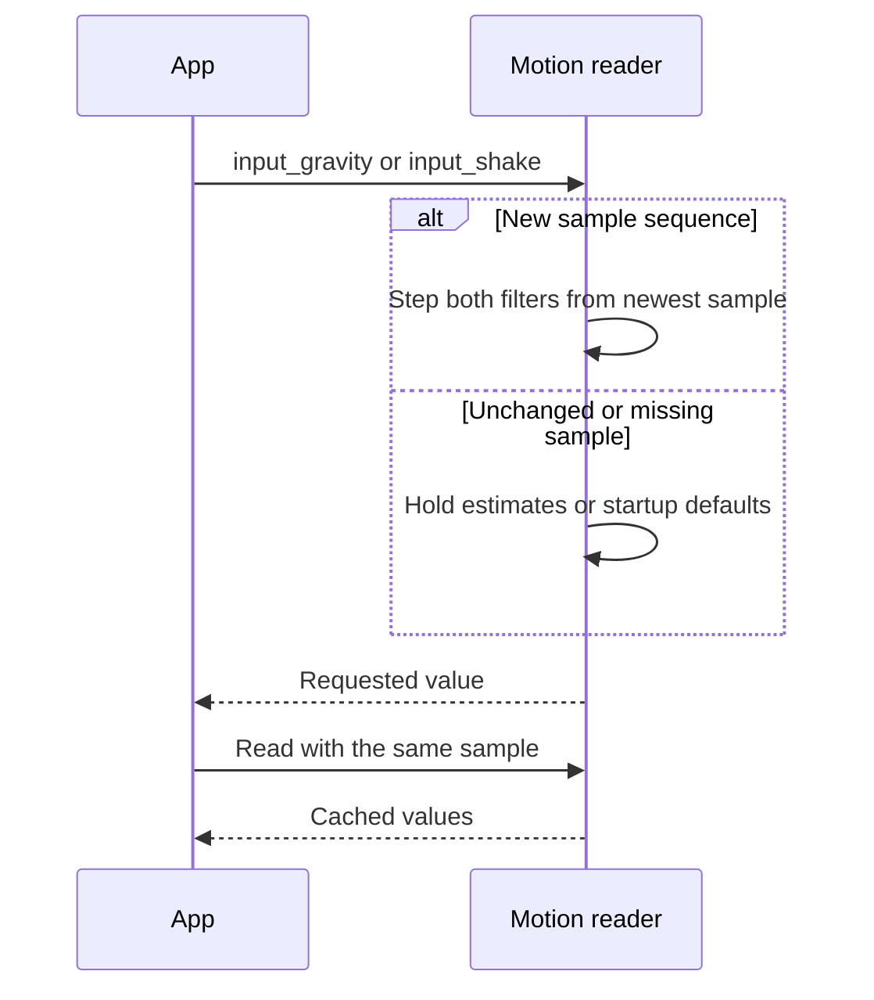
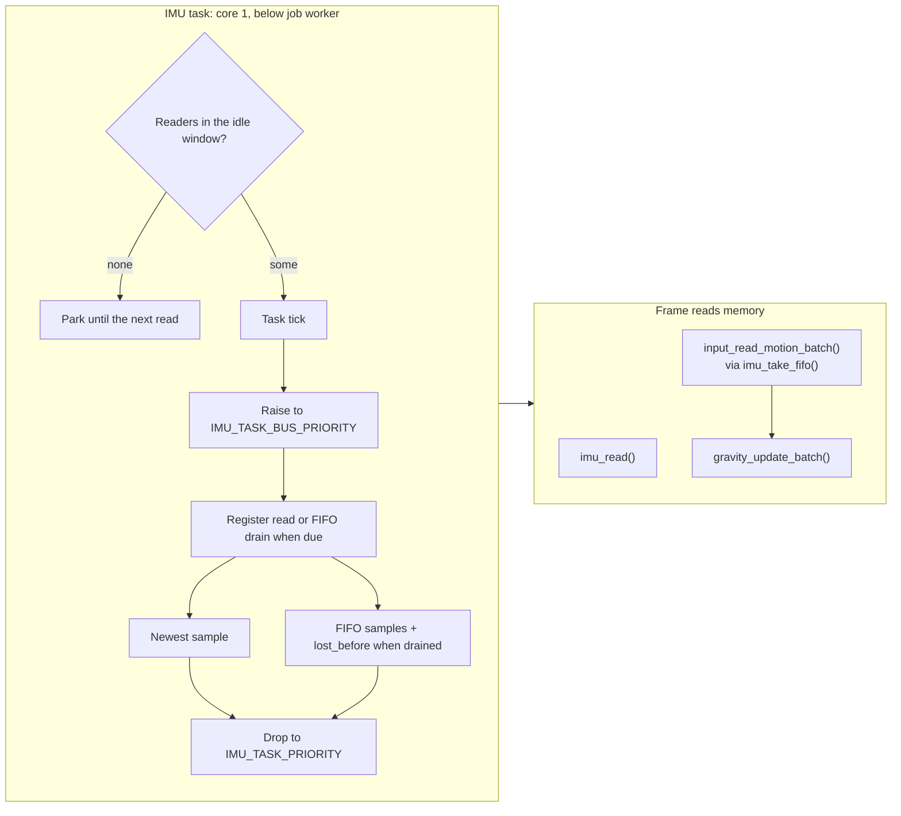
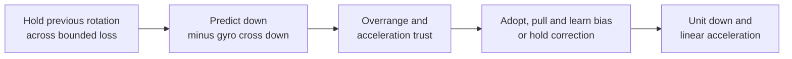
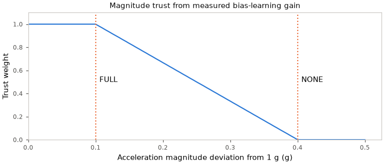
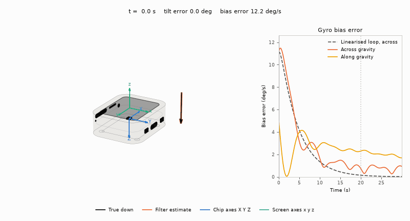

# Gravity

`gravity_t` estimates unit down, linear acceleration, gyro bias, in-plane strength and free fall.
Gyro predicts motion; trusted acceleration corrects drift.
Acceleration cannot distinguish gravity from other forces. See [axes](Motion-Axes.md) and [calibration](Motion-Calibration.md).

## App readers

`input_gravity()` returns screen-axis g: x right, y down, z out.
It is unit length while held and zero in free fall.
`hypotf(g.x, g.y)` gives in-plane strength, matching `gravity_strength()`.

No sensor gives gravity `(0,1,0)` and shake zero.
A present sensor gives both as zero until its first reading.
Unchanged or missed samples hold both estimates without stepping the filters.

`input_shake()` returns the [shake reader](Shake.md)'s level, 0..1.
Call both readers only on the frame thread.



Each new sample steps both filters on the first read, without an `input_poll()` call.
The step uses clock time since the last update, capped at `GRAVITY_MAX_DT_US`.

Apps that do not call either reader do no estimation work.
The input module retains its filters across app switches.
FIFO batches have one queue consumer and do not feed the shared readers.

`GRAVITY_MIN_DIRECTION_STRENGTH` is the minimum in-plane strength for a meaningful direction.

In development builds, `autana tune motion.log_ms 1000` logs the reader's
smoothed shake magnitude in mg. Zero disables the log.

## App example

<!-- generated: input-gravity-shared-example check: python launcher/tools/gen/examples_doc.py --check -->
```c
/* Gravity: call from the frame thread's app update. */
#include <math.h>
#include "input/input.h"

#define BALL_SPEED 0.1F /* pixels per ms at full strength */

typedef struct {
    float ball_x, ball_y, strength, shake;
} gravity_shared_example_t;

void
gravity_shared_example(gravity_shared_example_t* s, uint32_t dt_ms) {
    const vec3f_t down = input_gravity();
    s->strength = hypotf(down.x, down.y);
    s->shake = input_shake();
    s->ball_x += down.x * BALL_SPEED * dt_ms;
    s->ball_y += down.y * BALL_SPEED * dt_ms;
}
```
<!-- /generated: input-gravity-shared-example -->

## FIFO example

<!-- generated: input-gravity-example check: python launcher/tools/gen/examples_doc.py --check -->
```c
/* Gravity: a ball rolls downhill. Call from your app's update(dt_ms, input). */
#include "input/motion/gravity.h"
#include "input/input.h"

#define BALL_SPEED 0.1F /* pixels per ms at full strength */

typedef struct {
    gravity_t gravity;
    input_motion_batch_t batch;
    float ball_x, ball_y;
} gravity_example_t;

void
gravity_example_start(gravity_example_t* s) {
    gravity_reset(&s->gravity);
}

void
gravity_example(gravity_example_t* s, uint32_t dt_ms) {
    if (input_read_motion_batch(&s->batch)) {
        gravity_update_batch(&s->gravity, &s->batch);
    }
    const vec3f_t down = gravity_down(&s->gravity);
    s->ball_x += down.x * BALL_SPEED * dt_ms;
    s->ball_y += down.y * BALL_SPEED * dt_ms;
}
```
<!-- /generated: input-gravity-example -->

## Update

Periods and task settings live in `input/motion/imu.c`; header-owned settings name their owners below.

| Setting | Value | Live tunable / effect |
|---|---|---|
| Register read period | 50 Hz (`IMU_READ_HZ`) | `imu.read_ms` |
| FIFO drain period | 10 Hz (`IMU_FIFO_DRAIN_HZ`) | `imu.drain_ms` |
| `IMU_TASK_CORE` | `JOB_CORE1` | Core 1 |
| `IMU_TASK_PRIORITY` | `JOB_CORE1_PRIORITY - 1` | Below job worker |
| `IMU_TASK_BUS_PRIORITY` | `JOB_CORE1_PRIORITY + 1` | Bus lock has no priority inheritance; a preempted transaction holds the bus, a preempted drain holds FIFO read mode |
| `IMU_BUS_HOLD_TARGET_US` | 1000 us of data | The FIFO burst is read in `IMU_FIFO_CHUNK_SAMPLES` whole samples per transaction; the bus lock is taken per transaction, so a touch read waits for at most one chunk |
| `IMU_FIFO_SAMPLES` | 128 samples | `input/motion/imu.h` |
| `IMU_SAMPLE_US` / `INPUT_MOTION_SAMPLE_US` | `1 / ODR` | `input/motion/imu.h` / `input/input.h` |

The interval follows the QMI8658A CTRL2/CTRL3 ODR codes in the datasheet<sup>[[79]](../Citations.md#qst-qmi8658a)</sup> and SensorLib.<sup>[[80]](../Citations.md#he-sensorlib)</sup>
`input_device.c` checks the interval and batch capacity against the IMU definitions.

Batches arrive up to one drain period late; a drain delayed past FIFO capacity while core 1 is busy becomes a gap.
On drain ticks the FIFO supplies the newest sample instead of a register read.

The task works only for recent readers (`input/motion/imu_demand.h`); each kind keeps its level for `IMU_DEMAND_IDLE_US`, the FIFO's retained history.

| Readers in the idle window | Task |
|---|---|
| `imu_take_fifo()`, `imu_take_fifo_at()`, `imu_set_odr()` | Register reads and drains |
| `imu_read()` only | Register reads; no drains |
| None | Parked on a task notification; the next read wakes it |

Drains resume on a reset FIFO behind a gap, so no sample from before a park is queued or counted as loss.





| Output | Meaning |
|---|---|
| Linear acceleration | Acceleration minus unit down, in g |
| Strength | In-plane share of unit down, clamped to 0..1; zero in free fall |
| Free fall | Magnitude of linear acceleration plus down below `GRAVITY_FREE_FALL_G` |

## Trust and rejection



| Condition | Effect |
|---|---|
| Magnitude deviation from 1 g | Full trust through FULL, linear ramp to zero at NONE (Android tolerance)<sup>[[75]](../Citations.md#aosp-window-orientation-listener)</sup> |
| Positive trust and direction inside reject cone | Pull by `weight * dt / (tau + dt)`, normalize; angular rejection follows Fusion<sup>[[74]](../Citations.md#madgwick-fusion)</sup> |
| Zero acceleration | No correction or distrust counting |
| First nonzero acceleration after reset | Adopt direction exactly, even at zero dt |

## Recovery

| Condition | Effect |
|---|---|
| Rejection | Add dt to debt, clamp at limit; exceeding limit enters recovery (Fusion counter)<sup>[[74]](../Citations.md#madgwick-fusion)</sup> |
| Acceptance | Subtract `RECOVER_ACCEPT_WEIGHT * dt` from debt, floor at zero; leave recovery<sup>[[74]](../Citations.md#madgwick-fusion)</sup> |
| Recovery with nonzero acceleration | Full TAU gain, bypass rejection until inside cone; preserve bias, no learning or startup ramp<sup>[[74]](../Citations.md#madgwick-fusion)</sup> |
| Corrected gyro below still limit, magnitude within FULL, rejection beyond still timeout | Adopt direction, clear both timers and recovery; motion or acceptance clears still timer |
| Any raw gyro axis reaches overrange (inclusive) | Maximum debt and recovery; clipped sample still predicts, down and bias preserved. Fusion uses strict greater-than<sup>[[74]](../Citations.md#madgwick-fusion)</sup> |

## Bias learning



The device rocks about flat with a known gyro offset. Its readings pass through `imu_axes_screen()` into `gravity_update_batch()`.
Device and IMU placement come from `board/board_geometry.h`.<sup>[[89]](../Citations.md#waveshare-amoled-3d-model)</sup>

| Condition | Effect |
|---|---|
| Accepted acceleration | Integrate `cross(down, direction) * weight * dt` before correction; Mahony integral, sign follows minus-cross prediction<sup>[[73]](../Citations.md#mahony-2008)</sup> |
| Bias reaches per-axis limit | Clamp in deg/s |
| Rejection, zero acceleration or recovery | No bias learning |
| Bias along gravity | Unobservable to the filter; rest-window learning measures that axis too, subject to the [vertical-rotation limit](Motion-Calibration.md#gyro-learning) |

The input layer subtracts the stored gyro offset before this learner sees
rotation. Its bias estimate is the residual after that correction; accepting
a new rest-window offset resets the learned bias to zero.

Bias along gravity is unobservable: rotation about down leaves down unchanged.
At full trust, the target is 2% settling for a datasheet-sized offset.

| Symbol | Meaning |
|---|---|
| $`\theta`$ | Tilt error |
| $`b_{\mathrm{err}}`$ | Gyro-bias error |
| $`\tau`$ | `GRAVITY_TAU_S`, correction time constant |
| $`K_{I}`$ | `GRAVITY_BIAS_KI`, integral gain |
| $`T_s`$ | `GRAVITY_BIAS_SETTLE_S`, settling target |

1. Linearised for small angles: bias makes the estimate drift; acceleration correction pulls it back at rate $`1/\tau`$. The integral learns bias from persistent error.

```math
\theta' = b_{\mathrm{err}} - \frac{\theta}{\tau}, \qquad b_{\mathrm{err}}' = -K_{I}\theta
```

2. The characteristic equation is:

```math
s^2 + \frac{s}{\tau} + K_{I} = 0
```

3. The gain and settling target give two real roots (overdamped):

```math
K_{I} = \frac{4}{\tau T_s}, \qquad T_s > 16\tau \quad (20\,\mathrm{s} > 8\,\mathrm{s})
```

```math
s_{\mathrm{fast}} \approx -\frac{1}{\tau}, \qquad s_{\mathrm{slow}} \approx -K_{I}\tau = -\frac{4}{T_s}
```

4. The slow mode gives the approximate bias-error decay, with about 1.8% left at the settling target (the 2% settling rule):

```math
b_{\mathrm{err}}(t) \propto e^{-4t/T_s}, \qquad e^{-4T_s/T_s} = e^{-4} \approx 0.018
```

## Constants

| Constant (`input/motion/gravity.h`) | Value | Source |
|---|---|---|
| `GRAVITY_TAU_S` | 0.5 s | Ours |
| `GRAVITY_TRUST_FULL_G` | 0.1 g | Ours |
| `GRAVITY_TRUST_NONE_G` | 0.4 g | Android WindowOrientationListener acceleration tolerance, 4 m/s^2<sup>[[75]](../Citations.md#aosp-window-orientation-listener)</sup> |
| `GRAVITY_REJECT_DEG` | 10 deg | x-io Fusion acceleration rejection<sup>[[74]](../Citations.md#madgwick-fusion)</sup> |
| `GRAVITY_RECOVER_MS` | 5000 ms, converted to us | x-io Fusion rejection timeout<sup>[[74]](../Citations.md#madgwick-fusion)</sup> |
| `GRAVITY_RECOVER_ACCEPT_WEIGHT` | 9 | x-io Fusion accepted-sample counter drain<sup>[[74]](../Citations.md#madgwick-fusion)</sup> |
| `GRAVITY_GYRO_OVERRANGE_RATIO` / `GRAVITY_GYRO_OVERRANGE_DPS` | 0.98 / 0.98 × `IMU_GYRO_RANGE_DPS` | Fusion ratio × configured full scale<sup>[[74]](../Citations.md#madgwick-fusion)</sup> |
| `GRAVITY_STILL_DPS` | `IMU_REST_GYRO_DEPARTURE` in deg/s | Shared rest-noise threshold |
| `GRAVITY_STILL_RECOVER_MS` | 500 ms | Ours: clears a fast-flip error promptly, outlasts a held swing reversal |
| `IMU_GYRO_OFFSET_TOL_DPS` + `IMU_GYRO_OFFSET_TCO_DPS_PER_C` × `IMU_GYRO_TEMP_SPAN_C` = `IMU_GYRO_BIAS_MAX_DPS` | 10 + 0.05 × 60 = 13 deg/s | QMI8658C Table 8: initial offset + drift from 25 C to 85 C<sup>[[76]](../Citations.md#qst-qmi8658c)</sup> |
| `GRAVITY_BIAS_SETTLE_S` | 20 s | Ours |
| `GRAVITY_BIAS_KI` | derived from TAU and SETTLE_S | Linearised integral loop; see Bias learning |
| `GRAVITY_FREE_FALL_G` | 0.3 g | Acceleration magnitude below which strength is zero |
| `GRAVITY_MAX_DT_MS` | 100 ms | Maximum prediction and correction interval |

## Limits

FIFO read mode discards arrivals (section 8.7), so loss = duration / `IMU_SAMPLE_US`, carrying fractional microseconds across drains.<sup>[[79]](../Citations.md#qst-qmi8658a)</sup>

| Condition | Effect |
|---|---|
| Read-mode exit | Count read before `CTRL9_REQ_FIFO`; CTRL9 polled with no minimum delay; every drain attempts to exit read mode, including errors<sup>[[79]](../Citations.md#qst-qmi8658a)</sup> |
| Read-mode timing | `esp_timer`: before `CTRL9_REQ_FIFO` through `REG_FIFO_CTRL` rewrite, every chunk and any bus wait between them included |
| Empty drain | Carry loss to next sample |
| Loss boundary | Hold previous rotation for at most `GRAVITY_MAX_DT_MS` converted to us |
| FIFO overflow, failed drain, queue overflow or loss beyond `uint8_t` | Mark gap; drop oldest on queue overflow |
| Gap | Clear pending loss and remainder; restart correction at full TAU gain, preserving down and bias |

Delivered rate = ODR × (1 - read-mode share); a 500 ms drain loses about half as much as every-frame.

SCL stays at 400 kHz, the QMI8658A rating; no bus part states more, and ESP32-S3 stops at 800 kbit/s.<sup>[[79]](../Citations.md#qst-qmi8658a)</sup><sup>[[66]](../Citations.md#espressif-esp32-s3-datasheet)</sup>
A faster SCL shortens read mode.

A clean soak at 800 kHz does not show the slower bus parts read it correctly, and the QMI8658A has no CRC.

<details>
<summary>Data log: drain periods and SCL</summary>

| Drain | Delivered | Time in read mode | ODR × (1 - share) |
|---|---|---|---|
| Every frame | 197.8 Hz | 10.8% | 200.0 Hz |
| Every 500 ms | 210.4 Hz | 6.1% | 210.5 Hz |

Drain every frame, 45 s per speed:

| QMI8658 SCL | Delivered | Lost | Time per drain | Launcher `frame.rest` |
|---|---|---|---|---|
| 400 kHz | 202.6 Hz | 9.1% | 2.36 ms | 1.40 ms |
| 800 kHz | 212.6 Hz | 5.5% | 1.42 ms | 1.20 ms |
| 1 MHz | 212.0 Hz | 5.2% | 1.31 ms | - |

</details>

## Figures

```sh
python launcher/tools/input/gravity_figures.py --cc cc --out docs/images/input
```
