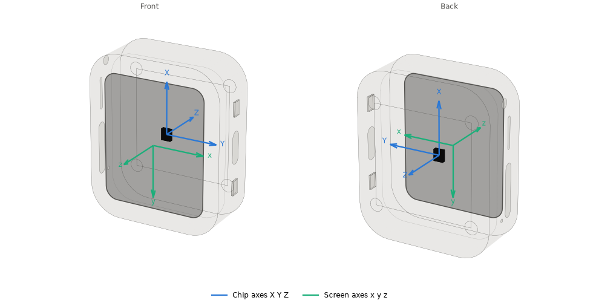
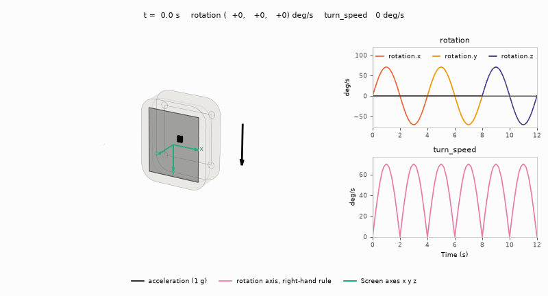

# Motion axes

`input/motion/imu.c` configures the QMI8658 (+/-8 g, +/-512 dps) and reads all
six axes in one burst. Keep the burst intact: separate reads can straddle
sample updates. A stream FIFO holds up to `IMU_FIFO_SAMPLES` at the rate
`IMU_ODR_HZ`; see [Gravity.md](Gravity.md#update) for the drain.



The IMU sits on the PCB's back (the faint outline inside the case) near the centre:
chip X runs up the screen, Y right, Z out of the back
(`board/board_geometry.h`).<sup>[[89]](../Citations.md#89)</sup>

It reads specific force, which points up at rest; the code treats that vector as down,
so each screen label is a chip axis negated:

| Screen label | Reading | Chip axis, physically |
|---|---|---|
| down (+y) | `+ax` | X, up the screen |
| right (+x) | `-ay` | Y, right |
| out (+z) | `+az` | Z, out of the back |

The labels form a left-handed set; acceleration in them is true down.

Use `imu_gravity_screen()` in `input/motion/imu_sample.h`, including its
orientation handling, rather than mapping sensor X to screen X. The
accelerometer measures gravity plus linear acceleration; the gyroscope
measures angular velocity, not tilt angle.

`input_read_motion()` (`input/input.h`) returns the newest sample read by
the IMU task as `input_motion_t` from memory, with no bus traffic on the caller:

| Field | Meaning |
|---|---|
| `acceleration` | offset-calibrated accelerometer, unfiltered, in screen axes (x right, y down, z out of the screen), pointing down at rest, Q12 g (`INPUT_ACCEL_ONE_G`). Upright reads +1 g on y; flat, screen up, -1 g on z |
| `rotation` | signed raw gyro counts, Q6 deg/s (`INPUT_ROTATION_ONE_DPS`), panel axes: x = -gy, y = gx, z = gz |
| `turn_speed` | deg/s, the sum of the absolute rates over all three axes: a speed with no sign or axis |

Rotation follows the right-hand rule on the chip axes behind those labels (left, up, into the screen):
+z is clockwise from the front, +x tips the bottom edge toward the viewer, +y turns the right edge
away. Calibrating the offsets is in [Motion-Calibration.md](Motion-Calibration.md).



A scripted sweep, not a recording: the device starts upright, facing the viewer,
and turns 90 degrees out and back about each rotation label, mapped as
`input_read_motion()` maps it. The acceleration follows the turns about x and z.
Rotation y is the vertical axis of the upright start pose, so a turn about it
leaves the acceleration unchanged.

## Figures

`launcher/tools/input/motion_axes_figures.py` probes `board_geometry.h` and
`imu_sample.h`; the image pipeline
(`launcher/tools/render/render_doc_images.sh`) regenerates both:

```sh
python launcher/tools/input/motion_axes_figures.py --cc cc --out docs/images/input
```
