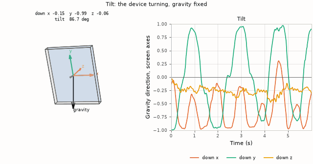
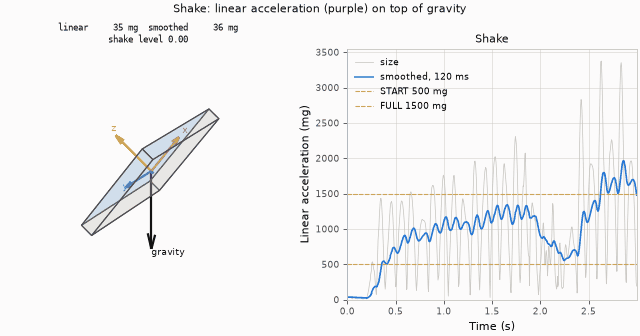

# Motion axes

`input/motion/imu.c` configures the QMI8658 (+/-8 g, +/-512 dps) and reads all
six axes in one burst. Keep the burst intact: separate reads can straddle
sample updates. A stream FIFO holds up to `IMU_FIFO_SAMPLES` at the rate
`IMU_ODR_HZ`; see [Gravity.md](Gravity.md#update) for the drain.

## What is tracked

Tilt: a recorded capture of the device turned between quarters, played at
recorded speed. The panel, drawn to its resolution, turns so gravity points
down; the strip traces gravity's direction in screen axes.

Shake: a recorded capture of hard shaking, played slowed. The purple arrow is
the linear acceleration; the strip is the [shake reader](Shake.md) run over
the same samples.

Yaw about gravity is not observable from the accelerometer, so the drawing
turns the panel by the smallest rotation that matches gravity.

## Sensor and screen axes

The IMU's axes do not match the screen's:

| Screen direction | Sensor axis |
|---|---|
| down (+y) | `+ax` |
| right (+x) | `-ay` |

Use `imu_gravity_screen()` in `input/motion/imu_sample.h`, including its
orientation handling, rather than mapping sensor X to screen X.

| Sensor | Measures | Not |
|---|---|---|
| Accelerometer | gravity plus linear acceleration | |
| Gyroscope | angular velocity | tilt angle |

## Reading motion

`input_read_motion()` (`input/input.h`) returns `input_motion_t` with one I2C
read per call:

| Field | Meaning |
|---|---|
| `acceleration` | offset-calibrated accelerometer, unfiltered, in screen axes (x right, y down, z out of the screen), pointing down at rest, Q12 g (`INPUT_ACCEL_ONE_G`). Upright reads +1 g on y; flat, screen up, -1 g on z |
| `rotation` | signed raw gyro counts, Q6 deg/s (`INPUT_ROTATION_ONE_DPS`), panel axes: x = -gy, y = gx, z = gz |
| `turn_speed` | deg/s, the sum of the absolute rates over all three axes: a speed with no sign or axis |

Rotation follows the right-hand rule on the screen axes:

| Positive rotation | Motion |
|---|---|
| +z | clockwise from the front |
| +x | tips the bottom edge toward the viewer |
| +y | turns the right edge away |

Calibrating the offsets is in [Motion-Calibration.md](Motion-Calibration.md).

## Figures

The figures replay the retained mixed-direction shake capture through
`launcher/tools/input/motion_axes_figures.py`; the image pipeline
(`launcher/tools/render/render_doc_images.sh`) regenerates them.
