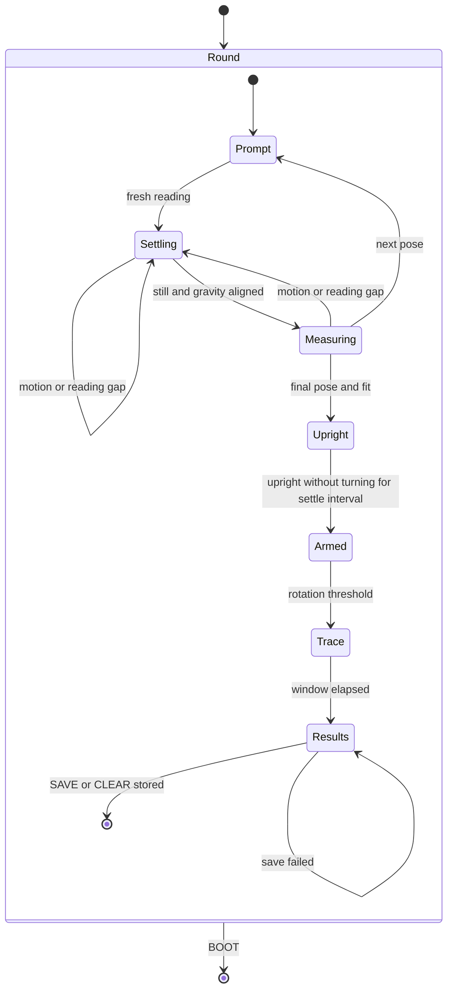

# Motion calibration

The accelerometer offset and the gyro zero-rate are measured on the board by
a calibration round on the development Motion page. Axes and fields are in
[Motion-Axes.md](Motion-Axes.md); the gyro bias that runs continuously is in
[Gravity.md](Gravity.md).

## Calibration round

A tap on the development Motion page starts a calibration round when idle.
Taps during a round are ignored. Prompts name the face and edges as seen on the pinned
`DISPLAY_DEFAULT_QUARTER` page; measurements stay in panel axes.

An unplugged round runs on battery so USB cannot disturb the readings:

1. Open the Motion page, disconnect USB and tap to start.
2. Follow each pose prompt and hold still until the full-screen white flash confirms its reading.
3. At the turn prompt, hold the display upright, bottom edge down, until `ARMED: TURN NOW`, then turn 90 degrees clockwise quickly.
4. A longer cyan flash means the round is complete. Keep the app open and reconnect USB.
5. Run `autana labdump > imu-round.log` on the PC.

`autana labdump` prints the kept lines between `LABDUMP_BEGIN` and `LABDUMP_END`, then frees
them. It sets DTR and RTS low before opening on Windows; on POSIX hosts it opens with both
raised, then lowers RTS before DTR.

Results live in RAM. A reset, a new round or leaving the app discards them; SAVE and CLEAR
keep them available for replay.

Each pose records `GRAV` down (unit vector) and gyro bias (deg/s) alongside
the calibration reading; see [Gravity.md](Gravity.md) for these
estimates. After the upright hold, rotation above
`IMU_PROBE_TURN_THRESHOLD` starts the `turn` trace at time zero. Each line
contains estimated unit `down` and the same sample's unit `accel` direction
(zero during zero acceleration), so their angular separation exposes lag.
`imu_probe.h` owns its duration and sampling bound; timestamps are elapsed
milliseconds from the trigger. Missing readings are not synthesized.
Every kept line starts with `LABDUMP` so its payload can be told apart from
the console's log lines; the calibration tools accept both live lines and
replayed dumps.

`input_read_motion()` subtracts the stored accelerometer offset before any
consumer filters or reads acceleration. The settings service stores Q12 g
screen-axis counts in space `imu`, keys `accel_x`, `accel_y`, `accel_z`.
A save writes `accel_valid` as 0, then the axes, then `accel_valid` as 1.
A missing marker, a marker other than 1, missing axes or any offset beyond
`IMU_CALIB_OFFSET_MAX` select zero offset. A failed write leaves the live offset unchanged.
Scale is reported but never applied; gyro readings remain raw.

The Motion page shows the stored offset. Its raw acceleration display, bubble
and `motion raw` log reconstruct sensor counts by adding that offset back.
The round measures calibrated samples, so the fitted offset is a residual.
SAVE stores the current offset plus this residual; CLEAR stores zero. The results
HUD labels the residual, while `calib` logs the absolute sensor offset in mg.
`imu_calib saved` logs Q12 counts;
`imu_calib cleared` confirms zero offset.



Settling uses recent per-axis accelerometer and gyro means. Thresholds and
durations are owned by `imu_probe.h`; constant gyro bias does not prevent
settling. Align each pose carefully: the gravity gate rejects wrong poses
but does not establish precision alignment. Upright arming instead accepts
acceleration within the bottom-down cone `IMU_PROBE_UPRIGHT_MIN` and rotation
at or below `IMU_PROBE_TURN_THRESHOLD` for `IMU_PROBE_SETTLE_MS`; it does not
require pose-grade stillness. Missing readings, gaps and departures reset
that interval. The cone follows the pinned page quarter.

For each axis, the positive and negative gravity windows give
`offset = (up + down) / 2` and
`scale = (up - down) / (2 * INPUT_ACCEL_ONE_G)`, the diagonal six-position
calibration model described by STMicroelectronics AN4508
<sup>[[67]](../Citations.md#67)</sup>. This measures offset and sensitivity, not cross-axis
misalignment. `input/motion/imu_calib.c` owns the offset and sensitivity fit. The gyro
zero-rate estimate averages samples across all pose windows. `pose` lines contain
rounded Q12 g and Q6 deg/s means and sample counts; `calib` reports offsets in
mg, sensitivity in ppm (unity is 1000000), and gyro offsets in mdps.

The Motion log records the shell quarter even though the page remains pinned.
The tool reports calibration fits and consecutive-round differences, the longest
still stretch before the first calibration round, and flat face-up quarter shares.
`motion_fit.py` owns the stillness, flat-sample and window thresholds.
Turn traces report the maximum and final angle between estimated down and
acceleration per round, excluding samples without a direction.

## Measured on the board

<details>
<summary>Two captures, before and after a power cycle</summary>

The captures are kept outside the repository. Supply their locations to
the tool; the command below uses plain capture names:

```sh
python motion_fit.py cjsd1-round1.log cjsd1-round2.log
```

These captures were taken before the gyro range was corrected; read every gyro figure in them at half its printed value.

All vectors below are x,y,z; gyro values and noise are mdps, offsets mg and
scales ppm. The incomplete calibration round is excluded from the fit comparison.

| Measurement | Capture 1 | Capture 2 (after power cycle) |
|---|---|---|
| Accel offset | 104,22,-107 | 109,22,-106 |
| Accel scale | 1008886,996951,993883 | 1009651,997281,994040 |
| Round-mean gyro | -6585,2606,-665 | -6642,1525,-628 |
| Pre-round still uptime s | 70.487-76.937 | 58.510-408.115 |
| First 60 s gyro / samples | -6017,2366,-755 / 65 | -7637,1593,-702 / 596 |
| Last 60 s gyro / samples | -6017,2366,-755 / 65 | -7584,1064,-632 / 597 |
| Still gyro noise sigma | 910,1077,1010 | 918,1008,1035 |
| Flat-still samples | 1296 | 6940 |
| Quarter shares q0,q1,q2,q3 % | 0.2,0.0,0.0,99.8 | 0.0,0.0,0.0,100.0 |
| Median flat bearing degrees | 16 | 17 |
| Flat-still transitions | 2: 95.544 s 3 -> 0; 95.655 s 0 -> 3 | 0 |

- Accel error is mostly offset: x +104 to +109 mg, y +22 mg, z -107 to -106 mg; scale errors are x +0.8886 to +0.9651%, y -0.3049 to -0.2719%, z -0.6117 to -0.5960%.
- Across the power cycle, offset differences are 5,0,1 mg and scale differences 0.0765,0.0330,0.0157 percentage points.
- At rest, x stays -7.637 to -7.584 dps, y drifts +1.593 to +1.064 dps, and z is -0.702 to -0.632 dps, with sigma about 1 dps per axis; round means are -6.585,+2.606,-0.665 and -6.642,+1.525,-0.628 dps, so bias is learned continuously ([Gravity.md](Gravity.md#bias-learning)) rather than stored as a constant.
- Flat face up settles on q3 in 99.8% and 100.0% of still samples across held quarters: the +x offset supplies about 0.1 g in-plane at bearing 16-17 degrees.

Rotation sense is measured across both captures: gravity change agrees with
`dg/dt = -(omega x g)` (fitted gain -0.4 at 10 Hz; sign agreement about 2:1 over roughly 550 tipping samples).

</details>
