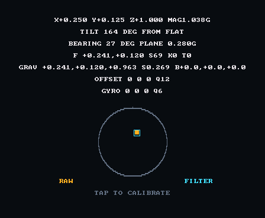
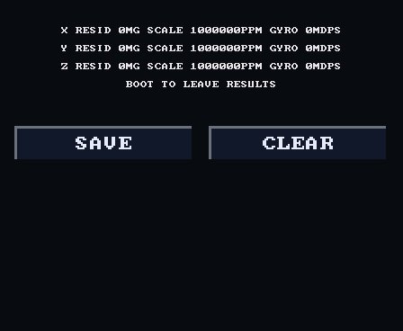
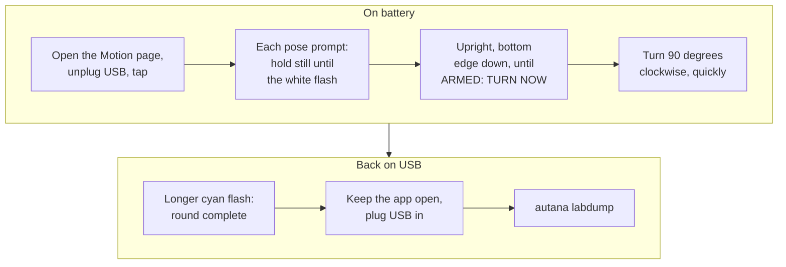
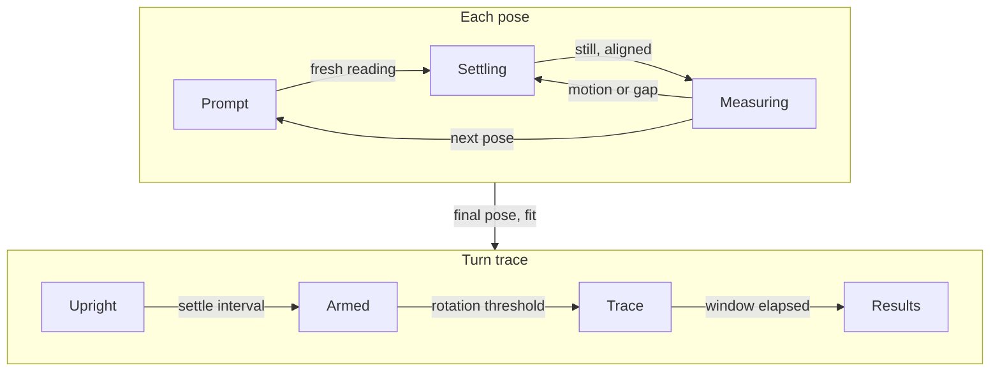
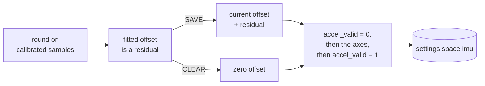
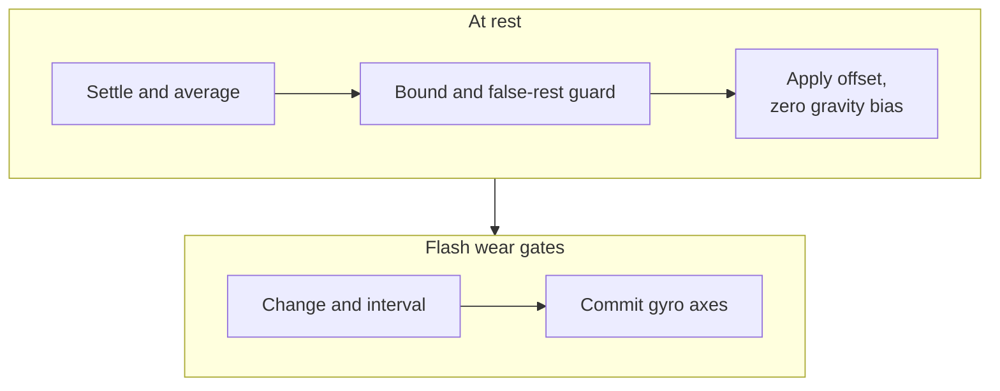

# Motion calibration

A calibration round on the development Motion page measures the accelerometer
offset and the gyro zero-rate on the board. Axes and fields are in
[Motion-Axes.md](Motion-Axes.md); the gyro offset is learned at rest and stored;
the residual bias the filter learns is in [Gravity.md](Gravity.md).

| Motion page, idle | Results page |
|---|---|
|  |  |

Both screens are rendered on the host from the page's own drawing code with
scripted, not recorded, values, turned to read upright. The results page shows
its default state, not a fitted round.

## Calibration round

An unplugged round runs on battery, so USB cannot disturb the readings:



```sh
autana labdump > imu-round.log
```

| Rule | Detail |
|---|---|
| Start | a tap starts a round when idle; taps during a round are ignored |
| Prompts | name the face and edges as seen on the pinned `DISPLAY_DEFAULT_QUARTER` page; measurements stay in panel axes |
| Lifetime | results live in RAM: a reset, a new round or leaving the app discards them; SAVE and CLEAR keep them available for replay |

### Round states



SAVE or CLEAR ends the round only after storage succeeds. BOOT leaves from
any state. Motion or a gap restarts settling. `imu_rest.h` owns stillness;
`imu_probe.h` owns pose and turn gates.

| Gate | Passes when | Resets on |
|---|---|---|
| Pose settling | recent per-axis accelerometer and gyro means are still and gravity is aligned; constant gyro bias does not block it | motion, a reading gap |
| Upright arming | acceleration within the bottom-down cone `IMU_PROBE_UPRIGHT_MIN` and rotation at or below `IMU_PROBE_TURN_THRESHOLD` for `IMU_REST_SETTLE_MS`; no pose-grade stillness needed | missing readings, gaps, leaving the cone |
| Turn trigger | rotation above `IMU_PROBE_TURN_THRESHOLD` after the upright hold | not applicable: fires once |

Align each pose carefully: the gravity gate rejects wrong poses but does not
establish precision alignment. The upright cone follows the pinned page quarter.

## What a round records

| Line | Contents |
|---|---|
| `pose` | rounded Q12 g and Q6 deg/s means, sample counts, `GRAV` down (unit vector) and gyro bias (deg/s); see [Gravity.md](Gravity.md) |
| `turn` | from the trigger at time zero: estimated unit `down` and the same sample's unit `accel` direction (zero during zero acceleration); their angular separation exposes lag |
| `calib` | offsets in mg (the absolute sensor offset), sensitivity in ppm (`IMU_CALIB_SCALE_ONE` is unity), gyro residuals in mdps |

Turn timestamps are elapsed milliseconds from the trigger. `imu_probe.h` owns
the trace's duration and sampling bound; missing readings are not synthesized.

| `autana labdump` | Behaviour |
|---|---|
| Output | the kept lines between `LABDUMP_BEGIN` and `LABDUMP_END`; repeated dumps return the same text |
| Line prefix | every kept line starts with `LABDUMP`, which tells it apart from the console's log lines; the tools accept live lines and replayed dumps |
| Serial lines | Windows sets DTR and RTS low before opening; POSIX opens with both raised, then lowers RTS before DTR |

The round averages corrected gyro samples. Its residual is meaningful only
while the live gyro offset is unchanged; automatic learning can apply a new
offset during a round.

## The fit

For each axis, the positive and negative gravity windows give the diagonal
six-position model of STMicroelectronics AN4508
<sup>[[67]](../Citations.md#st-an4508)</sup>:

```math
\text{offset} = \frac{up + down}{2} \qquad
\text{scale} = \frac{up - down}{2 \cdot \text{INPUT\_ACCEL\_ONE\_G}}
```

It measures offset and sensitivity, not cross-axis misalignment.
`input/motion/imu_calib.c` owns the fit. The gyro zero-rate estimate averages
corrected samples across all pose windows, reporting the residual offset.

## Offset storage

Motion reads subtract the stored accelerometer and gyro offsets before
consumers see acceleration or rotation. Turn speed uses corrected rotation;
accelerometer scale is reported but never applied.



| Stored | Detail |
|---|---|
| Keys | `accel_x`, `accel_y`, `accel_z`: Q12 g screen-axis counts, plus the `accel_valid` marker |
| Zero offset on load | a missing marker, a marker other than 1, missing axes, or any offset beyond `IMU_CALIB_OFFSET_MAX` |
| Failed write | leaves the live offset unchanged |
| Logs | `imu_calib saved` logs Q12 counts; `imu_calib cleared` confirms zero offset |

The Motion page shows the stored offset. Its raw acceleration display, bubble
and `motion raw` log add that offset back to reconstruct sensor counts. The
results HUD labels the residual; `calib` logs the absolute offset.

### Gyro learning

The shared motion reader learns all gyro axes at rest, settling for
`IMU_REST_SETTLE_MS` and averaging for `IMU_REST_WINDOW_MS`. Stored offsets
apply from boot; gravity learns only their residual bias.



| Stored or rule | Detail |
|---|---|
| Keys | `gyro_x`, `gyro_y`, `gyro_z`: Q6 deg/s screen-axis counts, plus `gyro_valid` |
| Zero offset on load | missing or uncommitted marker, missing axes, or any axis beyond `IMU_CALIB_GYRO_MAX` |
| Stillness | departure from recent acceleration and gyro means, so a constant gyro offset does not prevent learning; `imu_rest.h` owns the thresholds |
| Acceleration gate | magnitude within `GRAVITY_TRUST_FULL_G` of one g |
| Whole-span drift | recent-mean acceleration stays within `IMU_REST_DRIFT` per axis of its settling-start anchor throughout settling and measurement; the limit derives from the angle swept by `IMU_REST_RATE_RESOLUTION` across that span |
| Restart | motion or a gap beyond `IMU_REST_MAX_GAP_MS` |
| Acceptance | current offset plus the mean residual must stay within `IMU_CALIB_GYRO_MAX`; once valid, each residual axis must stay within the temperature-drift allowance `IMU_CALIB_GYRO_RESIDUAL_MAX` |
| Live update | accepted offset applies to subsequent reads and clears the shared gravity learner's residual bias |
| Save gates | no valid stored offset, or some axis differs by more than `IMU_CALIB_GYRO_SAVE_DELTA`; attempts are spaced by `IMU_CALIB_GYRO_SAVE_INTERVAL_US` |
| Failed write | keeps the live offset and invalidates storage; the next accepted window after `IMU_CALIB_GYRO_SAVE_INTERVAL_US` retries regardless of delta; failed attempts also start the interval |
| Commit | invalidate the marker, write the axes in one batch, then commit the valid marker; interrupted writes cannot load as valid |
| Log | `imu_calib gyro saved x y z`, in Q6 deg/s counts |

Rotation about the vertical leaves acceleration unchanged, so the drift gate
cannot distinguish that rotation from gyro bias.

## The analysis tool

`motion_fit.py` owns the stillness, flat-sample and window thresholds. For
each capture it reports:

- calibration fits and consecutive-round differences;
- the longest still stretch before the first round;
- flat face-up quarter shares, from the shell quarter the Motion log records
  even though the page stays pinned;
- per turn trace, the maximum and final angle between estimated down and
  acceleration, skipping samples without a direction.

## Measured captures

Accelerometer and gyro offsets persist across power cycles. Rest windows
track gyro drift; the gravity filter learns the remaining residual
([Gravity.md](Gravity.md#bias-learning)).

<details>
<summary>Two captures, before and after a power cycle</summary>

The captures are kept outside the repository; pass their locations to the
tool:

```sh
python motion_fit.py cjsd1-round1.log cjsd1-round2.log
```

These captures predate the gyro range correction: read every gyro figure in
them at half its printed value.

Vectors are x,y,z; gyro values and noise are mdps, offsets mg and scales ppm.
The incomplete round is excluded from the fit comparison.

| Measurement | Capture 1 | Capture 2 (after power cycle) |
|---|---|---|
| Accel offset | 104,22,-107 | 109,22,-106 |
| Accel scale | 1008886,996951,993883 | 1009651,997281,994040 |
| Round-mean gyro | -6585,2606,-665 | -6642,1525,-628 |
| Pre-round still uptime s | 70.487-76.937 | 58.510-408.115 |
| First 60 s gyro / samples | -6017,2366,-755 / 65 | -7637,1593,-702 / 596 |
| Last 60 s gyro / samples | -6017,2366,-755 / 65 | -7584,1064,-632 / 597 |
| Still gyro noise sigma | 910,1077,1010 | 918,1008,1035 |
| Flat-still samples | 1296 | 6940 |
| Quarter shares q0,q1,q2,q3 % | 0.2,0.0,0.0,99.8 | 0.0,0.0,0.0,100.0 |
| Median flat bearing degrees | 16 | 17 |
| Flat-still transitions | 2: 95.544 s 3 -> 0; 95.655 s 0 -> 3 | 0 |

| Quantity | x | y | z |
|---|---|---|---|
| Accel offset, mg | +104 to +109 | +22 | -107 to -106 |
| Accel scale error, % | +0.8886 to +0.9651 | -0.3049 to -0.2719 | -0.6117 to -0.5960 |
| Power-cycle offset change, mg | 5 | 0 | 1 |
| Power-cycle scale change, points | 0.0765 | 0.0330 | 0.0157 |
| Gyro at rest, dps | -7.637 to -7.584 | +1.593 to +1.064 (drifting) | -0.702 to -0.632 |
| Round-mean gyro, dps | -6.585, -6.642 | +2.606, +1.525 | -0.665, -0.628 |

Still gyro noise sigma is about 1 dps per axis. Flat face up settles on q3 in
99.8% and 100.0% of still samples across held quarters: the +x offset supplies
about 0.1 g in-plane at bearing 16-17 degrees.

Rotation sense agrees with `dg/dt = -(omega x g)` across both captures:
fitted gain -0.4 at 10 Hz, sign agreement about 2:1 over roughly 550
tipping samples.

</details>
