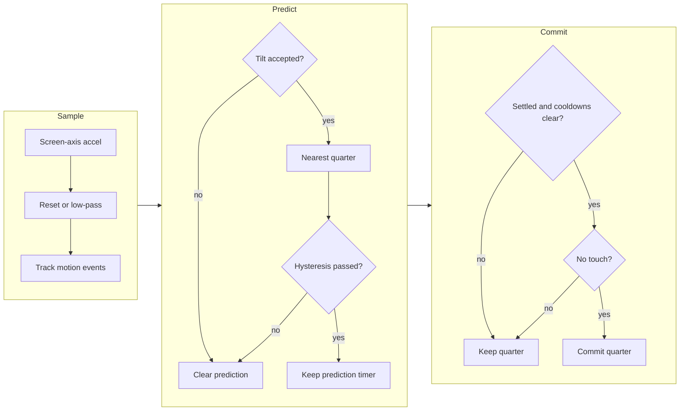

# Shell orientation



The shell samples acceleration every `DISPLAY_SAMPLE_MS` and runs the
Android WindowOrientationListener judge [75](../Citations.md#75).
`display_quarter_now()` returns the committed quarter.

Screen axes point right, down and out. Down at rest is negative z face-up,
so tilt uses `-z / magnitude`: positive means face-up.
The filter and gates use floats, square roots and precomputed angle companions.

| Constant in `display/display.h` | Value | Source |
|---|---:|---|
| `DISPLAY_SAMPLE_MS` | 20 ms | Shell cadence |
| `DISPLAY_FILTER_TAU_MS` | 200 ms | [75] |
| `DISPLAY_FILTER_RESET_MS` | 1000 ms | [75] |
| `DISPLAY_ACCEL_TOLERANCE_G` | 0.4 g | [75], same tolerance as gravity |
| `DISPLAY_NEAR_ZERO_G` | 0.1 g | [75] |
| `DISPLAY_FLAT_DEG` | 80 degrees | [75] |
| `DISPLAY_FLAT_MS` | 1000 ms | [75] |
| `DISPLAY_SWING_DEG` | +20 degrees | [75] |
| `DISPLAY_SWING_MS` | 300 ms | [75] |
| `DISPLAY_MAX_TILT_DEG` | 80 degrees | [75] |
| `DISPLAY_OVERHEAD_ENTER_DEG` | -40 degrees | [75] |
| `DISPLAY_OVERHEAD_EXIT_DEG` | -15 degrees | [75] |
| `DISPLAY_HYSTERESIS_GAP_DEG` | 45 degrees | [75] |
| `DISPLAY_SETTLE_MS` | 40 ms | [75] |
| `DISPLAY_AFTER_FLAT_MS` | 500 ms | [75] |
| `DISPLAY_AFTER_ACCEL_MS` | 500 ms | [75] |
| `DISPLAY_AFTER_SWING_MS` | 300 ms | [75] |
| `DISPLAY_AFTER_TOUCH_MS` | 500 ms | [75] |
| `DISPLAY_TILT_MIN_DEG` | -25 degrees | [75] |
| `DISPLAY_TILT_DEFAULT_MAX_DEG` | 70 degrees | Maintainer: default quarter |
| `DISPLAY_TILT_ADJACENT_MAX_DEG` | 65 degrees | Maintainer: adjacent quarters |
| `DISPLAY_TILT_OPPOSITE_MAX_DEG` | 60 degrees | Maintainer: opposite quarter |

An adjacent quarter needs more than `(90 + gap) / 2` degrees from the
committed axis. A prediction keeps its timer while unchanged.
Flat, swing, acceleration and touch each postpone commitment.

`display_hold_quarter(display_quarter_now())` locks rotation and stops
sensor reads. Release resets the filter and prediction; the committed
quarter changes only after the normal gates pass.

The console IMU reply gives `sample_ms` and `commit_ms`. The latter includes
a filter-flush allowance, cooldown and settle time for a steady unit sample.
A continuing touch or rotation hold can prevent commitment indefinitely.

## Replay

The guided orientation round records FIFO accel and gyro counts with
microsecond timestamps in the shared `labdump` transcript.
Its capture commands are in the round's README.

```sh
python launcher/tools/input/orientation_replay.py round.log --model both --initial-quarter 1 --cc gcc
```

The C probe links the real display and gravity modules. `accel` uses the
judge's low-pass filter; `fused` feeds unit `gravity_down()` after every FIFO
sample, so its magnitude gate sees only the judge filter's vector length.

Both models retain the judge filter and timing gates. Fusion updates at
FIFO cadence; judge runs use 20 ms and 100 ms deadlines, taking the first
available sample after each deadline. Touch is absent from replay.

Each segment reports switches, false switches and wanted-switch latency.
Hold segments count every switch as false; reading segments count switches
to another target as false. An absent target is reported as missed.

Latency starts at the script prompt, including human reaction time.
A target already committed at the prompt has zero latency. FIFO gaps remain
visible as timestamp gaps; replay does not reconstruct missing samples.
