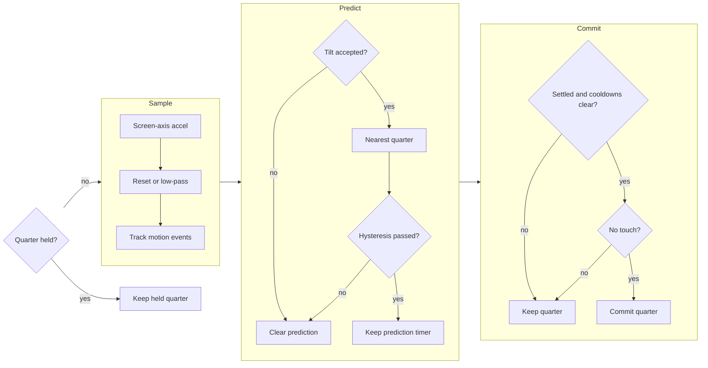

# Shell orientation

The shell runs Android's WindowOrientationListener judge.[[75]](../Citations.md#aosp-window-orientation-listener)
This tree uses screen-axis down, board-relative tilt limits and shell sampling.
`display_quarter_now()` returns the committed quarter.

Screen axes point right, down and out. Down at rest is negative z face-up,
so tilt uses `-z / magnitude`: positive means face-up.
The filter and gates use floats, square roots and precomputed angle companions.

| Constant in `display/display_judge.h` | Value | Source |
|---|---:|---|
| `DISPLAY_SAMPLE_MS` | 20 ms | This tree: shell cadence |
| `DISPLAY_FILTER_TAU_MS` | 200 ms | [75] |
| `DISPLAY_FILTER_RESET_MS` | 1000 ms | [75] |
| `DISPLAY_ACCEL_TOLERANCE_G` | 0.4 g | [75], same tolerance as gravity |
| `DISPLAY_NEAR_ZERO_G` | 0.1 g | [75] |
| `DISPLAY_FLAT_DEG` | 80 degrees | [75] |
| `DISPLAY_FLAT_MS` | 1000 ms | [75] |
| `DISPLAY_SWING_DEG` | +20 degrees | [75] |
| `DISPLAY_SWING_MS` | 300 ms | [75] |
| `DISPLAY_MAX_TILT_DEG` | 80 degrees | [75] |
| `DISPLAY_OVERHEAD_ENTER_DEG` | -40 degrees | [75] |
| `DISPLAY_OVERHEAD_EXIT_DEG` | -15 degrees | [75] |
| `DISPLAY_HYSTERESIS_GAP_DEG` | 45 degrees | [75] |
| `DISPLAY_SETTLE_MS` | 40 ms | [75] |
| `DISPLAY_AFTER_FLAT_MS` | 500 ms | [75] |
| `DISPLAY_AFTER_ACCEL_MS` | 500 ms | [75] |
| `DISPLAY_AFTER_SWING_MS` | 300 ms | [75] |
| `DISPLAY_AFTER_TOUCH_MS` | 500 ms | [75] |
| `DISPLAY_TILT_MIN_DEG` | -25 degrees | [75] |
| `DISPLAY_TILT_DEFAULT_MAX_DEG` | 70 degrees | This tree: widest reading tilt for the normal grip |
| `DISPLAY_TILT_ADJACENT_MAX_DEG` | 65 degrees | This tree: narrower reading tilt for side grips |
| `DISPLAY_TILT_OPPOSITE_MAX_DEG` | 60 degrees | This tree: narrowest reading tilt for an inverted grip |

An adjacent quarter needs more than `(90 + gap) / 2` degrees from the
committed axis. A prediction keeps its timer while unchanged.
Flat, swing, acceleration and touch each postpone commitment.

The sampler reads at most once per `DISPLAY_SAMPLE_MS`, including failed reads.
The shell calls `display_touch_now()` before sampling on every finger-down frame;
commitment waits `DISPLAY_AFTER_TOUCH_MS` after the last such frame.

`display_hold_quarter(display_quarter_now())` locks rotation and stops
sensor reads. Release resets the filter and prediction; the committed
quarter changes only after the normal gates pass.

The console IMU reply gives `sample_ms` and `commit_ms`. The latter includes
a filter-flush allowance, cooldown and settle time for a steady unit sample.
A continuing touch or rotation hold can prevent commitment indefinitely.
