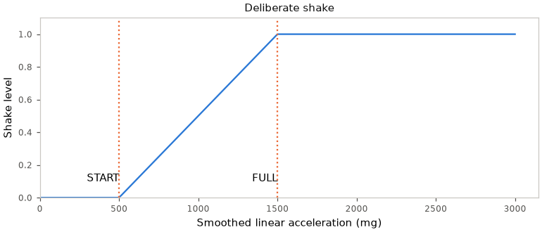
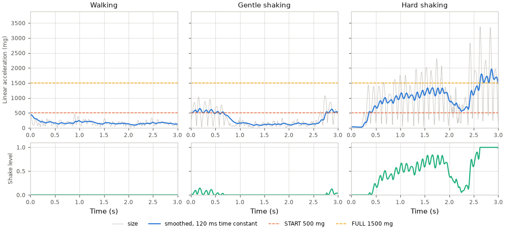
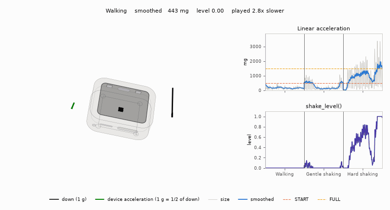

# Shake



Shake measures the smoothed size of linear acceleration in screen axes.
It reports deliberate shaking only; a gentle shake can overlap walking.
Spinning about the screen normal reads nothing because gravity tracks the rotation.

## Reader

Feed `shake_update()` with `gravity_linear()` in g and elapsed microseconds,
per sample or frame. The one-pole exponential step accepts any dt;
zero dt leaves the state unchanged. `shake_reset()` clears the smoothed size.

`shake_level()` is zero at or below START, rises linearly to one at FULL,
and stays at one above FULL. Direction does not affect the result.

| Constant | Capture constraint |
|---|---|
| `SHAKE_TAU_MS` | Mixed-direction and side-to-side shaking: carries motion between strokes |
| `SHAKE_START_G` | Both protocols: above walking, taps, flips and lifting the board |
| `SHAKE_FULL_G` | Both protocols: hard shaking reaches full level |

The constants in `shake.h` come from guided board captures.

Apps use `input_shake()` for the shared motion reader; see [Gravity.md](Gravity.md).

## On recorded motion



A hardware recording, the retained mixed-direction shake capture, run through
`shake_update()`: for each activity, the three-second span with the median
smoothed size.

The grey size swings with every stroke; the smoothed size carries between
strokes. Walking stays under START, gentle shaking touches it, and hard
shaking climbs past FULL.



A recording, not a scripted sweep: the same three spans, played slowed on the
device. The pose comes from the capture's gravity; the arrow is the device's
linear acceleration.

## Figures

`launcher/tools/input/shake_figures.py` builds a probe against `shake.c`, so
the time constant and thresholds come from `shake.h`. The level curve probes
`shake_level()` directly:

```sh
python launcher/tools/input/shake_figures.py --cc cc --out docs/images/input/shake-level.png
```

The image pipeline (`launcher/tools/render/render_doc_images.sh`) regenerates
all three, the trace and animation from the capture.
