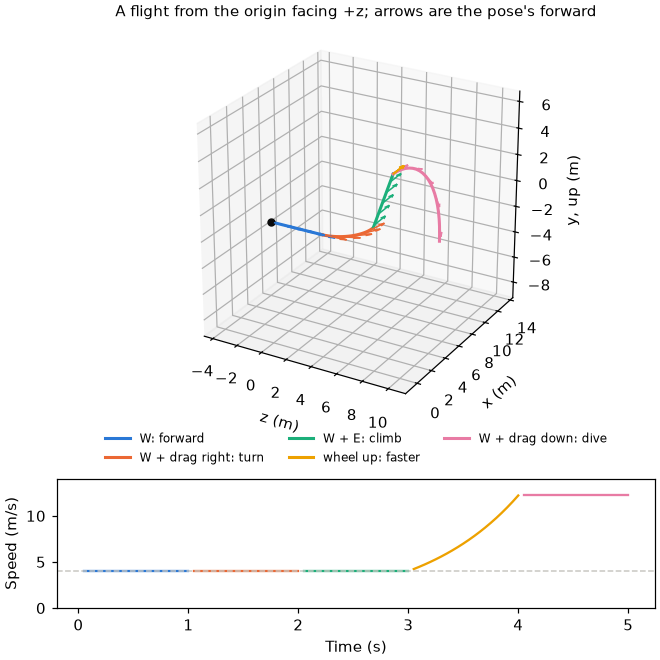

# Fly

A transform flown freely, as a free camera is, from caller-gathered steering. [Kinematics index](README.md).

## fly_motion.h

Keys move the transform, a drag turns it with a level horizon, and a wheel scales its speed.

| Function | Purpose |
|---|---|
| `fly_motion_t` | The pose, its speed in scene units per second, and the start speed the wheel's bounds scale with |
| `fly_motion_steer_t` | One step's key axes, drag in pixels and wheel notches |
| `fly_motion_start` | Flying from a pose at a start speed in the scene's units |
| `fly_motion_update` | Scales the speed, turns, then moves for the step; true when the pose changed |

| Constant | Purpose |
|---|---|
| `FLY_MOTION_START_SPEED` | A start speed in metres per second, for a scene measured in metres |
| `FLY_MOTION_SPEED_STEP` | Speed ratio per wheel notch |
| `FLY_MOTION_SPEED_MIN_RATIO`, `FLY_MOTION_SPEED_MAX_RATIO` | Speed bounds, as multiples of the start speed |
| `FLY_MOTION_RADIANS_PER_PIXEL` | Turn per pixel of drag |
| `FLY_MOTION_PITCH_LIMIT` | Steepest pitch either way, short of a quarter turn |

### Steering

| Input | Effect |
|---|---|
| `move.x` | Along the pose's right |
| `move.y` | Along the world's up, whichever way the pose faces |
| `move.z` | Along the pose's forward |
| `look.x` | Yaw about the world's up |
| `look.y` | Pitch, clamped to `FLY_MOTION_PITCH_LIMIT`; no roll |
| `wheel` | Speed scaled by `FLY_MOTION_SPEED_STEP` per notch, within the bounds |

The bounds scale with the start speed, so a scene in centimetres flies as one
in metres does once its caller starts it a hundred times faster.

For wheel notches $`n`$, speed $`s`$, start speed $`s_0`$ and step $`\Delta t`$,
with $`k`$ the `FLY_MOTION_SPEED_STEP` and $`r_{\min}, r_{\max}`$ the two ratios,
the step $`\mathbf{d}`$ along the summed key directions $`\mathbf{m}`$ is never
longer than one key's:

```math
s \gets \operatorname{clamp}\!\left(s\,k^{n},\; r_{\min} s_0,\; r_{\max} s_0\right), \qquad \mathbf{d}=\frac{s\,\Delta t\,\mathbf{m}}{\max(\lVert\mathbf{m}\rVert,1)}
```

Straight up or down, forward has no heading across the ground; the top of the
view gives one, so a turn from there tips toward the top.

The figure flies one scripted flight through each input in turn.


