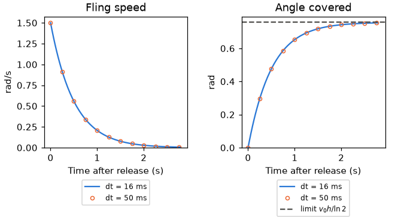
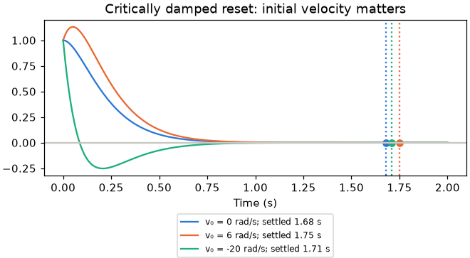

# Follow

Exact steps toward a target, on a caller-owned offset and speed. [Kinematics index](README.md).

## follow.h

Each step is solved in closed form for its $`\Delta t`$, so the same elapsed
time gives the same result at any frame step.

| Function | Purpose |
|---|---|
| `follow_halved_over` | Share left of anything halving every half-life after a time step |
| `follow_coast` | Speed halving every half-life, and the exact distance it covers |
| `follow_spring` | Critically damped spring toward zero, from an offset at a speed |

### Coast

The speed halves every $`h`$ seconds. The exact integral gives the distance
covered, which approaches $`v_0 h/\ln 2`$:

```math
v(t)=v_0 2^{-t/h}, \qquad x(t)=\frac{v_0 h}{\ln 2}(1-2^{-t/h})
```

The figure coasts an orbit's yaw after a fling at two frame steps.



### Spring

The spring solves critical damping exactly, with time constant $`\tau`$, from
offset $`e_0`$ at speed $`v_0`$:

```math
e(t)=(e_0+ct)e^{-t/\tau}, \qquad c=v_0+e_0/\tau
```

Critical damping prevents oscillation; it does not guarantee no crossing for
arbitrary initial velocity. For $`e_0>0`$, a velocity $`v_0<-e_0/\tau`$ crosses
zero.

The figure springs an orbit's yaw home; the dotted lines mark where the orbit
snaps home once the offset and speed are below its settle threshold.


