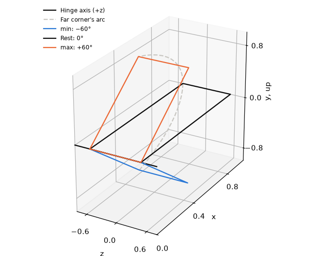

# Hinge

A joint's local pose from a prescribed angle, with no forces or time state.
[Kinematics index](README.md).



## hinge.h

| Type | Holds |
|---|---|
| `hinge_t` | The joint's local `rest` transform, unit `axis` in that rest frame, and `min` / `max` angles in radians (`min <= max`) |

| Function | Purpose |
|---|---|
| `hinge_pose` | Returns rest followed by a right-handed turn about the axis, clamping the supplied angle to the limits; leaves the hinge unchanged |

The turn is in the joint's rest frame. Its position and scale stay fixed;
its rotation composes on the right:

```math
\theta_c = \min(\theta_{\max},\max(\theta_{\min},\theta)), \qquad
q(\theta) = q_{\mathrm{rest}}\,q_{\mathrm{axis}}(\theta_c)
```

Zero gives the rest pose when the limits contain zero. Opposite axes on
mirrored joints let one prescribed angle raise both far sides together.

The [figure producer](../../launcher/tools/kinematics/hinge_figures.py)
samples `hinge_pose` through a C probe:

```sh
python launcher/tools/kinematics/hinge_figures.py --cc cc --out docs/images/kinematics
```
