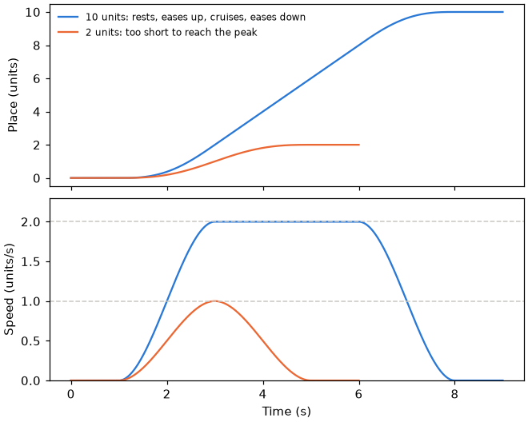

# Profile

A move along a line as a function of time. [Kinematics index](README.md).

## motion_profile.h

An S-curve motion profile: the move rests at its start, eases up to its
cruise speed, holds it, eases down to rest at its end and rests again. Any
time is one call, so a seek costs the same as a step.

A `motion_profile_t` holds the line's start and end, the peak speed, the
rest at each end and the ramp's time, all in seconds and units of the line.
`motion_profile_at` returns a `motion_profile_at_t`: the place and the speed.

| Function | Purpose |
|---|---|
| `motion_profile_at` | Place and speed at a time from the start |
| `motion_profile_cruise_speed` | The speed the cruise holds: the peak, or lower for a short move |
| `motion_profile_duration_s` | From the first rest's start to the last rest's end |

Each ramp's speed is a smoothstep of its time, $`u = t/T`$ through a ramp of
$`T`$ seconds, so speed and place have no jumps. The place is the
smoothstep's integral:

```math
v(u)=v_c(3u^2-2u^3), \qquad x(u)=x_0+\frac{v_c T}{2}\,(2u^3-u^4)
```

A ramp covers $`v_c T/2`$. When two ramps at the peak would overrun the
distance $`d`$, the cruise drops to $`v_c = d/T`$ and the ramps meet with no
cruise between them.


