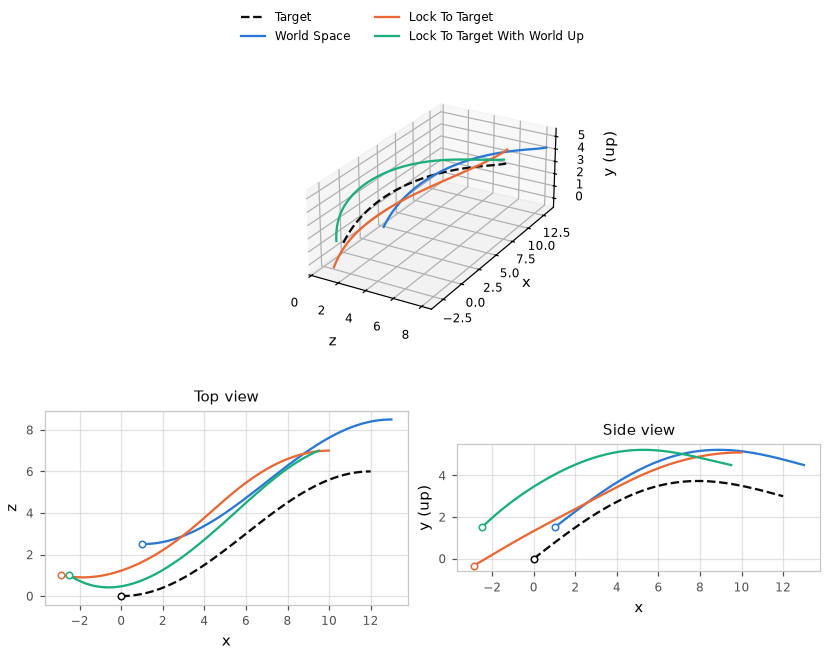

# Rig

The functions are stateless: each call takes the target pose it should follow.
A caller that wants a trailing camera passes the target's pose from an earlier
time. [Kinematics index](README.md).



The target banks and climbs. Only `RIG_BIND_TARGET` follows the roll.
Open circles mark the starts.

## Follow position

`rig_follow_position` adds a target-relative offset along the bind's axes.
The Cinemachine column maps names.<sup>[[144]](../Citations.md#unity-cinemachine-binding)</sup>

| Bind | Cinemachine | Offset axes |
|---|---|---|
| `RIG_BIND_WORLD` | World Space | World axes |
| `RIG_BIND_TARGET` | Lock To Target | Target rotation, including pitch and roll |
| `RIG_BIND_TARGET_YAW` | Lock To Target With World Up | Horizontal target heading, with world +Y up |

For target position $p$, offset $o$ and the bind's rotation $R$:

```math
p_{\mathrm{follow}} = p + Ro
```

The world bind uses the identity for $R$. Target scale has no effect.

The yaw bind follows the target's forward vector projected onto the horizontal plane.<sup>[[144]](../Citations.md#unity-cinemachine-binding)</sup>
When that projection is near zero, the offset uses world axes.

## Look rotation

`rig_look_rotation` aims local `+Z` from one point to another and takes its
roll from the supplied up vector. [`quatf_looking`](../math/Linear.md#quat-looking)
defines the fallback at coincident points and poles.

The [figure producer](../../launcher/tools/kinematics/rig_figures.py) samples the
paths through a C probe.

```sh
python launcher/tools/kinematics/rig_figures.py --cc cc --out docs/images/kinematics
```
