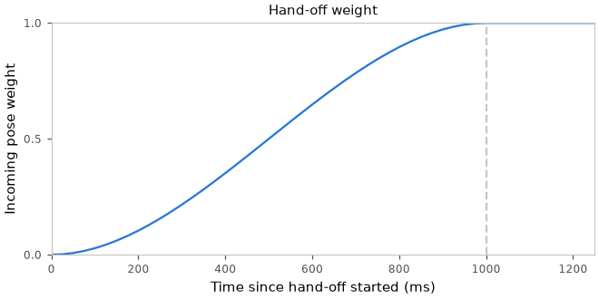

# Rig

Follow one target and aim at another using timeline samples. Seeking and
playing to the same time give the same pose. The caller supplies a target
sampled at `t - lag` for smoothing. [Kinematics index](README.md).


## Follow position

`rig_follow_position` adds an offset to the target position. The bind chooses
the offset's axes. Cinemachine names the corresponding modes below.<sup>[[136]](../Citations.md#unity-cinemachine-binding)</sup>

| Bind | Cinemachine | Offset axes |
|---|---|---|
| `RIG_BIND_WORLD` | World Space | World axes |
| `RIG_BIND_TARGET` | Lock To Target | Target rotation, including pitch and roll |
| `RIG_BIND_TARGET_YAW` | Lock To Target With World Up | Heading of the target's local `-Z` projected onto the ground plane, with world +Y up |

For target position $p$, offset $o$ and the bind's rotation $R$:

```math
p_{\mathrm{follow}} = p + Ro
```

$R$ is the identity in World Space. The yaw bind also uses the identity
when the heading is vertical within float roundoff. Target scale does not affect the offset.

## Look rotation

`rig_look_rotation` points local `-Z` from one point to another. Its right axis is
perpendicular to the supplied up vector $`u_0`$, which sets the horizon.

```math
f = \mathrm{normalize}(\mathrm{at} - \mathrm{from}), \qquad
r = \mathrm{normalize}(f \times u_0), \qquad
R = [r\;\; r \times f\;\; -f]
```

Coincident points or an aim direction parallel to up return the caller's
`keep` rotation. For seeking, supply `keep` from the timeline or a fixed pose.

## Hand-off



`rig_handoff` maps elapsed time $s$ and blend duration $d$ to the incoming
pose's weight. Both times are in milliseconds.

```math
x = \min(1, s/d), \qquad w = x^2(3 - 2x) \quad (d > 0)
```

A zero duration gives weight 1 immediately. `transformf_blend` clamps the
weight, linearly blends position and scale, and uses normalized linear
interpolation for rotation.

The [figure producer](../../launcher/tools/kinematics/rig_figures.py) samples the
paths and weight through a C probe.

```sh
python launcher/tools/kinematics/rig_figures.py --cc cc --out docs/images/kinematics
```
