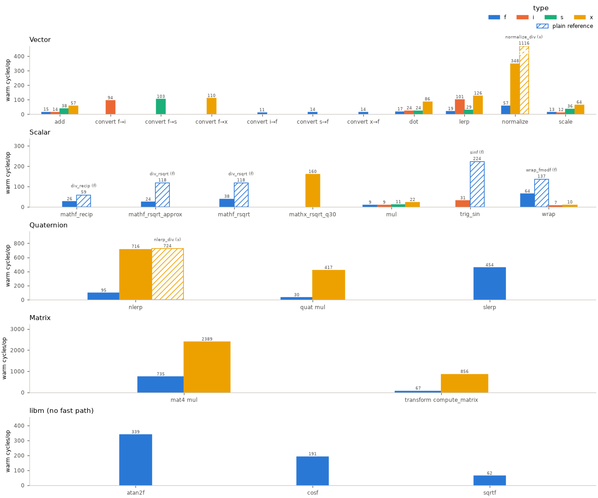

# Math benchmark

Board cycles and instructions per op for every bench row, with QEMU instruction counts for information.
See [fast paths](../packages/Fast-Paths.md) for each fast path's plain-versus-ours cost, error and target.

## How it is measured

| what | how | caveat |
|---|---|---|
| Warm | Median after an untimed call, following Embench-IoT's cache-warming method.[[69]](../Citations.md#patterson-embench) | Includes call overhead. |
| Cold | Median per call after `esp_cache_msync()` invalidates I-cache and flash-rodata D-cache over linker-defined, cache-line-rounded ranges, without writeback. | Includes libm and other callees; caches stay enabled, PSRAM untouched. Inputs and outputs are in internal RAM; calls refill code and flash rodata. |
| Board instructions | Count a warmed call on core zero with frame counters disarmed; a compiler barrier preserves every output component. | Interrupts can contribute. |
| QEMU instructions | Wrapper instructions divided by the row's op count. | No cache stalls or FPU latency. `recip0.s`/`rsqrt0.s`, gated by `CONFIG_MATH_FPU_RECIP`, show as "device-only instruction". CI ratchets only float dot, normalize, mat4 mul and slerp. |
| Cycles/insn | Warm cycles divided by board instructions. | Includes stalls and call overhead. |
| Op | One input element; types follow [math suffixes](README.md#number-types), conversions name source and destination. | Mat4 includes by-value struct copies; transform compute_matrix composes TRS, quat mul composes rotations. |
| Fused/approx column | Matching wrapper mnemonics and sorted callees. | Callee bodies are excluded; unresolved indirect targets are starred registers; `-` means no match. |
| Max error | Measured by `suite_math_numbers` on the board; host captures are labelled separately. Values count ulp steps from the rounded result. | A fast path's error is in its linked Fast-Paths section. Only rows without a section carry a value here; `-` means no measurement. |
| Calibration | `dot_f32_n256` is a full dot-product call matching ESP-DSP's ANSI O2 workload.[[68]](../Citations.md#espressif-esp-dsp-benchmarks) | Compares warm cycles/call; compiler flags, loads, stores and call overhead affect the ratio. |

Warm cycles per op, generated from the committed capture.

Full benchmark log

<!-- generated: math-benchmark check: python launcher/tools/perf/fast_paths.py --check -->
#### Vector

| function | type | cycles/op warm | cold cycles/call (I-cache refill) | board insn/op | QEMU insn/op | cycles/insn | fused/approx ops; calls | max error |
|---|---|---:|---:|---:|---:|---:|---|---|
| add (vec3) | f | 15.2 | 1527.0 | 14.4 | 14.2 | 1.1 | - | - |
| add (vec3) | i | 14.2 | 1405.0 | 14.4 | 14.2 | 1.0 | - | - |
| add (vec3) | s | 22.3 | 2347.0 | 22.5 | 31.4 | 1.0 | - | - |
| add (vec3) | x | 58.3 | 5792.0 | 43.5 | 44.4 | 1.3 | - | - |
| convert | f_to_i | 94.4 | 8602.0 | 61.0 | 62.0 | 1.5 | - | - |
| convert | f_to_s | 103.4 | 8926.0 | 74.6 | 75.5 | 1.4 | - | - |
| convert | f_to_x | 109.5 | 9574.0 | 81.3 | 70.5 | 1.3 | - | - |
| convert | i_to_f | 11.2 | 1234.0 | 11.4 | 11.2 | 1.0 | - | - |
| convert | s_to_f | 14.3 | 1692.0 | 14.4 | 14.3 | 1.0 | - | - |
| convert | x_to_f | 14.3 | 1684.0 | 14.4 | 14.3 | 1.0 | - | - |
| dot (vec3) | f | 17.2 | 1654.0 | 12.4 | 12.2 | 1.4 | madd.s | - |
| dot (vec3) | i | 24.2 | 2224.0 | 24.4 | 24.2 | 1.0 | - | - |
| dot (vec3) | s | 24.2 | 2206.0 | 24.4 | 24.2 | 1.0 | - | - |
| dot (vec3) | x | 83.6 | 9291.0 | 64.8 | 65.8 | 1.3 | - | - |
| lerp (vec3) | f | 19.3 | 1930.0 | 17.4 | 17.3 | 1.1 | madd.s | - |
| lerp (vec3) | i | 101.2 | 8475.0 | 92.5 | 93.4 | 1.1 | - | - |
| lerp (vec3) | s | 29.3 | 2626.0 | 29.4 | 31.3 | 1.0 | - | - |
| lerp (vec3) | x | 125.3 | 12229.0 | 98.5 | 99.5 | 1.3 | - | - |
| [normalize_div](../packages/Fast-Paths.md#mathx-rsqrt-q30) | x | 1111.7 | 76545.0 | 905.2 | 907.9 | 1.2 | calls __udivdi3, mathi_isqrt64_digits | - |
| normalize (vec3) | f | 57.3 | 5240.0 | 29.5 | device-only instruction | 1.9 | madd.s msub.s rsqrt0.s; calls __divsf3, sqrtf | 1 step (sweep) |
| [normalize (vec3)](../packages/Fast-Paths.md#mathx-rsqrt-q30) | x | 333.7 | 27543.0 | 267.7 | device-only instruction | 1.2 | madd.s msub.s rsqrt0.s; calls __assert_func, mathx_rsqrt_q30 | [fast paths](../packages/Fast-Paths.md#mathx-rsqrt-q30) |
| scale (vec3) | f | 13.2 | 1258.0 | 12.4 | 12.2 | 1.1 | - | - |
| scale (vec3) | i | 12.2 | 1180.0 | 12.4 | 12.2 | 1.0 | - | - |
| scale (vec3) | s | 20.3 | 2052.0 | 20.5 | 30.4 | 1.0 | - | - |
| scale (vec3) | x | 64.0 | 7125.0 | 48.7 | 49.0 | 1.3 | - | - |

#### Scalar

| function | type | cycles/op warm | cold cycles/call (I-cache refill) | board insn/op | QEMU insn/op | cycles/insn | fused/approx ops; calls | max error |
|---|---|---:|---:|---:|---:|---:|---|---|
| [div_recip](../packages/Fast-Paths.md#mathf-recip) | f | 59.2 | 4555.0 | 40.4 | 40.3 | 1.5 | calls __divsf3 | - |
| [div_rsqrt](../packages/Fast-Paths.md#mathf-rsqrt) | f | 118.2 | 9965.0 | 83.4 | 82.3 | 1.4 | calls __divsf3, sqrtf | - |
| [mathf_recip_approx](../packages/Fast-Paths.md#mathf-recip-approx) | f | 18.2 | 1818.0 | 10.4 | device-only instruction | 1.7 | madd.s msub.s recip0.s | [fast paths](../packages/Fast-Paths.md#mathf-recip-approx) |
| [mathf_recip](../packages/Fast-Paths.md#mathf-recip) | f | 26.2 | 2470.0 | 13.4 | device-only instruction | 2.0 | madd.s msub.s recip0.s | [fast paths](../packages/Fast-Paths.md#mathf-recip) |
| [mathf_rsqrt_approx](../packages/Fast-Paths.md#mathf-rsqrt-approx) | f | 24.2 | 2410.0 | 12.5 | device-only instruction | 1.9 | msub.s rsqrt0.s | [fast paths](../packages/Fast-Paths.md#mathf-rsqrt-approx) |
| [mathf_rsqrt](../packages/Fast-Paths.md#mathf-rsqrt) | f | 38.3 | 3859.0 | 18.5 | device-only instruction | 2.1 | madd.s msub.s rsqrt0.s; calls __divsf3, sqrtf | [fast paths](../packages/Fast-Paths.md#mathf-rsqrt) |
| maths_saturate | s | 8.3 | 1088.0 | 8.4 | - | 1.0 | - | 0 lsb (sweep) |
| [mathx_rsqrt_q30](../packages/Fast-Paths.md#mathx-rsqrt-q30) | x | 147.2 | 13260.0 | 113.4 | device-only instruction | 1.3 | madd.s msub.s rsqrt0.s; calls mathx_rsqrt_q30 | [fast paths](../packages/Fast-Paths.md#mathx-rsqrt-q30) |
| mul (scalar) | f | 9.2 | 970.0 | 6.4 | 6.2 | 1.4 | - | - |
| mul (scalar) | i | 9.2 | 911.0 | 8.4 | 8.2 | 1.1 | - | - |
| mul (scalar) | s | 11.3 | 1540.0 | 10.4 | 10.2 | 1.1 | - | - |
| mul (scalar) | x | 22.3 | 2814.0 | 17.4 | 17.3 | 1.3 | - | - |
| [trig_sin](../packages/Fast-Paths.md#trig-sin) | i | 30.7 | 4441.0 | 23.9 | 23.8 | 1.3 | - | [fast paths](../packages/Fast-Paths.md#trig-sin) |
| [wrap](../packages/Fast-Paths.md#mathf-repeat) | f | 63.7 | 6720.0 | 30.0 | device-only instruction | 2.1 | madd.s msub.s recip0.s; calls fmodf | [fast paths](../packages/Fast-Paths.md#mathf-repeat) |
| wrap | i | 7.2 | 856.0 | 7.4 | 7.2 | 1.0 | - | - |
| wrap | x | 10.2 | 1336.0 | 10.4 | 10.2 | 1.0 | - | - |

#### Quaternion

| function | type | cycles/op warm | cold cycles/call (I-cache refill) | board insn/op | QEMU insn/op | cycles/insn | fused/approx ops; calls | max error |
|---|---|---:|---:|---:|---:|---:|---|---|
| [nlerp_div](../packages/Fast-Paths.md#mathx-rsqrt-q30) | x | 723.7 | 59776.0 | 519.4 | 529.4 | 1.4 | calls __divdi3, mathi_isqrt64_digits | - |
| nlerp | f | 94.7 | 8676.0 | 53.6 | device-only instruction | 1.8 | madd.s msub.s rsqrt0.s; calls __divsf3, sqrtf | 2 steps (sweep) |
| [nlerp](../packages/Fast-Paths.md#mathx-rsqrt-q30) | x | 650.1 | 58118.0 | 511.4 | device-only instruction | 1.3 | madd.s msub.s rsqrt0.s; calls mathx_rsqrt_q30 | [fast paths](../packages/Fast-Paths.md#mathx-rsqrt-q30) |
| quat mul | f | 30.2 | 2657.0 | 30.4 | 30.2 | 1.0 | madd.s msub.s | - |
| quat mul | x | 418.3 | 39620.0 | 312.5 | 313.9 | 1.3 | - | - |
| slerp | f | 451.6 | 34405.0 | 305.2 | device-only instruction | 1.5 | madd.s msub.s rsqrt0.s; calls __divsf3, sqrtf | - |

#### Matrix

| function | type | cycles/op warm | cold cycles/call (I-cache refill) | board insn/op | QEMU insn/op | cycles/insn | fused/approx ops; calls | max error |
|---|---|---:|---:|---:|---:|---:|---|---|
| mat4 mul | f | 735.3 | 48605.0 | 504.5 | 506.4 | 1.5 | madd.s; calls memcpy | - |
| mat4 mul | x | 2389.4 | 159039.0 | 1637.0 | 1640.4 | 1.5 | calls memcpy | - |
| transform compute_matrix | f | 67.3 | 6193.0 | 67.5 | 67.4 | 1.0 | madd.s msub.s | - |
| transform compute_matrix | x | 854.4 | 75912.0 | 660.1 | 661.4 | 1.3 | calls mat4x_from_trs, memcpy | - |

#### Libm

| function | type | cycles/op warm | cold cycles/call (I-cache refill) | board insn/op | QEMU insn/op | cycles/insn | fused/approx ops; calls | max error |
|---|---|---:|---:|---:|---:|---:|---|---|
| atan2f | f | 338.6 | 28842.0 | 196.8 | 197.0 | 1.7 | calls atan2f | - |
| cosf | f | 191.3 | 21605.0 | 110.6 | 111.6 | 1.7 | calls _cosf | - |
| [sinf](../packages/Fast-Paths.md#trig-sin) | f | 223.6 | 24014.0 | 125.9 | 110.0 | 1.8 | calls _sinf | - |
| sqrtf | f | 62.2 | 5772.0 | 45.4 | 46.3 | 1.4 | calls sqrtf | - |
| [wrap_fmodf](../packages/Fast-Paths.md#mathf-repeat) | f | 136.9 | 13239.0 | 88.5 | 88.6 | 1.5 | calls fmodf | - |

#### Calibration

| function | type | cycles/op warm | cold cycles/call (I-cache refill) | board insn/op | QEMU insn/op | cycles/insn | fused/approx ops; calls | max error |
|---|---|---:|---:|---:|---:|---:|---|---|
| dot_f32_n256 | f | 1299.0 | 1811.0 | 1309.0 | 1299.0 | 1.0 | madd.s | - |

ESP-DSP calibration: measured warm 1299.0 cycles/call; ANSI O2 reference 1311 cycles/call; measured/reference 99.1%.
<!-- /generated: math-benchmark -->

## Capture

| step | command |
|---|---|
| Bench capture | [board capture build](../../launcher/packages/math/test_apps/README.md), then `idf -C packages/math/test_apps -B packages/math/test_apps/build.board monitor > docs/math/data/math_bench_capture.txt` |
| Error capture | Included in the package app capture |
| ELF metadata | `idf -C packages/math/test_apps -B packages/math/test_apps/build.board build`, then `python launcher/tools/perf/math_bench_table.py --from-elf <math_test_app.elf>` |
| Linked sizes | `python launcher/tools/perf/fast_paths.py --from-elf <math_test_app.elf>` |
| Host error sweep | `bash launcher/test/run_tests.sh --sanitize` |
| Host records | Save `MATHERROR`/`MATHERRORBIN` in `data/math_error_host_capture.txt` with a `MATHTARGET target=host arch=<architecture> execution=host` record. |
| Regenerate blocks | `python launcher/tools/perf/fast_paths.py`; add `--check` to verify. |
| Figures | `bash launcher/tools/render/render_doc_images.sh`, or `python launcher/tools/math/math_bench_figures.py` and `python launcher/tools/math/fast_path_figures.py`. |

Initialize the pinned IDF as shown in the [test app commands](../../launcher/packages/math/test_apps/README.md).
The board app ELF is `launcher/packages/math/test_apps/build.board/math_test_app.elf`.

Keep `BUILD_ID=`, `MATHTARGET`, `MATHBENCH`, `MATHERROR` and `MATHERRORBIN` records in `docs/math/data/math_bench_capture.txt`.
Separate images require one `scope=bench` and one `scope=error` build ID; a single image uses one unscoped ID.

`MATHTARGET` identifies the shared target; ELF metadata and sizes must match the bench image. Host evidence is labelled separately.
