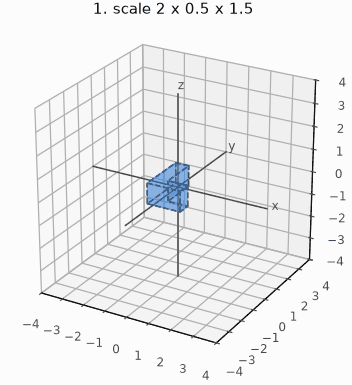
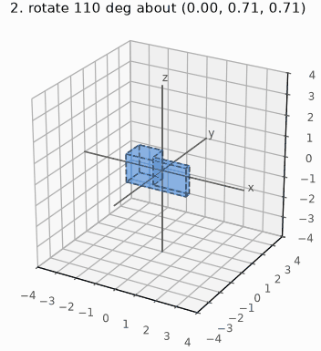
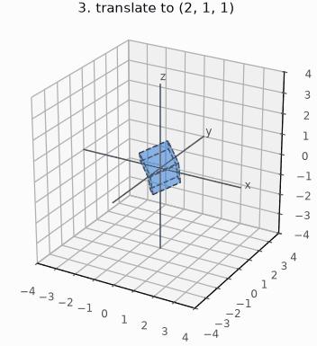

# Conventions

Axes, composition, templates and float build rules. [Math index](README.md).

| | |
|---|---|
| Axes | left-handed, local +x right, +y up, +z forward; a camera looks down +z; source assets are right-handed and mirrored at the pack ([Mesh-Import.md](../render/offline/Mesh-Import.md#the-offline-tools)) |
| Rotation sense | left-handed, +y up: a positive angle about +y turns +z toward +x |
| Quaternion | `x, y, z, w` with `w` the scalar, unit length, Hamilton product; `mul(a, b)` applies `b` first |
| Euler | `from_euler` applies Z, then X, then Y about the fixed axes |
| Matrix | `m[row][col]`, acting on column vectors; the translation is column 3; `mul(a, b)` applies `b` first |
| TRS | scale, then rotate, then translate |

```math
v' = q\,v\,q^{-1} = v + 2w\,(u \times v) + 2\,u \times (u \times v), \qquad u = (q_x, q_y, q_z)
```

```math
M = T\,R\,S, \qquad p_{\text{world}} = M\,p_{\text{local}}, \qquad
V = R^{\mathsf T}\,T(-\text{position})
```

  

Each GIF animates one step of `mat4f_from_trs`; the dashed block is the stage before.

## Templates

A template is a header holding one macro per group of functions; an
instantiation header (`vec3f.h`, `quatx.h`, ...) calls the macros and adds
any type-specific operations.

| Template header | Macros | Generates | Instantiated for |
|---|---|---|---|
| `vec2_template.h` | `MATH_DEFINE_VEC2` | the vec2 type, arithmetic, dot | `vec2f`, `vec2i`, `vec2s`, `vec2x` |
| `vec3_template.h` | `MATH_DEFINE_VEC3`, `MATH_DEFINE_VEC3_NORMALIZE` | the vec3 type, arithmetic, dot, cross; normalize | all four; normalize `f` only; `vec3x` normalization is hand-written |
| `vec_ops_template.h` | `MATH_DEFINE_VEC_OPS`, `MATH_DEFINE_VEC_LERP`, `MATH_DEFINE_VEC_LERP_RATIO` | component-wise operations, lerp | every vector; lerp `f x`, ratio lerp `i s` |
| `vec_swizzle_template.h` | `MATH_DEFINE_VEC_SWIZZLE` | swizzles between vec2 and vec3 | `vec3f`, `vec3i`, `vec3s`, `vec3x` |
| `quat_template.h` | `MATH_DEFINE_QUAT`, `MATH_DEFINE_QUAT_NORMALIZE` | rotations | `quatf`, `quatx` |
| `affine2_template.h` | `MATH_DEFINE_AFFINE2`, `MATH_DEFINE_AFFINE2_RECT` | 2D affine maps; integer-pixel maps | `affine2f`, `affine2x` |
| `mat4_template.h` | `MATH_DEFINE_MAT4`, `MATH_DEFINE_MAT4_INVERT_AFFINE` | 4x4 matrices; affine inverse | `mat4f`, `mat4x`; inverse `f` |
| `transform_template.h` | `MATH_DEFINE_TRANSFORM` | position, rotation, scale and the cached matrix | `transformf`, `transformx` |
| `project_template.h` | `MATH_DEFINE_CLIP_NEAR` | near-plane segment clipping, no type | `projectf`, `projectx` |
| `rect_template.h` | `MATH_DEFINE_RECT` | half-open rectangles | `rectf`, `recti`, `rects`, `rectx` |
| `box3_template.h` | `MATH_DEFINE_BOX3`, `MATH_DEFINE_BOX3_REAL` | closed boxes; real queries take a plane type | `box3s`, `box3f`; real `f` |
| `ball_template.h` | `MATH_DEFINE_BALL`, `MATH_DEFINE_BALL_REAL` | closed balls; real closest-point/segment queries | via circle and sphere templates |
| `circle_template.h` | `MATH_DEFINE_CIRCLE`, `MATH_DEFINE_CIRCLE_REAL` | ball queries, disc bounds and rect queries | `circlef`, `circlei`; real `f` |
| `sphere_template.h` | `MATH_DEFINE_SPHERE` | ball queries and sphere box queries | `spheref` |
| `stats_template.h` | `MATH_DEFINE_STATS` | percentile and median by in-place selection | `statsi`, `statsf` |
| `plane_template.h` | `MATH_DEFINE_PLANE` | planes, signed distance, frustum planes from a matrix's rows | `planef`, `planex` |

The macro arguments:

| Argument | What it is |
|---|---|
| `P` | The type being made, e.g. `vec3f` (its functions are `vec3f_add`, ...) |
| `V`, `R`, `Q`, `M`, `B` | The vector, rectangle, quaternion, matrix and box types a family builds on |
| `L` | The projection lens prefix for `MATH_DEFINE_PLANE`, e.g. `projectf`; the plane prefix for `MATH_DEFINE_BOX3_REAL`, e.g. `planef` |
| `EDGE` | `MATH_DEFINE_CIRCLE` takes this extra argument: one cell for integers, zero for real rect closures and bounds |
| `LOWEST`, `HIGHEST` | The box scalar bounds, e.g. `INT16_MIN`, `INT16_MAX` or `-INFINITY`, `INFINITY` |
| `T` | The scalar (`float`, `int`, `int32_t`, `int16_t`); `recti` keeps plain `int` |
| `W` | The type a dot product sums in (wider than `T` for an integer) |
| `OPS` | The scalar operations' prefix (`mathf`, `mathi`, `maths`, `mathx`): the static inline functions `OPS_add`, `OPS_mul`, `OPS_one` and the rest in `mathf.h`, `mathi.h`, `maths.h` and `mathx.h`. A family names only the ones it uses, so normalization requires `OPS_rsqrt` (reciprocal square root), supplied by `mathf` and `mathx`. |
| `N` | A vector's component count: the vector's own for component-wise operations (`vec_ops_template.h`), a swizzle source's otherwise |
| `D`, `S` | A swizzle's result and source vector types (`vec_swizzle_template.h`) |
| `CROSS` | `MATH_DEFINE_CLIP_NEAR`'s crossing step, `_projectf_cross_near` or `_projectx_cross_near`; it defines `P_clip_near` and no type |
| `SUFFIX`, `MAP` | `MATH_DEFINE_AFFINE2_RECT`'s generated function name and point mapper; the pixel instantiations use `vec2i`, `recti`, `mathi`, `map_recti` and `map_pixel` |

`MATH_DEFINE_RECT(P, T, OPS)` takes no vector type and calls only `OPS_min` and
`OPS_max`. Its arithmetic does not saturate, so sums and differences must fit `T`.

## The float-precision build rules

The S3's FPU is single precision, so a `double` is a software call; the cost
and the rules are in [Build-Variants.md](../tools/Build-Variants.md):

| Rule | Where |
|---|---|
| `-Werror=double-promotion`, `-Werror=float-conversion` | the whole `main` component |
| `-ffp-contract=off` | the host builds [Build-Variants.md](../tools/Build-Variants.md#float-maths-is-single-precision-and-the-build-holds-it-there) names; the device fuses |
| soft-double link gate | `launcher/tools/build/check_no_soft_double.py`: a function calling a soft-double routine fails unless it also logs |
| libm | float needs `sqrtf`, `sinf`, `cosf`, `lroundf`; link it |
