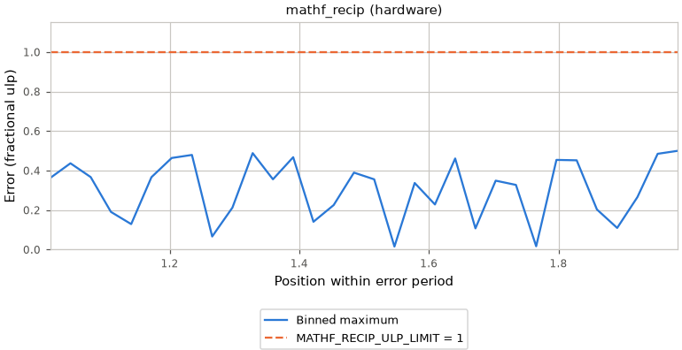
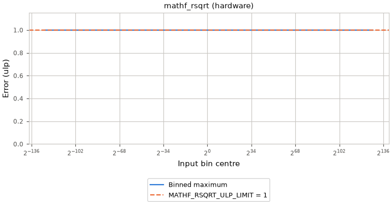
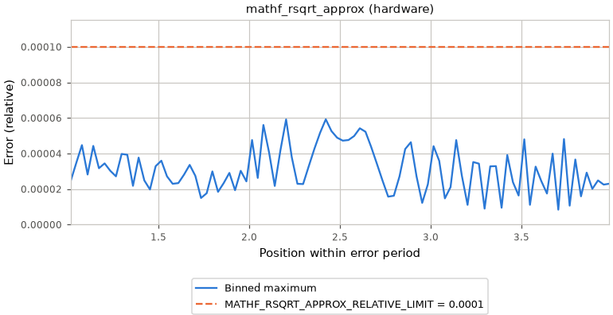
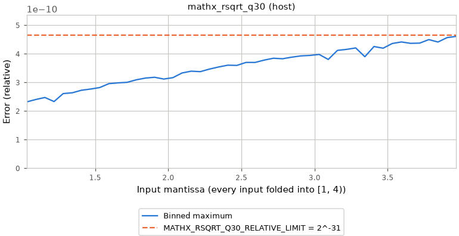
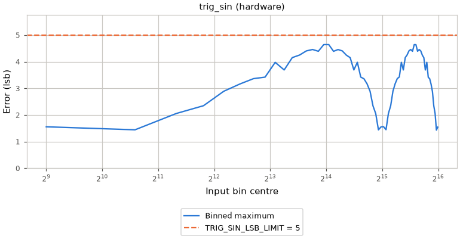

# Math fast paths

The tables compare plain C with the package implementation: algorithm,
measured cost and error, linked size, build conditions, and calling modules.
The [capture commands](Benchmark.md#capture) produce the evidence.

Key: warm cycles measure cached batches; cold cycles include instruction-cache refill.
Plain/fast is the warm cycle ratio (greater than one wins).
Errors: steps count ulp steps from the rounded result; figures show ulp from the exact value.
Code totals wrappers and callees by ELF region; table bytes total linked copies.
A dash means no measurement or table. Callers are engine modules; app names are grouped.

<!-- generated: math-fast-paths check: python launcher/tools/perf/fast_paths.py --check -->
Measured target: esp32s3 (Xtensa, LX7_ESP32_S3_MP).

### What it replaces

| Fast path | Plain way | Ours |
|---|---|---|
| [`mathf_recip`](#mathf-recip) | `1.0F / x` | reciprocal seed with two Newton corrections |
| [`mathf_rsqrt`](#mathf-rsqrt) | `1.0F / sqrtf(x)` | reciprocal-root seed with two Newton corrections |
| [`mathf_rsqrt_approx`](#mathf-rsqrt-approx) | `1.0F / sqrtf(x)` | reciprocal-root seed with one Newton correction |
| [`mathx_rsqrt_q30`](#mathx-rsqrt-q30) (normalize) | isqrt64 normalization | seed table, three Newton corrections and exact midpoint bracket |
| [`mathx_rsqrt_q30`](#mathx-rsqrt-q30) (nlerp) | blend + isqrt64 normalization | seed table, three Newton corrections and exact midpoint bracket |
| [`mathf_repeat`](#mathf-repeat) | `fmodf(v - lo, hi - lo)` | reciprocal quotient and fused remainder, with range fallback |
| [`trig_sin`](#trig-sin) | `sinf(phase * (MATH_TAU / TRIG_TURN))` | quarter-wave interpolation |

### Cost and error

| Fast path | Warm cycles: fast / plain (×) | Cold cycles: fast / plain | Max error |
|---|---|---|---|
| [`mathf_recip`](#mathf-recip) | 26 / 59 (2.3×) | 2400 / 4400 | 1 step |
| [`mathf_rsqrt`](#mathf-rsqrt) | 38 / 120 (3.1×) | 3700 / 9800 | 1 step |
| [`mathf_rsqrt_approx`](#mathf-rsqrt-approx) | 24 / 120 (4.9×) | 2300 / 9800 | 5.9e-5 rel |
| [`mathx_rsqrt_q30`](#mathx-rsqrt-q30) (normalize) | 350 / 1100 (3.2×) | 29000 / 77000 | 4.6e-10 rel (host) |
| [`mathx_rsqrt_q30`](#mathx-rsqrt-q30) (nlerp) | 720 / 720 (1×) | 63000 / 60000 | 4.6e-10 rel (host) |
| [`mathf_repeat`](#mathf-repeat) | 64 / 140 (2.1×) | 6500 / 13000 | 0 steps |
| [`trig_sin`](#trig-sin) | 31 / 220 (7.3×) | 4600 / 24000 | 4.6 lsb |

### Size and builds

| Fast path | Fast code bytes | Plain code bytes | Table bytes |
|---|---|---|---|
| [`mathf_recip`](#mathf-recip) | 57 flash | ROM + 39 flash | - |
| [`mathf_rsqrt`](#mathf-rsqrt) | ROM + 151 flash | ROM + 66 flash | - |
| [`mathf_rsqrt_approx`](#mathf-rsqrt-approx) | 61 flash | ROM + 66 flash | - |
| [`mathx_rsqrt_q30`](#mathx-rsqrt-q30) (normalize) | 236 IRAM + 945 flash | ROM + 1139 flash | 768 |
| [`mathx_rsqrt_q30`](#mathx-rsqrt-q30) (nlerp) | 236 IRAM + 2652 flash | ROM + 2599 flash | 768 |
| [`mathf_repeat`](#mathf-repeat) | 595 flash | 443 flash | - |
| [`trig_sin`](#trig-sin) | 192 flash | 171 flash | 390 |

## `mathf_recip` [[85]](../Citations.md#85)

| Original | Fast path |
|---|---|
| $`y = 1/a`$ | $`y = y + y(1 - ay)`$ |

Symbols: nonzero input `a`; reciprocal seed `y`.

Sweep: signed magnitudes and power-of-two edges.

Target: Xtensa: `recip0.s`, `madd.s`, `msub.s`.

Builds: `CONFIG_MATH_FPU_RECIP`; QEMU plain; host plain.

Callers: `render`.

Bench rows `mathf_recip_f` vs `div_recip_f`; limit `MATHF_RECIP_ULP_LIMIT` (1 step); sweep.

Plain way: `1.0F / x`.

## `mathf_rsqrt` [[85]](../Citations.md#85)

| Original | Fast path |
|---|---|
| $`y = 1/\sqrt{v}`$ | $`y = y + (y/2)(1 - vy^2)`$ |

Symbols: positive input `v`; reciprocal-root seed `y`.

Proof: all mantissas in `[1,4)`, normal exponent strides and edges.

Target: Xtensa: `rsqrt0.s`, `madd.s`, `msub.s`.

Builds: `CONFIG_MATH_FPU_RECIP`; QEMU plain; host plain.

Callers: `anim`, `apps (not named)`, `input`, `kinematics`, `render`, `scene`.

Bench rows `mathf_rsqrt_f` vs `div_rsqrt_f`; limit `MATHF_RSQRT_ULP_LIMIT` (1 step); proof.

Plain way: `1.0F / sqrtf(x)`.

## `mathf_rsqrt_approx` [[85]](../Citations.md#85)

| Original | Fast path |
|---|---|
| $`y = 1/\sqrt{v}`$ | $`y = y(3/2 - (v/2)y^2)`$ |

Symbols: positive input `v`; reciprocal-root seed `y`.

Proof: all mantissas in `[1,4)`, normal exponent strides and edges.

Target: Xtensa: `rsqrt0.s`, `msub.s`.

Builds: `CONFIG_MATH_FPU_RECIP`; QEMU plain; host plain.

Callers: `render`.

Bench rows `mathf_rsqrt_approx_f` vs `div_rsqrt_f`; limit `MATHF_RSQRT_APPROX_RELATIVE_LIMIT` (0.0001 rel); proof.

Plain way: `1.0F / sqrtf(x)`.

## `mathx_rsqrt_q30` [[85]](../Citations.md#85) [[90]](../Citations.md#90)

| Original | Fast path |
|---|---|
| $`y = 2^{46}/\sqrt{m}`$ | $`y = round(2^{46}/sqrt(m))`$ |

Symbols: integer mantissa `m` in `[MATHX_RSQRT_MIN, 2^32)`; reciprocal root `y`.

Proof: mantissa segment strides and exact midpoint brackets.

Target: portable.

Builds: none; QEMU fast; host fast.

Callers: none.

Bench rows `normalize_x` vs `normalize_div_x`; limit `MATHX_RSQRT_Q30_RELATIVE_LIMIT` (2^-31 rel); proof.

Plain way: isqrt64 squared length, then 64-bit divide and component scaling.

Bench rows `nlerp_x` vs `nlerp_div_x`; limit `MATHX_RSQRT_Q30_RELATIVE_LIMIT` (2^-31 rel); proof.

Plain way: linear quaternion blend, isqrt64 length, then 64-bit divide normalization.

## `mathf_repeat` [[85]](../Citations.md#85)

| Original | Fast path |
|---|---|
| $`r = v - \lfloor v/len \rfloor len`$ | $`r = fma(-floor(v/len), len, v)`$ |

Symbols: input `v` and positive period `len`; fused remainder `r`.

Sweep: signed float bit patterns, quotient guard and endpoint edges.

Target: portable; Xtensa needs fused `madd.s`, `msub.s`.

Builds: `CONFIG_MATH_FPU_FUSED_MADD`; QEMU plain; host fast.

Callers: none.

Bench rows `wrap_f` vs `wrap_fmodf_f`; limit `MATHF_WRAP_ULP_LIMIT` (0 steps); sweep.

Plain way: `fmodf(v - lo, hi - lo)`.

Exact: no error over 97845 inputs of the sweep.

## `trig_sin`

| Original | Fast path |
|---|---|
| $`s = 2^{TRIG\_SIN\_SHIFT}\sin(2\pi\,phase/TRIG\_TURN)`$ | $`s = a + floor((b-a)t/256)`$ |

Symbols: 16-bit phase input; quarter-wave samples `a` and `b` bracket it; `t` is the low eight phase bits and `s` is sine in output LSBs.

Sweep: every 16-bit phase against `sinf` in output LSBs.

Target: portable.

Builds: none; QEMU fast; host fast.

Callers: `audio`, `boot`, `shell`.

Bench rows `trig_sin_i` vs `sinf_f`; limit `TRIG_SIN_LSB_LIMIT` (5 lsb); sweep.

Plain way: `sinf(phase * (MATH_TAU / TRIG_TURN))`.

<!-- /generated: math-fast-paths -->
