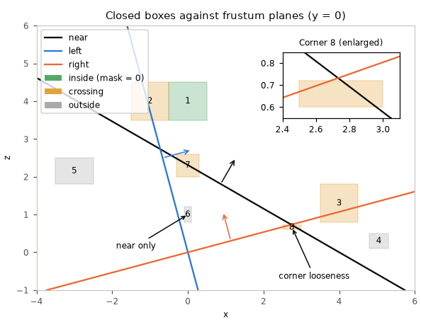
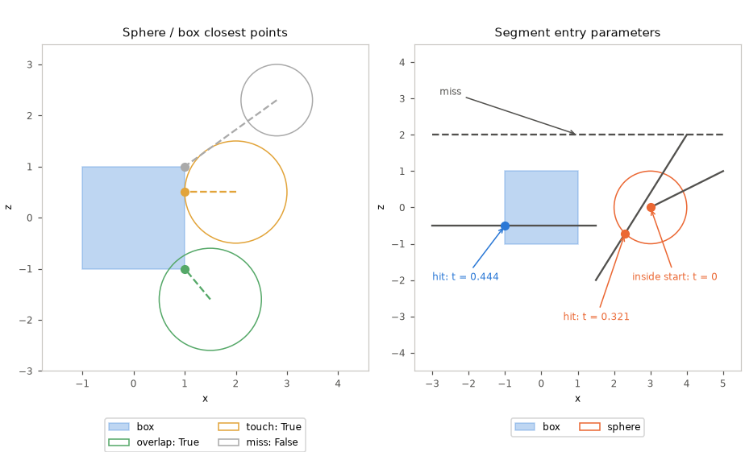

# Geometry

Half-open rectangles, oriented planes, closed boxes, spheres and circles. [Math index](README.md).

## rect (`f i s x`)

`P` is `rectf`, `recti`, `rects` or `rectx`. A rectangle stores `x, y, w, h`:
its corner and size, with exclusive right and bottom edges. A nonpositive
width or height is empty. Queries clamp result sizes to zero.

| Function | Purpose | Formula |
|---|---|---|
| `P_right(r)` | exclusive right edge | $`r_x + r_w`$ |
| `P_bottom(r)` | exclusive bottom edge | $`r_y + r_h`$ |
| `P_from_edges(left, top, right, bottom)` | rectangle from half-open edges; crossed edges are empty | $`(left, top, \max(right-left,0), \max(bottom-top,0))`$ |
| `P_is_empty(r)` | a nonpositive extent | $`r_w \le 0 \lor r_h \le 0`$ |
| `P_intersect(a, b)` | shared area, with nonnegative extents | $`l = \max(a_x,b_x),\ t = \max(a_y,b_y)`$ $`r = \min(a_x+a_w,b_x+b_w),\ b = \min(a_y+a_h,b_y+b_h)`$ $`\mathrm{from\_edges}(l,t,r,b)`$ |
| `P_union(a, b)` | smallest rectangle holding both; empty inputs add nothing; two empty inputs give zero size at a's corner | $`l = \min(a_x,b_x),\ t = \min(a_y,b_y)`$ $`r = \max(a_x+a_w,b_x+b_w),\ b = \max(a_y+a_h,b_y+b_h)`$ $`\mathrm{from\_edges}(l,t,r,b)`$ for nonempty inputs |
| `P_contains(r, px, py)` | includes left and top, excludes right and bottom | $`r_x \le px < r_x+r_w \land r_y \le py < r_y+r_h`$ |

The queries use half-open edges; crossed edges produce an empty rectangle.

## plane (`f x`)

`planef_t` and `planex_t` hold a vec3 `normal` and a scalar `d`; inside is
`dot(normal, point) + d >= 0`. Distances are scaled by the normal's length
until the plane is normalized.

| Function | Purpose | Formula |
|---|---|---|
| `P_from_normal_point(n, p)` | plane through a point with the given normal | $`(n, -n \cdot p)`$ |
| `P_from_points(a, b, c)` | winding determines the inside; unnormalized; the points must not be collinear | $`n = (b-a) \times (c-a),\ d = -n \cdot a`$ |
| `P_distance(p, q)` | signed plane value | $`p_n \cdot q + p_d`$ |
| `P_normalize(p)` | unit normal; normal must be nonzero; `x` range and error as [vec3 `P_normalize_divide`](Linear.md#vec3-f-i-s-x) | $`(p_n, p_d)/\lVert p_n\rVert`$ |
| `P_from_rows(&m, a, b, c, e)` | the plane $`a x + b y + c z + e \ge 0`$ of affine m's target, in m's source space | $`n_j = a m_{0j} + b m_{1j} + c m_{2j},\ d = a m_{03} + b m_{13} + c m_{23} + e`$ |
| `P_frustum(&m, &lens, screen, out)` | near and screen side planes in affine m's source space | `P_from_rows` of each lens-space plane below |

`P_frustum` reads rows as in Gribb and Hartmann[[77]](../Citations.md#77),
with picture coordinates `cx + fx*x/z`, `cy - fy*y/z` and z supplying w.
Each output is `P_from_rows` of a lens-space plane, in this order:

| Index | Plane | $`(a, b, c, e)`$ |
|---|---|---|
| `PLANE_FRUSTUM_NEAR` | `z >= near_z` | $`(0, 0, 1, -\mathit{near\_z})`$ |
| `PLANE_FRUSTUM_LEFT` | screen x at or right of `left` | $`(f_x, 0, c_x - \text{left}, 0)`$ |
| `PLANE_FRUSTUM_RIGHT` | screen x at or left of `right` | $`(-f_x, 0, \text{right} - c_x, 0)`$ |
| `PLANE_FRUSTUM_TOP` | screen y at or below `top` | $`(0, -f_y, c_y - \text{top}, 0)`$ |
| `PLANE_FRUSTUM_BOTTOM` | screen y at or above `bottom` | $`(0, f_y, \text{bottom} - c_y, 0)`$ |

`PLANE_FRUSTUM_COUNT` sizes the output. There is no far plane, and the
planes are not normalized.

The shown depth bounds the drawing; the frustum has no far plane, and every plane must accept a point.

## box3 (`f s`)

`P` is `box3f` or `box3s`. A box stores vec3 corners `lo, hi` and includes
both ends on every axis. `P_empty()` supplies the identity for extension
and union; any crossed axis is empty.

| Function | Purpose | Formula |
|---|---|---|
| `P_empty()` | empty identity | $`lo = HIGHEST,\ hi = LOWEST`$ on every axis |
| `P_is_empty(b)` | detect crossed bounds | $`\exists k: lo_k > hi_k`$ |
| `P_from_point(p)` | zero-extent closed box | $`(p,p)`$ |
| `P_extend(b, p)` | include a point | $`(\min(lo,p),\max(hi,p))`$ |
| `P_union(a, b)` | include both boxes | $`(\min(a_{lo},b_{lo}),\max(a_{hi},b_{hi}))`$ |
| `P_intersect(a, b)` | shared closed bounds; may be empty | $`(\max(a_{lo},b_{lo}),\min(a_{hi},b_{hi}))`$ |
| `P_contains_point(b, p)` | point within every closed interval | $`\forall k: lo_k \le p_k \le hi_k`$ |
| `P_contains(outer, inner)` | inner bounds within outer | $`\forall k: outer_{lo,k} \le inner_{lo,k}`$ $`inner_{hi,k} \le outer_{hi,k}`$ |
| `P_overlaps(a, b)` | shared points, including touching faces | $`\neg\mathrm{is\_empty}(\mathrm{intersect}(a,b))`$ |
| `P_closest_point(b, p)` | closest point on a nonempty box | $`\mathrm{clamp}(p,lo,hi)`$ |
| `P_centre(b)` | midpoint (`f`) | $`c = 0.5(lo+hi)`$ |
| `P_half_extent(b)` | half size (`f`) | $`e = 0.5(hi-lo)`$ |
| `P_segment_hit(b, a, c, &t)` | slab entry in `[0,1]` (`f`); inside starts at zero | $`v=c-a`$; intersect $`[0,1]`$ with each axis's $`[(lo_k-a_k)/v_k,(hi_k-a_k)/v_k]`$, sorted |
| `P_outside_planes(b, planes, count, &mask)` | reject outside; clear wholly inside bits (`f`) | $`d=n\cdot c+d_{plane},\ r=\sum_k \lvert n_k\rvert e_k`$ outside: $`d+r<0`$; clear bit: $`d-r\ge0`$ |
| `box3f_from_box3s(b, scale)` | convert position ticks to float units | $`(lo\,scale,hi\,scale)`$ |

Real queries use finite, nonempty bounds, except that `P_segment_hit`
rejects empty boxes. Segment endpoints and box values must be finite.
Plane bits index the input array; `count` must fit an unsigned mask.

When `P_outside_planes` returns false, the bits of planes the box crosses
stay set in the mask; a box in a loose corner is not rejected.

The near plane alone rejects one box. Box 8 crosses each plane separately
but contains no point inside the frustum: a known conservative result of
the per-plane test.

## Ball queries

Circles and spheres store `centre` and nonnegative `radius`, including the
boundary. Arithmetic must fit the number type; real values and segment
endpoints must be finite. Integer squared products use widened arithmetic.

| Function | Purpose | Formula |
|---|---|---|
| `P_contains_point(s, p)` | point inside or on the ball | $`\lVert p-c\rVert^2 \le r^2`$ |
| `P_overlaps(a, b)` | balls share points, including tangency | $`\lVert c_a-c_b\rVert^2 \le (r_a+r_b)^2`$ |
| `P_closest_point(c, p)` | p inside; nearest boundary point outside (real) | $`p`$ if inside, else $`c_c+(p-c_c)r/\lVert p-c_c\rVert`$ |
| `P_segment_hit(s, a, c, &t)` | first real segment entry in `[0,1]`; inside starts at zero | $`m=a-s_c,\ v=c-a`$ $`A=v\cdot v,\ B=m\cdot v,\ f=m-(B/A)v`$ $`D=r^2-f\cdot f,\ t=(-B-\sqrt{AD})/A`$ |

`P_segment_hit` uses the perpendicular-distance discriminant of Haines,
Günther and Akenine-Möller[[84]](../Citations.md#84) to avoid
cancellation in the hit decision. It writes `t` only on a hit.

Zero-length segments hit when the point is inside; tangency counts as a hit.
Fixed-point results have Q16.16 rounding and range limits.

## sphere (`f`)

`P` is `spheref`, with a vec3 centre and the shared [ball queries](#ball-queries).
Box queries use finite, nonempty bounds.

`P_overlaps_box` follows Arvo 1990[[83]](../Citations.md#83), but forms the
closest box point first and compares its squared distance, rather than
summing per-axis terms.

| Function | Purpose | Formula |
|---|---|---|
| `P_from_box(b)` | circumscribed sphere | $`c=\mathrm{centre}(b),\ r=\lVert\mathrm{half\_extent}(b)\rVert`$ |
| `P_overlaps_box(s, b)` | closest box point inside the sphere | $`q=\mathrm{closest\_point}(b,c)`$ $`\lVert q-c\rVert^2\le r^2`$ |

Closest points decide sphere overlap; marked segment entries include a start inside the sphere at t = 0.

## circle (`f`, `x`, `i`)

`P` is `circlef`, `circlex` or `circlei`, with a vec2 centre and the shared
[ball queries](#ball-queries). Real queries are available for `f` and `x` only.

`P_overlaps_rect` uses Arvo 1990[[83]](../Citations.md#83) in two
dimensions. Rectangles must be nonempty. Integer edges end at `right-1`
and `bottom-1`; real queries include the closure at `right` and `bottom`.

| Function | Meaning | Formula |
|---|---|---|
| `P_overlaps_rect(c, rect)` | closest covered coordinate is inside | $`q=\mathrm{clamp}(c_c,lo,hi)`$ $`\lVert q-c_c\rVert^2\le r^2`$ |
| `P_bounds(c)` | enclosing rect; integer cells include both extremes | $`(c_x-r,c_y-r,2r+e,2r+e)`$, $`e=1`$ for `i`, $`e=0`$ for real |
| `P_from_rect(rect)` | circumscribed disc (`f x`) | $`e=(w,h)/2,\ c=(x,y)+e,\ r=\lVert e\rVert`$ |
| `circlei_cell_count(r)` | exact integer disc size; negative radius gives zero, result must fit int | $`\sum_{d=-r}^{r}(2\lfloor\sqrt{r^2-d^2}\rfloor+1)`$ |
