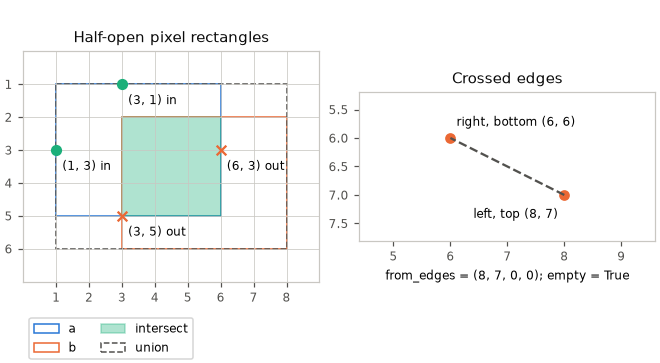
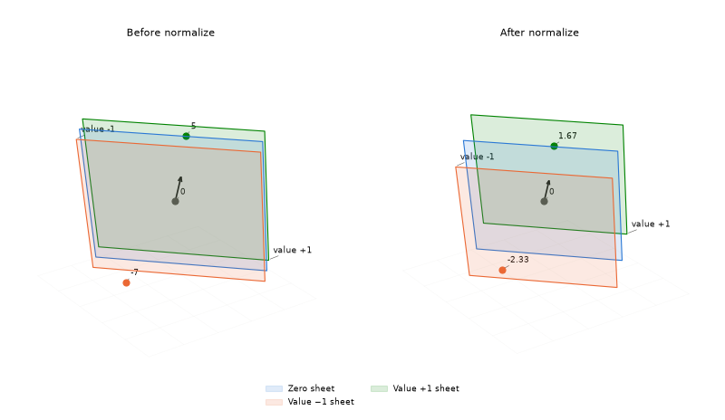
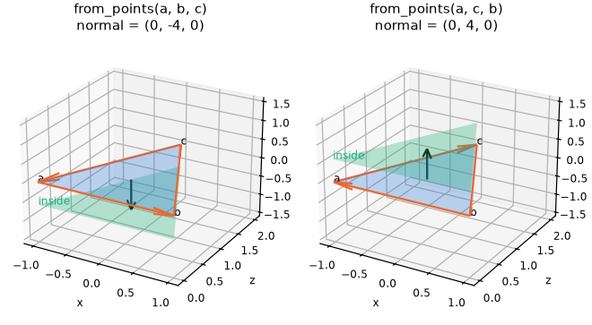
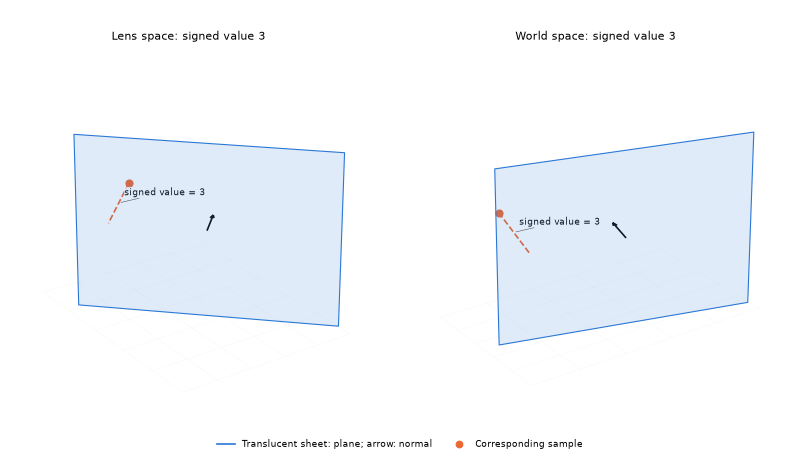
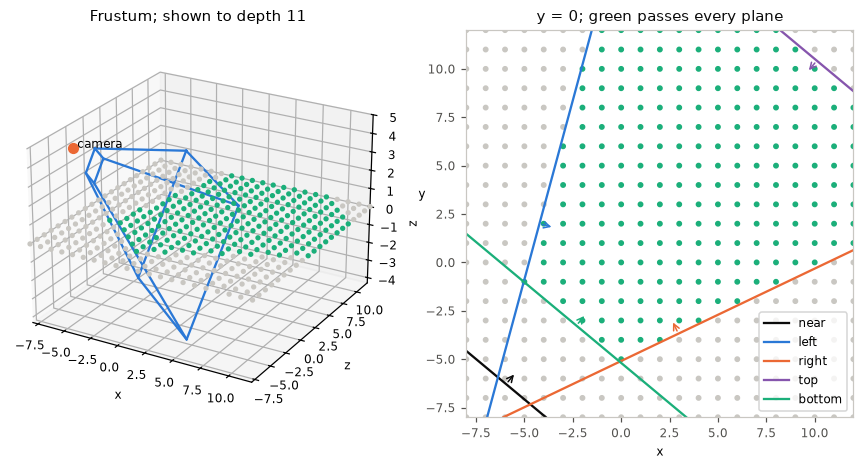
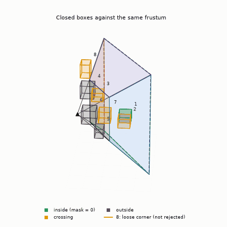
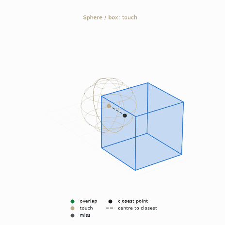
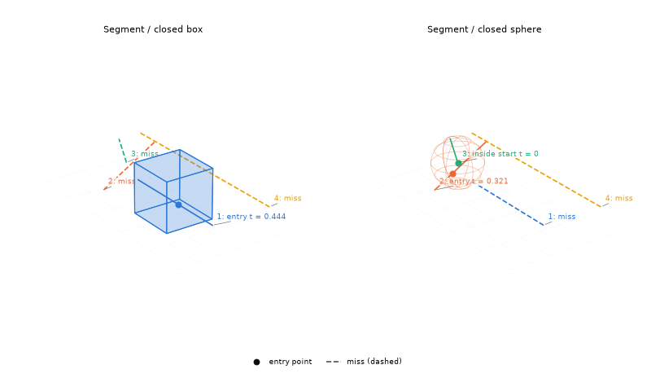
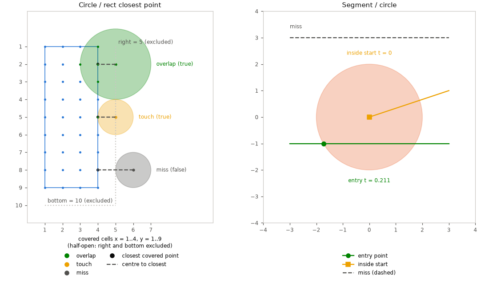

# Geometry

Half-open rectangles, oriented planes, closed boxes, spheres, circles and iso surfaces. [Math index](README.md).

## rect (`f i s x`)

`P` is `rectf`, `recti`, `rects` or `rectx`. A rectangle stores `x, y, w, h`:
its corner and size, with exclusive right and bottom edges. A nonpositive
width or height is empty. Queries clamp result sizes to zero.

| Function | Purpose | Formula |
|---|---|---|
| `P_right(r)` | exclusive right edge | $`r_x + r_w`$ |
| `P_bottom(r)` | exclusive bottom edge | $`r_y + r_h`$ |
| `P_from_edges(left, top, right, bottom)` | rectangle from half-open edges; crossed edges are empty | $`(left, top, \max(right-left,0), \max(bottom-top,0))`$ |
| `P_is_empty(r)` | a nonpositive extent | $`r_w \le 0 \lor r_h \le 0`$ |
| `P_intersect(a, b)` | shared area, with nonnegative extents | $`l = \max(a_x,b_x),\ t = \max(a_y,b_y)`$<br>$`r = \min(a_x+a_w,b_x+b_w),\ b = \min(a_y+a_h,b_y+b_h)`$<br>$`\mathrm{from\_edges}(l,t,r,b)`$ |
| `P_union(a, b)` | smallest rectangle holding both; empty inputs add nothing; two empty inputs give zero size at a's corner | $`l = \min(a_x,b_x),\ t = \min(a_y,b_y)`$<br>$`r = \max(a_x+a_w,b_x+b_w),\ b = \max(a_y+a_h,b_y+b_h)`$<br>$`\mathrm{from\_edges}(l,t,r,b)`$ for nonempty inputs |
| `P_contains(r, px, py)` | includes left and top, excludes right and bottom | $`r_x \le px < r_x+r_w \land r_y \le py < r_y+r_h`$ |



The queries use half-open edges; crossed edges produce an empty rectangle.

## plane (`f x`)

`planef_t` and `planex_t` hold a vec3 `normal` and a scalar `d`; inside is
$`n \cdot p + d \ge 0`$. Distances are scaled by the normal's length
until the plane is normalized.

| Function | Purpose | Formula |
|---|---|---|
| `P_from_normal_point(n, p)` | plane through a point with the given normal | $`(n, -n \cdot p)`$ |
| `P_from_points(a, b, c)` | winding determines the inside; unnormalized; the points must not be collinear | $`n = (b-a) \times (c-a),\ d = -n \cdot a`$ |
| `P_distance(p, q)` | signed plane value | $`p_n \cdot q + p_d`$ |
| `P_normalize(p)` | unit normal; normal must be nonzero; `x` range and error as [vec3 `P_normalize_divide`](Linear.md#vec3-f-i-s-x) | $`(p_n, p_d)/\lVert p_n\rVert`$ |
| `P_from_rows(&m, a, b, c, e)` | the plane $`a x + b y + c z + e \ge 0`$ of affine m's target, in m's source space | $`n_j = a m_{0j} + b m_{1j} + c m_{2j},\ d = a m_{03} + b m_{13} + c m_{23} + e`$ |
| `P_frustum(&m, &lens, screen, out)` | near and screen side planes in affine m's source space | See [frustum](#frustum) |



Dividing the signed value by $`\lVert n\rVert`$ gives the signed distance.
Normalization changes the ruler spacing while keeping the same zero plane.





## frustum

`P_frustum` reads rows as in Gribb and Hartmann<sup>[[77]](../Citations.md#gribb-2001)</sup>,
with picture coordinates $`c_x + f_x x/z`$, $`c_y - f_y y/z`$ and $`z`$ supplying $`w`$.
Each output is `P_from_rows` of a lens-space plane, in this order:

| Index | Plane | $`(a, b, c, e)`$ |
|---|---|---|
| `PLANE_FRUSTUM_NEAR` | $`z \ge \mathit{near\_z}`$ | $`(0, 0, 1, -\mathit{near\_z})`$ |
| `PLANE_FRUSTUM_LEFT` | screen x at or right of `left` | $`(f_x, 0, c_x - \text{left}, 0)`$ |
| `PLANE_FRUSTUM_RIGHT` | screen x at or left of `right` | $`(-f_x, 0, \text{right} - c_x, 0)`$ |
| `PLANE_FRUSTUM_TOP` | screen y at or below `top` | $`(0, -f_y, c_y - \text{top}, 0)`$ |
| `PLANE_FRUSTUM_BOTTOM` | screen y at or above `bottom` | $`(0, f_y, \text{bottom} - c_y, 0)`$ |

`PLANE_FRUSTUM_COUNT` sizes the output. There is no far plane, and the
planes are not normalized.



A point is inside when every plane accepts it; the drawn depth only bounds the picture.

`box3f_outside_planes` tests these planes against a box centre $`c`$ and
half extent $`e`$. For each plane it forms:

```math
d = n \cdot c + d_{plane}, \qquad r = \sum_k \lvert n_k\rvert e_k
```

It rejects the box when $`d+r<0`$ and clears the plane's mask bit when
$`d-r\ge0`$. When it returns false, the bits of planes the box crosses
stay set; a box in a loose corner is not rejected.



Boxes switch between inside, intersecting and outside as the camera moves.
A box crossing planes separately can stay intersecting while outside the
frustum: the loose-corner test is conservative.

## box3 (`f s`)

`P` is `box3f` or `box3s`. A box stores vec3 corners `lo, hi` and includes
both ends on every axis. `P_empty()` supplies the identity for extension
and union; any crossed axis is empty.

| Function | Purpose | Formula |
|---|---|---|
| `P_empty()` | empty identity | $`lo = HIGHEST,\ hi = LOWEST`$ on every axis |
| `P_is_empty(b)` | detect crossed bounds | $`\exists k: lo_k > hi_k`$ |
| `P_from_point(p)` | zero-extent closed box | $`(p,p)`$ |
| `P_extend(b, p)` | include a point | $`(\min(lo,p),\max(hi,p))`$ |
| `P_union(a, b)` | include both boxes | $`(\min(a_{lo},b_{lo}),\max(a_{hi},b_{hi}))`$ |
| `P_intersect(a, b)` | shared closed bounds; may be empty | $`(\max(a_{lo},b_{lo}),\min(a_{hi},b_{hi}))`$ |
| `P_contains_point(b, p)` | point within every closed interval | $`\forall k: lo_k \le p_k \le hi_k`$ |
| `P_contains(outer, inner)` | inner bounds within outer | $`\forall k: outer_{lo,k} \le inner_{lo,k}`$<br>$`inner_{hi,k} \le outer_{hi,k}`$ |
| `P_overlaps(a, b)` | shared points, including touching faces | $`\neg\mathrm{is\_empty}(\mathrm{intersect}(a,b))`$ |
| `P_closest_point(b, p)` | closest point on a nonempty box | $`\mathrm{clamp}(p,lo,hi)`$ |
| `P_corner(b, k)` | corner `k` of eight; bit 0 picks $`hi_x`$, bit 1 $`hi_y`$, bit 2 $`hi_z`$ | $`(k_0\,?\,hi_x:lo_x,\ k_1\,?\,hi_y:lo_y,\ k_2\,?\,hi_z:lo_z)`$ |
| `P_centre(b)` | midpoint (`f`) | $`c = 0.5(lo+hi)`$ |
| `P_half_extent(b)` | half size (`f`) | $`e = 0.5(hi-lo)`$ |
| `P_segment_hit(b, a, c, &t)` | slab entry in `[0,1]` (`f`); inside starts at zero | $`v=c-a`$; intersect $`[0,1]`$ with each axis's $`[(lo_k-a_k)/v_k,(hi_k-a_k)/v_k]`$, sorted |
| `P_outside_planes(b, planes, count, &mask)` | reject outside; clear wholly inside bits (`f`) | See [frustum](#frustum) |
| `P_plane_reach(e, plane)` | how far a box of half extent `e` spans along the normal (`f`) | $`r = \sum_k \lvert n_k\rvert e_k`$ |
| `P_plane_min(b, plane)` | the least plane value of any point in `b` (`f`) | $`n \cdot c + d - r`$ |
| `P_plane_min_inside(b, objective, constraint)` | the least `objective` over the part of `b` where `constraint` $`\ge 0`$ (`f`); exact when they meet, a lower bound when not | See [least value inside a half-space](#least-value-inside-a-half-space) |
| `box3f_from_box3s(b, scale)` | convert position ticks to float units | $`(lo\,scale,hi\,scale)`$ |

Real queries use finite, nonempty bounds, except that `P_segment_hit`
rejects empty boxes. Segment endpoints and box values must be finite.
Plane bits index the input array; `count` must fit an unsigned mask.

### Least value inside a half-space

`P_plane_min_inside` solves a small linear programme: the least of a plane
$`o`$ over the box's points where a plane $`g`$ is not negative. Lagrangian
duality gives it without a search. For every $`\lambda \ge 0`$,

```math
\phi(\lambda) = \min_{p \in b}\,\bigl(o(p) - \lambda\,g(p)\bigr) = \mathrm{plane\_min}(b,\ o - \lambda g)
```

is at most the answer, since $`g(p) \ge 0`$ there. $`\phi`$ is concave and
piecewise linear, with kinks where a term $`\lvert o_k - \lambda g_k\rvert`$
turns, at $`\lambda = o_k / g_k`$. Its peak is at $`\lambda = 0`$ or one of
those three kinks, and by linear-programming duality that peak is the
answer whenever the box meets the half-space. So the function takes the best
of at most four `P_plane_min` values. A box wholly outside has no answer and
gets a lower bound.

The renderer uses it with view depth as the objective and each frustum
plane as a constraint. The best over the planes bounds the nearest depth of
a cluster's box where the picture can see it, even when the box reaches
behind the eye.

## ball: shared circle and sphere queries (`f`, `i`)

A ball is a filled circle (2D) or sphere (3D): every point within `radius` of `centre`.

Circles and spheres store `centre` and nonnegative `radius`, including the boundary. Arithmetic must fit; real values must be finite. Integer squared products are widened.

| Function | Purpose | Formula |
|---|---|---|
| `P_contains_point(s, p)` | point inside or on the ball | $`\lVert p-c\rVert^2 \le r^2`$ |
| `P_overlaps(a, b)` | balls share points, including tangency | $`\lVert c_a-c_b\rVert^2 \le (r_a+r_b)^2`$ |
| `P_closest_point(c, p)` | p itself if inside, else the nearest boundary point (real only) | $`p`$ if inside, else $`c_c+(p-c_c)r/\lVert p-c_c\rVert`$ |
| `P_segment_hit(s, a, c, &t)` | first real segment entry in `[0,1]`; inside starts at zero | $`m=a-s_c,\ v=c-a`$<br>$`A=v\cdot v,\ B=m\cdot v,\ f=m-(B/A)v`$<br>$`D=r^2-f\cdot f,\ t=(-B-\sqrt{AD})/A`$ |

| Prefix | Generated ball functions |
|---|---|
| `circlef` | `circlef_contains_point`, `circlef_overlaps`, `circlef_closest_point`, `circlef_segment_hit` |
| `circlei` | `circlei_contains_point`, `circlei_overlaps` |
| `spheref` | `spheref_contains_point`, `spheref_overlaps`, `spheref_closest_point`, `spheref_segment_hit` |

`P_segment_hit` uses Haines, Günther and Akenine-Möller's perpendicular-distance discriminant<sup>[[84]](../Citations.md#haines-2019)</sup> to avoid cancellation in the hit decision. It writes `t` only on a hit.

Zero-length segments hit when the point is inside; tangency counts as a hit.

## sphere (`f`)

`spheref` has a vec3 centre and the shared [ball queries](#ball-shared-circle-and-sphere-queries-f-i); box bounds must be finite and nonempty.
`spheref_overlaps_box` compares the closest box point's squared distance
with the squared radius (Arvo 1990<sup>[[83]](../Citations.md#arvo-1990)</sup>).

| Function | Purpose | Formula |
|---|---|---|
| `spheref_from_box(b)` | circumscribed sphere | $`c=\mathrm{centre}(b),\ r=\lVert\mathrm{half\_extent}(b)\rVert`$ |
| `spheref_overlaps_box(s, b)` | closest box point inside the sphere | $`q=\mathrm{closest\_point}(b,c)`$<br>$`\lVert q-c\rVert^2\le r^2`$ |



The closest box point decides whether the moving sphere misses, touches or overlaps.



Marked segment entries include a start inside the sphere at $`t = 0`$.

## circle (`f`, `i`)

`circlef` and `circlei` have a vec2 centre and shared [ball queries](#ball-shared-circle-and-sphere-queries-f-i). The circle has no fixed-point variant yet.
Rectangle overlaps use Arvo 1990<sup>[[83]](../Citations.md#arvo-1990)</sup> in two dimensions; rectangles must be nonempty.
Integer edges end at `right-1` and `bottom-1`; real queries include the closure at `right` and `bottom`.

| Function | Meaning | Formula |
|---|---|---|
| `circlef_overlaps_rect(c, rect)`, `circlei_overlaps_rect(c, rect)` | closest covered coordinate is inside | $`q=\mathrm{clamp}(c_c,lo,hi)`$<br>$`\lVert q-c_c\rVert^2\le r^2`$ |
| `circlef_bounds(c)`, `circlei_bounds(c)` | enclosing rect; integer cells include both extremes | $`(c_x-r,c_y-r,2r+e,2r+e)`$, $`e=1`$ for `i`, $`e=0`$ for real |
| `circlef_from_rect(rect)` | circumscribed disc (`f`) | $`e=(w,h)/2,\ c=(x,y)+e,\ r=\lVert e\rVert`$ |
| `circlei_cell_count(r)` | exact integer disc size; negative radius gives zero, result must fit int | $`\sum_{d=-r}^{r}(2\lfloor\sqrt{r^2-d^2}\rfloor+1)`$ |



The integer touch reaches `right−1`; segment markers show the first hit, including an inside start.

## iso_surface

The surface where a sampled field crosses a level, as triangles, by naive
surface nets<sup>[[95]](../Citations.md#gibson-1998)</sup>: one vertex per cell the surface
passes through, at the mean of its edge crossings, and a quad across every
crossing sample edge.

| Function | Purpose |
|---|---|
| `iso_field_t` | Samples, their counts, origin and spacing per axis |
| `iso_mesh_t` | Caller-owned positions, normals, triangles and scratch, with capacities and counts |
| `iso_surface_scratch_count` | Two slabs of cell indices for a field's y and z counts |
| `iso_surface_nets` | Meshes the field at a level; false when a capacity ran out, keeping whole triangles |
| `iso_surface_nets_slabs` | Meshes a range of cell slabs along x, so parts can run at once |
| `iso_surface_append` | Moves a part's vertices and triangles onto the end of a mesh, indices rebased |

| Rule | Detail |
|---|---|
| Inside | Above the level |
| Winding | Counter-clockwise about the outward normal, right-handed: $`(b-a)\times(c-a)`$ points out |
| Normals | Unit, down the field's gradient over the cell's corners |
| Closed | A field below the level all round its border gives a closed surface |
| Memory | Scratch is two slabs along x, so it does not grow with the field's length |
| Parts | Parts over slabs `[0, a)`, `[a, b)`, … appended in x order make the whole surface's triangles; each needs its own scratch |
