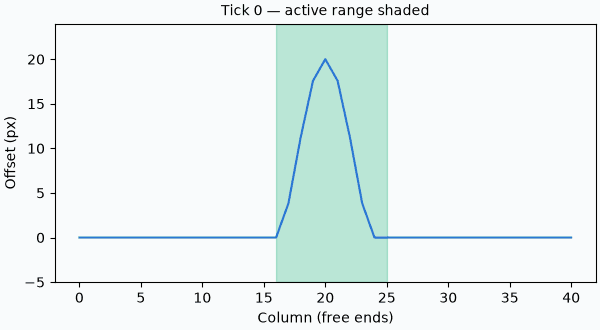
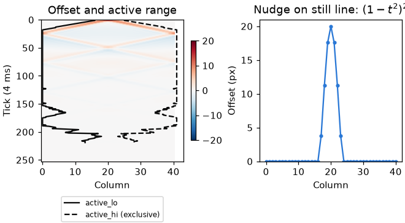

# Motion

Orbit steering, spring-line motion and water in a box, with caller-owned state. [Math index](README.md).

## orbit_motion.h

A transform orbits a target, with direct steering, a decaying fling and a critically damped reset.

| Function | Purpose |
|---|---|
| `orbit_motion_state_t` | Yaw and pitch in radians, and natural log of distance |
| `orbit_motion_limits_t` | Pitch and log-distance bounds |
| `orbit_motion_t` | Target, current and home states, velocity, limits and time constants |
| `orbit_motion_input_t` | One frame of steering |
| `orbit_motion_init` | At home, still, with default half-lives; clamps home to limits |
| `orbit_motion_update` | Advances by seconds; held steering cancels a reset |
| `orbit_motion_pose` | Transform with +z facing the target and +x level |
| `orbit_motion_fit_distance` | Distance that fits a sphere in the lens with padding around each half-axis |

| Constant | Purpose |
|---|---|
| `ORBIT_MOTION_PITCH_LIMIT` | Steepest pitch, short of a quarter turn |
| `ORBIT_MOTION_FLING_HALF_LIFE_S` | Time for fling speed to halve |
| `ORBIT_MOTION_DRAG_VELOCITY_HALF_LIFE_S` | Half-life for speed to follow held steering |
| `ORBIT_MOTION_RESET_TIME_S` | Reset spring time constant |
| `ORBIT_MOTION_RESET_SETTLED` | Home distance and speed threshold for settling |
| `ORBIT_MOTION_FRAME_PADDING` | Fraction of each picture half-axis left clear |

### Steering and fling

Held steering applies the frame's turn $`\Delta`$ directly. Its smoothed speed
follows that turn over the frame time $`\Delta t`$, with half-life $`h_d`$
(`ORBIT_MOTION_DRAG_VELOCITY_HALF_LIFE_S`):

```math
v \gets v + (\Delta/\Delta t-v)(1-2^{-\Delta t/h_d})
```

The 3D orbit shows held yaw and pitch steering, a released fling, and a reset to home.
The pose's +z faces the target; the speed strip tracks both turns.


After release, speed halves every $`h`$ seconds (`ORBIT_MOTION_FLING_HALF_LIFE_S`).
The exact integral gives the angle covered; the same elapsed time gives the same
result at either frame step.

```math
v(t)=v_0 2^{-t/h}, \qquad x(t)=\frac{v_0 h}{\ln 2}(1-2^{-t/h})
```


Zoom stores $`\ell=\ln d`$. A zoom turn $`z`$ adds to $`\ell`$, so
$`d_{\mathrm{new}}/d_{\mathrm{old}}=e^z`$ at any starting distance.

### Reset spring

Reset solves the critically damped spring exactly, with time constant $`\tau`$.
For yaw, $`e_0`$ is the shortest signed angular offset from home.

```math
e(t)=(e_0+ct)e^{-t/\tau}, \qquad c=v_0+e_0/\tau
```

Critical damping prevents oscillation; it does not guarantee no crossing for
arbitrary initial velocity. For $`e_0>0`$, a velocity $`v_0<-e_0/\tau`$ crosses
home.

Reset snaps home once every yaw, pitch and log-distance offset and its speed is
below `ORBIT_MOTION_RESET_SETTLED`. The dotted lines mark that moment.


### Fitting a sphere

For sphere radius $`r`$, lens half-angle $`\theta`$ and padding fraction $`p`$,
the padded cone's tangent is $`t`$:

```math
t=\tan\theta(1-p), \qquad d=\frac{r\sqrt{1+t^2}}{t}
```

The 3D view shows the camera, padded picture and sphere touching the short-side planes.
The plot compares fit distance with and without padding.


## spring_line.h

A row of points on springs carries a wave along caller-owned Q16 pixel offsets and velocities.

| Function | Purpose |
|---|---|
| `spring_line_t` | Caller-owned arrays, active half-open range, tension, stiffness, damping and carried time |
| `spring_line_init` | Initializes the line with caller-owned arrays |
| `spring_line_at_rest` | Tests whether the active range is empty |
| `spring_line_scale` | Scales by a share out of 256 |
| `spring_line_wake` | Includes columns in the active half-open range |
| `spring_line_add_bump` | Adds a smooth bump falling to zero at its half-width |
| `spring_line_poke` | Flicks with Q16 pixels per tick; negative is up |
| `spring_line_nudge` | Moves the line by Q16 pixels and lets go |
| `spring_line_quiet` | Tests rest offset and velocity thresholds |
| `spring_line_trim` | Puts quiet columns at each end of the active range to rest |
| `spring_line_tick` | Advances velocities then offsets by one tick, with free ends |
| `spring_line_advance` | Runs ticks for the elapsed milliseconds, carrying the remainder; returns ticks run |
| `spring_line_apply` | Writes rest plus offset, reports changed columns, and returns furthest movement in whole pixels rounded up |

| Constant | Purpose |
|---|---|
| `SPRING_LINE_TICK_MS` | Simulated time per tick |
| `SPRING_LINE_MAX_TICKS` | Tick cap per frame; drops excess time |
| `SPRING_LINE_REST_OFFSET`, `SPRING_LINE_REST_VELOCITY` | Thresholds for putting the line to rest |
| `SPRING_LINE_MAX_OFFSET` | Maximum offset magnitude |
| `SPRING_LINE_OUT_SHIFT`, `SPRING_LINE_OUT_ONE` | Fractional bits and units per output pixel |

### Wave tick and bump

For offsets $`u_i`$ and velocities $`v_i`$ in Q16 units, tension $`T`$,
stiffness $`K`$ and damping $`D`$ are shares out of 256. A tick first computes
all velocities from the old offsets:

```math
a_i=v_i+\mathrm{trunc}\!\left(\frac{T(u_{i-1}-2u_i+u_{i+1})}{256}\right)
-\mathrm{trunc}\!\left(\frac{Ku_i}{256}\right)
```

```math
v_i' = a_i-\mathrm{trunc}\!\left(\frac{Da_i}{256}\right), \qquad
u_i' = \mathrm{clamp}(u_i+v_i',-U_{\max},U_{\max})
```

The free ends mirror their own offset for the missing neighbour. Without
stiffness or damping, the long-wavelength speed is $`\sqrt{T/256}`$ columns per
tick. `SPRING_LINE_TICK_MS` sets the tick duration.



The active range expands at most one column per tick and trims quiet ends.
A nudge or poke uses the compact bump $`(1-t^2)^2`$ for $`\lvert t\rvert<1`$,
with $`t`$ the distance from the centre divided by the half-width; outside it is zero.



## flip3.h

Water in a closed box: FLIP particles on a MAC grid<sup>[[88]](../Citations.md#88)</sup><sup>[[89]](../Citations.md#89)</sup>,
driven by any acceleration, in caller-owned grid and particle blocks.

| Function | Purpose |
|---|---|
| `flip3_config_t` | Box size, nominal cell and particle capacity |
| `flip3_tuning_t` | FLIP share, pressure sweeps, over-relaxation and drift gain |
| `flip3_t` | Grid, particles, cell and seed spacing per axis, rest density |
| `flip3_grid_bytes`, `flip3_particle_bytes` | The two blocks a configuration needs; 0 when refused |
| `flip3_init` | Carves the blocks; empty, at the default tuning |
| `flip3_fill` | Refills a share of the volume at rest, lowest first along a down vector |
| `flip3_step` | Advances one substep under an acceleration |
| `flip3_fraction` | The share of the volume the particles stand for |
| `flip3_particle` | A particle in box coordinates |
| `flip3_cells_x`, `flip3_cells_y`, `flip3_cells_z` | Cells inside the box per axis |
| `flip3_density_field` | Density over the box at any samples per cell, 1 at rest, padded with empty samples |

| Constant | Purpose |
|---|---|
| `FLIP3_RADIUS_CELLS` | Closest a particle comes to a wall |
| `FLIP3_SEED_SPACING_CELLS` | Seed lattice spacing; a cell holds about 4.6 seeds |
| `FLIP3_FLIP_RATIO`, `FLIP3_PRESSURE_ITERS`, `FLIP3_OVER_RELAXATION` | Defaults of the Ten Minute Physics tank<sup>[[91]](../Citations.md#91)</sup> |
| `FLIP3_DRIFT_GAIN` | Share of a cell's density error turned into flow per step |
| `FLIP3_TUNING_DEFAULT` | All four together |

### The step

Each step runs in Bridson's order<sup>[[90]](../Citations.md#90)</sup>:

| Stage | What it does |
|---|---|
| Particles to grid | Trilinear splat of each velocity component onto its faces; cells holding a particle are water |
| Acceleration | Added to every face not on a wall |
| Pressure | Gauss-Seidel on the divergence, cells of any aspect, plus the drift push |
| Grid to particles | PIC and FLIP blended by the FLIP share |
| Move | Particles advect with the projected velocity, then stop a radius from each wall |

The cell is rounded per axis so whole cells fill the box, so no wall cell
leaks pressure as a false free surface. The drift push turns a cell's
density error $`
ho-
ho_0`$ into flow: always when the cell is packed,
and also when thin if water surrounds it, since a divergence-free field never
closes a gap and a resting pool would slowly turn to foam. The Ten Minute
Physics tank instead moves particles before the pressure solve and pushes
overlapping pairs apart; that sinks a pool by $`a\Delta t^2`$ each step and
holds heaps up the way grains do, so flip3 does neither.
