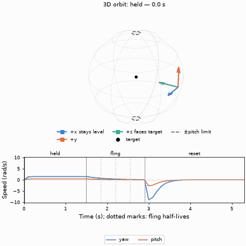
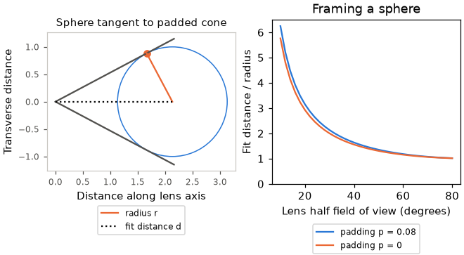

# Motion

Orbit steering with caller-owned state. [Math index](README.md).

## orbit_motion.h

A transform orbits a target, with direct steering, a decaying fling and a critically damped reset.

| Function | Purpose |
|---|---|
| `orbit_motion_state_t` | Yaw and pitch in radians, and natural log of distance |
| `orbit_motion_limits_t` | Pitch and log-distance bounds |
| `orbit_motion_t` | Target, current and home states, velocity, limits and time constants |
| `orbit_motion_input_t` | One frame of steering |
| `orbit_motion_init` | At home, still, with default half-lives; clamps home to limits |
| `orbit_motion_update` | Advances by seconds; held steering cancels a reset |
| `orbit_motion_pose` | Transform with +z facing the target and +x level |
| `orbit_motion_fit_distance` | Distance that fits a sphere in the lens with padding around each half-axis |

| Constant | Purpose |
|---|---|
| `ORBIT_MOTION_PITCH_LIMIT` | Steepest pitch, short of a quarter turn |
| `ORBIT_MOTION_FLING_HALF_LIFE_S` | Time for fling speed to halve |
| `ORBIT_MOTION_DRAG_VELOCITY_HALF_LIFE_S` | Half-life for speed to follow held steering |
| `ORBIT_MOTION_RESET_TIME_S` | Reset spring time constant |
| `ORBIT_MOTION_RESET_SETTLED` | Home distance and speed threshold for settling |
| `ORBIT_MOTION_FRAME_PADDING` | Fraction of each picture half-axis left clear |

### Steering and fling

Held steering applies the frame's turn $`\Delta`$ directly. Its smoothed speed
follows that turn over the frame time $`\Delta t`$, with half-life $`h_d`$
(`ORBIT_MOTION_DRAG_VELOCITY_HALF_LIFE_S`):

```math
v \gets v + (\Delta/\Delta t-v)(1-2^{-\Delta t/h_d})
```

The 3D orbit shows held yaw and pitch steering, a released fling, and a reset to home.
The pose's +z faces the target; the speed strip tracks both turns.



After release, speed halves every $`h`$ seconds (`ORBIT_MOTION_FLING_HALF_LIFE_S`).
The exact integral gives the angle covered; the same elapsed time gives the same
result at either frame step.

```math
v(t)=v_0 2^{-t/h}, \qquad x(t)=\frac{v_0 h}{\ln 2}(1-2^{-t/h})
```


Zoom stores $`\ell=\ln d`$. A zoom turn $`z`$ adds to $`\ell`$, so
$`d_{\mathrm{new}}/d_{\mathrm{old}}=e^z`$ at any starting distance.

### Reset spring

Reset solves the critically damped spring exactly, with time constant $`\tau`$.
For yaw, $`e_0`$ is the shortest signed angular offset from home.

```math
e(t)=(e_0+ct)e^{-t/\tau}, \qquad c=v_0+e_0/\tau
```

Critical damping prevents oscillation; it does not guarantee no crossing for
arbitrary initial velocity. For $`e_0>0`$, a velocity $`v_0<-e_0/\tau`$ crosses
home.

Reset snaps home once every yaw, pitch and log-distance offset and its speed is
below `ORBIT_MOTION_RESET_SETTLED`. The dotted lines mark that moment.


### Fitting a sphere

For sphere radius $`r`$, lens half-angle $`\theta`$ and padding fraction $`p`$,
the padded cone's tangent is $`t`$:

```math
t=\tan\theta(1-p), \qquad d=\frac{r\sqrt{1+t^2}}{t}
```

The 3D view shows the camera, padded picture and sphere touching the short-side planes.
The plot compares fit distance with and without padding.


