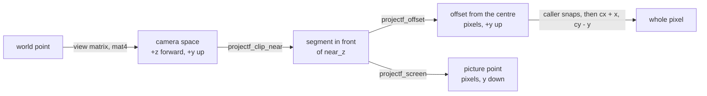
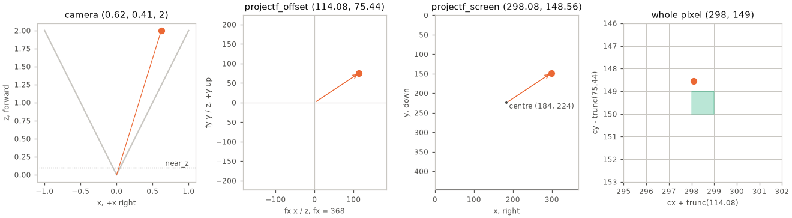

# Projection: projectf.h, projectx.h, inverse_depth.h

Camera-space clipping and mapping to picture pixels. [Math index](README.md).

A camera point reaches the picture through these functions; segments are
cut at the near plane in camera space.



`projectf_t` holds independent `fx`, `fy` (pixels per camera unit at unit depth),
`cx`, `cy` (optical centre, pixels) and `near_z` (camera units).
`projectx_t` holds these in Q16.16; projection functions take `projectf_t*`.

| Name | Maps | Inputs | Types | Formula |
|---|---|---|---|---|
| `projectx_from_projectf(lens)` | float lens → Q16.16 lens | `projectf_t*` | `f → x` | `mathf_to_x` on each field |
| `projectf_offset(lens, p)` | camera → offset from the centre, +y up | lens, camera point with $`z > 0`$ | `f` | $`(f_x\,x/z,\ f_y\,y/z)`$ |
| `projectf_screen(lens, p)` | camera → picture, y down, not snapped | lens, camera point with $`z > 0`$ | `f` | $`(c_x + o_x,\ c_y - o_y)`$, $`o`$ the offset |
| `projectf_clip_near`, `projectx_clip_near` | camera segment → its part in front of `near_z`; false when none is | `near_z`, then both endpoints by pointer; only the one behind the plane moves | `f x` | $`t = \frac{\mathit{near\_z} - z_{\text{behind}}}{z_{\text{front}} - z_{\text{behind}}}`$<br>behind $`\leftarrow`$ behind $`+\,t\,(\text{front} - \text{behind})`$<br>behind.z $`\leftarrow`$ `near_z` |

A point exactly at `near_z` counts as behind. For `x`, endpoints and
`near_z` share any fixed scale, $`t`$ is a Q16.16 ratio applied with a
floored multiply, and the caller keeps differences and products in range.

The caller snaps a picture point to whole pixels, truncating each offset toward the centre
(`r3d_project_screen` first adds a bias of `R3D_PIXEL_BIAS` away from zero):

```math
\text{pixel}_x = c_x + \mathrm{trunc}\!\left(f_x\,\frac{x}{z}\right), \qquad
\text{pixel}_y = c_y - \mathrm{trunc}\!\left(f_y\,\frac{y}{z}\right)
```



The point is `render_view_make`'s lens on the panel's viewport, snapped by `r3d_project_screen`.
Truncating toward the centre puts picture y 148.56 on pixel 149: the point lies above the pixel it snaps to.

## Inverse depth (`inverse_depth.h`)

A depth buffer can store a point at depth $`z`$ as the code
$`q = \mathit{code\_max}\cdot s/z`$ for $`z \ge s`$. Unlike $`z`$, $`1/z`$ is
linear across the picture, so a span steps it with one add per pixel. The
scale $`s`$ sets where the precision goes:

```math
\left\lvert\frac{dq}{dz}\right\rvert = \mathit{code\_max}\cdot\frac{s}{z^2}
```

| Function | Purpose | Formula |
|---|---|---|
| `inverse_depth_steps_per_unit(scale, code_max, z)` | codes per unit of depth at `z` | $`\mathit{code\_max}\,s/z^2`$ |
| `inverse_depth_scale_fit(near_z, nearest_z)` | the scale for a picture whose nearest point is at `nearest_z` or beyond | $`\max(\mathit{near\_z},\ 2^{\lfloor\log_2 \mathit{nearest\_z}\rfloor})`$; `near_z` when `nearest_z` is not past it |

The fit takes the power of two below the bound from its exponent alone. A
bound that drifts by rounding from frame to frame keeps one scale, so codes
of two near surfaces do not swap order every frame. The floor gives up at
most one bit.
