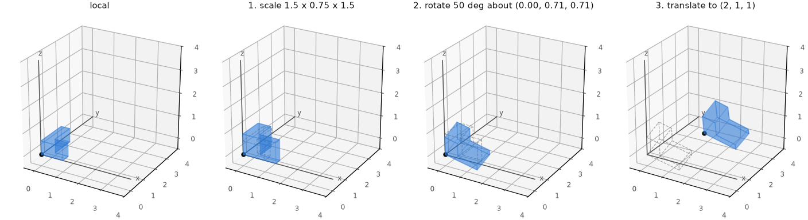
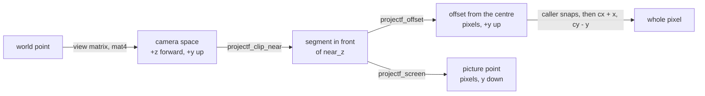

# Math: vectors, rotations, matrices, transforms

`math/linear/` and `math/geometry/` hold the firmware's vectors, rotations,
matrices, transforms and shapes, on the per-type scalar operations in `math/scalar/`.
All are part of the [math package](../../launcher/packages/math/README.md):

- header-only and static inline, with no ESP-IDF, so a host suite checks every line;
- each family written once as a template ([Templates](#templates)) and instantiated per number type;
- a type named for its family plus a number-type suffix (`vec3f`, `quatx`), with no bare name.

Macros generate the functions, so a search for `vec3f_add` finds no definition.
Look the plain name up in the reference below; read `*_template.h` only to change an algorithm.

## Contents

- [Benchmark](Benchmark.md): board cycles and retired instructions beside QEMU instruction counts
- [Number types](#number-types)
- [Conventions](#conventions)
- [Templates](#templates)
- [The transform cache](#the-transform-cache)
- [Scalar](#scalar): [mathi.h](#mathih), [mathf.h](#mathfh), [maths.h](#mathsh), [mathx.h](#mathxh), [mathf_round.h](#mathf_roundh), [mathf_rsqrt.h](#mathf_rsqrth), [fixed.h](#fixedh), [rng.h](#rngh), [trig.h](#trigh), [units.h](#unitsh)
- [Linear](#linear): [vec2](#vec2-f-i-s-x), [vec3](#vec3-f-i-s-x), [quat](#quat-f-x), [affine2](#affine2-f-x), [mat3](#mat3-f), [mat4](#mat4-f-x), [transform](#transform-f-x), [projection](#projection-projectfh-projectxh), [conversions](#conversions-vec_converth)
- [Geometry](#geometry): [rect](#rect-f-i-s-x), [plane](#plane-f-x)
- [Examples](#examples)
- [The float-precision build rules](#the-float-precision-build-rules)

## Number types

| Suffix | Number type | Range | Precision | Families | For |
|---|---|---|---|---|---|
| `f` | float, single precision | about ±3.4e38 | 24-bit mantissa, ~7 digits | `vec2f`, `vec3f`, `quatf`, `affine2f`, `mat3f`, `mat4f`, `transformf`, `rectf`, `planef` | the default |
| `i` | int32 | ±2.1e9 | exact; sums and products wrap | `vec2i`, `vec3i`, `recti` | grid, pixel and cell coordinates |
| `s` | int16 | -32768 to 32767 | exact; sums and products saturate | `vec2s`, `vec3s`, `rects` | coordinates kept compact where memory is short |
| `x` | Q16.16 fixed point | ±32768 | 1/65536 (1.5e-5); sine good to ~1e-3; saturates | `vec2x`, `vec3x`, `quatx`, `affine2x`, `mat4x`, `transformx`, `rectx`, `planex` | deterministic maths, or a chip with no FPU |

| Rule | Applies to |
|---|---|
| A dot product widens to int64 | `i`, `s` |
| A dot product is a saturating Q16.16 sum | `x` |
| `mat4x_apply` floors each product and wraps the sum (`mathx_dot3c`): a multiply and a shift a term, for coordinates inside ±32768 | `x` |
| `mathx_dot3_narrow` is three 32-bit products and a shift, for a caller that proves the sum fits an int32 | `x` |
| Divide by zero saturates by the numerator's sign; 0 / 0 is 0 | `x` |
| Angles are turns, `MATHX_ONE` to a turn (an eighth is `MATHX_ONE / 8`) | `x` |
| Angles are radians (`MATH_PI`, `MATH_TAU`) | `f` |

## Conventions

| | |
|---|---|
| Axes | left-handed, local +x right, +y up, +z forward; a camera looks down +z; source assets are right-handed and mirrored at the pack ([Mesh-Import.md](../render/Mesh-Import.md#the-offline-tools)) |
| Rotation sense | left-handed, +y up: a positive angle about +y turns +z toward +x |
| Quaternion | `x, y, z, w` with `w` the scalar, unit length, Hamilton product; `mul(a, b)` applies `b` first |
| Euler | `from_euler` applies Z, then X, then Y about the fixed axes |
| Matrix | `m[row][col]`, acting on column vectors; the translation is column 3; `mul(a, b)` applies `b` first |
| TRS | scale, then rotate, then translate |

```math
v' = q\,v\,q^{-1} = v + 2w\,(u \times v) + 2\,u \times (u \times v), \qquad u = (q_x, q_y, q_z)
```

```math
M = T\,R\,S, \qquad p_{\text{world}} = M\,p_{\text{local}}, \qquad
V = R^{\mathsf T}\,T(-\text{position})
```



The panels apply `mat4f_from_trs` with one more part each; the dashed outline is the panel before.

### Projection: projectf.h, projectx.h

A camera point reaches the picture through these functions; segments are
cut at the near plane in camera space.



`projectf_t` holds independent `fx`, `fy` (pixels per camera unit at unit depth),
`cx`, `cy` (optical centre, pixels) and `near_z` (camera units).
`projectx_t` holds these in Q16.16; projection functions take `projectf_t*`.

| Name | Maps | Inputs | Types | Formula |
|---|---|---|---|---|
| `projectf_offset(lens, p)` | camera → offset from the centre, +y up | lens, camera point with $`z > 0`$ | `f` | $`(f_x\,x/z,\ f_y\,y/z)`$ |
| `projectf_screen(lens, p)` | camera → picture, y down, not snapped | lens, camera point with $`z > 0`$ | `f` | $`(c_x + o_x,\ c_y - o_y)`$, $`o`$ the offset |
| `projectf_clip_near`, `projectx_clip_near` | camera segment → its part in front of `near_z`; false when none is | `near_z`, then both endpoints by pointer; only the one behind the plane moves | `f x` | $`t = \frac{\mathit{near\_z} - z_{\text{behind}}}{z_{\text{front}} - z_{\text{behind}}}`$<br>behind $`\leftarrow`$ behind $`+\,t\,(\text{front} - \text{behind})`$<br>behind.z $`\leftarrow`$ `near_z` |

A point exactly at `near_z` counts as behind. For `x`, endpoints and
`near_z` share any fixed scale, $`t`$ is a Q16.16 ratio applied with a
floored multiply, and the caller keeps differences and products in range.

The caller snaps a picture point to whole pixels, truncating each offset toward the centre
(`r3d_project_screen` first adds a bias of `R3D_PIXEL_BIAS` away from zero):

```math
\text{pixel}_x = c_x + \mathrm{trunc}\!\left(f_x\,\frac{x}{z}\right), \qquad
\text{pixel}_y = c_y - \mathrm{trunc}\!\left(f_y\,\frac{y}{z}\right)
```


The point is `render_view_make`'s lens on the panel's viewport, snapped by `r3d_project_screen`.
Truncating toward the centre puts picture y 148.56 on pixel 149: the point lies above the pixel it snaps to.

## Templates

A template is a header holding one macro per group of functions; an
instantiation header (`vec3f.h`, `quatx.h`, ...) calls the macros and adds
any type-specific operations.

| Template header | Macros | Generates | Instantiated for |
|---|---|---|---|
| `vec2_template.h` | `MATH_DEFINE_VEC2` | the vec2 type, arithmetic, dot | `vec2f`, `vec2i`, `vec2s`, `vec2x` |
| `vec3_template.h` | `MATH_DEFINE_VEC3`, `MATH_DEFINE_VEC3_NORMALIZE` | the vec3 type, arithmetic, dot, cross; normalize | all four; normalize `f x` |
| `vec_ops_template.h` | `MATH_DEFINE_VEC_OPS`, `MATH_DEFINE_VEC_LERP`, `MATH_DEFINE_VEC_LERP_RATIO` | component-wise operations, lerp | every vector; lerp `f x`, ratio lerp `i s` |
| `vec_swizzle_template.h` | `MATH_DEFINE_VEC_SWIZZLE` | swizzles between vec2 and vec3 | `vec3f`, `vec3i`, `vec3s`, `vec3x` |
| `quat_template.h` | `MATH_DEFINE_QUAT`, `MATH_DEFINE_QUAT_NORMALIZE` | rotations | `quatf`, `quatx` |
| `affine2_template.h` | `MATH_DEFINE_AFFINE2`, `MATH_DEFINE_AFFINE2_RECT` | 2D affine maps; integer-pixel maps | `affine2f`, `affine2x` |
| `mat4_template.h` | `MATH_DEFINE_MAT4`, `MATH_DEFINE_MAT4_INVERT_AFFINE` | 4x4 matrices; affine inverse | `mat4f`, `mat4x`; inverse `f` |
| `transform_template.h` | `MATH_DEFINE_TRANSFORM` | position, rotation, scale and the cached matrix | `transformf`, `transformx` |
| `project_template.h` | `MATH_DEFINE_CLIP_NEAR` | near-plane segment clipping, no type | `projectf`, `projectx` |
| `rect_template.h` | `MATH_DEFINE_RECT` | half-open rectangles | `rectf`, `recti`, `rects`, `rectx` |
| `plane_template.h` | `MATH_DEFINE_PLANE` | planes, signed distance, frustum planes from a matrix's rows | `planef`, `planex` |

The macro arguments:

| Argument | What it is |
|---|---|
| `P` | The type being made, e.g. `vec3f` (its functions are `vec3f_add`, ...) |
| `V`, `V2`, `R`, `Q`, `M` | The vector, optional vec2, rectangle, quaternion and matrix types a family builds on |
| `T` | The scalar (`float`, `int`, `int32_t`, `int16_t`); `recti` keeps plain `int` |
| `W` | The type a dot product sums in (wider than `T` for an integer) |
| `OPS` | The scalar operations' prefix (`mathf`, `mathi`, `maths`, `mathx`): the static inline functions `OPS_add`, `OPS_mul`, `OPS_one` and the rest in `mathf.h`, `mathi.h`, `maths.h` and `mathx.h`. A family names only the ones it uses, so a type without `OPS_div` or `OPS_sqrt` gets no normalize. |
| `N` | A vector's component count: the vector's own for component-wise operations (`vec_ops_template.h`), a swizzle source's otherwise |
| `D`, `S` | A swizzle's result and source vector types (`vec_swizzle_template.h`) |
| `CROSS` | `MATH_DEFINE_CLIP_NEAR`'s crossing step, `_projectf_cross_near` or `_projectx_cross_near`; it defines `P_clip_near` and no type |
| `SUFFIX`, `MAP` | `MATH_DEFINE_AFFINE2_RECT`'s generated function name and point mapper; the pixel instantiations use `vec2i`, `recti`, `mathi`, `map_recti` and `map_pixel` |

`MATH_DEFINE_RECT(P, T, OPS)` takes no vector type and calls only `OPS_min` and
`OPS_max`. Its arithmetic does not saturate, so sums and differences must fit `T`.

## The transform cache

A `transform` holds position, rotation and scale as the truth and a derived
model matrix with a `cached` flag.

| Call | Effect |
|---|---|
| any setter, `translate`, `rotate`, `look_at`, `rotate_around` | stores the new value and clears `cached` |
| `P_matrix(t)` | rebuilds the matrix only when `cached` is false, then sets it; use for an object read every frame |
| `P_compute_matrix(t)` | a fresh matrix from a const transform; never touches the cache; use in read-only code |
| `P_view(t)` | the inverse of position and rotation (scale ignored), computed every call |

`TRANSFORMF_IDENTITY` / `TRANSFORMX_IDENTITY` are initializers with the cache
valid. A zero-initialized transform has `cached` false, so it builds on first use,
and its zero scale sends every point to the origin. Code never edits `matrix`.

`MAT4F_IDENTITY` / `MAT4X_IDENTITY` initialize a constant matrix, where `P_identity()` cannot.

## Scalar

`math/scalar/` holds per-type arithmetic, fixed point, random draws, trigonometry
and time units. The tables list the range, lerp and rounding helpers; the
[catalogue](../Shared-Helpers.md) lists the rest.

### mathi.h

These take and return plain integers, not structs.

| Function | Purpose | Formula |
|---|---|---|
| `mathi_repeat(v, len)` | floored modulo into `[0, len)`; `len > 0`, any `int` value | $`v - \lfloor v/len\rfloor\,len`$ |
| `mathi_wrap(v, lo, hi)` | into `[lo, hi)`; `lo < hi`, any `int` value | $`lo + \mathrm{repeat}(v-lo,hi-lo)`$ |
| `mathi_repeat_u32(v, len)`, `mathi_repeat_u64(v, len)` | into `[0, len)`; `len > 0`, full unsigned range | $`v \bmod len`$ |
| `mathi_clamp_u32(v, lo, hi)`, `mathi_clamp_u64(v, lo, hi)` | inclusive bounds, full unsigned range | $`\min(\max(v,lo),hi)`$ |
| `mathi_min(a, b)`, `mathi_max(a, b)` | smaller or larger value by comparison | $`\min(a,b)`$, $`\max(a,b)`$ |
| `mathi_clamp(v, lo, hi)` | inclusive bounds | $`\min(\max(v,lo),hi)`$ |
| `mathi_lerp(a, b, t, n)` | `t` of `n` steps from `a` to `b`, the step truncated toward `a`; `n > 0`, `0 <= t <= n` | $`a + \mathrm{trunc}((b-a)t/n)`$ |
| `mathi_lerp_u8(a, b, w)` | `mathi_lerp` with `n = UINT8_MAX` | $`a + \mathrm{trunc}((b-a)w/255)`$ |

### mathf.h

| Function | Purpose | Formula |
|---|---|---|
| `mathf_lerp(a, b, t)` | single-precision interpolation | $`a + (b - a)t`$ |
| `mathf_min(a, b)` | smaller value by comparison | $`\min(a,b)`$ |
| `mathf_max(a, b)` | larger value by comparison | $`\max(a,b)`$ |
| `mathf_clamp(v, lo, hi)` | inclusive bounds | $`\min(\max(v,lo),hi)`$ |
| `mathf_repeat(v, len)` | into `[0, len)`; `len > 0`; a remainder rounded to `len` maps to zero | $`v - \lfloor v/len\rfloor len`$ |
| `mathf_wrap(v, lo, hi)` | into `[lo, hi)`; `lo < hi` | $`lo + \mathrm{repeat}(v-lo,hi-lo)`$ |

### maths.h

Lerp and range helpers widen to `mathi.h`; lerp weights are int32 and the step truncates toward `a`.

| Function | Purpose | Formula |
|---|---|---|
| `maths_lerp(a, b, t, n)` | interpolation across the int16 range | $`a + \mathrm{trunc}((b-a)t/n)`$ |
| `maths_min(a, b)`, `maths_max(a, b)`, `maths_clamp(v, lo, hi)`, `maths_repeat(v, len)`, `maths_wrap(v, lo, hi)` | range helpers on the value | as in `mathi.h` |

### mathx.h

`mathx_lerp` saturates as `mathx_add` and `mathx_mul` do; the range helpers apply `mathi.h` to the raw Q16.16 value.

| Function | Purpose | Formula |
|---|---|---|
| `mathx_lerp(a, b, t)` | interpolation by a Q16.16 weight `t` | $`\mathrm{add}(a,\mathrm{mul}(\mathrm{sub}(b,a),t))`$ |
| `mathx_min(a, b)`, `mathx_max(a, b)`, `mathx_clamp(v, lo, hi)`, `mathx_repeat(v, len)`, `mathx_wrap(v, lo, hi)` | range helpers on the value | as in `mathi.h` |

### mathf_round.h

| Function | Purpose | Formula |
|---|---|---|
| `mathf_clamp_finite(v, lo, hi)` | finite ordered bounds; NaN maps to `lo`, infinities to the corresponding bound | $`\min(\max(v,lo),hi)`$ for finite inputs |
| `mathf_round_i32(v)` | nearest int32, ties away from zero; saturates | $`\mathrm{round}(v)`$ |
| `mathf_round_i32_in_range(v)` | as `mathf_round_i32` for a finite input whose nearest integer fits int32; no limit tests | $`\mathrm{round}(v)`$ |
| `mathf_round_i16(v)` | nearest int16, ties away from zero; saturates, NaN maps to `INT16_MIN` | $`\mathrm{round}(\mathrm{clamp}(v))`$ |

`MATH_FLOAT_INT_LIMIT` is the largest float below 2^31 that converts to int32.

### mathf_rsqrt.h

| Function | Purpose | Formula |
|---|---|---|
| `mathf_rsqrt(x)` | reciprocal square root for positive normal-range inputs; on the board the FPU's `rsqrt0.s` seed plus one Newton step, on host and QEMU the exact `1 / sqrt(x)` | $`y_0 = \mathrm{rsqrt0}(x)`$<br>$`y_1 = y_0\,(3 - x\,y_0^2) / 2`$ |

The device result is within `MATHF_RSQRT_RELATIVE_LIMIT` relative error of the exact value, which the device sweep checks.

### fixed.h

Fixed-point multiplication, division and rounding at a caller-selected shift:

| Function | Behaviour |
|---|---|
| `fx_mul_floor` | widens, then floors a negative product |
| `fx_mul_round` | widens, then rounds to nearest, ties away from zero |
| `fx_div_round_wide` | nonzero denominator; keeps the wide result |
| `fx_div_round` | nonzero denominator; wraps a result outside int32 |

### rng.h

`rng_t` is an explicitly seeded xorshift32 generator.

| Function | Behaviour |
|---|---|
| `rng_seed` | sets the state; a zero seed becomes a nonzero state |
| `rng_next` | advances the state |
| `rng_below` | a draw below a positive bound, by modulo: slightly biased when the bound does not divide the range |
| `rng_chance` | never and always consume no draw |
| `rng_hash` | a counter-based draw with no state, mixed by `rng_avalanche32` |

### trig.h

`trig_sin` and `trig_cos` take a uint16 phase, `TRIG_TURN` to a turn, and return
integers with `TRIG_SIN_SHIFT` fractional bits, at most `TRIG_SIN_MAX`.

`trig_sin_quadrant` interpolates the quarter-wave table; cosine adds `TRIG_QUARTER_TURN`.

### units.h

`MATH_MS_PER_S` owns the integer milliseconds per second for time conversions.

## Linear

`P` stands for the type's prefix (`vec3f`, `vec3x`, ...). The families pass small
structs by value, and inputs may alias outputs. Only the transform's own `t` and
affine2 inversion's `out` are written through a pointer.

### vec2 (`f i s x`)

| Function | Purpose | Formula |
|---|---|---|
| `P_min(a, b)` | component-wise min | $`\min(a_k,b_k)`$ |
| `P_max(a, b)` | component-wise max | $`\max(a_k,b_k)`$ |
| `P_clamp(v, lo, hi)` | component-wise clamp | $`\min(\max(v_k,lo_k),hi_k)`$ |
| `P_repeat(v, len)` | component-wise repeat | $`\mathrm{repeat}(v_k,len_k)`$ |
| `P_wrap(v, lo, hi)` | component-wise wrap | $`\mathrm{wrap}(v_k,lo_k,hi_k)`$ |
| `P_lerp(a, b, t)`, `P_lerp(a, b, t, n)` | per-component lerp: `f x` take one weight `t`; `i s` take `t` of `n`, truncating toward `a` | $`\mathrm{lerp}(a_k,b_k,t)`$ or $`\mathrm{lerp}(a_k,b_k,t,n)`$ |
| `P_add(a, b)` | component sum | $`a + b = (a_x + b_x,\ a_y + b_y)`$ |
| `P_sub(a, b)` | component difference | $`a - b = (a_x - b_x,\ a_y - b_y)`$ |
| `P_scale(a, s)` | every component times the scalar `s` | $`s\,a = (s\,a_x,\ s\,a_y)`$ |
| `P_dot(a, b)` | dot product, in the wide type of the number type | $`a \cdot b = a_x b_x + a_y b_y`$ |
| `P_equal(a, b)` | exact component equality | $`a_x = b_x \land a_y = b_y`$ |
| `P_<c1><c2>(v)` | swizzle, each `c` one of `x y`: `vec2f_yx(v)` swaps | $`(v_{c_1},\ v_{c_2})`$ |
| `P_<c1><c2><c3>(v)` | swizzle to the vec3 of the same number type, each `c` one of `x y` | $`(v_{c_1},\ v_{c_2},\ v_{c_3})`$ |

### vec3 (`f i s x`)

| Function | Purpose | Formula |
|---|---|---|
| `P_min(a, b)` | component-wise min | $`\min(a_k,b_k)`$ |
| `P_max(a, b)` | component-wise max | $`\max(a_k,b_k)`$ |
| `P_clamp(v, lo, hi)` | component-wise clamp | $`\min(\max(v_k,lo_k),hi_k)`$ |
| `P_repeat(v, len)` | component-wise repeat | $`\mathrm{repeat}(v_k,len_k)`$ |
| `P_wrap(v, lo, hi)` | component-wise wrap | $`\mathrm{wrap}(v_k,lo_k,hi_k)`$ |
| `P_lerp(a, b, t)`, `P_lerp(a, b, t, n)` | per-component lerp: `f x` take one weight `t`; `i s` take `t` of `n`, truncating toward `a` | $`\mathrm{lerp}(a_k,b_k,t)`$ or $`\mathrm{lerp}(a_k,b_k,t,n)`$ |
| `P_add(a, b)` | component sum | $`a + b = (a_x + b_x,\ a_y + b_y,\ a_z + b_z)`$ |
| `P_sub(a, b)` | component difference | $`a - b = (a_x - b_x,\ a_y - b_y,\ a_z - b_z)`$ |
| `P_scale(a, s)` | every component times the scalar `s` | $`s\,a = (s\,a_x,\ s\,a_y,\ s\,a_z)`$ |
| `P_dot(a, b)` | dot product, in the wide type of the number type | $`a \cdot b = a_x b_x + a_y b_y + a_z b_z`$ |
| `P_equal(a, b)` | exact component equality | $`a_x = b_x \land a_y = b_y \land a_z = b_z`$ |
| `P_cross(a, b)` | cross product; x × y = z | $`(a \times b)_x = a_y b_z - a_z b_y`$<br> $`(a \times b)_y = a_z b_x - a_x b_z`$<br> $`(a \times b)_z = a_x b_y - a_y b_x`$ |
| `P_normalize(a)` | unit vector; `f` and `x` only; `a` must not be zero | $`\hat a = \frac{a}{\sqrt{a \cdot a}}`$ |
| `P_<c1><c2><c3>(v)` | swizzle, each `c` one of `x y z`: `vec3f_zyx(v)` reverses | $`(v_{c_1},\ v_{c_2},\ v_{c_3})`$ |
| `P_<c1><c2>(v)` | swizzle to the vec2 of the same number type, each `c` one of `x y z` | $`(v_{c_1},\ v_{c_2})`$ |
| `P_from_xy(xy, z)` | the vec3 of a vec2 and a `z` | $`(\mathit{xy}_x,\ \mathit{xy}_y,\ z)`$ |
| `vec3f_octahedral(n)` | the point of the square $`[-1, 1]^2`$ a direction maps to<sup>[[21]](../Citations.md#21)</sup>, the $`z < 0`$ half folded over the diagonals; any length but zero; `f` only | $`(u, v) = \frac{(n_x,\ n_y)}{\lvert n_x\rvert + \lvert n_y\rvert + \lvert n_z\rvert}`$<br> folded to $`(\mathrm{sign}(u)\,(1 - \lvert v\rvert),\ \mathrm{sign}(v)\,(1 - \lvert u\rvert))`$ when $`n_z < 0`$ |
| `vec3f_from_octahedral(p)` | the unit direction of a point of the square, the inverse of `vec3f_octahedral`; `f` only | $`z = 1 - \lvert p_x\rvert - \lvert p_y\rvert`$<br> the point unfolded when $`z < 0`$<br> then normalized |

A swizzle copies components and does no arithmetic. One that changes dimension
returns the other vector type of the same number type: `vec3f_xz(v)` is a `vec2f_t`.

Each vec3 header instantiates `vec_swizzle_template.h` after including its vec2.

### quat (`f x`)

| Function | Purpose | Formula |
|---|---|---|
| `P_identity()` | the no-rotation quaternion | $`(0,\ 0,\ 0,\ 1)`$ |
| `P_from_axis_angle(axis, angle)` | rotation of `angle` about unit `axis` | $`u = \mathit{axis}\,\sin\tfrac{\mathit{angle}}{2}`$<br> $`w = \cos\tfrac{\mathit{angle}}{2}`$<br> $`(u_x,\ u_y,\ u_z,\ w)`$ |
| `P_mul(a, b)` | composition: `b` first, then `a` | $`a\,b = (a_w \vec b + b_w \vec a + \vec a \times \vec b,\ a_w b_w - \vec a \cdot \vec b)`$<br> with $`\vec a = (a_x, a_y, a_z)`$ |
| `P_from_euler(angles)` | Z, then X, then Y; `angles` is a vec3 of radians (`f`) or turns (`x`) | $`q_y\,q_x\,q_z`$<br> with $`q_k`$ the rotation by $`\mathit{angles}_k`$ about axis $`k`$ |
| `P_rotate(q, v)` | rotates the vec3 `v` by unit `q` | $`v + 2 q_w\,(u \times v) + 2\,u \times (u \times v)`$<br> with $`u = (q_x, q_y, q_z)`$ |
| `P_normalize(q)` | unit length; `q` must not be zero | $`\frac{q}{\sqrt{q_x^2 + q_y^2 + q_z^2 + q_w^2}}`$ |
| `P_from_basis(r, u, f)` | the rotation whose right, up and forward axes are `r`, `u`, `f`; when the trace is not positive, `s` comes from the largest diagonal entry instead<sup>[[53]](../Citations.md#53)</sup> | $`s = 2\sqrt{1 + r_x + u_y + f_z}`$<br> $`\left(\frac{u_z - f_y}{s},\ \frac{f_x - r_z}{s},\ \frac{r_y - u_x}{s},\ \frac{s}{4}\right)`$ |
| `P_nlerp(a, b, t)` | unit-length shortest arc; negate `b` when the 4D dot is negative | $`\mathrm{normalize}(a(1-t)+bt)`$ |
| `quatf_slerp(a, b, t)` | shortest-arc interpolation<sup>[[19]](../Citations.md#19)</sup>, `t` in 0..1; `f` only; `b` is negated first when $`a \cdot b < 0`$ | $`\frac{\sin((1 - t)\,\Omega)}{\sin\Omega}\,a + \frac{\sin(t\,\Omega)}{\sin\Omega}\,b`$<br> with $`\cos\Omega = a \cdot b`$: nearly parallel inputs take `P_nlerp`, the rest evaluated by Eberly's series in cos - 1, halving the arc past a 120-degree rotation ($`a \cdot b < \frac{1}{2}`$) and summing until its terms fall below float precision, with no last-term correction<sup>[[71]](../Citations.md#71)</sup> |

### affine2 (`f x`)

`affine2f_t` and `affine2x_t` hold `x_axis`, `y_axis` and `origin` as vec2 values,
the columns of `L = [a c; b d]` and its translation.

- Points map as `x_axis * p.x + y_axis * p.y + origin`; `mul(a, b)` applies `b` first.
- Fixed-point operations saturate and round each product to Q16.16 before summing.
- Integer-pixel maps sum exact int64 products and round once, without saturation checks.
- The maps read `t` through a pointer, like `mat4_apply`, so inlining copies no struct.
- Rectangle maps return the bounding box of the four corners, exact for an axis-preserving map.

| Function | Purpose | Formula |
|---|---|---|
| `P_identity()` | unit axes, zero origin | $`L = I, o = 0`$ |
| `P_mul(a, b)` | compose, b first | $`L = L_a L_b, o = L_a o_b + o_a`$ |
| `P_determinant(t)` | signed area scale | $`a d - b c`$ |
| `P_invert(t, &out)` | false on zero determinant, out untouched | $`L^{-1} = [d,-c;-b,a]/\det L, o' = -L^{-1}o`$ |
| `P_map_point(&t, p)` | map a point | $`L p + o`$ |
| `P_map_vector(&t, v)` | map a direction, ignore origin | $`L v`$ |
| `P_map_rect(&t, r)` | bounding box in the scalar type | $`\mathrm{bbox}(t(\mathrm{corners}(r)))`$ |
| `affine2f_map_pixel(&t, p)`, `affine2x_map_pixel(&t, p)` | vec2i result, nearest, ties away from zero | $`\mathrm{round}(L p + o)`$ |
| `P_map_recti(&t, r)` | recti bounding box of mapped pixels | $`\mathrm{bbox}(\mathrm{round}(t(\mathrm{corners}(r))))`$ |
| `P_equal(a, b)` | exact comparison of axes and origin | $`L_a = L_b \land o_a = o_b`$ |

### mat3 (`f`)

`mat3f_t` is a row-major linear matrix.

- `mat3f_from_mat4()` takes a mat4's linear part, without translation; `mat3f_mul()` multiplies two.
- `mat3f_cofactor()` is the determinant times the inverse-transpose, with no division.
- It satisfies `cofactor(M) * transpose(M) = det(M) * I`, a reflection's determinant negative.
- Dividing it by the determinant gives the inverse-transpose.

### mat4 (`f x`)

| Function | Purpose | Formula |
|---|---|---|
| `P_identity()` | the identity matrix | $`I`$ |
| `P_view_from_axes(x, y, z, eye)` | world to the frame whose axes form the rows | $`p' = (x \cdot (p-eye), y \cdot (p-eye), z \cdot (p-eye))`$ |
| `P_scale_rows(m, s)` | scales rows 0 through 2, including translation; bottom row unchanged | $`\mathrm{diag}(s_x, s_y, s_z, 1)\,m`$ |
| `P_scale_columns(m, s)` | scales columns 0 through 2; translation and bottom row unchanged | $`m\,\mathrm{diag}(s_x, s_y, s_z, 1)`$ |
| `P_row_dot_column3(row, &b, c)` | dot of three row entries with column `c` of `b`; used by the matrix products | $`\sum_{k=0}^{2} \mathit{row}_k\,b_{kc}`$ |
| `P_mul(a, b)` | matrix product `a * b` | $`(a\,b)_{rc} = \sum_{k=0}^{3} a_{rk}\,b_{kc}`$ |
| `P_mul_affine(a, b)` | `a * b`, with `b` applied first; both bottom rows must be (0, 0, 0, 1) | $`\begin{pmatrix} A & a \\ 0 & 1 \end{pmatrix}\begin{pmatrix} B & b \\ 0 & 1 \end{pmatrix}`$<br> $`= \begin{pmatrix} A B & A b + a \\ 0 & 1 \end{pmatrix}`$ |
| `P_invert_affine(m)` | float only (opt-in); inverse; bottom row (0, 0, 0, 1), invertible 3x3 part; one divide | $`\begin{pmatrix} M & t \\ 0 & 1 \end{pmatrix}^{-1}`$<br> $`= \begin{pmatrix} M^{-1} & -M^{-1} t \\ 0 & 1 \end{pmatrix}`$<br> $`M^{-1} = \frac{\mathrm{adj} M}{\det M}`$ |
| `P_apply(&m, p)` | transforms the point `p`, translation included | $`p'_r = m_{r0}\,p_x + m_{r1}\,p_y + m_{r2}\,p_z + m_{r3}`$, for $`r = 0, 1, 2`$ |
| `P_from_trs(position, rotation, scale)` | scale, rotate, translate; `rotation` must be unit | $`T\,R\,S = \begin{pmatrix} R\,\mathrm{diag}(\mathit{scale}) & \mathit{position} \\ 0 & 1 \end{pmatrix}`$ |

### transform (`f x`)

| Function | Purpose | Formula |
|---|---|---|
| `P_set_position(&t, p)` | sets position, clears the cache | $`\mathit{position} \leftarrow p`$ |
| `P_set_rotation(&t, q)` | sets rotation (unit), clears the cache | $`\mathit{rotation} \leftarrow q`$ |
| `P_set_scale(&t, s)` | sets scale, clears the cache | $`\mathit{scale} \leftarrow s`$ |
| `P_translate(&t, delta)` | adds `delta` to the position | $`\mathit{position} \leftarrow \mathit{position} + \mathit{delta}`$ |
| `P_rotate(&t, q)` | turns about the transform's own axes | $`\mathit{rotation} \leftarrow \mathrm{normalize}(\mathit{rotation}\;q)`$ |
| `P_matrix(&t)` | the cached model matrix | $`M = T\,R\,S`$ |
| `P_compute_matrix(&t)` | a fresh model matrix from a const transform | $`M = T\,R\,S`$ |
| `P_view(&t)` | the camera's view matrix | $`V = R^{\mathsf T}\,T(-\mathit{position})`$ |
| `transformf_rotate_around(&t, point, axis, angle)` | float only: turns about the line through `point` along `axis`, in the parent's frame; the position swings round `point` and the rotation turns with it | $`q = \mathrm{from\_axis\_angle}(\hat a, \mathit{angle})`$<br> $`\mathit{position} \leftarrow \mathit{point} + q\,(\mathit{position} - \mathit{point})`$<br> $`\mathit{rotation} \leftarrow \mathrm{normalize}(q\;\mathit{rotation})`$ |
| `transformf_from_mat(m, &t)` | float only: affine TRS decomposition, refuses singular, nonfinite, sheared or reflected matrices; orthogonality uses `TRANSFORMF_MATRIX_TOLERANCE` | $`s_i = \lVert M_{:i}\rVert`$<br>$`R_{:i} = M_{:i}/s_i`$<br>$`t = M_{:3}`$<br>Require orthogonal columns and $`\det R > 0`$, quaternion from basis<sup>[[53]](../Citations.md#53)</sup> |
| `P_looking(position, forward, up)` | unit-scale pose looking along `forward` from `position` | $`\mathit{look\_along}(\mathit{forward}, \mathit{up})`$ |
| `P_look_along(&t, direction, up)` | faces a nonzero `direction`; `up` must not be parallel to it | $`f = \frac{\mathit{direction}}{\lVert \mathit{direction} \rVert}`$<br> $`r = \frac{\mathit{up} \times f}{\lVert \mathit{up} \times f \rVert}`$<br> $`u = f \times r`$<br> then $`\mathit{rotation} = \mathrm{from\_basis}(r, u, f)`$ |
| `P_look_at(&t, target, up)` | faces `target` with `up` as the sky; `up` must not be parallel to the line to `target`, and `target` must not be the position | $`f = \frac{\mathit{target} - \mathit{position}}{\lVert \mathit{target} - \mathit{position} \rVert}`$<br> $`r = \frac{\mathit{up} \times f}{\lVert \mathit{up} \times f \rVert}`$<br> $`u = f \times r`$<br> then $`\mathit{rotation} = \mathrm{from\_basis}(r, u, f)`$ |

### Conversions (`vec_convert.h`)

Always an explicit call named for destination and source, both `vec2` and `vec3`.

| Function | Rule |
|---|---|
| `vec3f_from_vec3i(v)`, `vec2f_from_vec2i(v)` | exact |
| `vec3i_from_vec3f(v)`, `vec2i_from_vec2f(v)` | rounded to nearest, saturated |
| `vec3f_from_vec3s(v, scale)`, `vec2f_from_vec2s(v, scale)` | `v * scale`: one int16 step is `scale` units |
| `vec3s_from_vec3f(v, scale)`, `vec2s_from_vec2f(v, scale)` | `v / scale`, rounded, saturated to int16 |
| `vec3f_from_vec3x(v)`, `vec2f_from_vec2x(v)` | `v / 65536` |
| `vec3x_from_vec3f(v)`, `vec2x_from_vec2f(v)` | `v * 65536`, rounded, saturated |
| `vec3i_from_vec3s(v)`, `vec2i_from_vec2s(v)` | exact widening |
| `vec3s_from_vec3i(v)`, `vec2s_from_vec2i(v)` | saturating narrowing |

The scalar steps behind them, in `vec_convert.h`:

| Function | Purpose | Formula |
|---|---|---|
| `mathf_round_s(v, scale)` | int16, rounded and saturated | $`\mathrm{round}(v/scale)`$ |
| `mathf_to_x(v)` | Q16.16, rounded and saturated | $`\mathrm{round}(v\,2^{16})`$ |
| `mathx_to_f(v)` | float | $`v/2^{16}`$ |

## Geometry

### rect (`f i s x`)

`P` is `rectf`, `recti`, `rects` or `rectx`. A rectangle stores `x, y, w, h`:
its corner and size, with exclusive right and bottom edges. A nonpositive
width or height is empty. Queries clamp result sizes to zero.

| Function | Purpose | Formula |
|---|---|---|
| `P_right(r)` | exclusive right edge | $`r_x + r_w`$ |
| `P_bottom(r)` | exclusive bottom edge | $`r_y + r_h`$ |
| `P_from_edges(left, top, right, bottom)` | rectangle from half-open edges; crossed edges are empty | $`(left, top, \max(right-left,0), \max(bottom-top,0))`$ |
| `P_is_empty(r)` | a nonpositive extent | $`r_w \le 0 \lor r_h \le 0`$ |
| `P_intersect(a, b)` | shared area, with nonnegative extents | $`l = \max(a_x,b_x),\ t = \max(a_y,b_y)`$<br>$`r = \min(a_x+a_w,b_x+b_w),\ b = \min(a_y+a_h,b_y+b_h)`$<br>$`\mathrm{from\_edges}(l,t,r,b)`$ |
| `P_union(a, b)` | smallest rectangle holding both; empty inputs add nothing; two empty inputs give zero size at a's corner | $`l = \min(a_x,b_x),\ t = \min(a_y,b_y)`$<br>$`r = \max(a_x+a_w,b_x+b_w),\ b = \max(a_y+a_h,b_y+b_h)`$<br>$`\mathrm{from\_edges}(l,t,r,b)`$ for nonempty inputs |
| `P_contains(r, px, py)` | includes left and top, excludes right and bottom | $`r_x \le px < r_x+r_w \land r_y \le py < r_y+r_h`$ |

### plane (`f x`)

`planef_t` and `planex_t` hold a vec3 `normal` and a scalar `d`; inside is
`dot(normal, point) + d >= 0`. Distances are scaled by the normal's length
until the plane is normalized.

| Function | Purpose | Formula |
|---|---|---|
| `P_from_normal_point(n, p)` | plane through a point with the given normal | $`(n, -n \cdot p)`$ |
| `P_from_points(a, b, c)` | winding determines the inside; unnormalized; the points must not be collinear | $`n = (b-a) \times (c-a),\ d = -n \cdot a`$ |
| `P_distance(p, q)` | signed plane value | $`p_n \cdot q + p_d`$ |
| `P_normalize(p)` | unit normal; normal must be nonzero; for `x`, `dot(normal, normal)` must be representable, as for `vec3x_normalize` | $`(p_n, p_d)/\lVert p_n\rVert`$ |
| `P_from_rows(&m, a, b, c, e)` | the plane $`a x + b y + c z + e \ge 0`$ of affine m's target, in m's source space | $`n_j = a m_{0j} + b m_{1j} + c m_{2j},\ d = a m_{03} + b m_{13} + c m_{23} + e`$ |
| `P_frustum(&m, &lens, screen, out)` | near and screen side planes in affine m's source space | `P_from_rows` of each lens-space plane below |

`P_frustum` reads rows as in Gribb and Hartmann<sup>[[77]](../Citations.md#77)</sup>,
with picture coordinates `cx + fx*x/z`, `cy - fy*y/z` and z supplying w.
Each output is `P_from_rows` of a lens-space plane, in this order:

| Index | Plane | $`(a, b, c, e)`$ |
|---|---|---|
| `PLANE_FRUSTUM_NEAR` | `z >= near_z` | $`(0, 0, 1, -\mathit{near\_z})`$ |
| `PLANE_FRUSTUM_LEFT` | screen x at or right of `left` | $`(f_x, 0, c_x - \text{left}, 0)`$ |
| `PLANE_FRUSTUM_RIGHT` | screen x at or left of `right` | $`(-f_x, 0, \text{right} - c_x, 0)`$ |
| `PLANE_FRUSTUM_TOP` | screen y at or below `top` | $`(0, -f_y, c_y - \text{top}, 0)`$ |
| `PLANE_FRUSTUM_BOTTOM` | screen y at or above `bottom` | $`(0, f_y, \text{bottom} - c_y, 0)`$ |

`PLANE_FRUSTUM_COUNT` sizes the output. There is no far plane, and the
planes are not normalized.

## Examples

```c
#include "math/linear/transformf.h"

transformf_t body = TRANSFORMF_IDENTITY;
transformf_set_position(&body, (vec3f_t){1.0F, 0.0F, 4.0F});
transformf_set_rotation(&body, quatf_from_euler((vec3f_t){0.0F, MATH_PI / 2.0F, 0.0F}));

const mat4f_t model = transformf_matrix(&body);          /* built now, kept */
const vec3f_t world = mat4f_apply(&model, (vec3f_t){0.0F, 0.0F, 1.0F});

transformf_t camera = TRANSFORMF_IDENTITY;
transformf_look_at(&camera, world, (vec3f_t){0.0F, 1.0F, 0.0F});
const mat4f_t view = transformf_view(&camera);
const vec3f_t in_camera = mat4f_apply(&view, world);     /* straight ahead: x = y = 0 */

const quatf_t halfway = quatf_slerp(quatf_identity(), body.rotation, 0.5F);
```

## The float-precision build rules

The S3's FPU is single precision, so a `double` is a software call; the cost
and the rules are in [Build-Variants.md](../Build-Variants.md):

| Rule | Where |
|---|---|
| `-Werror=double-promotion`, `-Werror=float-conversion` | the whole `main` component |
| `-ffp-contract=off` | the host builds [Build-Variants.md](../Build-Variants.md#float-maths-is-single-precision-and-the-build-holds-it-there) names; the device fuses |
| soft-double link gate | `launcher/tools/build/check_no_soft_double.py`: a function calling a soft-double routine fails unless it also logs |
| libm | float needs `sqrtf`, `sinf`, `cosf`, `lroundf`; link it |
