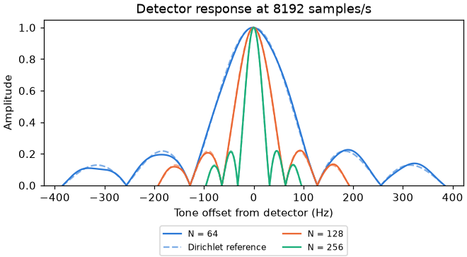
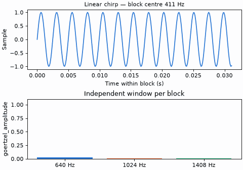
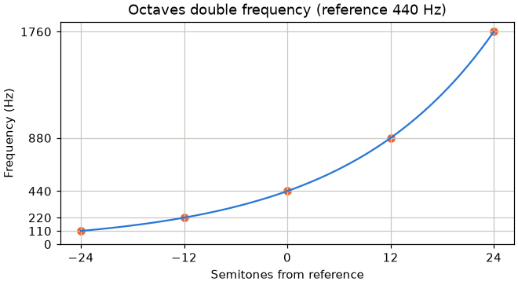

# Signal: goertzel.h and pitch.h

Single-bin detection on sample blocks; unlike the other legs it is compiled C, not header-only. [Math index](README.md).

`goertzel_t` accumulates one frequency across sample blocks with a float
recurrence, including non-integer DFT bins.<sup>[[72]](../Citations.md#72)</sup>
The caller supplies frequency and sample rate in Hz, with $`0 < hz < sample\_rate\_hz/2`$ (at DC the float power cancels), and a positive full scale.

| Function | Result |
|---|---|
| `goertzel_init` | Clear the stream and set coefficient $`c = 2\cos(2\pi\,hz/sample\_rate\_hz)`$ |
| `goertzel_reset` | Clear the stream, retaining the coefficient |
| `goertzel_feed_s` | Feed signed 16-bit samples |
| `goertzel_feed_f` | Feed float samples with the same recurrence |
| `goertzel_phase` | DFT phase in radians, sign $`e^{-j\omega n}`$, referenced to the first sample since init/reset; $`(-\pi, \pi]`$, zero for an empty stream |
| `goertzel_power` | Squared unnormalized DFT magnitude, clamped to zero |
| `goertzel_amplitude` | Sine amplitude $`2\sqrt{P}/N`$; zero before any sample |
| `goertzel_level_db` | Sine level relative to full scale; floored at `MATH_DB_FLOOR` |

Phase accuracy is about 0.001 rad on short records and up to 0.03 rad at
65,537 off-bin samples. The error comes from the float recurrence, not the
phase step.

For each sample $`x`$, the recurrence updates the two stored values:

```math
s = x + c s_1 - s_2, \qquad s_2 \gets s_1, \qquad s_1 \gets s
```

With $`N`$ samples and full scale $`F`$, power and level are:

```math
P = \max(0, s_1^2 + s_2^2 - c s_1 s_2), \qquad S = NF/2
```

```math
L = \max(\mathrm{MATH\_DB\_FLOOR}, 10\log_{10}(P/S^2))
```

An empty stream or zero power returns the level floor. A sine of amplitude
$`F`$ reads 0 dB; doubling the reference full scale lowers its level by
$`20\log_{10}(2)`$ dB.

### Frequency response

A finite rectangular window spreads a tone across nearby frequencies. For normalized
frequency offset $`d=(f-f_0)/f_s`$, the positive-frequency Dirichlet reference is:

```math
R_N(d)=\left\lvert\frac{\sin(\pi N d)}{N\sin(\pi d)}\right\rvert, \qquad R_N(0)=1
```

A real sine's negative-frequency term slightly changes this reference response.
At a shared sample rate, doubling the window length halves the main lobe width
in Hz.



Each chirp block resets the detectors for a fresh window. The top panel tracks
chirp frequency and the current block. Below, each detector's amplitude is plotted
against sweep frequency and peaks as the tone passes it.



## Equal-temperament pitch

`pitch.h` converts offsets relative to a caller-supplied reference frequency.
`PITCH_SEMITONES_PER_OCTAVE` is the octave scale; `PITCH_CENTS_PER_SEMITONE`
converts semitone errors to cents.

| Function | Result |
|---|---|
| `pitch_semitone_hz(reference_hz, semitones)` | `reference_hz * exp2f(semitones / PITCH_SEMITONES_PER_OCTAVE)` |
| `pitch_hz_semitones(reference_hz, hz)` | `PITCH_SEMITONES_PER_OCTAVE * log2f(hz / reference_hz)`; `NAN` if either frequency is nonpositive |

For reference frequency $`f_r`$ and semitone offset $`s`$, with $`O`$ =
`PITCH_SEMITONES_PER_OCTAVE`:

```math
f=f_r 2^{s/O}, \qquad s=O\log_2(f/f_r)
```


