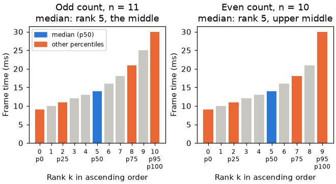

# Stats: statsi.h and statsf.h

Order statistics of a sample array, such as frame timings or touch positions. [Math index](README.md).

`MATH_DEFINE_STATS` is instantiated as `statsi` for int32 samples and `statsf` for float samples.
Selection is Hoare's FIND:<sup>[[87]](../Citations.md#87)</sup> it partitions the array in place around
the wanted rank, O(n) on average, and returns exactly the value a full sort would put there.

| Function | Result |
|---|---|
| `statsi_percentile(values, count, percent)`, `statsf_percentile(values, count, percent)` | The value at rank $`k_p`$ below |
| `statsi_median(values, count)`, `statsf_median(values, count)` | The percentile at 50: the value at rank $`k_{50}`$ |

Both reorder `values` and need `count > 0`.

## Rank

With $`n`$ samples, $`x_{(0)} \le x_{(1)} \le \dots \le x_{(n-1)}`$ in ascending order, ranks counted from 0, and
$`p`$ the percent from 0 to 100, the percentile is one sample, chosen by rank:

```math
k_p = \min\left(\left\lfloor \frac{n\,p}{100} \right\rfloor,\; n - 1\right), \qquad P_p = x_{(k_p)}
```

The median is the percentile at 50:

```math
k_{50} = \left\lfloor \frac{n}{2} \right\rfloor, \qquad M = x_{(k_{50})}
```

- **Rank selection, rounded down, no interpolation.** The result is always one of the samples, never a value between two.
- **An even count takes the upper middle.** With $`n = 10`$ the two middle samples are ranks 4 and 5; the median is rank 5, not their mean.
- **Percent 100 is the largest sample.** The clamp to $`n - 1`$ keeps it in range.
- **Not the textbook nearest rank.** That method picks rank $`\lceil n p / 100 \rceil`$ counted from 1. Where $`n p / 100`$ is a whole number, this one picks the next sample up: for $`n = 10`$ the median is rank 5, the sixth sample, where nearest rank takes the fifth (rank 4).


