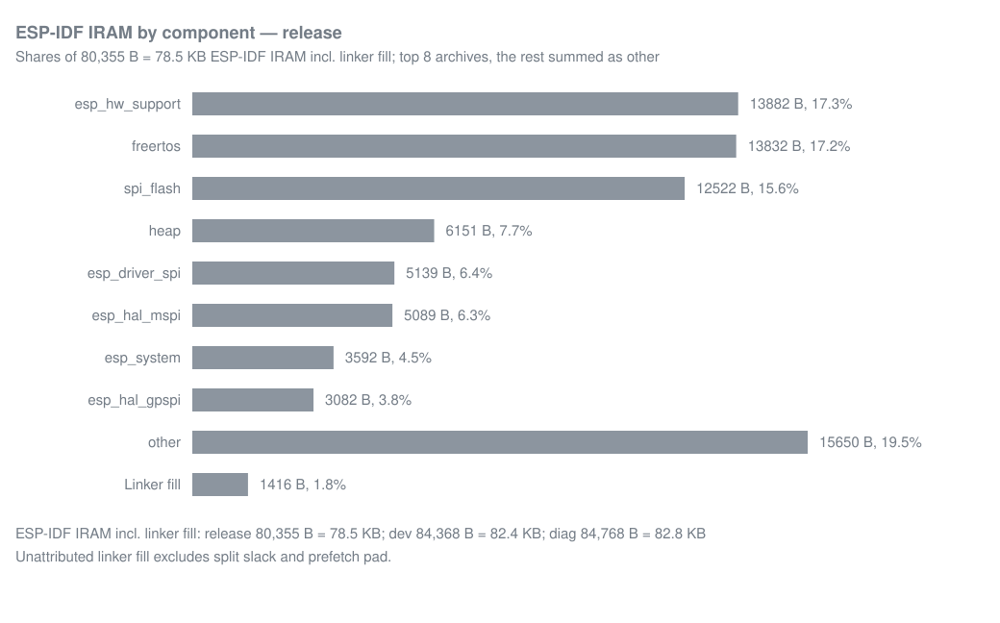
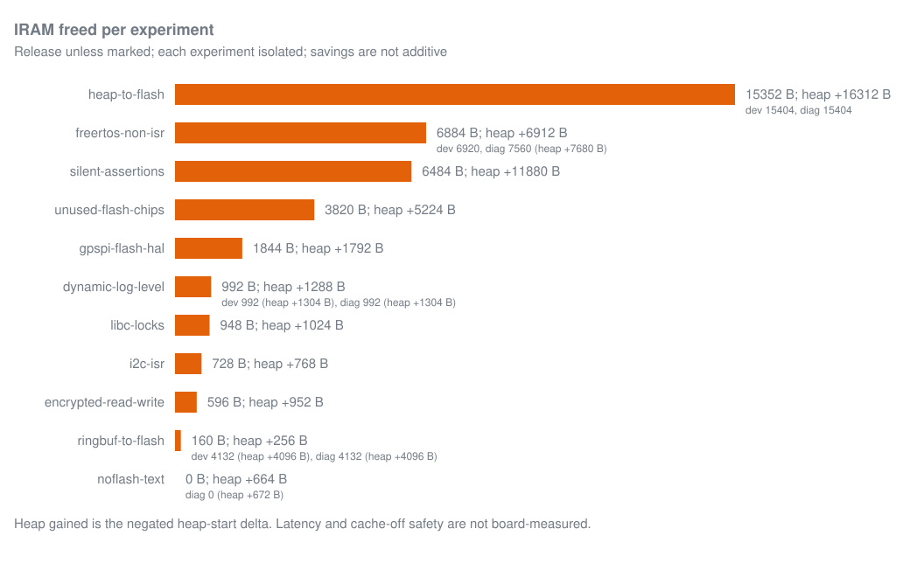

# Internal memory map

How much room each build has left:

<!-- generated: internal-memory-headroom sha256=0b3bfc33ab2c6108cb2b9d9e6146393b9cb8c5520d9815f72392b37fc83fb41f -->
> Generated by: `python launcher/tools/build/memory_map.py launcher/build launcher/build.dev launcher/build.diag --write`

release: 171.8 KB linked internal heap (not measured at runtime: release has no console, and its boot log is lost in the USB reset gap) of the 333.8 KB shared pool; IRAM can grow 137 B before it costs heap.

dev: 98.2 KB free of its 283.5 KB internal heap at its floor (after opening the app that leaves the least; capture from build e63d733d83ee-dev), largest block 64 KB, 149.8 KB of that heap is linked in the 333.8 KB pool and 133.8 KB lies outside it, added by ESP-IDF at runtime. IRAM can grow 41 B before it costs heap.

diag: 83.1 KB free of its 268.6 KB internal heap at its floor (after opening the app that leaves the least; capture from build df73e55eee0a-diag), largest block 50 KB, 134.0 KB of that heap is linked in the 333.8 KB pool and 134.6 KB lies outside it, added by ESP-IDF at runtime. IRAM can grow 97 B before it costs heap.
<!-- /generated: internal-memory-headroom -->

IRAM and DRAM are two address aliases of one internal SRAM pool, so every
byte of code placed in IRAM is a byte less for static data and the internal
heap. Each bar is one build variant, to scale, in address order. Linked heap
ranges are not runtime free memory. A measured bar's last segment is the heap
outside the linked pool, taken from the board capture.


The charts read the generated tables below and `data/runtime-heap.txt`.
Capture the board readings with `bash launcher/tools/device/capture_runtime_heap.sh docs/memory/data/runtime-heap.txt`.
The refresh command reads the three builds; `--write` refreshes the generated
blocks, both charts and the diag boot heap values in the device profile:
A smaller boot heap refreshes the blocks and charts but fails the profile
update, retaining the validated host arena.

```sh
python launcher/tools/build/memory_map.py launcher/build launcher/build.dev launcher/build.diag --write
```

## ESP-IDF IRAM components



The chart names the largest archives in the release build and sums the
remaining archives as other, with unattributed linker fill as its own bar.
Engine placement sites are separate from IDF placement, including sites that
place code from external archives.

## Placement rules and gate

`launcher/tools/build/memory_map.py` reads each build's own map, ELF,
sdkconfig and linked scripts. The measured block is refreshed by CI;
its SHA-256 marker lets host gates detect hand edits without building firmware.

An IRAM site's immediately preceding comment gives a reason and `IRAM budget: N B`.
An IRAM attribute alias with this comment immediately above its `#define` is
one budget site; its attributed function definitions in the same archive share
that budget.
When sizes differ, use `IRAM budget: release R B, dev D B, diag T B`
with measured integers in place of R, D and T. Each build selects its variant
from `build_id.txt`. On the IDF commit in
[`launcher/idf-pin.json`](../../launcher/idf-pin.json), budgets match in both
directions. Other IDF commits report budget drift as a note naming both
commits. The reason, after removing the budget, must contain at least two
words and sentence-ending punctuation; TODO, TBD and FIXME stubs fail.
Placement options in `launcher/sdkconfig.defaults*` need an adjacent reason,
including `*_PLACE_*_INTO_FLASH=n`, but no budget for IDF-owned code.
The clone escape gate reads the fragment inputs of the build's ldgen rule in
`build.ninja` and evaluates their mappings under its sdkconfig, including IDF
and configuration-driven placements. A base function can be absent from the
linked script when only its compiler clone survives.
Engine and app sites are reported separately. Ownership comes from the build's
component directories under this repository, excluding managed components.
Without a build, discovery follows
[`launcher/CMakeLists.txt`](../../launcher/CMakeLists.txt) and IDF's project
component discovery rule.

| Gate finds | Result |
|---|---|
| Our linked IRAM symbol has no site | Fail |
| A compiler clone (`.isra.N`, `.constprop.N`, `.part.N`, `.cold`, or their `$` forms) of a symbol-level IRAM placement in ldgen's fragment inputs lands outside IRAM | Fail; owned functions need `IRAM_ATTR` so clones inherit placement. For IDF or third-party code, map the whole object or move the caller-facing entry; linker mappings cannot name clones |
| Site lacks an adjacent reason or required budget | Fail |
| Measured bytes differ from the variant's budget, larger or smaller | Fail on pinned IDF; drift note otherwise |
| Per-variant budget omits this build's variant | Fail |
| Enabled site places nothing | Fail |
| Compiler or linker-fragment configuration excludes a site | Note |

Run `python launcher/tools/build/memory_map.py --source-only` to check comments
without a build. Run `python launcher/tools/build/memory_map.py --check
launcher/build launcher/build.dev launcher/build.diag` to check linked bytes.

`--update-budgets` with those build directories rewrites only each active site's
`IRAM budget:` clause, preserving its reason and line endings. It requires every
variant in `memory_map.VARIANTS` on the pinned IDF commit and refuses a partial
or unpinned build set. Equal active sizes use a plain budget; differing sizes
use per-variant budgets. Compiled-out sites contribute no active budget.

<!-- generated: internal-memory-map sha256=a02e05c2eb7758a80c5ac73c1b769a01adb9d35de27fc019a3e342d563bb2027 -->
> Generated by: `python launcher/tools/build/memory_map.py launcher/build launcher/build.dev launcher/build.diag --write`

Bytes from each build's ELF, link map, sdkconfig and ESP-IDF size JSON. Heap is a link-time range, not runtime free memory.

Builds: b47ad9b9fb7c-release (IDF 9a97f6c54ec6); ee3e203a325b-dev (IDF 9a97f6c54ec6); b2bd73484cd6-diag (IDF 9a97f6c54ec6)

<details><summary>Regions and boundaries</summary>

| Region / boundary | release | dev | diag |
|---|---|---|---|
| iram0_0_seg shared alias | 0x40378000–0x403cb700 (341760 B) | 0x40378000–0x403cb700 (341760 B) | 0x40378000–0x403cb700 (341760 B) |
| dram0_0_seg shared alias | 0x3fc88000–0x3fcdb700 (341760 B) | 0x3fc88000–0x3fcdb700 (341760 B) | 0x3fc88000–0x3fcdb700 (341760 B) |
| DIRAM used (idf_size) | 165654 | 188342 | 204474 |
| .dram0.bss | 55464 | 68152 | 83312 |
| .dram0.data | 18695 | 23223 | 23739 |
| .dram0.dummy | 91648 | 97024 | 97536 |
| .dram0.heap_start | 0 | 0 | 0 |
| .iram0.bss | 0 | 0 | 0 |
| .iram0.data | 0 | 0 | 0 |
| .iram0.text | 90467 | 95939 | 96395 |
| .iram0.text_end | 153 | 57 | 113 |
| .iram0.vectors | 1028 | 1028 | 1028 |
| Split granularity | 256 | 256 | 256 |
| Prefetch pad | 16 | 16 | 16 |
| Slack including pad | 153 | 57 | 113 |
| _iram_end | 0x4038e600 | 0x4038fb00 | 0x4038fd00 |
| _data_start | 0x3fc9e600 | 0x3fc9fb00 | 0x3fc9fd00 |
| _bss_start | 0x3fca2f08 | 0x3fca55b8 | 0x3fca59c0 |
| _bss_end | 0x3fcb07b0 | 0x3fcb5ff0 | 0x3fcb9f30 |
| _heap_start | 0x3fcb07b0 | 0x3fcb5ff0 | 0x3fcb9f30 |
| _heap_low_start | 0x3fcb07b0 | 0x3fcb5ff0 | 0x3fcb9f30 |

</details>

Split follows `CONFIG_ESP_SYSTEM_MEMPROT_FEATURE`; alignment and prefetch padding are read from the linked scripts and map.

<details><summary>IRAM components by placement</summary>

| IRAM component | Placement | release | dev | diag |
|---|---|---|---|---|
| libfreertos.a | IDF | 13828 | 14413 | 14894 |
| libesp_hw_support.a | IDF | 13878 | 13870 | 13870 |
| libspi_flash.a | IDF | 12522 | 12576 | 12576 |
| libmain.a | our sites | 9009 | 10501 | 10501 |
| libheap.a | IDF | 6265 | 6320 | 6320 |
| libesp_driver_spi.a | IDF | 5139 | 5139 | 5139 |
| libesp_hal_mspi.a | IDF | 5089 | 5089 | 5089 |
| libesp_system.a | IDF | 3588 | 3588 | 3558 |
| libesp_hal_gpspi.a | IDF | 3082 | 3082 | 3082 |
| libesp_libc.a | IDF | 2449 | 2938 | 2938 |
| libesp_ringbuf.a | IDF | 0 | 2598 | 2598 |
| libxtensa.a | IDF | 2496 | 2512 | 2512 |
| libesp_psram.a | IDF | 1920 | 1920 | 1920 |
| libhal.a | IDF | 1873 | 1873 | 1873 |
| libesp_lcd.a | our sites | 1574 | 1574 | 1574 |
| libesp_lcd.a | IDF | 139 | 139 | 139 |
| libesp_mm.a | IDF | 1261 | 1261 | 1261 |
| libbootloader_support.a | IDF | 1018 | 1018 | 1018 |
| libesp_driver_i2c.a | IDF | 811 | 811 | 811 |
| libesp_rom.a | IDF | 707 | 707 | 707 |
| libesp_hal_dma.a | IDF | 593 | 593 | 593 |
| libesp_hal_systimer.a | IDF | 555 | 555 | 555 |
| libesp_driver_dma.a | IDF | 543 | 543 | 543 |
| libxt_hal.a | IDF | 405 | 405 | 405 |
| liblog.a | IDF | 354 | 383 | 383 |
| libesp_driver_gpio.a | IDF | 354 | 354 | 354 |
| libwaveshare__esp_lcd_sh8601.a | our sites | 327 | 327 | 327 |
| libesp_driver_usb_serial_jtag.a | IDF | 114 | 114 | 114 |
| libgcc.a | IDF | 0 | 104 | 104 |
| libesp_timer.a | IDF | 65 | 65 | 65 |
| libefuse.a | IDF | 10 | 10 | 10 |
| Linker fill / split slack | unattributed | 1527 | 1585 | 1590 |

</details>

| Placement site | Symbols | release | dev | diag | Budget B | Reason |
|---|---|---|---|---|---|---|
| launcher/main/audio/audio_out.h:15 | add_tail, audio_adpcm_read, sound_mixer_render, sound_read, sound_seek | 2048 | 2048 | 2048 | 2048 | Core 0's renderer competes for the flash cache; the mixer and decoder hot path avoid those fetch stalls in IRAM. ADPCM tables occupy 1440 B of DRAM. |
| launcher/main/board/board_usb.c:38 | __wrap_mspi_timing_psram_tuning | 130 | 130 | 130 | 130 | IRAM, because the wrapped tuning changes the MSPI timing under the cache. The tuning's own "Enter psram timing tuning" line is muted with the rest. |
| launcher/main/gfx/present/gfx_present.c:169 | on_strip_sent | 36 | 36 | 36 | 36 | The panel bus uses interrupt flags 0, so this callback need not survive cache-off (ESP-IDF v5.5 SPI Master Driver guide); IRAM only spares it cache misses. |
| launcher/main/gfx/present/gfx_present.c:38 | gather_and_send$constprop$0, gfx_present, gfx_present_begin, gfx_present_wait, present_task_fn, run_present, run_present_normal, send_dirty_rows, send_dirty_rows$constprop$0, send_fb_rows | 2422 | 3243 | 3243 | release 2422, dev 3243, diag 3243 | The send hot path runs from IRAM so a present after a cold instruction cache does not wait on flash fetches. An attribute, not a linker.lf entry, places it: the compiler's clones of a function inherit the attribute, and a mapping entry names only the original. Development overlays and send auditing make dev and diag larger. |
| launcher/main/input/touch/touch.c:70 | on_touch_int | 50 | 50 | 50 | 50 | Need not be cache-off safe: esp_lcd_touch installs the GPIO ISR service with flags 0. Kept in IRAM until a touch-latency measurement says flash is fine. |
| launcher/main/linker.lf:18 | esp_lcd_panel_draw_bitmap, esp_lcd_panel_io_tx_color, esp_lcd_panel_io_tx_param, lcd_spi_post_trans_color_cb, panel_io_spi_tx_color, panel_io_spi_tx_param | 1574 | 1574 | 1574 | 1574 | Avoid cache misses in the LCD dispatch and SPI completion path used by every present. |
| launcher/main/linker.lf:30 | panel_sh8601_draw_bitmap | 327 | 327 | 327 | 327 | Avoid cache misses in the panel draw dispatch used by every present. |
| launcher/main/profile/frame_watch.c:112 | heap_call_site | 0 | 419 | 419 | 419 | Heap hooks and their callees must remain callable while flash cache is disabled. |
| launcher/main/profile/frame_watch.c:128 | esp_heap_trace_alloc_hook | 0 | 22 | 22 | 22 | Heap hooks and their callees must remain callable while flash cache is disabled; IDF's declaration in esp_heap_caps.h places this one in IRAM. |
| launcher/main/profile/frame_watch.c:140 | esp_heap_trace_free_hook | 0 | 22 | 22 | 22 | Heap hooks and their callees must remain callable while flash cache is disabled; IDF's declaration in esp_heap_caps.h places this one in IRAM. |
| launcher/main/profile/frame_watch.c:62 | watching_this_task | 0 | 78 | 78 | 78 | Heap hooks and their callees must remain callable while flash cache is disabled. |
| launcher/main/profile/frame_watch.c:78 | record | 0 | 130 | 130 | 130 | Heap hooks and their callees must remain callable while flash cache is disabled. |
| launcher/main/render/code_layout.h:21 | draw_reading, fill_flat, fill_gouraud, fill_solid, r3d_span_hidden, r3d_span_triangle_impl, upscale_rows, walk_rows | 4323 | 4323 | 4323 | 4323 | The draw path's entry functions run from IRAM: on a dense scene, flash fetch stalls cost the drawing core about a tenth of its draw cycles. IRAM has no cache line to place a loop on, so the render sources' cache-line function alignment would only waste IRAM; 4 bytes keeps entries aligned. |

### Differs between variants

Exclusive symbols are absent from IRAM in every other listed variant. The console reports the full symbol-level diff.

<details><summary>Variant differences</summary>

| Component | release | dev | diag | release only | dev only | diag only |
|---|---|---|---|---|---|---|
| libfreertos.a | 13828 | 14413 | 14894 |  |  | tasks.c.obj:vTaskSuspend (313 B), tasks.c.obj:prvTaskCreateDynamicPinnedToCoreWithCaps (193 B), tasks.c.obj:uxTaskGetNumberOfTasks (13 B) |
| libesp_hw_support.a | 13878 | 13870 | 13870 |  |  |  |
| libspi_flash.a | 12522 | 12576 | 12576 |  |  |  |
| libmain.a | 9009 | 10501 | 10501 | gfx_present.c.obj:send_dirty_rows$constprop$0 (1303 B), gfx_present.c.obj:run_present_normal (232 B) |  |  |
| libheap.a | 6265 | 6320 | 6320 |  |  |  |
| libesp_system.a | 3588 | 3588 | 3558 |  |  |  |
| libesp_libc.a | 2449 | 2938 | 2938 |  |  |  |
| libesp_ringbuf.a | 0 | 2598 | 2598 |  |  |  |
| libxtensa.a | 2496 | 2512 | 2512 |  |  |  |
| liblog.a | 354 | 383 | 383 |  |  |  |
| libgcc.a | 0 | 104 | 104 |  |  |  |

</details>
<!-- /generated: internal-memory-map -->

## What could move out of IRAM



<!-- generated: internal-memory-what-if sha256=e9519963d9193772a31ef7340332cea1133e31a04ba11f0a270a04ada9e916f2 -->
> Generated by: `python launcher/tools/build/iram_what_if.py launcher/build launcher/build.dev launcher/build.diag --work launcher/build/iram-what-if --jobs 6 --write`

Bytes are deltas against a fresh baseline build of each variant, made from a snapshot of the tracked tree on the IDF commit named below; that commit can differ from launcher/idf-pin.json, and CI does not refresh this table. Latency and cache-off safety are not board-measured. Positive IRAM/DRAM deltas are bytes freed. Heap-start delta is negative when the heap grows. Each row is isolated; savings are not additive.

Baseline builds: 3c0ff5781429-release (IDF 9a97f6c54ec6, IRAM 82639 B); 444818bfbf02-dev (IDF 9a97f6c54ec6, IRAM 89983 B); 5cf11dc5d2ba-diag (IDF 9a97f6c54ec6, IRAM 90735 B)

<details><summary>Isolated experiment measurements</summary>

| Variant | Experiment | IRAM freed B | DRAM freed B | Heap-start delta B | Change |
|---|---|---|---|---|---|
| release | ringbuf-to-flash | 0 | 0 | 0 | CONFIG_RINGBUF_PLACE_ISR_FUNCTIONS_INTO_FLASH=y |
| release | silent-assertions | 6364 | 5115 | -11264 | CONFIG_COMPILER_OPTIMIZATION_ASSERTIONS_ENABLE=n, CONFIG_COMPILER_OPTIMIZATION_ASSERTIONS_SILENT=y, CONFIG_COMPILER_OPTIMIZATION_CHECKS_SILENT=y |
| release | unused-flash-chips | 3824 | 1372 | -5216 | CONFIG_SPI_FLASH_SUPPORT_ISSI_CHIP=n, CONFIG_SPI_FLASH_SUPPORT_MXIC_CHIP=n, CONFIG_SPI_FLASH_SUPPORT_GD_CHIP=n, CONFIG_SPI_FLASH_SUPPORT_WINBOND_CHIP=n, CONFIG_SPI_FLASH_SUPPORT_BOYA_CHIP=n, CONFIG_SPI_FLASH_SUPPORT_TH_CHIP=n, CONFIG_SPI_FLASH_SUPPORT_MXIC_OPI_CHIP=n |
| release | encrypted-read-write | 588 | 176 | -688 | CONFIG_SPI_FLASH_ENABLE_ENCRYPTED_READ_WRITE=n |
| release | libc-locks | 952 | 0 | -768 | CONFIG_LIBC_LOCKS_PLACE_IN_IRAM=n |
| release | i2c-isr | 808 | 0 | -768 | CONFIG_I2C_MASTER_ISR_HANDLER_IN_IRAM=n |
| release | dynamic-log-level | 964 | 272 | -1040 | CONFIG_LOG_TAG_LEVEL_IMPL_NONE=y, CONFIG_LOG_DYNAMIC_LEVEL_CONTROL=n |
| release | heap-to-flash | 14452 | 972 | -15312 | CONFIG_SPI_MASTER_IN_IRAM=n, CONFIG_SPI_MASTER_ISR_IN_IRAM=n, CONFIG_HEAP_PLACE_FUNCTION_INTO_FLASH=y |
| release | noflash-text | 0 | 668 | -672 | our `(noflash)` entries become `(noflash_text)` |
| release | gpspi-flash-hal | 1848 | 0 | -1792 | the flash HAL's `spi_flash_hal_gpspi*` to flash |
| release | freertos-non-isr | 7588 | 0 | -7424 | CONFIG_FREERTOS_IN_IRAM=n (IDF's split) with present-path queue calls kept in IRAM; SPI_MASTER_IN_IRAM depends on it and drops too |
| dev | ringbuf-to-flash | 2612 | 0 | -2560 | CONFIG_RINGBUF_PLACE_ISR_FUNCTIONS_INTO_FLASH=y |
| dev | dynamic-log-level | 964 | 272 | -1296 | CONFIG_LOG_TAG_LEVEL_IMPL_NONE=y, CONFIG_LOG_DYNAMIC_LEVEL_CONTROL=n |
| dev | heap-to-flash | 14556 | 956 | -15552 | CONFIG_SPI_MASTER_IN_IRAM=n, CONFIG_SPI_MASTER_ISR_IN_IRAM=n, CONFIG_HEAP_PLACE_FUNCTION_INTO_FLASH=y |
| dev | noflash-text | 0 | 668 | -672 | our `(noflash)` entries become `(noflash_text)` |
| dev | freertos-non-isr | 7880 | 0 | -7936 | CONFIG_FREERTOS_IN_IRAM=n (IDF's split) with present-path queue calls kept in IRAM; SPI_MASTER_IN_IRAM depends on it and drops too |
| diag | ringbuf-to-flash | 2612 | 0 | -2560 | CONFIG_RINGBUF_PLACE_ISR_FUNCTIONS_INTO_FLASH=y |
| diag | dynamic-log-level | 964 | 272 | -1296 | CONFIG_LOG_TAG_LEVEL_IMPL_NONE=y, CONFIG_LOG_DYNAMIC_LEVEL_CONTROL=n |
| diag | heap-to-flash | 14556 | 964 | -15552 | CONFIG_SPI_MASTER_IN_IRAM=n, CONFIG_SPI_MASTER_ISR_IN_IRAM=n, CONFIG_HEAP_PLACE_FUNCTION_INTO_FLASH=y |
| diag | noflash-text | 0 | 676 | -672 | our `(noflash)` entries become `(noflash_text)` |
| diag | freertos-non-isr | 8664 | 0 | -8704 | CONFIG_FREERTOS_IN_IRAM=n (IDF's split) with present-path queue calls kept in IRAM; SPI_MASTER_IN_IRAM depends on it and drops too |

</details>
<!-- /generated: internal-memory-what-if -->

Recommendations, costs, citations and board validation live in the
[internal memory opportunities plan](../plans/Internal-Memory-Opportunities.md).
