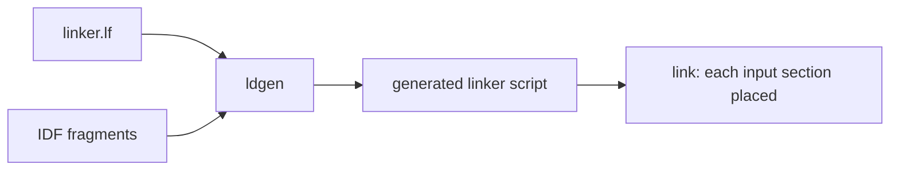

# Linker fragments

How code and data get into a chosen memory region with an ESP-IDF linker fragment
(`.lf` file), and when an attribute is the better tool. The only fragment file in the
firmware is [`launcher/main/linker.lf`](../../launcher/main/linker.lf), registered in
[`launcher/main/CMakeLists.txt`](../../launcher/main/CMakeLists.txt) with `LDFRAGMENTS`.

## What a fragment does

ESP-IDF's `ldgen` reads every component's `.lf` files and writes the linker script that
decides which input section lands in which output section. A fragment changes that
mapping without touching the source.

## The three entries

| Entry | Says | Example in `linker.lf` |
|---|---|---|
| `[sections:name]` | a custom input section to name | `patchable_entries` (`__patchable_function_entries`) |
| `[scheme:name]` | where a section kind goes | `patchable_entries -> flash_rodata` |
| `[mapping:name]` | which archive and object, with which scheme | `archive: libmain.a`, `* (patchable_entries_default)` |

A mapping line is `object:function (target)`. `noflash` is the built-in scheme that moves the
function into IRAM; the file uses it for the LCD dispatch path in `libesp_lcd.a` and the
panel driver ([`linker.lf:18`](../../launcher/main/linker.lf#L18)).

## Fragment or attribute

| Code | Use | Why |
|---|---|---|
| Our own function | `IRAM_ATTR` ([Function attributes](../c-style/Function-Attributes.md)) | the compiler's clones (`.isra`, `.constprop`, `.cold`) inherit an attribute; a mapping names only the original ([`gfx_present.c:31`](../../launcher/main/gfx/present/gfx_present.c#L31)) |
| A function in ESP-IDF or a managed component | a `noflash` mapping | the source cannot be changed |
| A whole object or archive | a mapping with `*` | one line instead of one per function |
| A section the stock script does not place | `[sections]` plus a scheme | the file places `__patchable_function_entries` in flash rodata this way |

A mapping cannot name a compiler clone. If the build produces only a clone of an IDF
function, map the whole object or move the caller-facing entry; the gate described in
[Internal memory map](Internal-Memory-Map.md#placement-rules-and-gate) fails when a
clone of a mapped function lands outside IRAM.

## Adding a placement

1. Add the mapping, with a comment above it that gives the reason and `IRAM budget: N B`.
2. Build, then run `python launcher/tools/build/memory_map.py launcher/build launcher/build.dev launcher/build.diag`.
3. Put the measured byte counts in the comment; the gate fails if they differ in either
   direction. A budget that differs per variant is written `release R B, dev D B, diag T B`.

## Reading what happened

The generated script is in the build folder (`launcher/build/esp-idf/esp_system/ld/sections.ld`), and the
linker map lists every placed symbol with its address. The
[Internal memory map](Internal-Memory-Map.md) tables are generated from the same files.
