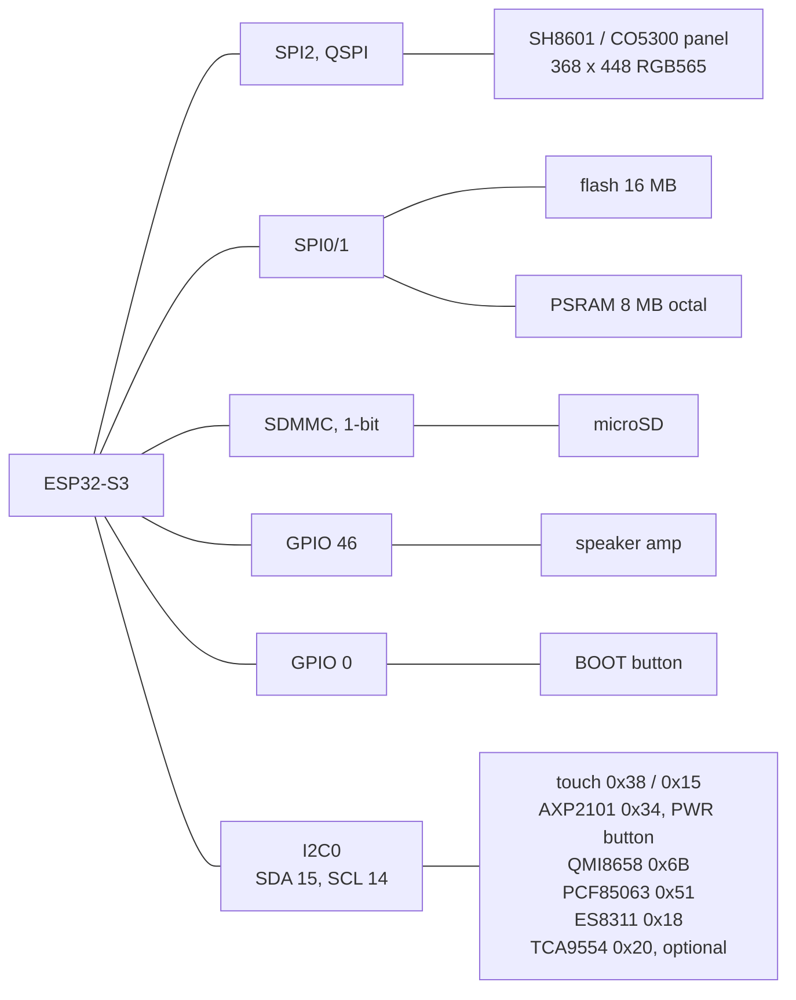
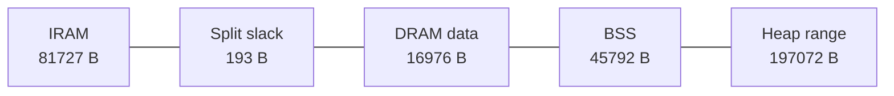

# Board and Memory

Part of the [platform notes](README.md). Hardware selection lives in
`launcher/main/board/`; memory policy lives in `launcher/main/core/memory.h`
and `launcher/sdkconfig.defaults`.

## The board

ESP32-S3R8, dual-core Xtensa LX7 @ 240 MHz, single-precision FPU. Flash and
PSRAM clocks are set in `launcher/sdkconfig.defaults`.



The display, SD card and external memory use separate buses. CPU work and
internal-memory traffic can still contend; separate buses do not guarantee
independent throughput.

| Peripheral | Part | POST | Notes |
|---|---|---|---|
| Display | SH8601 (V1) / CO5300 (V2) | ✓ | 368×448 RGB565 |
| Touch | FT3168 (V1) / CST820 (V2) | ✓ | the address that answers identifies the revision |
| IO expander | TCA9554 | optional | resets display and touch when fitted |
| Power management | AXP2101 | ✓ | battery charging, the PWR button ([Input-and-Sensors.md](Input-and-Sensors.md)) |
| IMU | QMI8658 | ✓ | axes in [Input-and-Sensors.md](Input-and-Sensors.md) |
| Real-time clock | PCF85063 | ✓ | |
| Audio codec | ES8311 | ✓ | datasheet address `0x30` is 8-bit; I2C wants `0x18` |
| microSD | - | optional | see [SD card](#sd-card) |
| Flash | - | ✓ | memory-mapped |
| PSRAM | - | ✓ | 8 MB octal |
| Wi-Fi 4 / BLE 5 | on-die | via `soc` | reported, not exercised |
| BOOT button | - | | active low, bounces; also the flashing button |
| Temperature sensor | on-die | ✓ | |

POST (`launcher/main/selftest/post.c`) also checks the MAC/eFuse and the I2C bus
itself. It raises the amp GPIO before probing the codec, which does not answer
without it (`board_audio_amp_enable()`).

### Revisions

| Revision | Touch answers at | Panel | X gap |
|---|---|---|---|
| V2 | CST820 `0x15` | CO5300 | `0x10` (`BOARD_PANEL_X_GAP`) |
| original (V1) | FT3168 `0x38` | SH8601 | none |

`board_detect()` tells them apart; go through it rather than hardcoding a
driver, and do not add the gap yourself.

## Memory: the constraint that shapes everything

| Tier | Current placement | Rule |
|---|---|---|
| Internal SRAM | stacks, ordinary mutable statics, DMA gather and bounce buffers, hot working data | budget static storage and the largest allocation together |
| PSRAM | full framebuffer (`MEMORY_PSRAM`) and app arena | keep frequently accessed working data internal where it fits |
| Flash | executable code, ordinary `static const` tables and mapped assets | account for cache misses on bulk or scattered reads |

In full-framebuffer mode the framebuffer is in PSRAM; band and indexed modes
free it. The band ring aliases the internal DMA bounce slots. See
[Gfx-and-Presentation.md](../Gfx-and-Presentation.md) for presentation.
The app arena (`launcher/main/app/app_arena.h`) uses explicit external-memory
placement, so its reservation reduces the PSRAM heap before apps allocate.

`CONFIG_SPIRAM_MALLOC_ALWAYSINTERNAL=65536` makes ordinary allocations up to
that threshold **try** internal RAM first, with PSRAM fallback. This is a
preference, not a placement guarantee. `memory_alloc()` requests the named
kind explicitly and does not fall back to another kind. Use `MEMORY_INTERNAL`
for required internal placement and `MEMORY_DMA` for the panel's buffers.

Read current free-heap and largest-block measurements from POST and the
development build's `HEAPMARK` lines. The host model's budget is recorded in
`launcher/tools/device/device_profiles/esp32s3.sh`; it is not a live heap
measurement of every build variant.

### PSRAM throughput

Device measurements put PSRAM reads at 33–58 MB/s depending on access
pattern, versus 365–724 MB/s for internal RAM. Sequential copies measure
about 58 MB/s out of PSRAM, 47 MB/s into it and 22 MB/s from PSRAM to PSRAM.
Writes incur cache-line loads before writeback, so bulk copies are costly
beside the arithmetic they support. These are measured access-pattern
ranges, not a guarantee for a particular buffer or clock configuration.
Prefer internal SRAM for hot working data where it fits, and read PSRAM
for bulk or cold content. The [presentation memory policy](../Gfx-and-Presentation.md#presentation-memory-policy)
explains why presentation keeps one retained framebuffer.

### Cycle budgets

At 240 MHz, one core has about 24 cycles per physical pixel at 60 fps,
48 at 30 fps, or 97 per half-resolution pixel at 60 fps. These are clock
and pixel-count budgets, not measured rendering costs.

### Cache is carved from the same pool

| Cache | Build configuration | Access |
|---|---|---|
| Instruction | 32 KiB, 32-byte lines, 8-way | flash-resident instructions |
| Data | 64 KiB, 64-byte lines, 8-way | mapped flash data and PSRAM |

`launcher/sdkconfig.defaults` selects the instruction-cache size with
`CONFIG_ESP32S3_INSTRUCTION_CACHE_32KB` and the data-cache size and line size
with `CONFIG_ESP32S3_DATA_CACHE_64KB` and `CONFIG_ESP32S3_DATA_CACHE_LINE_64B`;
the remaining settings use ESP-IDF's ESP32-S3 cache defaults. The larger data
cache serves the renderer's PSRAM vertex, depth and colour streams. Cache
storage consumes internal SRAM: increasing its capacity reduces the internal
heap available to allocations. Internal working data avoids external-memory
cache traffic;
flash-resident `const` data is not internal working data. Inspect the linker
map for actual placement, including explicitly RAM-mapped code and tables.
Changing code layout can change cache behaviour even when a hot function's
instructions are identical; measure the linked image on the device.

### Internal memory map

IRAM and DRAM are aliases of the same shared SRAM pool. Code placement
reduces the space available for static data and the internal heap.
`launcher/tools/build/memory_map.py` reads each build's own map, ELF,
sdkconfig and linked scripts. The measured block is refreshed by CI;
its SHA-256 marker lets host gates detect hand edits without building firmware.

An IRAM site's immediately preceding comment gives a reason and `IRAM budget: N B`.
When sizes differ, use `IRAM budget: release 784 B, dev 3926 B, diag 3926 B`;
each build selects its number from sdkconfig, with no rounding or allowance in
either direction. The reason, after removing the budget, must contain at least
two words and sentence-ending punctuation; TODO, TBD and FIXME stubs fail.
Placement options in `launcher/sdkconfig.defaults*` need an adjacent reason,
including `*_PLACE_*_INTO_FLASH=n`, but no budget for IDF-owned code.
Engine and app sites are reported separately. Ownership comes from the build's
component directories under this repository, excluding `managed_components`.

| Gate finds | Result |
|---|---|
| Our linked IRAM symbol has no site | Fail |
| Site lacks an adjacent reason or required budget | Fail |
| Measured bytes differ from the variant's budget, larger or smaller | Fail; set the budget to measured bytes |
| Per-variant budget omits this build's variant | Fail |
| Enabled site places nothing | Fail |
| Compiler or linker-fragment configuration excludes a site | Note |

Run `python launcher/tools/build/memory_map.py --source-only` to check comments
without a build; it scans `launcher/main`, `launcher/components/*` and
`launcher/packages/*`. Run `python launcher/tools/build/memory_map.py --check
launcher/build launcher/build.dev launcher/build.diag` to check linked bytes.

<!-- generated: internal-memory-map sha256=1c0ba5e4f529cbedb72106f78d8c399424ddb0c2f93690087042c14d93bef7e6 -->
> Generated by: `python launcher/tools/build/memory_map.py launcher/build launcher/build.dev launcher/build.diag --write`

Bytes from each build's ELF, link map, sdkconfig and ESP-IDF size JSON. Heap is a link-time range, not runtime free memory.

| Region / boundary | release | dev | diag |
|---|---|---|---|
| iram0_0_seg shared alias | 0x40378000–0x403cb700 (341760 B) | 0x40378000–0x403cb700 (341760 B) | 0x40378000–0x403cb700 (341760 B) |
| dram0_0_seg shared alias | 0x3fc88000–0x3fcdb700 (341760 B) | 0x3fc88000–0x3fcdb700 (341760 B) | 0x3fc88000–0x3fcdb700 (341760 B) |
| DIRAM used (idf_size) | 144495 | 166687 | 181915 |
| .dram0.bss | 45792 | 56264 | 70168 |
| .dram0.data | 16976 | 20216 | 20780 |
| .dram0.dummy | 81920 | 90368 | 91136 |
| .dram0.heap_start | 0 | 0 | 0 |
| .iram0.bss | 0 | 0 | 0 |
| .iram0.data | 0 | 0 | 0 |
| .iram0.text | 80699 | 89179 | 89939 |
| .iram0.text_end | 193 | 161 | 169 |
| .iram0.vectors | 1028 | 1028 | 1028 |
| Split granularity | 256 | 256 | 256 |
| Prefetch pad | 16 | 16 | 16 |
| Slack including pad | 193 | 161 | 169 |
| _iram_end | 0x4038c000 | 0x4038e100 | 0x4038e400 |
| _data_start | 0x3fc9c000 | 0x3fc9e100 | 0x3fc9e400 |
| _bss_start | 0x3fca0250 | 0x3fca2ff8 | 0x3fca3530 |
| _bss_end | 0x3fcab530 | 0x3fcb0bc0 | 0x3fcb4748 |
| _heap_start | 0x3fcab530 | 0x3fcb0bc0 | 0x3fcb4748 |
| _heap_low_start | 0x3fcab530 | 0x3fcb0bc0 | 0x3fcb4748 |

Split follows `CONFIG_ESP_SYSTEM_MEMPROT_FEATURE`; alignment and prefetch padding are read from the linked scripts and map.

| IRAM component | Ownership | release | dev | diag |
|---|---|---|---|---|
| libfreertos.a | IDF / managed | 13701 | 13836 | 14619 |
| libesp_hw_support.a | IDF / managed | 13334 | 13326 | 13326 |
| libspi_flash.a | IDF / managed | 12379 | 12433 | 12433 |
| libhal.a | IDF / managed | 10999 | 10999 | 10999 |
| libheap.a | IDF / managed | 6381 | 6463 | 6463 |
| libesp_driver_spi.a | IDF / managed | 5041 | 5041 | 5041 |
| libmain.a | ours | 870 | 4641 | 4641 |
| libesp_ringbuf.a | IDF / managed | 159 | 4106 | 4106 |
| libesp_system.a | IDF / managed | 3522 | 3522 | 3492 |
| libnewlib.a | IDF / managed | 2313 | 2595 | 2595 |
| libxtensa.a | IDF / managed | 2492 | 2508 | 2508 |
| libesp_psram.a | IDF / managed | 1932 | 1932 | 1932 |
| libesp_lcd.a | IDF / managed | 1688 | 1688 | 1688 |
| libesp_mm.a | IDF / managed | 1342 | 1342 | 1342 |
| libbootloader_support.a | IDF / managed | 1064 | 1064 | 1064 |
| libesp_driver_i2c.a | IDF / managed | 738 | 738 | 738 |
| libesp_rom.a | IDF / managed | 693 | 693 | 693 |
| libxt_hal.a | IDF / managed | 405 | 405 | 405 |
| liblog.a | IDF / managed | 348 | 377 | 377 |
| libesp_driver_gpio.a | IDF / managed | 350 | 350 | 350 |
| libwaveshare__esp_lcd_sh8601.a | IDF / managed | 339 | 339 | 339 |
| libgcc.a | IDF / managed | 0 | 104 | 104 |
| libesp_driver_usb_serial_jtag.a | IDF / managed | 103 | 103 | 103 |
| libesp_timer.a | IDF / managed | 57 | 57 | 57 |
| libesp_pm.a | IDF / managed | 16 | 16 | 16 |
| Linker fill / split slack | unattributed | 1654 | 1690 | 1705 |

| Owner | Placement site | Symbols | release | dev | diag | Budget B | Reason |
|---|---|---|---|---|---|---|---|
| engine | launcher/main/gfx/present/gfx_present.c:127 | on_strip_sent | 36 | 36 | 36 | 36 | The panel bus uses interrupt flags 0, so this callback need not survive cache-off (docs/Citations.md#59); IRAM only spares it cache misses. |
| engine | launcher/main/input/touch.c:71 | on_touch_int | 50 | 50 | 50 | 50 | Need not be cache-off safe: esp_lcd_touch installs the GPIO ISR service with flags 0. Kept in IRAM until a touch-latency measurement says flash is fine. |
| engine | launcher/main/linker.lf:20 | gather_and_send, gfx_present, gfx_present_begin, gfx_present_wait, present_task_fn, run_present_normal, send_fb_rows | 784 | 3926 | 3926 | release 784, dev 3926, diag 3926 | Keep every normal present's hot path in IRAM to avoid cache-dependent flash timing. suite_gfx test_narrow_present_counters measures that path. Setup, other present modes and the SPI driver's own queue keep their configured placement. |
| engine | launcher/main/linker.lf:33 | esp_lcd_panel_draw_bitmap, esp_lcd_panel_io_tx_color, esp_lcd_panel_io_tx_param, lcd_spi_post_trans_color_cb, panel_io_spi_tx_color, panel_io_spi_tx_param | 1549 | 1549 | 1549 | 1549 | Avoid cache misses in the LCD dispatch and SPI completion path used by every present. |
| engine | launcher/main/linker.lf:45 | panel_sh8601_draw_bitmap | 339 | 339 | 339 | 339 | Avoid cache misses in the panel draw dispatch used by every present. |
| engine | launcher/main/profile/frame_watch.c:111 | heap_call_site | 0 | 378 | 378 | 378 | Heap hooks and their callees must remain callable while flash cache is disabled. |
| engine | launcher/main/profile/frame_watch.c:127 | esp_heap_trace_alloc_hook | 0 | 22 | 22 | 22 | Heap hooks and their callees must remain callable while flash cache is disabled. |
| engine | launcher/main/profile/frame_watch.c:139 | esp_heap_trace_free_hook | 0 | 22 | 22 | 22 | Heap hooks and their callees must remain callable while flash cache is disabled. |
| engine | launcher/main/profile/frame_watch.c:61 | watching_this_task | 0 | 78 | 78 | 78 | Heap hooks and their callees must remain callable while flash cache is disabled. |
| engine | launcher/main/profile/frame_watch.c:77 | record | 0 | 129 | 129 | 129 | Heap hooks and their callees must remain callable while flash cache is disabled. |

#### Differs between variants

Exclusive symbols are absent from IRAM in every other listed variant. The console reports the full symbol-level diff.

`CONFIG_LAUNCHER_DEVELOPMENT` enables presentation overlays, send auditing and raw-full dispatch in `gfx_present.c`; those branches enlarge the mapped `present_gfx` functions from 784 B in release to 3926 B in dev and diag.

| Component | release | dev | diag | release only | dev only | diag only |
|---|---|---|---|---|---|---|
| libfreertos.a | 13701 | 13836 | 14619 |  |  | tasks.c.obj:vTaskSuspend (317 B), tasks.c.obj:xTaskGenericNotifyWait (244 B), tasks.c.obj:prvTaskCreateDynamicPinnedToCoreWithCaps (209 B), tasks.c.obj:uxTaskGetStackHighWaterMark (58 B), tasks.c.obj:uxTaskGetNumberOfTasks (13 B) |
| libesp_hw_support.a | 13334 | 13326 | 13326 |  |  |  |
| libspi_flash.a | 12379 | 12433 | 12433 |  |  |  |
| libheap.a | 6381 | 6463 | 6463 |  |  |  |
| libmain.a | 870 | 4641 | 4641 |  |  |  |
| libesp_ringbuf.a | 159 | 4106 | 4106 |  |  |  |
| libesp_system.a | 3522 | 3522 | 3492 |  |  |  |
| libnewlib.a | 2313 | 2595 | 2595 |  |  |  |
| libxtensa.a | 2492 | 2508 | 2508 |  |  |  |
| liblog.a | 348 | 377 | 377 |  |  |  |
| libgcc.a | 0 | 104 | 104 |  |  |  |

#### Release shared block

The split slack includes the prefetch pad. Boxes show linked bytes in address order; width is schematic.


<!-- /generated: internal-memory-map -->

### What could move out of IRAM

Each row is one scratch build with one change; it measures linked bytes only.

<!-- generated: internal-memory-what-if sha256=1f0cd5d9e05d5c161701afb08405e65c1af8b3c68b12bd7ed4af2981a4056972 -->
> Generated by: `python launcher/tools/build/iram_what_if.py launcher/build launcher/build.dev launcher/build.diag --work launcher/test/build/memory-experiments --write`

Positive IRAM/DRAM deltas are bytes freed. Heap-start delta is negative when the heap grows. Each row is isolated; savings are not additive. Rows identify the source ELF SHA-256; latency and cache-off safety are not measured.

| Source build id | Variant | Experiment | IRAM freed B | DRAM freed B | Heap-start delta B | Measured / constraint |
|---|---|---|---|---|---|---|
| b71fdff2147eb5a35e361eddd03175690f1799997e894926344e7a6f9334b95c | dev | dynamic-log-level | 992 | 280 | -1304 | bytes: scratch build; latency: not board-measured; CONFIG_LOG_TAG_LEVEL_IMPL_NONE=y, CONFIG_LOG_DYNAMIC_LEVEL_CONTROL=n |
| b71fdff2147eb5a35e361eddd03175690f1799997e894926344e7a6f9334b95c | dev | freertos-non-isr | 6920 | 0 | -6912 | bytes: scratch build; latency: not board-measured;  |
| b71fdff2147eb5a35e361eddd03175690f1799997e894926344e7a6f9334b95c | dev | heap-to-flash | 15404 | 952 | -16312 | bytes: scratch build; latency: not board-measured; CONFIG_SPI_MASTER_IN_IRAM=n, CONFIG_SPI_MASTER_ISR_IN_IRAM=n, CONFIG_HEAP_PLACE_FUNCTION_INTO_FLASH=y |
| b71fdff2147eb5a35e361eddd03175690f1799997e894926344e7a6f9334b95c | dev | noflash-text | 0 | 668 | -664 | bytes: scratch build; latency: not board-measured;  |
| b71fdff2147eb5a35e361eddd03175690f1799997e894926344e7a6f9334b95c | dev | ringbuf-to-flash | 4132 | 0 | -4096 | bytes: scratch build; latency: not board-measured; CONFIG_RINGBUF_PLACE_FUNCTIONS_INTO_FLASH=y, CONFIG_RINGBUF_PLACE_ISR_FUNCTIONS_INTO_FLASH=y |
| ea4976d8ef16745e3add384b25da06ea2078d38b440a50de1b442d1ef3da9b02 | diag | dynamic-log-level | 992 | 280 | -1304 | bytes: scratch build; latency: not board-measured; CONFIG_LOG_TAG_LEVEL_IMPL_NONE=y, CONFIG_LOG_DYNAMIC_LEVEL_CONTROL=n |
| ea4976d8ef16745e3add384b25da06ea2078d38b440a50de1b442d1ef3da9b02 | diag | freertos-non-isr | 7560 | 0 | -7680 | bytes: scratch build; latency: not board-measured;  |
| ea4976d8ef16745e3add384b25da06ea2078d38b440a50de1b442d1ef3da9b02 | diag | heap-to-flash | 15404 | 952 | -16312 | bytes: scratch build; latency: not board-measured; CONFIG_SPI_MASTER_IN_IRAM=n, CONFIG_SPI_MASTER_ISR_IN_IRAM=n, CONFIG_HEAP_PLACE_FUNCTION_INTO_FLASH=y |
| ea4976d8ef16745e3add384b25da06ea2078d38b440a50de1b442d1ef3da9b02 | diag | noflash-text | 0 | 668 | -672 | bytes: scratch build; latency: not board-measured;  |
| ea4976d8ef16745e3add384b25da06ea2078d38b440a50de1b442d1ef3da9b02 | diag | ringbuf-to-flash | 4132 | 0 | -4096 | bytes: scratch build; latency: not board-measured; CONFIG_RINGBUF_PLACE_FUNCTIONS_INTO_FLASH=y, CONFIG_RINGBUF_PLACE_ISR_FUNCTIONS_INTO_FLASH=y |
| 4cf78d42b241cc2938431ffb8bd39915e65fcb92d1a8400aea5b924f21e15782 | release | dynamic-log-level | 992 | 264 | -1288 | bytes: scratch build; latency: not board-measured; CONFIG_LOG_TAG_LEVEL_IMPL_NONE=y, CONFIG_LOG_DYNAMIC_LEVEL_CONTROL=n |
| 4cf78d42b241cc2938431ffb8bd39915e65fcb92d1a8400aea5b924f21e15782 | release | encrypted-read-write | 596 | 188 | -952 | bytes: scratch build; latency: not board-measured; CONFIG_SPI_FLASH_ENABLE_ENCRYPTED_READ_WRITE=n |
| 4cf78d42b241cc2938431ffb8bd39915e65fcb92d1a8400aea5b924f21e15782 | release | freertos-non-isr | 6884 | 0 | -6912 | bytes: scratch build; latency: not board-measured;  |
| 4cf78d42b241cc2938431ffb8bd39915e65fcb92d1a8400aea5b924f21e15782 | release | gpspi-flash-hal | 1844 | 0 | -1792 | bytes: scratch build; latency: not board-measured;  |
| 4cf78d42b241cc2938431ffb8bd39915e65fcb92d1a8400aea5b924f21e15782 | release | heap-to-flash | 15352 | 952 | -16312 | bytes: scratch build; latency: not board-measured; CONFIG_SPI_MASTER_IN_IRAM=n, CONFIG_SPI_MASTER_ISR_IN_IRAM=n, CONFIG_HEAP_PLACE_FUNCTION_INTO_FLASH=y |
| 4cf78d42b241cc2938431ffb8bd39915e65fcb92d1a8400aea5b924f21e15782 | release | i2c-isr | 728 | 0 | -768 | bytes: scratch build; latency: not board-measured; CONFIG_I2C_MASTER_ISR_HANDLER_IN_IRAM=n |
| 4cf78d42b241cc2938431ffb8bd39915e65fcb92d1a8400aea5b924f21e15782 | release | libc-locks | 948 | 0 | -1024 | bytes: scratch build; latency: not board-measured; CONFIG_LIBC_LOCKS_PLACE_IN_IRAM=n |
| 4cf78d42b241cc2938431ffb8bd39915e65fcb92d1a8400aea5b924f21e15782 | release | noflash-text | 0 | 668 | -664 | bytes: scratch build; latency: not board-measured;  |
| 4cf78d42b241cc2938431ffb8bd39915e65fcb92d1a8400aea5b924f21e15782 | release | ringbuf-to-flash | 160 | 0 | -256 | bytes: scratch build; latency: not board-measured; CONFIG_RINGBUF_PLACE_FUNCTIONS_INTO_FLASH=y, CONFIG_RINGBUF_PLACE_ISR_FUNCTIONS_INTO_FLASH=y |
| 4cf78d42b241cc2938431ffb8bd39915e65fcb92d1a8400aea5b924f21e15782 | release | silent-assertions | 6484 | 5224 | -11880 | bytes: scratch build; latency: not board-measured; CONFIG_COMPILER_OPTIMIZATION_ASSERTIONS_ENABLE=n, CONFIG_COMPILER_OPTIMIZATION_ASSERTIONS_SILENT=y, CONFIG_COMPILER_OPTIMIZATION_CHECKS_SILENT=y |
| 4cf78d42b241cc2938431ffb8bd39915e65fcb92d1a8400aea5b924f21e15782 | release | unused-flash-chips | 3820 | 1388 | -5224 | bytes: scratch build; latency: not board-measured; CONFIG_SPI_FLASH_SUPPORT_ISSI_CHIP=n, CONFIG_SPI_FLASH_SUPPORT_MXIC_CHIP=n, CONFIG_SPI_FLASH_SUPPORT_GD_CHIP=n, CONFIG_SPI_FLASH_SUPPORT_WINBOND_CHIP=n, CONFIG_SPI_FLASH_SUPPORT_BOYA_CHIP=n, CONFIG_SPI_FLASH_SUPPORT_TH_CHIP=n, CONFIG_SPI_FLASH_SUPPORT_MXIC_OPI_CHIP=n |
<!-- /generated: internal-memory-what-if -->

Recommendations, costs, citations and board validation live in the
[internal memory opportunities plan](../plans/Internal-Memory-Opportunities.md).

### Static growth still taxes the internal heap

Ordinary mutable file-scope statics reserve internal DRAM for the whole boot,
including those in development and self-test code. Explicit PSRAM placement
and flash-resident constant tables have different costs. Allocate optional
debug buffers on use and mutable large test fixtures per test, then free them.
Clean up earlier allocations before an assertion can abort a failing fixture.

Check `.bss`, `.data` and RAM-resident code in the linker map and size report
for every build variant (release, `--dev`, `--diag`). From `launcher/`, run
`idf.py -B build.dev size` and `idf.py -B build.diag size` as well as the
release size report. Link-time size does not prove that a contiguous block
will remain available after runtime allocations.

Compare `memory_free_bytes(MEMORY_DMA)` and
`memory_largest_block(MEMORY_DMA)` from the same pool. Total free heap across
other capabilities does not establish whether a DMA buffer fits. Watch POST
and `HEAPMARK` after changing either static storage or allocation order.

### Task stacks are not the heap

```
Guru Meditation Error: Core 0 panic'ed (Stack protection fault).
Detected in task "main" at 0x4200b2f8
--- app_main at <file>:23
```

| You see | It means | Do |
|---|---|---|
| a stack protection fault pointing at a function's opening brace | a large local overran the task stack on frame setup | `malloc` it |
| a frozen picture after a crash | the panel's GRAM keeps the last frame | do not take it as the firmware running |

## Storage

### Flash

`launcher/partitions.csv` keeps 64 KB after the app partition for the last
panic's core dump ([Debugging](Debugging.md)) and gives the rest of the flash
to one data partition, `assets`, which holds the [asset pack](../assets/README.md).
`esp_partition_mmap()` reads it like an array; mapped reads go
through the cache, so sequential access is fast and random access thrashes.

### SD card

`bsp_sdcard_mount()` and `bsp_sdcard_unmount()` work at any time, display up
or not. POST mounts and releases the card before `gfx_init()` and can remount
it live.

| Filesystem | Mounts |
|---|---|
| FAT32 | yes |
| exFAT | no (`FF_FS_EXFAT 0`); reformat to FAT32 first |

8.3 filenames only (`CONFIG_FATFS_LFN_NONE`); 20 MHz (`SDMMC_FREQ_DEFAULT`),
1-bit.

## Related

- [Display-and-Rendering.md](Display-and-Rendering.md): panel constraints on SPI2.
- [Flashing-and-Toolchain.md](Flashing-and-Toolchain.md): build configuration
  and compiler checks.
