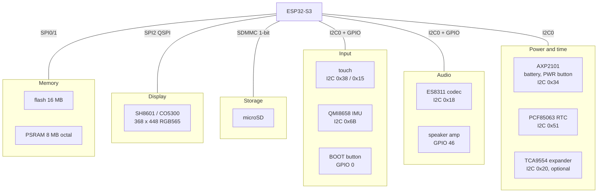
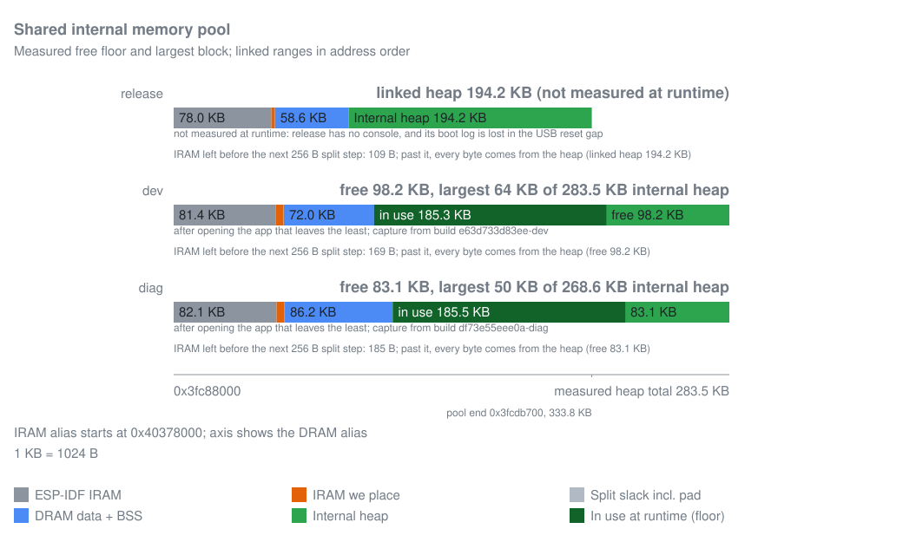

# Board and Memory

Part of the [platform notes](README.md). Hardware selection lives in
`launcher/main/board/`; memory policy lives in `launcher/main/core/memory.h`
and `launcher/sdkconfig.defaults`.

## The board

ESP32-S3R8, dual-core Xtensa LX7 @ 240 MHz, single-precision FPU. Flash and
PSRAM clocks are set in `launcher/sdkconfig.defaults`.



The display, SD card and external memory use separate buses. CPU work and
internal-memory traffic can still contend; separate buses do not guarantee
independent throughput.

I2C0 has 2.2 kΩ pull-ups to 3.3 V.<sup>[[81]](../Citations.md#waveshare-amoled-schematic)</sup> Each device sets its own SCL; all run at 400 kHz.

| Peripheral | Part | POST | Notes |
|---|---|---|---|
| Display | SH8601 (V1) / CO5300 (V2) | ✓ | 368×448 RGB565 |
| Touch | FT3168 (V1) / CST820 (V2) | ✓ | the address that answers identifies the revision |
| IO expander | TCA9554 | optional | resets display and touch when fitted |
| Power management | AXP2101 | ✓ | battery charging, the PWR button ([Buttons.md](../input/Buttons.md)) |
| IMU | QMI8658 | ✓ | axes in [Motion-Axes.md](../input/Motion-Axes.md) |
| Real-time clock | PCF85063 | ✓ | |
| Audio codec | ES8311 | ✓ | datasheet address `0x30` is 8-bit; I2C wants `0x18` |
| microSD | - | optional | see [SD card](#sd-card) |
| Flash | - | ✓ | memory-mapped |
| PSRAM | - | ✓ | 8 MB octal |
| Wi-Fi 4 / BLE 5 | on-die | via `soc` | reported, not exercised |
| BOOT button | - | | active low, bounces; also the flashing button |
| Temperature sensor | on-die | ✓ | |

POST (`launcher/main/selftest/post.c`) also checks the MAC/eFuse and the I2C bus
itself. It raises the amp GPIO with `board_audio_amp_enable()` before probing
the codec.

### Audio

The ES8311 codec and the speaker amplifier. The audio path, sound assets and captured
levels are in the [audio docs](../audio/README.md).

| Constraint | Owner |
|---|---|
| The amplifier on GPIO 46 has one owner, `board_audio_amp_enable()`. The codec PA pin is unused. | `launcher/main/board/board_esp32s3.c`, `launcher/main/audio/audio_codec.c` |
| `audio_out_amp_enable()` returns immediately. The mixer holds voice positions and writes silence during `AUDIO_OUT_AMP_STARTUP_MS`. | `launcher/main/audio/audio_out_device.h`, `launcher/main/sound/sound_mixer.c` |
| The microphone gain rationale is in the comment at `AUDIO_IN_GAIN_DB`. | `launcher/main/audio/audio_in.c` |

### Revisions

| Revision | Touch answers at | Panel | X gap |
|---|---|---|---|
| V2 | CST820 `0x15` | CO5300 | `0x10` (`BOARD_PANEL_X_GAP`) |
| original (V1) | FT3168 `0x38` | SH8601 | none |

`board_detect()` tells them apart; go through it rather than hardcoding a
driver, and do not add the gap yourself.

### Vendor sources

Check these before writing a driver or guessing a register sequence.

| Source | Holds |
|---|---|
| [Examples repository](https://github.com/waveshareteam/ESP32-S3-Touch-AMOLED-1.8) | Waveshare's ESP-IDF and Arduino examples for every chip on the board: display, touch, IMU, RTC, power, codec, SD |
| [Wiki](https://www.waveshare.com/wiki/ESP32-S3-Touch-AMOLED-1.8) | Pinout, dimension drawing, datasheet links |
| [Schematic](https://files.waveshare.com/wiki/ESP32-S3-Touch-AMOLED-1.8/ESP32-S3-Touch-AMOLED-1.8.pdf) | Nets, pull-ups and part numbers<sup>[[81]](../Citations.md#waveshare-amoled-schematic)</sup> |
| [3D model](https://files.waveshare.com/wiki/ESP32-S3-Touch-AMOLED-1.8/ESP32-S3-Touch-AMOLED-1.8-3D.zip) | Module outline and part placement, the source of `launcher/main/board/board_geometry.h`<sup>[[89]](../Citations.md#waveshare-amoled-3d-model)</sup> |

## Memory: the constraint that shapes everything

<!-- generated: memory-tiers sha256=50da5f58a8ea7591aa8ece9e0f6ee0dd5a0a76325ecfff0e807a0658d11900d9 -->
> Generated by: `python launcher/tools/build/memory_map.py launcher/build launcher/build.dev launcher/build.diag --write`

| Tier | Size | Current placement | Rule |
|---|---|---|---|
| Internal SRAM | 512 KB chip total <sup>[[66]](../Citations.md#espressif-esp32-s3-datasheet)</sup>; 333.8 KB (341760 B) shared IRAM/DRAM pool; [internal heap](../memory/images/internal-pool.svg) release 171.8 KB linked, not measured at runtime; dev 149.8 KB linked, 283.5 KB at runtime, 98.2 KB free at floor; diag 134.0 KB linked, 268.6 KB at runtime, 83.1 KB free at floor | stacks, ordinary mutable statics, DMA gather and bounce buffers, hot working data | budget static storage and the largest allocation together |
| PSRAM | 8 MB total <sup>[[66]](../Citations.md#espressif-esp32-s3-datasheet)</sup>; 4 MB app arena; 322 KB full framebuffer; 3.7 MB at most left for other PSRAM allocations while the full framebuffer is held (IDF use reduces it) | full framebuffer (`MEMORY_PSRAM`) and app arena | keep frequently accessed working data internal where it fits |
| Flash | 16 MB total; 7.9 MB app partition; 7.9 MB assets partition | executable code, ordinary `static const` tables and mapped assets | account for cache misses on bulk or scattered reads |

KB = 1024 B; MB = 1024 KB. Linked is the heap range the link leaves; at runtime is the heap the board reports, which also spans SRAM outside the linked pool that ESP-IDF adds at runtime (the ROM-reserved area above the pool, among others); free at floor is the lowest free-heap reading after boot and after opening each app (a reading, not the heap's low-water mark), from [runtime-heap.txt](../memory/data/runtime-heap.txt).
Arena and framebuffer sizes come from source headers, flash size from the build's sdkconfig and partitions from the partition table it names, chip totals from the device profile (datasheet), and pool/heap from the build.
<!-- /generated: memory-tiers -->

### Quick answers

| Question | Answer |
|---|---|
| Where does an ordinary allocation up to 64 KB go? | internal RAM if there is room, PSRAM otherwise |
| How do I force a placement? | `memory_alloc()` with `MEMORY_INTERNAL` or `MEMORY_DMA`; it never falls back |
| Why did a DMA buffer fail? | free bytes are not enough; compare [the largest block](#dma-memory-and-the-largest-block) |
| Why did the task crash on entering a function? | a large local overran the [task stack](#task-stacks-are-not-the-heap) |
| What can I read right now? | `autana heap`, POST, `HEAPMARK`; see [Measuring memory](#measuring-memory) |

### Placement: who decides where an allocation lands

| Mechanism | Effect |
|---|---|
| `CONFIG_SPIRAM_MALLOC_ALWAYSINTERNAL=65536` | ordinary allocations up to that size **try** internal RAM first, with PSRAM fallback; a preference, not a guarantee |
| `memory_alloc()` | requests the named kind explicitly and never falls back to another kind |
| `memory_alloc(MEMORY_INTERNAL)` | required internal placement |
| `memory_alloc(MEMORY_DMA)` | the panel's buffers |
| App arena (`launcher/main/app/app_arena.h`) | explicit external placement; its reservation shrinks the PSRAM heap before apps allocate |

### Internal SRAM

IRAM and DRAM share one pool, so code placement reduces the space left for
static data and the heap. The [internal memory map](../memory/Internal-Memory-Map.md)
records linked ranges, placement budgets, variant differences and isolated
experiments.



#### Cache is carved from the same pool

| Cache | Build configuration | Access |
|---|---|---|
| Instruction | 32 KiB, 32-byte lines, 8-way | flash-resident instructions |
| Data | 64 KiB, 64-byte lines, 8-way | mapped flash data and PSRAM |

`launcher/sdkconfig.defaults` selects the sizes with
`CONFIG_ESP32S3_INSTRUCTION_CACHE_32KB`, `CONFIG_ESP32S3_DATA_CACHE_64KB` and
`CONFIG_ESP32S3_DATA_CACHE_LINE_64B`. The larger data cache serves the renderer's PSRAM vertex, depth and
colour streams.

Cache storage consumes internal SRAM, so a larger cache shrinks the internal
heap. Internal working data avoids external-memory cache traffic; flash-resident
`const` data is not internal working data. Inspect the linker map for actual
placement, including explicitly RAM-mapped code and tables.

Changing code layout can change cache behaviour even when a hot function's
instructions are identical; measure the linked image on the device.

#### Static growth still taxes the internal heap

Ordinary mutable file-scope statics reserve internal DRAM for the whole boot,
including those in development and self-test code. Explicit PSRAM placement
and flash-resident constant tables have different costs.

Allocate optional debug buffers on use and mutable large test fixtures per
test, then free them. Clean up earlier allocations before an assertion can
abort a failing fixture.

### Task stacks are not the heap

A crash like this one means a large local variable overran the task stack:

```
Guru Meditation Error: Core 0 panic'ed (Stack protection fault).
Detected in task "main" at 0x4200b2f8
--- app_main at <file>:23
```

| You see | It means | Do |
|---|---|---|
| a stack protection fault pointing at a function's opening brace | a large local overran the task stack on frame setup | `malloc` it |
| a frozen picture after a crash | the panel's GRAM keeps the last frame | do not take it as the firmware running |

### PSRAM

In full-framebuffer mode the framebuffer is in PSRAM; band and indexed modes
free it. The band ring aliases the internal DMA bounce slots. See
[gfx/README.md](../gfx/README.md) for presentation.

#### PSRAM throughput

Device measurements put PSRAM reads at 33–58 MB/s depending on access
pattern, versus 365–724 MB/s for internal RAM. These are measured
access-pattern ranges, not a guarantee for a particular buffer or clock
configuration.

| Sequential copy | Measured |
|---|---|
| out of PSRAM | about 58 MB/s |
| into PSRAM | 47 MB/s |
| PSRAM to PSRAM | 22 MB/s |

Writes incur cache-line loads before writeback, so bulk copies are costly
beside the arithmetic they support.

Prefer internal SRAM for hot working data where it fits, and read PSRAM for
bulk or cold content. The [presentation memory policy](../gfx/Present.md#presentation-memory-policy)
explains the catch-up copy that keeps single-buffer presentation retained,
and why double mode redraws every pixel instead.

### DMA memory and the largest block

Compare `memory_free_bytes(MEMORY_DMA)` and `memory_largest_block(MEMORY_DMA)`
from the same pool. Total free heap across other capabilities does not
establish whether a DMA buffer fits. Link-time size does not prove that a
contiguous block will remain available after runtime allocations.

### Measuring memory

| Question | Where to look |
|---|---|
| Free heap and largest block now | POST, the development build's `HEAPMARK` lines, and `autana heap` (internal DMA pool, [Watch.md](../cli/Watch.md)) |
| Static `.bss`, `.data`, RAM-resident code | the linker map and size report, for every variant (release, `--dev`, `--diag`) |
| Host model's budget | `launcher/tools/device/device_profiles/esp32s3.sh`; not a live heap measurement of every variant |

From `launcher/`, run `idf.py -B build.dev size` and `idf.py -B build.diag size`
as well as the release size report. Watch POST and `HEAPMARK` after changing
static storage or allocation order.

### Cycle budgets

At 240 MHz, one core has about 24 cycles per physical pixel at 60 fps,
48 at 30 fps, or 97 per half-resolution pixel at 60 fps. These are clock
and pixel-count budgets, not measured rendering costs.

## Storage

### Flash

`launcher/partitions.csv` keeps 64 KB after the app partition for the last
panic's core dump ([Debugging](Debugging.md)) and gives the rest of the flash
to one data partition, `assets`, which holds the [asset pack](../assets/README.md).
`esp_partition_mmap()` reads it like an array; mapped reads go
through the cache, so sequential access is fast and random access thrashes.

### SD card

`bsp_sdcard_mount()` and `bsp_sdcard_unmount()` work at any time, display up
or not. POST mounts and releases the card before `gfx_init()` and can remount
it live.

| Filesystem | Mounts |
|---|---|
| FAT32 | yes |
| exFAT | no (`FF_FS_EXFAT 0`); reformat to FAT32 first |

8.3 filenames only (`CONFIG_FATFS_LFN_NONE`); 20 MHz (`SDMMC_FREQ_DEFAULT`),
1-bit.

## Related

- [Display-and-Rendering.md](Display-and-Rendering.md): panel constraints on SPI2.
- [Flashing-and-Toolchain.md](Flashing-and-Toolchain.md): build configuration
  and compiler checks.
