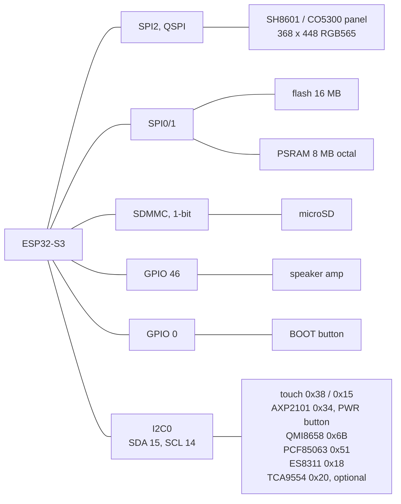
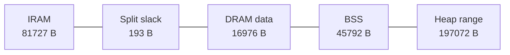

# Board and Memory

Part of the [platform notes](README.md). Hardware selection lives in
`launcher/main/board/`; memory policy lives in `launcher/main/core/memory.h`
and `launcher/sdkconfig.defaults`.

## The board

ESP32-S3R8, dual-core Xtensa LX7 @ 240 MHz, single-precision FPU. Flash and
PSRAM clocks are set in `launcher/sdkconfig.defaults`.



The display, SD card and external memory use separate buses. CPU work and
internal-memory traffic can still contend; separate buses do not guarantee
independent throughput.

| Peripheral | Part | POST | Notes |
|---|---|---|---|
| Display | SH8601 (V1) / CO5300 (V2) | ✓ | 368×448 RGB565 |
| Touch | FT3168 (V1) / CST820 (V2) | ✓ | the address that answers identifies the revision |
| IO expander | TCA9554 | optional | resets display and touch when fitted |
| Power management | AXP2101 | ✓ | battery charging, the PWR button ([Input-and-Sensors.md](Input-and-Sensors.md)) |
| IMU | QMI8658 | ✓ | axes in [Input-and-Sensors.md](Input-and-Sensors.md) |
| Real-time clock | PCF85063 | ✓ | |
| Audio codec | ES8311 | ✓ | datasheet address `0x30` is 8-bit; I2C wants `0x18` |
| microSD | - | optional | see [SD card](#sd-card) |
| Flash | - | ✓ | memory-mapped |
| PSRAM | - | ✓ | 8 MB octal |
| Wi-Fi 4 / BLE 5 | on-die | via `soc` | reported, not exercised |
| BOOT button | - | | active low, bounces; also the flashing button |
| Temperature sensor | on-die | ✓ | |

POST (`launcher/main/selftest/post.c`) also checks the MAC/eFuse and the I2C bus
itself. It raises the amp GPIO before probing the codec, which does not answer
without it (`board_audio_amp_enable()`).

### Revisions

| Revision | Touch answers at | Panel | X gap |
|---|---|---|---|
| V2 | CST820 `0x15` | CO5300 | `0x10` (`BOARD_PANEL_X_GAP`) |
| original (V1) | FT3168 `0x38` | SH8601 | none |

`board_detect()` tells them apart; go through it rather than hardcoding a
driver, and do not add the gap yourself.

## Memory: the constraint that shapes everything

| Tier | Current placement | Rule |
|---|---|---|
| Internal SRAM | stacks, ordinary mutable statics, DMA gather and bounce buffers, hot working data | budget static storage and the largest allocation together |
| PSRAM | full framebuffer (`MEMORY_PSRAM`) and app arena | keep frequently accessed working data internal where it fits |
| Flash | executable code, ordinary `static const` tables and mapped assets | account for cache misses on bulk or scattered reads |

In full-framebuffer mode the framebuffer is in PSRAM; band and indexed modes
free it. The band ring aliases the internal DMA bounce slots. See
[Gfx-and-Presentation.md](../Gfx-and-Presentation.md) for presentation.
The app arena (`launcher/main/app/app_arena.h`) uses explicit external-memory
placement, so its reservation reduces the PSRAM heap before apps allocate.

`CONFIG_SPIRAM_MALLOC_ALWAYSINTERNAL=65536` makes ordinary allocations up to
that threshold **try** internal RAM first, with PSRAM fallback. This is a
preference, not a placement guarantee. `memory_alloc()` requests the named
kind explicitly and does not fall back to another kind. Use `MEMORY_INTERNAL`
for required internal placement and `MEMORY_DMA` for the panel's buffers.

Read current free-heap and largest-block measurements from POST and the
development build's `HEAPMARK` lines. The host model's budget is recorded in
`launcher/tools/device/device_profiles/esp32s3.sh`; it is not a live heap
measurement of every build variant.

### PSRAM throughput

Device measurements put PSRAM reads at 33–58 MB/s depending on access
pattern, versus 365–724 MB/s for internal RAM. Sequential copies measure
about 58 MB/s out of PSRAM, 47 MB/s into it and 22 MB/s from PSRAM to PSRAM.
Writes incur cache-line loads before writeback, so bulk copies are costly
beside the arithmetic they support. These are measured access-pattern
ranges, not a guarantee for a particular buffer or clock configuration.
Prefer internal SRAM for hot working data where it fits, and read PSRAM
for bulk or cold content. The [presentation memory policy](../Gfx-and-Presentation.md#presentation-memory-policy)
explains why presentation keeps one retained framebuffer.

### Cycle budgets

At 240 MHz, one core has about 24 cycles per physical pixel at 60 fps,
48 at 30 fps, or 97 per half-resolution pixel at 60 fps. These are clock
and pixel-count budgets, not measured rendering costs.

### Cache is carved from the same pool

| Cache | Build configuration | Access |
|---|---|---|
| Instruction | 32 KiB, 32-byte lines, 8-way | flash-resident instructions |
| Data | 64 KiB, 64-byte lines, 8-way | mapped flash data and PSRAM |

`launcher/sdkconfig.defaults` selects the instruction-cache size with
`CONFIG_ESP32S3_INSTRUCTION_CACHE_32KB` and the data-cache size and line size
with `CONFIG_ESP32S3_DATA_CACHE_64KB` and `CONFIG_ESP32S3_DATA_CACHE_LINE_64B`;
the remaining settings use ESP-IDF's ESP32-S3 cache defaults. The larger data
cache serves the renderer's PSRAM vertex, depth and colour streams. Cache
storage consumes internal SRAM: increasing its capacity reduces the internal
heap available to allocations. Internal working data avoids external-memory
cache traffic;
flash-resident `const` data is not internal working data. Inspect the linker
map for actual placement, including explicitly RAM-mapped code and tables.
Changing code layout can change cache behaviour even when a hot function's
instructions are identical; measure the linked image on the device.

### Internal memory map

IRAM and DRAM are aliases of the same shared SRAM pool. Code placement
reduces the space available for static data and the internal heap.
`launcher/tools/build/memory_map.py` reads each build's own map, ELF,
sdkconfig and linked scripts. The measured block is refreshed by CI;
its SHA-256 marker lets host gates detect hand edits without building firmware.

Every IRAM placement site declares a reason in the comment immediately above
it and an exact budget in the form `IRAM budget: <bytes> B`. Starting budgets
are the site's measured release bytes, or the largest variant that builds
that site when its bytes differ. There is no rounding or growth allowance.
Raising a budget requires editing the site's comment for review. Engine
budgets and each app's budgets are separate. A compiled-out site is a note;
an enabled site that places nothing fails. sdkconfig placement options
require a reason; their IDF-owned bytes do not require a site budget.

<!-- generated: internal-memory-map sha256=ab53a14f4d3f7d0c2294722a20c48237f52b62f3248a25f876eedb6099e01440 -->
> Generated by: `python launcher/tools/build/memory_map.py launcher/build launcher/build.dev launcher/build.diag --write`

Bytes from each build's ELF, link map, sdkconfig and ESP-IDF size JSON. Heap is a link-time range, not runtime free memory.

| Region / boundary | release | dev | diag |
|---|---|---|---|
| iram0_0_seg shared alias | 0x40378000–0x403cb700 (341760 B) | 0x40378000–0x403cb700 (341760 B) | 0x40378000–0x403cb700 (341760 B) |
| dram0_0_seg shared alias | 0x3fc88000–0x3fcdb700 (341760 B) | 0x3fc88000–0x3fcdb700 (341760 B) | 0x3fc88000–0x3fcdb700 (341760 B) |
| DIRAM used (idf_size) | 144495 | 166687 | 181915 |
| .dram0.bss | 45792 | 56264 | 70168 |
| .dram0.data | 16976 | 20216 | 20780 |
| .dram0.dummy | 81920 | 90368 | 91136 |
| .dram0.heap_start | 0 | 0 | 0 |
| .iram0.bss | 0 | 0 | 0 |
| .iram0.data | 0 | 0 | 0 |
| .iram0.text | 80699 | 89179 | 89939 |
| .iram0.text_end | 193 | 161 | 169 |
| .iram0.vectors | 1028 | 1028 | 1028 |
| Split granularity | 256 | 256 | 256 |
| Prefetch pad | 16 | 16 | 16 |
| Slack including pad | 193 | 161 | 169 |
| _iram_end | 0x4038c000 | 0x4038e100 | 0x4038e400 |
| _data_start | 0x3fc9c000 | 0x3fc9e100 | 0x3fc9e400 |
| _bss_start | 0x3fca0250 | 0x3fca2ff8 | 0x3fca3530 |
| _bss_end | 0x3fcab530 | 0x3fcb0bc0 | 0x3fcb4748 |
| _heap_start | 0x3fcab530 | 0x3fcb0bc0 | 0x3fcb4748 |
| _heap_low_start | 0x3fcab530 | 0x3fcb0bc0 | 0x3fcb4748 |

Split follows `CONFIG_ESP_SYSTEM_MEMPROT_FEATURE`; alignment and prefetch padding are read from the linked scripts and map.

| IRAM component | Ownership | release | dev | diag |
|---|---|---|---|---|
| libfreertos.a | IDF / managed | 13701 | 13836 | 14619 |
| libesp_hw_support.a | IDF / managed | 13334 | 13326 | 13326 |
| libspi_flash.a | IDF / managed | 12379 | 12433 | 12433 |
| libhal.a | IDF / managed | 10999 | 10999 | 10999 |
| libheap.a | IDF / managed | 6381 | 6463 | 6463 |
| libesp_driver_spi.a | IDF / managed | 5041 | 5041 | 5041 |
| libmain.a | ours | 870 | 4641 | 4641 |
| libesp_ringbuf.a | IDF / managed | 159 | 4106 | 4106 |
| libesp_system.a | IDF / managed | 3522 | 3522 | 3492 |
| libnewlib.a | IDF / managed | 2313 | 2595 | 2595 |
| libxtensa.a | IDF / managed | 2492 | 2508 | 2508 |
| libesp_psram.a | IDF / managed | 1932 | 1932 | 1932 |
| libesp_lcd.a | IDF / managed | 1688 | 1688 | 1688 |
| libesp_mm.a | IDF / managed | 1342 | 1342 | 1342 |
| libbootloader_support.a | IDF / managed | 1064 | 1064 | 1064 |
| libesp_driver_i2c.a | IDF / managed | 738 | 738 | 738 |
| libesp_rom.a | IDF / managed | 693 | 693 | 693 |
| libxt_hal.a | IDF / managed | 405 | 405 | 405 |
| liblog.a | IDF / managed | 348 | 377 | 377 |
| libesp_driver_gpio.a | IDF / managed | 350 | 350 | 350 |
| libwaveshare__esp_lcd_sh8601.a | IDF / managed | 339 | 339 | 339 |
| libgcc.a | IDF / managed | 0 | 104 | 104 |
| libesp_driver_usb_serial_jtag.a | IDF / managed | 103 | 103 | 103 |
| libesp_timer.a | IDF / managed | 57 | 57 | 57 |
| libesp_pm.a | IDF / managed | 16 | 16 | 16 |
| Linker fill / split slack | unattributed | 1654 | 1690 | 1705 |

| Owner | Placement site | Symbols | release | dev | diag | Budget B | Reason |
|---|---|---|---|---|---|---|---|
| engine | launcher/main/gfx/present/gfx_present.c:128 | on_strip_sent | 36 | 36 | 36 | 36 | Avoid callback cache misses on the SPI completion path; the bus ISR uses flags 0. SPI_MASTER_ISR_IN_IRAM alone does not require cache-off safety (docs/Citations.md#59). IRAM budget: 36 B |
| engine | launcher/main/input/touch.c:71 | on_touch_int | 50 | 50 | 50 | 50 | GPIO dispatch uses gpio_install_isr_service(0), so no cache-off requirement is established. Retain placement pending a touch-latency measurement. IRAM budget: 50 B |
| engine | launcher/main/linker.lf:23 | gather_and_send, gfx_present, gfx_present_begin, gfx_present_wait, present_task_fn, run_present_normal, send_fb_rows | 784 | 3926 | 3926 | 3926 | A present's own code, from gfx down to the SPI queue, in IRAM: from flash its cost moved with whatever else the image linked, and a narrow strip went from ~236 us to ~398 us with the cache cold (suite_gfx test_narrow_present_counters). Only what every present runs; setup, the other present modes and the SPI driver's own queue (SPI_MASTER_IN_IRAM) stay where they are. IRAM budget: 3926 B |
| engine | launcher/main/linker.lf:36 | esp_lcd_panel_draw_bitmap, esp_lcd_panel_io_tx_color, esp_lcd_panel_io_tx_param, lcd_spi_post_trans_color_cb, panel_io_spi_tx_color, panel_io_spi_tx_param | 1549 | 1549 | 1549 | 1549 | Avoid cache misses in the LCD dispatch and SPI completion path used by every present. IRAM budget: 1549 B |
| engine | launcher/main/linker.lf:48 | panel_sh8601_draw_bitmap | 339 | 339 | 339 | 339 | Avoid cache misses in the panel draw dispatch used by every present. IRAM budget: 339 B |
| engine | launcher/main/profile/frame_watch.c:61 | watching_this_task | 0 | 78 | 78 | 78 | Heap hooks and their callees must remain callable while flash cache is disabled. IRAM budget: 78 B |
| engine | launcher/main/profile/frame_watch.c:77 | record | 0 | 129 | 129 | 129 | Heap hooks and their callees must remain callable while flash cache is disabled. IRAM budget: 129 B |
| engine | launcher/main/profile/frame_watch.c:111 | heap_call_site | 0 | 378 | 378 | 378 | Heap hooks and their callees must remain callable while flash cache is disabled. IRAM budget: 378 B |
| engine | launcher/main/profile/frame_watch.c:127 | esp_heap_trace_alloc_hook | 0 | 22 | 22 | 22 | Heap hooks and their callees must remain callable while flash cache is disabled. IRAM budget: 22 B |
| engine | launcher/main/profile/frame_watch.c:139 | esp_heap_trace_free_hook | 0 | 22 | 22 | 22 | Heap hooks and their callees must remain callable while flash cache is disabled. IRAM budget: 22 B |

#### Differs between variants

Symbol changes are map-derived; differing options are correlations, not isolated causal measurements. A zero means absent from IRAM, not necessarily absent from the image.

| Component / symbol group | release | dev | diag | Why / evidence | Differing Kconfig |
|---|---|---|---|---|---|
| libfreertos.a | 13701 | 13836 | 14619 | sum of changed input sections |  |
| libfreertos.a:heap_idf.c.obj:xPortCheckValidListMem | 0 | 76 | 76 | linked section differs; causal option not isolated | release to dev: CONFIG_ESP_COREDUMP_LOGS, CONFIG_HEAP_USE_HOOKS, CONFIG_LAUNCHER_DEVELOPMENT, CONFIG_LAUNCHER_RELEASE |
| libfreertos.a:heap_idf.c.obj:xPortCheckValidTCBMem | 76 | 68 | 68 | linked section differs; causal option not isolated | release to dev: CONFIG_ESP_COREDUMP_LOGS, CONFIG_HEAP_USE_HOOKS, CONFIG_LAUNCHER_DEVELOPMENT, CONFIG_LAUNCHER_RELEASE |
| libfreertos.a:portasm.S.obj:.literal | 28 | 32 | 32 | linked section differs; causal option not isolated | release to dev: CONFIG_ESP_COREDUMP_LOGS, CONFIG_HEAP_USE_HOOKS, CONFIG_LAUNCHER_DEVELOPMENT, CONFIG_LAUNCHER_RELEASE |
| libfreertos.a:queue.c.obj:xQueueGenericReset | 179 | 175 | 175 | linked section differs; causal option not isolated | release to dev: CONFIG_ESP_COREDUMP_LOGS, CONFIG_HEAP_USE_HOOKS, CONFIG_LAUNCHER_DEVELOPMENT, CONFIG_LAUNCHER_RELEASE |
| libfreertos.a:tasks.c.obj:prvTaskCreateDynamicPinnedToCoreWithCaps | 0 | 0 | 209 | linked section differs; causal option not isolated | dev to diag: CONFIG_LAUNCHER_SELFTEST, CONFIG_LAUNCHER_SELFTEST_SCOPE_FULL, CONFIG_UNITY_ENABLE_64BIT |
| libfreertos.a:tasks.c.obj:uxTaskGetNumberOfTasks | 0 | 0 | 13 | linked section differs; causal option not isolated | dev to diag: CONFIG_LAUNCHER_SELFTEST, CONFIG_LAUNCHER_SELFTEST_SCOPE_FULL, CONFIG_UNITY_ENABLE_64BIT |
| libfreertos.a:tasks.c.obj:uxTaskGetStackHighWaterMark | 0 | 0 | 58 | linked section differs; causal option not isolated | dev to diag: CONFIG_LAUNCHER_SELFTEST, CONFIG_LAUNCHER_SELFTEST_SCOPE_FULL, CONFIG_UNITY_ENABLE_64BIT |
| libfreertos.a:tasks.c.obj:vTaskSetTimeOutState | 0 | 71 | 71 | linked section differs; causal option not isolated | release to dev: CONFIG_ESP_COREDUMP_LOGS, CONFIG_HEAP_USE_HOOKS, CONFIG_LAUNCHER_DEVELOPMENT, CONFIG_LAUNCHER_RELEASE |
| libfreertos.a:tasks.c.obj:vTaskSuspend | 0 | 0 | 317 | linked section differs; causal option not isolated | dev to diag: CONFIG_LAUNCHER_SELFTEST, CONFIG_LAUNCHER_SELFTEST_SCOPE_FULL, CONFIG_UNITY_ENABLE_64BIT |
| libfreertos.a:tasks.c.obj:xTaskCheckForTimeOut | 207 | 203 | 203 | linked section differs; causal option not isolated | release to dev: CONFIG_ESP_COREDUMP_LOGS, CONFIG_HEAP_USE_HOOKS, CONFIG_LAUNCHER_DEVELOPMENT, CONFIG_LAUNCHER_RELEASE |
| libfreertos.a:tasks.c.obj:xTaskGenericNotifyWait | 0 | 0 | 244 | linked section differs; causal option not isolated | dev to diag: CONFIG_LAUNCHER_SELFTEST, CONFIG_LAUNCHER_SELFTEST_SCOPE_FULL, CONFIG_UNITY_ENABLE_64BIT |
| libfreertos.a:tasks.c.obj:xTaskGetCurrentTaskHandleForCore | 38 | 38 | 42 | linked section differs; causal option not isolated | dev to diag: CONFIG_LAUNCHER_SELFTEST, CONFIG_LAUNCHER_SELFTEST_SCOPE_FULL, CONFIG_UNITY_ENABLE_64BIT |
| libfreertos.a:tasks.c.obj:xTaskGetIdleTaskHandleForCore | 62 | 62 | 0 | linked section differs; causal option not isolated | dev to diag: CONFIG_LAUNCHER_SELFTEST, CONFIG_LAUNCHER_SELFTEST_SCOPE_FULL, CONFIG_UNITY_ENABLE_64BIT |
| libesp_hw_support.a | 13334 | 13326 | 13326 | sum of changed input sections |  |
| libesp_hw_support.a:esp_memory_utils.c.obj:esp_ptr_executable | 112 | 104 | 104 | linked section differs; causal option not isolated | release to dev: CONFIG_ESP_COREDUMP_LOGS, CONFIG_HEAP_USE_HOOKS, CONFIG_LAUNCHER_DEVELOPMENT, CONFIG_LAUNCHER_RELEASE |
| libspi_flash.a | 12379 | 12433 | 12433 | sum of changed input sections |  |
| libspi_flash.a:cache_utils.c.obj:spi_flash_disable_interrupts_caches_and_other_cpu_no_os | 0 | 21 | 21 | linked section differs; causal option not isolated | release to dev: CONFIG_ESP_COREDUMP_LOGS, CONFIG_HEAP_USE_HOOKS, CONFIG_LAUNCHER_DEVELOPMENT, CONFIG_LAUNCHER_RELEASE |
| libspi_flash.a:cache_utils.c.obj:spi_flash_enable_interrupts_caches_no_os | 0 | 17 | 17 | linked section differs; causal option not isolated | release to dev: CONFIG_ESP_COREDUMP_LOGS, CONFIG_HEAP_USE_HOOKS, CONFIG_LAUNCHER_DEVELOPMENT, CONFIG_LAUNCHER_RELEASE |
| libspi_flash.a:spi_flash_os_func_noos.c.obj:.iram1.0 | 0 | 0 | 17 | linked section differs; causal option not isolated | dev to diag: CONFIG_LAUNCHER_SELFTEST, CONFIG_LAUNCHER_SELFTEST_SCOPE_FULL, CONFIG_UNITY_ENABLE_64BIT |
| libspi_flash.a:spi_flash_os_func_noos.c.obj:esp_flash_app_disable_os_functions | 0 | 16 | 16 | linked section differs; causal option not isolated | release to dev: CONFIG_ESP_COREDUMP_LOGS, CONFIG_HEAP_USE_HOOKS, CONFIG_LAUNCHER_DEVELOPMENT, CONFIG_LAUNCHER_RELEASE |
| libspi_flash.a:spi_flash_os_func_noos.c.obj:start | 17 | 17 | 0 | linked section differs; causal option not isolated | dev to diag: CONFIG_LAUNCHER_SELFTEST, CONFIG_LAUNCHER_SELFTEST_SCOPE_FULL, CONFIG_UNITY_ENABLE_64BIT |
| libheap.a | 6381 | 6463 | 6463 | sum of changed input sections |  |
| libheap.a:heap_caps_base.c.obj:heap_caps_aligned_alloc_base | 379 | 425 | 425 | linked section differs; causal option not isolated | release to dev: CONFIG_ESP_COREDUMP_LOGS, CONFIG_HEAP_USE_HOOKS, CONFIG_LAUNCHER_DEVELOPMENT, CONFIG_LAUNCHER_RELEASE |
| libheap.a:heap_caps_base.c.obj:heap_caps_free | 98 | 118 | 118 | linked section differs; causal option not isolated | release to dev: CONFIG_ESP_COREDUMP_LOGS, CONFIG_HEAP_USE_HOOKS, CONFIG_LAUNCHER_DEVELOPMENT, CONFIG_LAUNCHER_RELEASE |
| libheap.a:heap_caps_base.c.obj:heap_caps_realloc_base | 339 | 355 | 355 | linked section differs; causal option not isolated | release to dev: CONFIG_ESP_COREDUMP_LOGS, CONFIG_HEAP_USE_HOOKS, CONFIG_LAUNCHER_DEVELOPMENT, CONFIG_LAUNCHER_RELEASE |
| libmain.a | 870 | 4641 | 4641 | sum of changed input sections |  |
| libmain.a:frame_watch.c.obj:esp_heap_trace_alloc_hook | 0 | 22 | 22 | (defined(ESP_PLATFORM) && CONFIG_LAUNCHER_DEVELOPMENT) | release to dev: CONFIG_ESP_COREDUMP_LOGS, CONFIG_HEAP_USE_HOOKS, CONFIG_LAUNCHER_DEVELOPMENT, CONFIG_LAUNCHER_RELEASE |
| libmain.a:frame_watch.c.obj:esp_heap_trace_free_hook | 0 | 22 | 22 | (defined(ESP_PLATFORM) && CONFIG_LAUNCHER_DEVELOPMENT) | release to dev: CONFIG_ESP_COREDUMP_LOGS, CONFIG_HEAP_USE_HOOKS, CONFIG_LAUNCHER_DEVELOPMENT, CONFIG_LAUNCHER_RELEASE |
| libmain.a:frame_watch.c.obj:heap_call_site | 0 | 378 | 378 | (defined(ESP_PLATFORM) && CONFIG_LAUNCHER_DEVELOPMENT) | release to dev: CONFIG_ESP_COREDUMP_LOGS, CONFIG_HEAP_USE_HOOKS, CONFIG_LAUNCHER_DEVELOPMENT, CONFIG_LAUNCHER_RELEASE |
| libmain.a:frame_watch.c.obj:record | 0 | 129 | 129 | (defined(ESP_PLATFORM) && CONFIG_LAUNCHER_DEVELOPMENT) | release to dev: CONFIG_ESP_COREDUMP_LOGS, CONFIG_HEAP_USE_HOOKS, CONFIG_LAUNCHER_DEVELOPMENT, CONFIG_LAUNCHER_RELEASE |
| libmain.a:frame_watch.c.obj:watching_this_task | 0 | 78 | 78 | (defined(ESP_PLATFORM) && CONFIG_LAUNCHER_DEVELOPMENT) | release to dev: CONFIG_ESP_COREDUMP_LOGS, CONFIG_HEAP_USE_HOOKS, CONFIG_LAUNCHER_DEVELOPMENT, CONFIG_LAUNCHER_RELEASE |
| libmain.a:gfx_present.c.obj:gather_and_send | 0 | 750 | 750 | linked section differs; causal option not isolated | release to dev: CONFIG_ESP_COREDUMP_LOGS, CONFIG_HEAP_USE_HOOKS, CONFIG_LAUNCHER_DEVELOPMENT, CONFIG_LAUNCHER_RELEASE |
| libmain.a:gfx_present.c.obj:gfx_present | 172 | 132 | 132 | linked section differs; causal option not isolated | release to dev: CONFIG_ESP_COREDUMP_LOGS, CONFIG_HEAP_USE_HOOKS, CONFIG_LAUNCHER_DEVELOPMENT, CONFIG_LAUNCHER_RELEASE |
| libmain.a:gfx_present.c.obj:gfx_present_begin | 92 | 65 | 65 | linked section differs; causal option not isolated | release to dev: CONFIG_ESP_COREDUMP_LOGS, CONFIG_HEAP_USE_HOOKS, CONFIG_LAUNCHER_DEVELOPMENT, CONFIG_LAUNCHER_RELEASE |
| libmain.a:gfx_present.c.obj:present_task_fn | 358 | 329 | 329 | linked section differs; causal option not isolated | release to dev: CONFIG_ESP_COREDUMP_LOGS, CONFIG_HEAP_USE_HOOKS, CONFIG_LAUNCHER_DEVELOPMENT, CONFIG_LAUNCHER_RELEASE |
| libmain.a:gfx_present.c.obj:run_present_normal | 0 | 2454 | 2454 | linked section differs; causal option not isolated | release to dev: CONFIG_ESP_COREDUMP_LOGS, CONFIG_HEAP_USE_HOOKS, CONFIG_LAUNCHER_DEVELOPMENT, CONFIG_LAUNCHER_RELEASE |
| libmain.a:gfx_present.c.obj:send_fb_rows | 112 | 146 | 146 | linked section differs; causal option not isolated | release to dev: CONFIG_ESP_COREDUMP_LOGS, CONFIG_HEAP_USE_HOOKS, CONFIG_LAUNCHER_DEVELOPMENT, CONFIG_LAUNCHER_RELEASE |
| libesp_ringbuf.a | 159 | 4106 | 4106 | sum of changed input sections |  |
| libesp_ringbuf.a:ringbuf.c.obj:prvAcquireItemNoSplit | 0 | 158 | 158 | linked section differs; causal option not isolated | release to dev: CONFIG_ESP_COREDUMP_LOGS, CONFIG_HEAP_USE_HOOKS, CONFIG_LAUNCHER_DEVELOPMENT, CONFIG_LAUNCHER_RELEASE |
| libesp_ringbuf.a:ringbuf.c.obj:prvCheckItemAvail | 0 | 54 | 54 | linked section differs; causal option not isolated | release to dev: CONFIG_ESP_COREDUMP_LOGS, CONFIG_HEAP_USE_HOOKS, CONFIG_LAUNCHER_DEVELOPMENT, CONFIG_LAUNCHER_RELEASE |
| libesp_ringbuf.a:ringbuf.c.obj:prvCheckItemFitsByteBuffer | 0 | 95 | 95 | linked section differs; causal option not isolated | release to dev: CONFIG_ESP_COREDUMP_LOGS, CONFIG_HEAP_USE_HOOKS, CONFIG_LAUNCHER_DEVELOPMENT, CONFIG_LAUNCHER_RELEASE |
| libesp_ringbuf.a:ringbuf.c.obj:prvCheckItemFitsDefault | 0 | 158 | 158 | linked section differs; causal option not isolated | release to dev: CONFIG_ESP_COREDUMP_LOGS, CONFIG_HEAP_USE_HOOKS, CONFIG_LAUNCHER_DEVELOPMENT, CONFIG_LAUNCHER_RELEASE |
| libesp_ringbuf.a:ringbuf.c.obj:prvCopyItemAllowSplit | 0 | 222 | 222 | linked section differs; causal option not isolated | release to dev: CONFIG_ESP_COREDUMP_LOGS, CONFIG_HEAP_USE_HOOKS, CONFIG_LAUNCHER_DEVELOPMENT, CONFIG_LAUNCHER_RELEASE |
| libesp_ringbuf.a:ringbuf.c.obj:prvCopyItemByteBuf | 0 | 116 | 116 | linked section differs; causal option not isolated | release to dev: CONFIG_ESP_COREDUMP_LOGS, CONFIG_HEAP_USE_HOOKS, CONFIG_LAUNCHER_DEVELOPMENT, CONFIG_LAUNCHER_RELEASE |
| libesp_ringbuf.a:ringbuf.c.obj:prvCopyItemNoSplit | 0 | 34 | 34 | linked section differs; causal option not isolated | release to dev: CONFIG_ESP_COREDUMP_LOGS, CONFIG_HEAP_USE_HOOKS, CONFIG_LAUNCHER_DEVELOPMENT, CONFIG_LAUNCHER_RELEASE |
| libesp_ringbuf.a:ringbuf.c.obj:prvGetCurMaxSizeAllowSplit | 0 | 76 | 76 | linked section differs; causal option not isolated | release to dev: CONFIG_ESP_COREDUMP_LOGS, CONFIG_HEAP_USE_HOOKS, CONFIG_LAUNCHER_DEVELOPMENT, CONFIG_LAUNCHER_RELEASE |
| libesp_ringbuf.a:ringbuf.c.obj:prvGetCurMaxSizeByteBuf | 0 | 28 | 28 | linked section differs; causal option not isolated | release to dev: CONFIG_ESP_COREDUMP_LOGS, CONFIG_HEAP_USE_HOOKS, CONFIG_LAUNCHER_DEVELOPMENT, CONFIG_LAUNCHER_RELEASE |
| libesp_ringbuf.a:ringbuf.c.obj:prvGetCurMaxSizeNoSplit | 0 | 58 | 58 | linked section differs; causal option not isolated | release to dev: CONFIG_ESP_COREDUMP_LOGS, CONFIG_HEAP_USE_HOOKS, CONFIG_LAUNCHER_DEVELOPMENT, CONFIG_LAUNCHER_RELEASE |
| libesp_ringbuf.a:ringbuf.c.obj:prvGetItemByteBuf | 0 | 175 | 175 | linked section differs; causal option not isolated | release to dev: CONFIG_ESP_COREDUMP_LOGS, CONFIG_HEAP_USE_HOOKS, CONFIG_LAUNCHER_DEVELOPMENT, CONFIG_LAUNCHER_RELEASE |
| libesp_ringbuf.a:ringbuf.c.obj:prvGetItemDefault | 0 | 310 | 310 | linked section differs; causal option not isolated | release to dev: CONFIG_ESP_COREDUMP_LOGS, CONFIG_HEAP_USE_HOOKS, CONFIG_LAUNCHER_DEVELOPMENT, CONFIG_LAUNCHER_RELEASE |
| libesp_ringbuf.a:ringbuf.c.obj:prvInitializeNewRingbuffer | 0 | 195 | 195 | linked section differs; causal option not isolated | release to dev: CONFIG_ESP_COREDUMP_LOGS, CONFIG_HEAP_USE_HOOKS, CONFIG_LAUNCHER_DEVELOPMENT, CONFIG_LAUNCHER_RELEASE |
| libesp_ringbuf.a:ringbuf.c.obj:prvReceiveGeneric | 0 | 334 | 334 | linked section differs; causal option not isolated | release to dev: CONFIG_ESP_COREDUMP_LOGS, CONFIG_HEAP_USE_HOOKS, CONFIG_LAUNCHER_DEVELOPMENT, CONFIG_LAUNCHER_RELEASE |
| libesp_ringbuf.a:ringbuf.c.obj:prvReceiveGenericFromISR | 0 | 164 | 164 | linked section differs; causal option not isolated | release to dev: CONFIG_ESP_COREDUMP_LOGS, CONFIG_HEAP_USE_HOOKS, CONFIG_LAUNCHER_DEVELOPMENT, CONFIG_LAUNCHER_RELEASE |
| libesp_ringbuf.a:ringbuf.c.obj:prvReturnItemByteBuf | 0 | 79 | 79 | linked section differs; causal option not isolated | release to dev: CONFIG_ESP_COREDUMP_LOGS, CONFIG_HEAP_USE_HOOKS, CONFIG_LAUNCHER_DEVELOPMENT, CONFIG_LAUNCHER_RELEASE |
| libesp_ringbuf.a:ringbuf.c.obj:prvReturnItemDefault | 0 | 340 | 340 | linked section differs; causal option not isolated | release to dev: CONFIG_ESP_COREDUMP_LOGS, CONFIG_HEAP_USE_HOOKS, CONFIG_LAUNCHER_DEVELOPMENT, CONFIG_LAUNCHER_RELEASE |
| libesp_ringbuf.a:ringbuf.c.obj:prvSendAcquireGeneric | 0 | 244 | 244 | linked section differs; causal option not isolated | release to dev: CONFIG_ESP_COREDUMP_LOGS, CONFIG_HEAP_USE_HOOKS, CONFIG_LAUNCHER_DEVELOPMENT, CONFIG_LAUNCHER_RELEASE |
| libesp_ringbuf.a:ringbuf.c.obj:prvSendItemDoneNoSplit | 0 | 258 | 258 | linked section differs; causal option not isolated | release to dev: CONFIG_ESP_COREDUMP_LOGS, CONFIG_HEAP_USE_HOOKS, CONFIG_LAUNCHER_DEVELOPMENT, CONFIG_LAUNCHER_RELEASE |
| libesp_ringbuf.a:ringbuf.c.obj:vRingbufferDelete | 0 | 43 | 43 | linked section differs; causal option not isolated | release to dev: CONFIG_ESP_COREDUMP_LOGS, CONFIG_HEAP_USE_HOOKS, CONFIG_LAUNCHER_DEVELOPMENT, CONFIG_LAUNCHER_RELEASE |
| libesp_ringbuf.a:ringbuf.c.obj:vRingbufferReturnItem | 0 | 100 | 100 | linked section differs; causal option not isolated | release to dev: CONFIG_ESP_COREDUMP_LOGS, CONFIG_HEAP_USE_HOOKS, CONFIG_LAUNCHER_DEVELOPMENT, CONFIG_LAUNCHER_RELEASE |
| libesp_ringbuf.a:ringbuf.c.obj:vRingbufferReturnItemFromISR | 0 | 93 | 93 | linked section differs; causal option not isolated | release to dev: CONFIG_ESP_COREDUMP_LOGS, CONFIG_HEAP_USE_HOOKS, CONFIG_LAUNCHER_DEVELOPMENT, CONFIG_LAUNCHER_RELEASE |
| libesp_ringbuf.a:ringbuf.c.obj:xRingbufferCreate | 0 | 130 | 130 | linked section differs; causal option not isolated | release to dev: CONFIG_ESP_COREDUMP_LOGS, CONFIG_HEAP_USE_HOOKS, CONFIG_LAUNCHER_DEVELOPMENT, CONFIG_LAUNCHER_RELEASE |
| libesp_ringbuf.a:ringbuf.c.obj:xRingbufferGetCurFreeSize | 60 | 52 | 52 | linked section differs; causal option not isolated | release to dev: CONFIG_ESP_COREDUMP_LOGS, CONFIG_HEAP_USE_HOOKS, CONFIG_LAUNCHER_DEVELOPMENT, CONFIG_LAUNCHER_RELEASE |
| libesp_ringbuf.a:ringbuf.c.obj:xRingbufferReceiveUpTo | 0 | 95 | 95 | linked section differs; causal option not isolated | release to dev: CONFIG_ESP_COREDUMP_LOGS, CONFIG_HEAP_USE_HOOKS, CONFIG_LAUNCHER_DEVELOPMENT, CONFIG_LAUNCHER_RELEASE |
| libesp_ringbuf.a:ringbuf.c.obj:xRingbufferReceiveUpToFromISR | 0 | 84 | 84 | linked section differs; causal option not isolated | release to dev: CONFIG_ESP_COREDUMP_LOGS, CONFIG_HEAP_USE_HOOKS, CONFIG_LAUNCHER_DEVELOPMENT, CONFIG_LAUNCHER_RELEASE |
| libesp_ringbuf.a:ringbuf.c.obj:xRingbufferSend | 0 | 100 | 100 | linked section differs; causal option not isolated | release to dev: CONFIG_ESP_COREDUMP_LOGS, CONFIG_HEAP_USE_HOOKS, CONFIG_LAUNCHER_DEVELOPMENT, CONFIG_LAUNCHER_RELEASE |
| libesp_ringbuf.a:ringbuf.c.obj:xRingbufferSendFromISR | 0 | 212 | 212 | linked section differs; causal option not isolated | release to dev: CONFIG_ESP_COREDUMP_LOGS, CONFIG_HEAP_USE_HOOKS, CONFIG_LAUNCHER_DEVELOPMENT, CONFIG_LAUNCHER_RELEASE |
| libesp_system.a | 3522 | 3522 | 3492 | sum of changed input sections |  |
| libesp_system.a:crosscore_int.c.obj:esp_crosscore_int_send_print_backtrace | 15 | 15 | 0 | linked section differs; causal option not isolated | dev to diag: CONFIG_LAUNCHER_SELFTEST, CONFIG_LAUNCHER_SELFTEST_SCOPE_FULL, CONFIG_UNITY_ENABLE_64BIT |
| libesp_system.a:crosscore_int.c.obj:esp_crosscore_int_send_twdt_abort | 15 | 15 | 0 | linked section differs; causal option not isolated | dev to diag: CONFIG_LAUNCHER_SELFTEST, CONFIG_LAUNCHER_SELFTEST_SCOPE_FULL, CONFIG_UNITY_ENABLE_64BIT |
| libnewlib.a | 2313 | 2595 | 2595 | sum of changed input sections |  |
| libnewlib.a:locks.c.obj:.iram1.3.literal | 8 | 0 | 0 | linked section differs; causal option not isolated | release to dev: CONFIG_ESP_COREDUMP_LOGS, CONFIG_HEAP_USE_HOOKS, CONFIG_LAUNCHER_DEVELOPMENT, CONFIG_LAUNCHER_RELEASE |
| libnewlib.a:locks.c.obj:.iram1.5.literal | 0 | 8 | 8 | linked section differs; causal option not isolated | release to dev: CONFIG_ESP_COREDUMP_LOGS, CONFIG_HEAP_USE_HOOKS, CONFIG_LAUNCHER_DEVELOPMENT, CONFIG_LAUNCHER_RELEASE |
| libnewlib.a:stdatomic.c.obj:__atomic_exchange_4 | 0 | 66 | 66 | linked section differs; causal option not isolated | release to dev: CONFIG_ESP_COREDUMP_LOGS, CONFIG_HEAP_USE_HOOKS, CONFIG_LAUNCHER_DEVELOPMENT, CONFIG_LAUNCHER_RELEASE |
| libnewlib.a:stdatomic.c.obj:__atomic_fetch_add_4 | 0 | 68 | 68 | linked section differs; causal option not isolated | release to dev: CONFIG_ESP_COREDUMP_LOGS, CONFIG_HEAP_USE_HOOKS, CONFIG_LAUNCHER_DEVELOPMENT, CONFIG_LAUNCHER_RELEASE |
| libnewlib.a:stdatomic.c.obj:__sync_bool_compare_and_swap_4 | 0 | 74 | 74 | linked section differs; causal option not isolated | release to dev: CONFIG_ESP_COREDUMP_LOGS, CONFIG_HEAP_USE_HOOKS, CONFIG_LAUNCHER_DEVELOPMENT, CONFIG_LAUNCHER_RELEASE |
| libnewlib.a:stdatomic_s32c1i.c.obj:__atomic_s32c1i_exchange_4 | 0 | 27 | 27 | linked section differs; causal option not isolated | release to dev: CONFIG_ESP_COREDUMP_LOGS, CONFIG_HEAP_USE_HOOKS, CONFIG_LAUNCHER_DEVELOPMENT, CONFIG_LAUNCHER_RELEASE |
| libnewlib.a:stdatomic_s32c1i.c.obj:__atomic_s32c1i_fetch_add_4 | 0 | 27 | 27 | linked section differs; causal option not isolated | release to dev: CONFIG_ESP_COREDUMP_LOGS, CONFIG_HEAP_USE_HOOKS, CONFIG_LAUNCHER_DEVELOPMENT, CONFIG_LAUNCHER_RELEASE |
| libnewlib.a:stdatomic_s32c1i.c.obj:__sync_s32c1i_bool_compare_and_swap_4 | 0 | 20 | 20 | linked section differs; causal option not isolated | release to dev: CONFIG_ESP_COREDUMP_LOGS, CONFIG_HEAP_USE_HOOKS, CONFIG_LAUNCHER_DEVELOPMENT, CONFIG_LAUNCHER_RELEASE |
| libxtensa.a | 2492 | 2508 | 2508 | sum of changed input sections |  |
| libxtensa.a:eri.c.obj:eri_read | 0 | 8 | 8 | linked section differs; causal option not isolated | release to dev: CONFIG_ESP_COREDUMP_LOGS, CONFIG_HEAP_USE_HOOKS, CONFIG_LAUNCHER_DEVELOPMENT, CONFIG_LAUNCHER_RELEASE |
| libxtensa.a:eri.c.obj:eri_write | 0 | 8 | 8 | linked section differs; causal option not isolated | release to dev: CONFIG_ESP_COREDUMP_LOGS, CONFIG_HEAP_USE_HOOKS, CONFIG_LAUNCHER_DEVELOPMENT, CONFIG_LAUNCHER_RELEASE |
| liblog.a | 348 | 377 | 377 | sum of changed input sections |  |
| liblog.a:log_timestamp.c.obj:esp_log_early_timestamp | 0 | 29 | 29 | linked section differs; causal option not isolated | release to dev: CONFIG_ESP_COREDUMP_LOGS, CONFIG_HEAP_USE_HOOKS, CONFIG_LAUNCHER_DEVELOPMENT, CONFIG_LAUNCHER_RELEASE |
| libgcc.a | 0 | 104 | 104 | sum of changed input sections |  |
| libgcc.a:lib2funcs.o:__xtensa_libgcc_window_spill | 0 | 32 | 32 | linked section differs; causal option not isolated | release to dev: CONFIG_ESP_COREDUMP_LOGS, CONFIG_HEAP_USE_HOOKS, CONFIG_LAUNCHER_DEVELOPMENT, CONFIG_LAUNCHER_RELEASE |
| libgcc.a:lib2funcs.o:__xtensa_nonlocal_goto | 0 | 64 | 64 | linked section differs; causal option not isolated | release to dev: CONFIG_ESP_COREDUMP_LOGS, CONFIG_HEAP_USE_HOOKS, CONFIG_LAUNCHER_DEVELOPMENT, CONFIG_LAUNCHER_RELEASE |
| libgcc.a:lib2funcs.o:__xtensa_sync_caches | 0 | 8 | 8 | linked section differs; causal option not isolated | release to dev: CONFIG_ESP_COREDUMP_LOGS, CONFIG_HEAP_USE_HOOKS, CONFIG_LAUNCHER_DEVELOPMENT, CONFIG_LAUNCHER_RELEASE |
| libesp_timer.a | 57 | 57 | 57 | sum of changed input sections |  |
| libesp_timer.a:esp_timer_impl_systimer.c.obj:.iram1.1.literal | 4 | 0 | 0 | linked section differs; causal option not isolated | release to dev: CONFIG_ESP_COREDUMP_LOGS, CONFIG_HEAP_USE_HOOKS, CONFIG_LAUNCHER_DEVELOPMENT, CONFIG_LAUNCHER_RELEASE |
| libesp_timer.a:esp_timer_impl_systimer.c.obj:.iram1.3.literal | 0 | 4 | 4 | linked section differs; causal option not isolated | release to dev: CONFIG_ESP_COREDUMP_LOGS, CONFIG_HEAP_USE_HOOKS, CONFIG_LAUNCHER_DEVELOPMENT, CONFIG_LAUNCHER_RELEASE |

#### Release shared block

The split slack includes the prefetch pad. Boxes show linked bytes in address order; width is schematic.



#### ESP-IDF IRAM options

| Option | release | dev | diag | What it places | IRAM bytes | Cost of moving it out | Recommendation | Measured | IDF source |
|---|---|---|---|---|---|---|---|---|---|
| CONFIG_ADC_CONTINUOUS_ISR_IRAM_SAFE | n | n | n | ADC continuous mode driver ISR IRAM-Safe | not attributable; component IRAM 0/0/0 B (upper bound, not savings) | Flash cache misses; cache-off callers must stay in IRAM. Latency: not board-measured. <sup>[[60]](../Citations.md#60)</sup> | keep; no linked component IRAM to free | bytes: attributed from map (component only) | components/esp_adc/Kconfig:9 |
| CONFIG_ADC_ONESHOT_CTRL_FUNC_IN_IRAM | n | n | n | Place ISR version ADC oneshot mode read function into IRAM | not attributable; component IRAM 0/0/0 B (upper bound, not savings) | Flash cache misses; cache-off callers must stay in IRAM. Latency: not board-measured. <sup>[[60]](../Citations.md#60)</sup> | keep; no linked component IRAM to free | bytes: attributed from map (component only) | components/esp_adc/Kconfig:2 |
| CONFIG_COMPILER_OPTIMIZATION_ASSERTIONS_SILENT | n | n | n | Silent (saves code size) | not attributable; component IRAM 0/0/0 B (upper bound, not savings) | Failure reports lose messages. Latency: not board-measured. <sup>[[60]](../Citations.md#60)</sup> | keep; no linked component IRAM to free | bytes: attributed from map (component only) | Kconfig:393 |
| CONFIG_COMPILER_OPTIMIZATION_CHECKS_SILENT | n | n | n | Disable messages in ESP_RETURN_ON_* and ESP_EXIT_ON_* macros | not attributable; component IRAM 0/0/0 B (upper bound, not savings) | Failure reports lose messages. Latency: not board-measured. <sup>[[60]](../Citations.md#60)</sup> | keep; no linked component IRAM to free | bytes: attributed from map (component only) | Kconfig:449 |
| CONFIG_ESP_EVENT_POST_FROM_IRAM_ISR | y | y | y | Support posting events from ISRs placed in IRAM | not attributable; component IRAM 0/0/0 B (upper bound, not savings) | Flash cache misses; cache-off callers must stay in IRAM. Latency: not board-measured. <sup>[[60]](../Citations.md#60)</sup> | keep; no linked component IRAM to free | bytes: attributed from map (component only) | components/esp_event/Kconfig:16 |
| CONFIG_ESP_HW_SUPPORT_FUNC_IN_IRAM | y | y | y | Internal selection | not attributable; component IRAM 13334/13326/13326 B (upper bound, not savings) | Flash cache misses; cache-off callers must stay in IRAM. Latency: not board-measured. <sup>[[60]](../Citations.md#60)</sup> | keep cache-off paths; audit finer selections | bytes: attributed from map (component only) | components/esp_hw_support/Kconfig:2 |
| CONFIG_ESP_INTR_IN_IRAM | y | y | y | Place esp_intr_alloc functions in IRAM | not attributable; component IRAM 13334/13326/13326 B (upper bound, not savings) | Flash cache misses; cache-off callers must stay in IRAM. Latency: not board-measured. <sup>[[60]](../Citations.md#60)</sup> | keep cache-off paths; audit finer selections | bytes: attributed from map (component only) | components/esp_hw_support/Kconfig:328 |
| CONFIG_ESP_PANIC_HANDLER_IRAM | n | n | n | Place panic handler code in IRAM | not attributable; component IRAM 3522/3522/3492 B (upper bound, not savings) | Flash cache misses; cache-off callers must stay in IRAM. Latency: not board-measured. <sup>[[60]](../Citations.md#60)</sup> | keep cache-off paths; audit finer selections | bytes: attributed from map (component only) | components/esp_system/Kconfig:561 |
| CONFIG_ESP_PERIPH_CTRL_FUNC_IN_IRAM | y | y | y | Place peripheral control functions into IRAM | not attributable; component IRAM 13334/13326/13326 B (upper bound, not savings) | Flash cache misses; cache-off callers must stay in IRAM. Latency: not board-measured. <sup>[[60]](../Citations.md#60)</sup> | keep cache-off paths; audit finer selections | bytes: attributed from map (component only) | components/esp_hw_support/Kconfig:246 |
| CONFIG_ESP_PHY_IRAM_OPT | y | y | y | PHY IRAM speed optimization | not attributable; component IRAM 0/0/0 B (upper bound, not savings) | Flash cache misses; cache-off callers must stay in IRAM. Latency: not board-measured. <sup>[[60]](../Citations.md#60)</sup> | keep; no linked component IRAM to free | bytes: attributed from map (component only) | components/esp_phy/Kconfig:198 |
| CONFIG_ESP_REGI2C_CTRL_FUNC_IN_IRAM | y | y | y | Place regi2c control functions into IRAM | not attributable; component IRAM 13334/13326/13326 B (upper bound, not savings) | Flash cache misses; cache-off callers must stay in IRAM. Latency: not board-measured. <sup>[[60]](../Citations.md#60)</sup> | keep cache-off paths; audit finer selections | bytes: attributed from map (component only) | components/esp_hw_support/Kconfig:252 |
| CONFIG_ESP_ROM_PRINT_IN_IRAM | y | y | y | Place print functions in IRAM | not attributable; component IRAM 693/693/693 B (upper bound, not savings) | Flash cache misses; cache-off callers must stay in IRAM. Latency: not board-measured. <sup>[[60]](../Citations.md#60)</sup> | needs a board measurement first | bytes: attributed from map (component only) | components/esp_rom/Kconfig:2 |
| CONFIG_ESP_SPI_BUS_LOCK_FUNCS_IN_IRAM | y | y | y | Internal selection | not attributable; component IRAM 13334/13326/13326 B (upper bound, not savings) | Flash cache misses; cache-off callers must stay in IRAM. Latency: not board-measured. <sup>[[60]](../Citations.md#60)</sup> | keep cache-off paths; audit finer selections | bytes: attributed from map (component only) | components/esp_hw_support/Kconfig:305 |
| CONFIG_ESP_SPI_BUS_LOCK_ISR_FUNCS_IN_IRAM | y | y | y | Internal selection | not attributable; component IRAM 13334/13326/13326 B (upper bound, not savings) | Flash cache misses; cache-off callers must stay in IRAM. Latency: not board-measured. <sup>[[60]](../Citations.md#60)</sup> | keep cache-off paths; audit finer selections | bytes: attributed from map (component only) | components/esp_hw_support/Kconfig:301 |
| CONFIG_ESP_SYSTEM_IN_IRAM | y | y | y | Place system functions in IRAM | not attributable; component IRAM 3522/3522/3492 B (upper bound, not savings) | Flash cache misses; cache-off callers must stay in IRAM. Latency: not board-measured. <sup>[[60]](../Citations.md#60)</sup> | keep cache-off paths; audit finer selections | bytes: attributed from map (component only) | components/esp_system/Kconfig:11 |
| CONFIG_ESP_TIMER_IN_IRAM | y | y | y | Place esp_timer functions in IRAM | not attributable; component IRAM 57/57/57 B (upper bound, not savings) | Flash cache misses; cache-off callers must stay in IRAM. Latency: not board-measured. <sup>[[60]](../Citations.md#60)</sup> | needs a board measurement first | bytes: attributed from map (component only) | components/esp_timer/Kconfig:2 |
| CONFIG_ESP_WIFI_EXTRA_IRAM_OPT | n | n | n | WiFi EXTRA IRAM speed optimization | not attributable; component IRAM 0/0/0 B (upper bound, not savings) | Flash cache misses; cache-off callers must stay in IRAM. Latency: not board-measured. <sup>[[60]](../Citations.md#60)</sup> | keep; no linked component IRAM to free | bytes: attributed from map (component only) | components/esp_wifi/Kconfig:282 |
| CONFIG_ESP_WIFI_IRAM_OPT | y | y | y | WiFi IRAM speed optimization | not attributable; component IRAM 0/0/0 B (upper bound, not savings) | Flash cache misses; cache-off callers must stay in IRAM. Latency: not board-measured. <sup>[[60]](../Citations.md#60)</sup> | keep; no linked component IRAM to free | bytes: attributed from map (component only) | components/esp_wifi/Kconfig:273 |
| CONFIG_ESP_WIFI_RX_IRAM_OPT | y | y | y | WiFi RX IRAM speed optimization | not attributable; component IRAM 0/0/0 B (upper bound, not savings) | Flash cache misses; cache-off callers must stay in IRAM. Latency: not board-measured. <sup>[[60]](../Citations.md#60)</sup> | keep; no linked component IRAM to free | bytes: attributed from map (component only) | components/esp_wifi/Kconfig:291 |
| CONFIG_ESP_WIFI_SLP_IRAM_OPT | n | n | n | WiFi SLP IRAM speed optimization | not attributable; component IRAM 0/0/0 B (upper bound, not savings) | Flash cache misses; cache-off callers must stay in IRAM. Latency: not board-measured. <sup>[[60]](../Citations.md#60)</sup> | keep; no linked component IRAM to free | bytes: attributed from map (component only) | components/esp_wifi/Kconfig:342 |
| CONFIG_FREERTOS_IN_IRAM | y | y | y | Internal selection | not attributable; component IRAM 13701/13836/14619 B (upper bound, not savings) | Flash cache misses; cache-off callers must stay in IRAM. Latency: not board-measured. <sup>[[60]](../Citations.md#60)</sup> | needs a board measurement first | bytes: attributed from map (component only) | components/freertos/Kconfig:659 |
| CONFIG_FREERTOS_PLACE_FUNCTIONS_INTO_FLASH | n | n | n | Place FreeRTOS functions into Flash | not attributable; component IRAM 13701/13836/14619 B (upper bound, not savings) | Flash cache misses; cache-off callers must stay in IRAM. Latency: not board-measured. <sup>[[60]](../Citations.md#60)</sup> | needs a board measurement first | bytes: attributed from map (component only) | components/freertos/Kconfig:556 |
| CONFIG_FREERTOS_PLACE_SNAPSHOT_FUNS_INTO_FLASH | y | y | y | Internal selection | not attributable; component IRAM 13701/13836/14619 B (upper bound, not savings) | Flash cache misses; cache-off callers must stay in IRAM. Latency: not board-measured. <sup>[[60]](../Citations.md#60)</sup> | needs a board measurement first | bytes: attributed from map (component only) | components/freertos/Kconfig:643 |
| CONFIG_GDMA_CTRL_FUNC_IN_IRAM | y | y | y | Place GDMA control functions in IRAM | not attributable; component IRAM 13334/13326/13326 B (upper bound, not savings) | Flash cache misses; cache-off callers must stay in IRAM. Latency: not board-measured. <sup>[[60]](../Citations.md#60)</sup> | keep cache-off paths; audit finer selections | bytes: attributed from map (component only) | components/esp_hw_support/dma/Kconfig.dma:3 |
| CONFIG_GDMA_ISR_HANDLER_IN_IRAM | y | y | y | Place GDMA ISR handler in IRAM to reduce latency | not attributable; component IRAM 13334/13326/13326 B (upper bound, not savings) | Flash cache misses; cache-off callers must stay in IRAM. Latency: not board-measured. <sup>[[60]](../Citations.md#60)</sup> | keep cache-off paths; audit finer selections | bytes: attributed from map (component only) | components/esp_hw_support/dma/Kconfig.dma:10 |
| CONFIG_GDMA_ISR_IRAM_SAFE | n | n | n | GDMA ISR IRAM-Safe (Deprecated. Read Help!) | not attributable; component IRAM 13334/13326/13326 B (upper bound, not savings) | Flash cache misses; cache-off callers must stay in IRAM. Latency: not board-measured. <sup>[[60]](../Citations.md#60)</sup> | keep cache-off paths; audit finer selections | bytes: attributed from map (component only) | components/esp_hw_support/dma/Kconfig.dma:34 |
| CONFIG_GPIO_CTRL_FUNC_IN_IRAM | n | n | n | Place GPIO control functions into IRAM | not attributable; component IRAM 350/350/350 B (upper bound, not savings) | Flash cache misses; cache-off callers must stay in IRAM. Latency: not board-measured. <sup>[[60]](../Citations.md#60)</sup> | needs a board measurement first | bytes: attributed from map (component only) | components/esp_driver_gpio/Kconfig:10 |
| CONFIG_GPTIMER_CTRL_FUNC_IN_IRAM | n | n | n | Place GPTimer control functions in IRAM | not attributable; component IRAM 0/0/0 B (upper bound, not savings) | Flash cache misses; cache-off callers must stay in IRAM. Latency: not board-measured. <sup>[[60]](../Citations.md#60)</sup> | keep; no linked component IRAM to free | bytes: attributed from map (component only) | components/esp_driver_gptimer/Kconfig:10 |
| CONFIG_GPTIMER_ISR_HANDLER_IN_IRAM | y | y | y | Place GPTimer ISR handler in IRAM to reduce latency | not attributable; component IRAM 0/0/0 B (upper bound, not savings) | Flash cache misses; cache-off callers must stay in IRAM. Latency: not board-measured. <sup>[[60]](../Citations.md#60)</sup> | keep; no linked component IRAM to free | bytes: attributed from map (component only) | components/esp_driver_gptimer/Kconfig:3 |
| CONFIG_HEAP_PLACE_FUNCTION_INTO_FLASH | n | n | n | Force the entire heap component to be placed in flash memory | not attributable; component IRAM 6381/6463/6463 B (upper bound, not savings) | Allocation/free cache misses; SPI_MASTER_IN_IRAM and SPI_MASTER_ISR_IN_IRAM must be disabled. Latency: not board-measured. <sup>[[60]](../Citations.md#60)</sup> | needs a board measurement first | bytes: attributed from map (component only) | components/heap/Kconfig:133 |
| CONFIG_I2C_ISR_IRAM_SAFE | n | n | n | I2C ISR IRAM-Safe | not attributable; component IRAM 738/738/738 B (upper bound, not savings) | Flash cache misses; cache-off callers must stay in IRAM. Latency: not board-measured. <sup>[[60]](../Citations.md#60)</sup> | needs a board measurement first | bytes: attributed from map (component only) | components/esp_driver_i2c/Kconfig:3 |
| CONFIG_I2C_MASTER_ISR_HANDLER_IN_IRAM | y | y | y | Place I2C master ISR handler into IRAM | not attributable; component IRAM 738/738/738 B (upper bound, not savings) | Flash cache misses; cache-off callers must stay in IRAM. Latency: not board-measured. <sup>[[60]](../Citations.md#60)</sup> | needs a board measurement first | bytes: attributed from map (component only) | components/esp_driver_i2c/Kconfig:26 |
| CONFIG_I2S_ISR_IRAM_SAFE | n | n | n | I2S ISR IRAM-Safe | not attributable; component IRAM 0/0/0 B (upper bound, not savings) | Flash cache misses; cache-off callers must stay in IRAM. Latency: not board-measured. <sup>[[60]](../Citations.md#60)</sup> | keep; no linked component IRAM to free | bytes: attributed from map (component only) | components/esp_driver_i2s/Kconfig:3 |
| CONFIG_LCD_RGB_ISR_IRAM_SAFE | n | n | n | RGB LCD ISR IRAM-Safe | not attributable; component IRAM 1688/1688/1688 B (upper bound, not savings) | Flash cache misses; cache-off callers must stay in IRAM. Latency: not board-measured. <sup>[[60]](../Citations.md#60)</sup> | needs a board measurement first | bytes: attributed from map (component only) | components/esp_lcd/Kconfig:4 |
| CONFIG_LEDC_CTRL_FUNC_IN_IRAM | n | n | n | Place LEDC control functions into IRAM | not attributable; component IRAM 0/0/0 B (upper bound, not savings) | Flash cache misses; cache-off callers must stay in IRAM. Latency: not board-measured. <sup>[[60]](../Citations.md#60)</sup> | keep; no linked component IRAM to free | bytes: attributed from map (component only) | components/esp_driver_ledc/Kconfig:2 |
| CONFIG_LIBC_LOCKS_PLACE_IN_IRAM | y | y | y | Place lock API in IRAM | not attributable; component IRAM 2313/2595/2595 B (upper bound, not savings) | Cache-off ISR callers cannot use flash functions; audit console and libc callers. Latency: not board-measured. <sup>[[60]](../Citations.md#60)</sup> | candidate to move out after caller audit | bytes: attributed from map (component only) | components/newlib/Kconfig:47 |
| CONFIG_LIBC_MISC_IN_IRAM | y | y | y | Place misc libc functions (abort/assert/stdatomics) in IRAM | not attributable; component IRAM 2313/2595/2595 B (upper bound, not savings) | Cache-off ISR callers cannot use flash functions; audit console and libc callers. Latency: not board-measured. <sup>[[60]](../Citations.md#60)</sup> | needs a board measurement first | bytes: attributed from map (component only) | components/newlib/Kconfig:42 |
| CONFIG_LOG_DYNAMIC_LEVEL_CONTROL | y | y | y | Enable dynamic log level changes at runtime | not attributable; component IRAM 348/377/377 B (upper bound, not savings) | Flash cache misses; cache-off callers must stay in IRAM. Latency: not board-measured. <sup>[[60]](../Citations.md#60)</sup> | candidate to move out after caller audit | bytes: attributed from map (component only) | components/log/Kconfig.level_settings:17 |
| CONFIG_LOG_IN_IRAM | y | y | y | Place logging functions in IRAM | not attributable; component IRAM 348/377/377 B (upper bound, not savings) | Flash cache misses; cache-off callers must stay in IRAM. Latency: not board-measured. <sup>[[60]](../Citations.md#60)</sup> | needs a board measurement first | bytes: attributed from map (component only) | components/log/Kconfig:54 |
| CONFIG_LWIP_EXTRA_IRAM_OPTIMIZATION | n | n | n | Enable LWIP IRAM optimization for TCP part | not attributable; component IRAM 0/0/0 B (upper bound, not savings) | Flash cache misses; cache-off callers must stay in IRAM. Latency: not board-measured. <sup>[[60]](../Citations.md#60)</sup> | keep; no linked component IRAM to free | bytes: attributed from map (component only) | components/lwip/Kconfig:92 |
| CONFIG_LWIP_IRAM_OPTIMIZATION | n | n | n | Enable LWIP IRAM optimization | not attributable; component IRAM 0/0/0 B (upper bound, not savings) | Flash cache misses; cache-off callers must stay in IRAM. Latency: not board-measured. <sup>[[60]](../Citations.md#60)</sup> | keep; no linked component IRAM to free | bytes: attributed from map (component only) | components/lwip/Kconfig:81 |
| CONFIG_MCPWM_CTRL_FUNC_IN_IRAM | n | n | n | Place MCPWM control functions in IRAM | not attributable; component IRAM 0/0/0 B (upper bound, not savings) | Flash cache misses; cache-off callers must stay in IRAM. Latency: not board-measured. <sup>[[60]](../Citations.md#60)</sup> | keep; no linked component IRAM to free | bytes: attributed from map (component only) | components/esp_driver_mcpwm/Kconfig:19 |
| CONFIG_MCPWM_ISR_HANDLER_IN_IRAM | y | y | y | Place MCPWM ISR handler into IRAM to reduce latency | not attributable; component IRAM 0/0/0 B (upper bound, not savings) | Flash cache misses; cache-off callers must stay in IRAM. Latency: not board-measured. <sup>[[60]](../Citations.md#60)</sup> | keep; no linked component IRAM to free | bytes: attributed from map (component only) | components/esp_driver_mcpwm/Kconfig:3 |
| CONFIG_NVS_ALLOCATE_CACHE_IN_SPIRAM | n | n | n | Prefers allocation of in-memory cache structures in SPI connected PSRAM | not attributable; component IRAM 0/0/0 B (upper bound, not savings) | Flash cache misses; cache-off callers must stay in IRAM. Latency: not board-measured. <sup>[[60]](../Citations.md#60)</sup> | keep; no linked component IRAM to free | bytes: attributed from map (component only) | components/nvs_flash/Kconfig:38 |
| CONFIG_PCNT_CTRL_FUNC_IN_IRAM | n | n | n | Place PCNT control functions into IRAM | not attributable; component IRAM 0/0/0 B (upper bound, not savings) | Flash cache misses; cache-off callers must stay in IRAM. Latency: not board-measured. <sup>[[60]](../Citations.md#60)</sup> | keep; no linked component IRAM to free | bytes: attributed from map (component only) | components/esp_driver_pcnt/Kconfig:3 |
| CONFIG_PCNT_ISR_IRAM_SAFE | n | n | n | PCNT ISR IRAM-Safe | not attributable; component IRAM 0/0/0 B (upper bound, not savings) | Flash cache misses; cache-off callers must stay in IRAM. Latency: not board-measured. <sup>[[60]](../Citations.md#60)</sup> | keep; no linked component IRAM to free | bytes: attributed from map (component only) | components/esp_driver_pcnt/Kconfig:10 |
| CONFIG_PM_SLEEP_FUNC_IN_IRAM | n | n | n | Place Power Management module functions in IRAM | not attributable; component IRAM 16/16/16 B (upper bound, not savings) | Flash cache misses; cache-off callers must stay in IRAM. Latency: not board-measured. <sup>[[60]](../Citations.md#60)</sup> | needs a board measurement first | bytes: attributed from map (component only) | components/esp_pm/Kconfig:2 |
| CONFIG_PM_SLP_IRAM_OPT | n | n | n | Put lightsleep related codes in internal RAM | not attributable; component IRAM 16/16/16 B (upper bound, not savings) | Flash cache misses; cache-off callers must stay in IRAM. Latency: not board-measured. <sup>[[60]](../Citations.md#60)</sup> | needs a board measurement first | bytes: attributed from map (component only) | components/esp_pm/Kconfig:61 |
| CONFIG_PM_SLP_SPIRAM_HALFSLEEP_ENABLED | y | y | y | Enable halfsleep mode for PSRAM in light sleep | not attributable; component IRAM 16/16/16 B (upper bound, not savings) | Flash cache misses; cache-off callers must stay in IRAM. Latency: not board-measured. <sup>[[60]](../Citations.md#60)</sup> | needs a board measurement first | bytes: attributed from map (component only) | components/esp_pm/Kconfig:222 |
| CONFIG_PM_SLP_SPIRAM_HALFSLEEP_EXIT_WAIT_DELAY | 150 | 150 | 150 | Internal selection | not attributable; component IRAM 16/16/16 B (upper bound, not savings) | Flash cache misses; cache-off callers must stay in IRAM. Latency: not board-measured. <sup>[[60]](../Citations.md#60)</sup> | needs a board measurement first | bytes: attributed from map (component only) | components/esp_pm/Kconfig:237 |
| CONFIG_RINGBUF_PLACE_FUNCTIONS_INTO_FLASH | n | n | n | Place non-ISR ringbuf functions into flash | not attributable; component IRAM 159/4106/4106 B (upper bound, not savings) | Cache-off ISR callers cannot use flash functions; audit console and libc callers. Latency: not board-measured. <sup>[[60]](../Citations.md#60)</sup> | candidate to move out after caller audit | bytes: attributed from map (component only) | components/esp_ringbuf/Kconfig:2 |
| CONFIG_RMT_ENCODER_FUNC_IN_IRAM | y | y | y | Place RMT encoder function in IRAM | not attributable; component IRAM 0/0/0 B (upper bound, not savings) | Flash cache misses; cache-off callers must stay in IRAM. Latency: not board-measured. <sup>[[60]](../Citations.md#60)</sup> | keep; no linked component IRAM to free | bytes: attributed from map (component only) | components/esp_driver_rmt/Kconfig:3 |
| CONFIG_RMT_ISR_IRAM_SAFE | n | n | n | RMT ISR IRAM-Safe (Deprecated) | not attributable; component IRAM 0/0/0 B (upper bound, not savings) | Flash cache misses; cache-off callers must stay in IRAM. Latency: not board-measured. <sup>[[60]](../Citations.md#60)</sup> | keep; no linked component IRAM to free | bytes: attributed from map (component only) | components/esp_driver_rmt/Kconfig:66 |
| CONFIG_RMT_RECV_FUNC_IN_IRAM | n | n | n | Place RMT receive function in IRAM | not attributable; component IRAM 0/0/0 B (upper bound, not savings) | Flash cache misses; cache-off callers must stay in IRAM. Latency: not board-measured. <sup>[[60]](../Citations.md#60)</sup> | keep; no linked component IRAM to free | bytes: attributed from map (component only) | components/esp_driver_rmt/Kconfig:23 |
| CONFIG_RMT_RX_ISR_HANDLER_IN_IRAM | y | y | y | Place RMT RX ISR handler in IRAM to reduce latency | not attributable; component IRAM 0/0/0 B (upper bound, not savings) | Flash cache misses; cache-off callers must stay in IRAM. Latency: not board-measured. <sup>[[60]](../Citations.md#60)</sup> | keep; no linked component IRAM to free | bytes: attributed from map (component only) | components/esp_driver_rmt/Kconfig:16 |
| CONFIG_RMT_TX_ISR_HANDLER_IN_IRAM | y | y | y | Place RMT TX ISR handler in IRAM to reduce latency | not attributable; component IRAM 0/0/0 B (upper bound, not savings) | Flash cache misses; cache-off callers must stay in IRAM. Latency: not board-measured. <sup>[[60]](../Citations.md#60)</sup> | keep; no linked component IRAM to free | bytes: attributed from map (component only) | components/esp_driver_rmt/Kconfig:9 |
| CONFIG_RTC_CLK_FUNC_IN_IRAM | y | y | y | Place RTC clock module functions into IRAM | not attributable; component IRAM 13334/13326/13326 B (upper bound, not savings) | Flash cache misses; cache-off callers must stay in IRAM. Latency: not board-measured. <sup>[[60]](../Citations.md#60)</sup> | keep cache-off paths; audit finer selections | bytes: attributed from map (component only) | components/esp_hw_support/Kconfig:231 |
| CONFIG_RTC_TIME_FUNC_IN_IRAM | y | y | y | Place RTC time module functions into IRAM | not attributable; component IRAM 13334/13326/13326 B (upper bound, not savings) | Flash cache misses; cache-off callers must stay in IRAM. Latency: not board-measured. <sup>[[60]](../Citations.md#60)</sup> | keep cache-off paths; audit finer selections | bytes: attributed from map (component only) | components/esp_hw_support/Kconfig:237 |
| CONFIG_SDM_CTRL_FUNC_IN_IRAM | n | n | n | Place SDM control functions into IRAM | not attributable; component IRAM 0/0/0 B (upper bound, not savings) | Flash cache misses; cache-off callers must stay in IRAM. Latency: not board-measured. <sup>[[60]](../Citations.md#60)</sup> | keep; no linked component IRAM to free | bytes: attributed from map (component only) | components/esp_driver_sdm/Kconfig:3 |
| CONFIG_SOC_SPIRAM_SUPPORTED | y | y | y | Internal selection | not attributable; component IRAM 0/0/0 B (upper bound, not savings) | Flash cache misses; cache-off callers must stay in IRAM. Latency: not board-measured. <sup>[[60]](../Citations.md#60)</sup> | keep; no linked component IRAM to free | bytes: attributed from map (component only) | components/soc/esp32s3/include/soc/Kconfig.soc_caps.in:945 |
| CONFIG_SOC_SPIRAM_XIP_SUPPORTED | y | y | y | Internal selection | not attributable; component IRAM 0/0/0 B (upper bound, not savings) | Flash cache misses; cache-off callers must stay in IRAM. Latency: not board-measured. <sup>[[60]](../Citations.md#60)</sup> | keep; no linked component IRAM to free | bytes: attributed from map (component only) | components/soc/esp32s3/include/soc/Kconfig.soc_caps.in:949 |
| CONFIG_SPIRAM | y | y | y | Support for external, SPI-connected RAM | not attributable; component IRAM 1932/1932/1932 B (upper bound, not savings) | Flash cache misses; cache-off callers must stay in IRAM. Latency: not board-measured. <sup>[[60]](../Citations.md#60)</sup> | needs a board measurement first | bytes: attributed from map (component only) | components/esp_psram/esp32s3/Kconfig.spiram:1 |
| CONFIG_SPIRAM_ALLOW_BSS_SEG_EXTERNAL_MEMORY | n | n | n | Allow .bss segment placed in external memory | not attributable; component IRAM 1932/1932/1932 B (upper bound, not savings) | Flash cache misses; cache-off callers must stay in IRAM. Latency: not board-measured. <sup>[[60]](../Citations.md#60)</sup> | needs a board measurement first | bytes: attributed from map (component only) | components/esp_psram/Kconfig.spiram.common:136 |
| CONFIG_SPIRAM_ALLOW_NOINIT_SEG_EXTERNAL_MEMORY | y | y | y | Allow .noinit segment placed in external memory | not attributable; component IRAM 1932/1932/1932 B (upper bound, not savings) | Flash cache misses; cache-off callers must stay in IRAM. Latency: not board-measured. <sup>[[60]](../Citations.md#60)</sup> | needs a board measurement first | bytes: attributed from map (component only) | components/esp_psram/Kconfig.spiram.common:149 |
| CONFIG_SPIRAM_BOOT_HW_INIT | y | y | y | Initialise the PSRAM related hardware | not attributable; component IRAM 1932/1932/1932 B (upper bound, not savings) | Flash cache misses; cache-off callers must stay in IRAM. Latency: not board-measured. <sup>[[60]](../Citations.md#60)</sup> | needs a board measurement first | bytes: attributed from map (component only) | components/esp_psram/Kconfig.spiram.common:4 |
| CONFIG_SPIRAM_BOOT_INIT | y | y | y | Initialize PSRAM during startup, including the hardware and memory related configurations | not attributable; component IRAM 1932/1932/1932 B (upper bound, not savings) | Flash cache misses; cache-off callers must stay in IRAM. Latency: not board-measured. <sup>[[60]](../Citations.md#60)</sup> | needs a board measurement first | bytes: attributed from map (component only) | components/esp_psram/Kconfig.spiram.common:14 |
| CONFIG_SPIRAM_CLK_IO | 30 | 30 | 30 | Internal selection | not attributable; component IRAM 1932/1932/1932 B (upper bound, not savings) | Flash cache misses; cache-off callers must stay in IRAM. Latency: not board-measured. <sup>[[60]](../Citations.md#60)</sup> | needs a board measurement first | bytes: attributed from map (component only) | components/esp_psram/esp32s3/Kconfig.spiram:40 |
| CONFIG_SPIRAM_CS_IO | 26 | 26 | 26 | Internal selection | not attributable; component IRAM 1932/1932/1932 B (upper bound, not savings) | Flash cache misses; cache-off callers must stay in IRAM. Latency: not board-measured. <sup>[[60]](../Citations.md#60)</sup> | needs a board measurement first | bytes: attributed from map (component only) | components/esp_psram/esp32s3/Kconfig.spiram:44 |
| CONFIG_SPIRAM_ECC_ENABLE | n | n | n | Enable SPI RAM ECC | not attributable; component IRAM 1932/1932/1932 B (upper bound, not savings) | Flash cache misses; cache-off callers must stay in IRAM. Latency: not board-measured. <sup>[[60]](../Citations.md#60)</sup> | needs a board measurement first | bytes: attributed from map (component only) | components/esp_psram/esp32s3/Kconfig.spiram:134 |
| CONFIG_SPIRAM_FETCH_INSTRUCTIONS | n | n | n | Move Instructions in Flash to PSRAM | not attributable; component IRAM 1932/1932/1932 B (upper bound, not savings) | Flash cache misses; cache-off callers must stay in IRAM. Latency: not board-measured. <sup>[[60]](../Citations.md#60)</sup> | needs a board measurement first | bytes: attributed from map (component only) | components/esp_psram/esp32s3/Kconfig.spiram:56 |
| CONFIG_SPIRAM_MALLOC_ALWAYSINTERNAL | 65536 | 65536 | 65536 | Internal selection | not attributable; component IRAM 1932/1932/1932 B (upper bound, not savings) | Flash cache misses; cache-off callers must stay in IRAM. Latency: not board-measured. <sup>[[60]](../Citations.md#60)</sup> | needs a board measurement first | bytes: attributed from map (component only) | components/esp_psram/Kconfig.spiram.common:96 |
| CONFIG_SPIRAM_MALLOC_RESERVE_INTERNAL | 32768 | 32768 | 32768 | Internal selection | not attributable; component IRAM 1932/1932/1932 B (upper bound, not savings) | Flash cache misses; cache-off callers must stay in IRAM. Latency: not board-measured. <sup>[[60]](../Citations.md#60)</sup> | needs a board measurement first | bytes: attributed from map (component only) | components/esp_psram/Kconfig.spiram.common:116 |
| CONFIG_SPIRAM_MEMTEST | y | y | y | Run memory test on SPI RAM initialization | not attributable; component IRAM 1932/1932/1932 B (upper bound, not savings) | Flash cache misses; cache-off callers must stay in IRAM. Latency: not board-measured. <sup>[[60]](../Citations.md#60)</sup> | needs a board measurement first | bytes: attributed from map (component only) | components/esp_psram/Kconfig.spiram.common:88 |
| CONFIG_SPIRAM_MODE_OCT | y | y | y | Octal Mode PSRAM | not attributable; component IRAM 1932/1932/1932 B (upper bound, not savings) | Flash cache misses; cache-off callers must stay in IRAM. Latency: not board-measured. <sup>[[60]](../Citations.md#60)</sup> | needs a board measurement first | bytes: attributed from map (component only) | components/esp_psram/esp32s3/Kconfig.spiram:17 |
| CONFIG_SPIRAM_MODE_QUAD | n | n | n | Quad Mode PSRAM | not attributable; component IRAM 1932/1932/1932 B (upper bound, not savings) | Flash cache misses; cache-off callers must stay in IRAM. Latency: not board-measured. <sup>[[60]](../Citations.md#60)</sup> | needs a board measurement first | bytes: attributed from map (component only) | components/esp_psram/esp32s3/Kconfig.spiram:14 |
| CONFIG_SPIRAM_PRE_CONFIGURE_MEMORY_PROTECTION | y | y | y | Pre-configure memory protection for PSRAM | not attributable; component IRAM 1932/1932/1932 B (upper bound, not savings) | Flash cache misses; cache-off callers must stay in IRAM. Latency: not board-measured. <sup>[[60]](../Citations.md#60)</sup> | needs a board measurement first | bytes: attributed from map (component only) | components/esp_psram/Kconfig.spiram.common:23 |
| CONFIG_SPIRAM_RODATA | n | n | n | Move Read-Only Data in Flash to PSRAM | not attributable; component IRAM 1932/1932/1932 B (upper bound, not savings) | Flash cache misses; cache-off callers must stay in IRAM. Latency: not board-measured. <sup>[[60]](../Citations.md#60)</sup> | needs a board measurement first | bytes: attributed from map (component only) | components/esp_psram/esp32s3/Kconfig.spiram:69 |
| CONFIG_SPIRAM_SPEED | 120 | 120 | 120 | Internal selection | not attributable; component IRAM 1932/1932/1932 B (upper bound, not savings) | Flash cache misses; cache-off callers must stay in IRAM. Latency: not board-measured. <sup>[[60]](../Citations.md#60)</sup> | needs a board measurement first | bytes: attributed from map (component only) | components/esp_psram/esp32s3/Kconfig.spiram:128 |
| CONFIG_SPIRAM_SPEED_120M | y | y | y | 120MHz clock speed (READ DOCS FIRST) | not attributable; component IRAM 1932/1932/1932 B (upper bound, not savings) | Flash cache misses; cache-off callers must stay in IRAM. Latency: not board-measured. <sup>[[60]](../Citations.md#60)</sup> | needs a board measurement first | bytes: attributed from map (component only) | components/esp_psram/esp32s3/Kconfig.spiram:88 |
| CONFIG_SPIRAM_SPEED_40M | n | n | n | 40Mhz clock speed | not attributable; component IRAM 1932/1932/1932 B (upper bound, not savings) | Flash cache misses; cache-off callers must stay in IRAM. Latency: not board-measured. <sup>[[60]](../Citations.md#60)</sup> | needs a board measurement first | bytes: attributed from map (component only) | components/esp_psram/esp32s3/Kconfig.spiram:106 |
| CONFIG_SPIRAM_SPEED_80M | n | n | n | 80MHz clock speed | not attributable; component IRAM 1932/1932/1932 B (upper bound, not savings) | Flash cache misses; cache-off callers must stay in IRAM. Latency: not board-measured. <sup>[[60]](../Citations.md#60)</sup> | needs a board measurement first | bytes: attributed from map (component only) | components/esp_psram/esp32s3/Kconfig.spiram:103 |
| CONFIG_SPIRAM_TIMING_MEASURE_TEMPERATURE_INTERVAL_SECOND | 5 | 5 | 5 | Internal selection | not attributable; component IRAM 1932/1932/1932 B (upper bound, not savings) | Flash cache misses; cache-off callers must stay in IRAM. Latency: not board-measured. <sup>[[60]](../Citations.md#60)</sup> | needs a board measurement first | bytes: attributed from map (component only) | components/esp_psram/esp32s3/Kconfig.spiram:119 |
| CONFIG_SPIRAM_TIMING_TUNING_POINT_VIA_TEMPERATURE_SENSOR | y | y | y | Adjust PSRAM timing tuning point via on-chip temperature sensor in real-time | not attributable; component IRAM 1932/1932/1932 B (upper bound, not savings) | Flash cache misses; cache-off callers must stay in IRAM. Latency: not board-measured. <sup>[[60]](../Citations.md#60)</sup> | needs a board measurement first | bytes: attributed from map (component only) | components/esp_psram/esp32s3/Kconfig.spiram:109 |
| CONFIG_SPIRAM_TRY_ALLOCATE_WIFI_LWIP | n | n | n | Try to allocate memories of WiFi and LWIP in SPIRAM firstly. If failed, allocate internal memory | not attributable; component IRAM 1932/1932/1932 B (upper bound, not savings) | Flash cache misses; cache-off callers must stay in IRAM. Latency: not board-measured. <sup>[[60]](../Citations.md#60)</sup> | needs a board measurement first | bytes: attributed from map (component only) | components/esp_psram/Kconfig.spiram.common:108 |
| CONFIG_SPIRAM_TYPE_AUTO | y | y | y | Auto-detect | not attributable; component IRAM 1932/1932/1932 B (upper bound, not savings) | Flash cache misses; cache-off callers must stay in IRAM. Latency: not board-measured. <sup>[[60]](../Citations.md#60)</sup> | needs a board measurement first | bytes: attributed from map (component only) | components/esp_psram/esp32s3/Kconfig.spiram:25 |
| CONFIG_SPIRAM_TYPE_ESPPSRAM64 | n | n | n | ESP-PSRAM64 , LY68L6400 or APS6408 | not attributable; component IRAM 1932/1932/1932 B (upper bound, not savings) | Flash cache misses; cache-off callers must stay in IRAM. Latency: not board-measured. <sup>[[60]](../Citations.md#60)</sup> | needs a board measurement first | bytes: attributed from map (component only) | components/esp_psram/esp32s3/Kconfig.spiram:36 |
| CONFIG_SPIRAM_USE_CAPS_ALLOC | n | n | n | Add RAM to heap_caps allocator (malloc() stays internal by default) | not attributable; component IRAM 1932/1932/1932 B (upper bound, not savings) | Flash cache misses; cache-off callers must stay in IRAM. Latency: not board-measured. <sup>[[60]](../Citations.md#60)</sup> | needs a board measurement first | bytes: attributed from map (component only) | components/esp_psram/Kconfig.spiram.common:73 |
| CONFIG_SPIRAM_USE_MALLOC | y | y | y | Make RAM allocatable using malloc() as well | not attributable; component IRAM 1932/1932/1932 B (upper bound, not savings) | Flash cache misses; cache-off callers must stay in IRAM. Latency: not board-measured. <sup>[[60]](../Citations.md#60)</sup> | needs a board measurement first | bytes: attributed from map (component only) | components/esp_psram/Kconfig.spiram.common:84 |
| CONFIG_SPIRAM_USE_MEMMAP | n | n | n | Integrate RAM into memory map | not attributable; component IRAM 1932/1932/1932 B (upper bound, not savings) | Flash cache misses; cache-off callers must stay in IRAM. Latency: not board-measured. <sup>[[60]](../Citations.md#60)</sup> | needs a board measurement first | bytes: attributed from map (component only) | components/esp_psram/Kconfig.spiram.common:70 |
| CONFIG_SPIRAM_XIP_FROM_PSRAM | n | n | n | Enable Executable in place from (XiP) from PSRAM feature | not attributable; component IRAM 1932/1932/1932 B (upper bound, not savings) | Flash cache misses; cache-off callers must stay in IRAM. Latency: not board-measured. <sup>[[60]](../Citations.md#60)</sup> | needs a board measurement first | bytes: attributed from map (component only) | components/esp_psram/esp32s3/Kconfig.spiram:48 |
| CONFIG_SPI_FLASH_AUTO_SUSPEND | n | n | n | Auto suspend long erase/write operations (READ DOCS FIRST) | not attributable; component IRAM 12379/12433/12433 B (upper bound, not savings) | Flash operations disable cache; retain required cache-off driver paths. Latency: not board-measured. <sup>[[60]](../Citations.md#60)</sup> | keep cache-off paths; audit finer selections | bytes: attributed from map (component only) | components/spi_flash/Kconfig:84 |
| CONFIG_SPI_FLASH_ENABLE_ENCRYPTED_READ_WRITE | y | y | y | Enable encrypted partition read/write operations | not attributable; component IRAM 12379/12433/12433 B (upper bound, not savings) | Flash operations disable cache; retain required cache-off driver paths. Latency: not board-measured. <sup>[[60]](../Citations.md#60)</sup> | keep cache-off paths; audit finer selections | bytes: attributed from map (component only) | components/spi_flash/Kconfig:457 |
| CONFIG_SPI_FLASH_PLACE_FUNCTIONS_IN_IRAM | y | y | y | Place spi_flash operation functions into IRAM | not attributable; component IRAM 12379/12433/12433 B (upper bound, not savings) | Flash operations disable cache; retain required cache-off driver paths. Latency: not board-measured. <sup>[[60]](../Citations.md#60)</sup> | keep cache-off paths; audit finer selections | bytes: attributed from map (component only) | components/spi_flash/Kconfig:177 |
| CONFIG_SPI_FLASH_ROM_IMPL | n | n | n | Use esp_flash implementation in ROM | not attributable; component IRAM 12379/12433/12433 B (upper bound, not savings) | Flash operations disable cache; retain required cache-off driver paths. Latency: not board-measured. <sup>[[60]](../Citations.md#60)</sup> | keep cache-off paths; audit finer selections | bytes: attributed from map (component only) | components/spi_flash/Kconfig:251 |
| CONFIG_SPI_FLASH_SUPPORT_BOYA_CHIP | y | y | y | BOYA | not attributable; component IRAM 12379/12433/12433 B (upper bound, not savings) | Flash operations disable cache; retain required cache-off driver paths. Latency: not board-measured. <sup>[[60]](../Citations.md#60)</sup> | keep cache-off paths; audit finer selections | bytes: attributed from map (component only) | components/spi_flash/Kconfig:426 |
| CONFIG_SPI_FLASH_SUPPORT_GD_CHIP | y | y | y | GigaDevice | not attributable; component IRAM 12379/12433/12433 B (upper bound, not savings) | Flash operations disable cache; retain required cache-off driver paths. Latency: not board-measured. <sup>[[60]](../Citations.md#60)</sup> | keep cache-off paths; audit finer selections | bytes: attributed from map (component only) | components/spi_flash/Kconfig:403 |
| CONFIG_SPI_FLASH_SUPPORT_ISSI_CHIP | y | y | y | ISSI | not attributable; component IRAM 12379/12433/12433 B (upper bound, not savings) | Flash operations disable cache; retain required cache-off driver paths. Latency: not board-measured. <sup>[[60]](../Citations.md#60)</sup> | keep cache-off paths; audit finer selections | bytes: attributed from map (component only) | components/spi_flash/Kconfig:385 |
| CONFIG_SPI_FLASH_SUPPORT_MXIC_CHIP | y | y | y | MXIC | not attributable; component IRAM 12379/12433/12433 B (upper bound, not savings) | Flash operations disable cache; retain required cache-off driver paths. Latency: not board-measured. <sup>[[60]](../Citations.md#60)</sup> | keep cache-off paths; audit finer selections | bytes: attributed from map (component only) | components/spi_flash/Kconfig:394 |
| CONFIG_SPI_FLASH_SUPPORT_MXIC_OPI_CHIP | y | y | y | mxic (opi) | not attributable; component IRAM 12379/12433/12433 B (upper bound, not savings) | Flash operations disable cache; retain required cache-off driver paths. Latency: not board-measured. <sup>[[60]](../Citations.md#60)</sup> | keep cache-off paths; audit finer selections | bytes: attributed from map (component only) | components/spi_flash/Kconfig:446 |
| CONFIG_SPI_FLASH_SUPPORT_TH_CHIP | y | y | y | TH | not attributable; component IRAM 12379/12433/12433 B (upper bound, not savings) | Flash operations disable cache; retain required cache-off driver paths. Latency: not board-measured. <sup>[[60]](../Citations.md#60)</sup> | keep cache-off paths; audit finer selections | bytes: attributed from map (component only) | components/spi_flash/Kconfig:436 |
| CONFIG_SPI_FLASH_SUPPORT_WINBOND_CHIP | y | y | y | Winbond | not attributable; component IRAM 12379/12433/12433 B (upper bound, not savings) | Flash operations disable cache; retain required cache-off driver paths. Latency: not board-measured. <sup>[[60]](../Citations.md#60)</sup> | keep cache-off paths; audit finer selections | bytes: attributed from map (component only) | components/spi_flash/Kconfig:417 |
| CONFIG_SPI_MASTER_IN_IRAM | y | y | y | Place transmitting functions of SPI master into IRAM | not attributable; component IRAM 5041/5041/5041 B (upper bound, not savings) | Present queue and callbacks gain cache misses; heap and FreeRTOS dependencies constrain placement. Latency: not board-measured. <sup>[[60]](../Citations.md#60)</sup> | needs a board measurement first | bytes: attributed from map (component only) | components/esp_driver_spi/Kconfig:3 |
| CONFIG_SPI_MASTER_ISR_IN_IRAM | y | y | y | Place SPI master ISR function into IRAM | not attributable; component IRAM 5041/5041/5041 B (upper bound, not savings) | Present queue and callbacks gain cache misses; heap and FreeRTOS dependencies constrain placement. Latency: not board-measured. <sup>[[60]](../Citations.md#60)</sup> | needs a board measurement first | bytes: attributed from map (component only) | components/esp_driver_spi/Kconfig:21 |
| CONFIG_SPI_SLAVE_IN_IRAM | n | n | n | Place transmitting functions of SPI slave into IRAM | not attributable; component IRAM 5041/5041/5041 B (upper bound, not savings) | Flash cache misses; cache-off callers must stay in IRAM. Latency: not board-measured. <sup>[[60]](../Citations.md#60)</sup> | needs a board measurement first | bytes: attributed from map (component only) | components/esp_driver_spi/Kconfig:39 |
| CONFIG_SPI_SLAVE_ISR_IN_IRAM | y | y | y | Place SPI slave ISR function into IRAM | not attributable; component IRAM 5041/5041/5041 B (upper bound, not savings) | Flash cache misses; cache-off callers must stay in IRAM. Latency: not board-measured. <sup>[[60]](../Citations.md#60)</sup> | needs a board measurement first | bytes: attributed from map (component only) | components/esp_driver_spi/Kconfig:52 |
| CONFIG_STDATOMIC_S32C1I_SPIRAM_WORKAROUND | y | y | y | Internal selection | not attributable; component IRAM 2313/2595/2595 B (upper bound, not savings) | Cache-off ISR callers cannot use flash functions; audit console and libc callers. Latency: not board-measured. <sup>[[60]](../Citations.md#60)</sup> | needs a board measurement first | bytes: attributed from map (component only) | components/newlib/Kconfig:209 |
| CONFIG_TOUCH_CTRL_FUNC_IN_IRAM | n | n | n | Place touch sensor control functions into IRAM | not attributable; component IRAM 0/0/0 B (upper bound, not savings) | Flash cache misses; cache-off callers must stay in IRAM. Latency: not board-measured. <sup>[[60]](../Citations.md#60)</sup> | keep; no linked component IRAM to free | bytes: attributed from map (component only) | components/esp_driver_touch_sens/Kconfig:3 |
| CONFIG_TOUCH_ISR_IRAM_SAFE | n | n | n | Touch sensor ISR IRAM-Safe | not attributable; component IRAM 0/0/0 B (upper bound, not savings) | Flash cache misses; cache-off callers must stay in IRAM. Latency: not board-measured. <sup>[[60]](../Citations.md#60)</sup> | keep; no linked component IRAM to free | bytes: attributed from map (component only) | components/esp_driver_touch_sens/Kconfig:10 |
| CONFIG_TWAI_IO_FUNC_IN_IRAM | n | n | n | Place TWAI I/O functions in IRAM | not attributable; component IRAM 0/0/0 B (upper bound, not savings) | Flash cache misses; cache-off callers must stay in IRAM. Latency: not board-measured. <sup>[[60]](../Citations.md#60)</sup> | keep; no linked component IRAM to free | bytes: attributed from map (component only) | components/esp_driver_twai/Kconfig:10 |
| CONFIG_TWAI_ISR_IN_IRAM | n | n | n | Place TWAI ISR function in IRAM | not attributable; component IRAM 0/0/0 B (upper bound, not savings) | Flash cache misses; cache-off callers must stay in IRAM. Latency: not board-measured. <sup>[[60]](../Citations.md#60)</sup> | keep; no linked component IRAM to free | bytes: attributed from map (component only) | components/esp_driver_twai/Kconfig:3 |
| CONFIG_UART_ISR_IN_IRAM | n | n | n | Place UART ISR function into IRAM | not attributable; component IRAM 0/0/0 B (upper bound, not savings) | Flash cache misses; cache-off callers must stay in IRAM. Latency: not board-measured. <sup>[[60]](../Citations.md#60)</sup> | keep; no linked component IRAM to free | bytes: attributed from map (component only) | components/esp_driver_uart/Kconfig:2 |
| CONFIG_UHCI_ISR_HANDLER_IN_IRAM | n | n | n | Place UHCI ISR function into IRAM | not attributable; component IRAM 0/0/0 B (upper bound, not savings) | Flash cache misses; cache-off callers must stay in IRAM. Latency: not board-measured. <sup>[[60]](../Citations.md#60)</sup> | keep; no linked component IRAM to free | bytes: attributed from map (component only) | components/esp_driver_uart/Kconfig:15 |
<!-- /generated: internal-memory-map -->

### What could move out of IRAM

The option inventory above reports component totals as upper bounds, not
independent savings per option. Isolated scratch experiments below measure
linked-byte changes; none measures interrupt latency, presentation cost,
boot reliability or cache-off safety on this board. Savings from separate
experiments cannot be added without measuring their combination.

<!-- generated: internal-memory-what-if sha256=5a038fd8da32bd8a8796da1988a849ccfecfd9405fa67ab848c18ae677bfb9a4 -->
> Generated by: `python launcher/tools/build/memory_map.py launcher/build launcher/build.dev launcher/build.diag --what-if launcher/test/build/memory-experiments --write`

Positive IRAM/DRAM deltas are bytes freed. Heap-start delta is negative when the heap grows. Each row is isolated; savings are not additive.

| Variant | Experiment | IRAM freed B | DRAM freed B | Heap-start delta B | Measured / constraint |
|---|---|---|---|---|---|
| dev | dynamic-log-level | 992 | 280 | -1304 | bytes: scratch build; latency: not board-measured; CONFIG_LOG_TAG_LEVEL_IMPL_NONE=y, CONFIG_LOG_DYNAMIC_LEVEL_CONTROL=n |
| dev | freertos-non-isr | 6920 | 0 | -6912 | bytes: scratch build; latency: not board-measured;  |
| dev | heap-to-flash | 15404 | 952 | -16312 | bytes: scratch build; latency: not board-measured; CONFIG_SPI_MASTER_IN_IRAM=n, CONFIG_SPI_MASTER_ISR_IN_IRAM=n, CONFIG_HEAP_PLACE_FUNCTION_INTO_FLASH=y |
| dev | noflash-text | 0 | 668 | -664 | bytes: scratch build; latency: not board-measured;  |
| dev | ringbuf-to-flash | 4132 | 0 | -4096 | bytes: scratch build; latency: not board-measured; CONFIG_RINGBUF_PLACE_FUNCTIONS_INTO_FLASH=y, CONFIG_RINGBUF_PLACE_ISR_FUNCTIONS_INTO_FLASH=y |
| diag | dynamic-log-level | 992 | 280 | -1304 | bytes: scratch build; latency: not board-measured; CONFIG_LOG_TAG_LEVEL_IMPL_NONE=y, CONFIG_LOG_DYNAMIC_LEVEL_CONTROL=n |
| diag | freertos-non-isr | 7560 | 0 | -7680 | bytes: scratch build; latency: not board-measured;  |
| diag | heap-to-flash | 15404 | 952 | -16312 | bytes: scratch build; latency: not board-measured; CONFIG_SPI_MASTER_IN_IRAM=n, CONFIG_SPI_MASTER_ISR_IN_IRAM=n, CONFIG_HEAP_PLACE_FUNCTION_INTO_FLASH=y |
| diag | noflash-text | 0 | 668 | -672 | bytes: scratch build; latency: not board-measured;  |
| diag | ringbuf-to-flash | 4132 | 0 | -4096 | bytes: scratch build; latency: not board-measured; CONFIG_RINGBUF_PLACE_FUNCTIONS_INTO_FLASH=y, CONFIG_RINGBUF_PLACE_ISR_FUNCTIONS_INTO_FLASH=y |
| release | dynamic-log-level | 992 | 264 | -1288 | bytes: scratch build; latency: not board-measured; CONFIG_LOG_TAG_LEVEL_IMPL_NONE=y, CONFIG_LOG_DYNAMIC_LEVEL_CONTROL=n |
| release | encrypted-read-write | 596 | 188 | -952 | bytes: scratch build; latency: not board-measured; CONFIG_SPI_FLASH_ENABLE_ENCRYPTED_READ_WRITE=n |
| release | freertos-non-isr | 6884 | 0 | -6912 | bytes: scratch build; latency: not board-measured;  |
| release | gpspi-flash-hal | 1844 | 0 | -1792 | bytes: scratch build; latency: not board-measured;  |
| release | heap-to-flash | 15352 | 952 | -16312 | bytes: scratch build; latency: not board-measured; CONFIG_SPI_MASTER_IN_IRAM=n, CONFIG_SPI_MASTER_ISR_IN_IRAM=n, CONFIG_HEAP_PLACE_FUNCTION_INTO_FLASH=y |
| release | i2c-isr | 728 | 0 | -768 | bytes: scratch build; latency: not board-measured; CONFIG_I2C_MASTER_ISR_HANDLER_IN_IRAM=n |
| release | libc-locks | 948 | 0 | -1024 | bytes: scratch build; latency: not board-measured; CONFIG_LIBC_LOCKS_PLACE_IN_IRAM=n |
| release | noflash-text | 0 | 668 | -664 | bytes: scratch build; latency: not board-measured;  |
| release | ringbuf-to-flash | 160 | 0 | -256 | bytes: scratch build; latency: not board-measured; CONFIG_RINGBUF_PLACE_FUNCTIONS_INTO_FLASH=y, CONFIG_RINGBUF_PLACE_ISR_FUNCTIONS_INTO_FLASH=y |
| release | silent-assertions | 6484 | 5224 | -11880 | bytes: scratch build; latency: not board-measured; CONFIG_COMPILER_OPTIMIZATION_ASSERTIONS_ENABLE=n, CONFIG_COMPILER_OPTIMIZATION_ASSERTIONS_SILENT=y, CONFIG_COMPILER_OPTIMIZATION_CHECKS_SILENT=y |
| release | unused-flash-chips | 3820 | 1388 | -5224 | bytes: scratch build; latency: not board-measured; CONFIG_SPI_FLASH_SUPPORT_ISSI_CHIP=n, CONFIG_SPI_FLASH_SUPPORT_MXIC_CHIP=n, CONFIG_SPI_FLASH_SUPPORT_GD_CHIP=n, CONFIG_SPI_FLASH_SUPPORT_WINBOND_CHIP=n, CONFIG_SPI_FLASH_SUPPORT_BOYA_CHIP=n, CONFIG_SPI_FLASH_SUPPORT_TH_CHIP=n, CONFIG_SPI_FLASH_SUPPORT_MXIC_OPI_CHIP=n |
<!-- /generated: internal-memory-what-if -->

The [internal-memory opportunities plan](../plans/Internal-Memory-Opportunities.md)
records risks, sources and board validation for maintainer decisions.
No configuration change is proposed for automatic application.

### Static growth still taxes the internal heap

Ordinary mutable file-scope statics reserve internal DRAM for the whole boot,
including those in development and self-test code. Explicit PSRAM placement
and flash-resident constant tables have different costs. Allocate optional
debug buffers on use and mutable large test fixtures per test, then free them.
Clean up earlier allocations before an assertion can abort a failing fixture.

Check `.bss`, `.data` and RAM-resident code in the linker map and size report
for every build variant (release, `--dev`, `--diag`). From `launcher/`, run
`idf.py -B build.dev size` and `idf.py -B build.diag size` as well as the
release size report. Link-time size does not prove that a contiguous block
will remain available after runtime allocations.

Compare `memory_free_bytes(MEMORY_DMA)` and
`memory_largest_block(MEMORY_DMA)` from the same pool. Total free heap across
other capabilities does not establish whether a DMA buffer fits. Watch POST
and `HEAPMARK` after changing either static storage or allocation order.

### Task stacks are not the heap

```
Guru Meditation Error: Core 0 panic'ed (Stack protection fault).
Detected in task "main" at 0x4200b2f8
--- app_main at <file>:23
```

| You see | It means | Do |
|---|---|---|
| a stack protection fault pointing at a function's opening brace | a large local overran the task stack on frame setup | `malloc` it |
| a frozen picture after a crash | the panel's GRAM keeps the last frame | do not take it as the firmware running |

## Storage

### Flash

`launcher/partitions.csv` keeps 64 KB after the app partition for the last
panic's core dump ([Debugging](Debugging.md)) and gives the rest of the flash
to one data partition, `assets`, which holds the [asset pack](../assets/README.md).
`esp_partition_mmap()` reads it like an array; mapped reads go
through the cache, so sequential access is fast and random access thrashes.

### SD card

`bsp_sdcard_mount()` and `bsp_sdcard_unmount()` work at any time, display up
or not. POST mounts and releases the card before `gfx_init()` and can remount
it live.

| Filesystem | Mounts |
|---|---|
| FAT32 | yes |
| exFAT | no (`FF_FS_EXFAT 0`); reformat to FAT32 first |

8.3 filenames only (`CONFIG_FATFS_LFN_NONE`); 20 MHz (`SDMMC_FREQ_DEFAULT`),
1-bit.

## Related

- [Display-and-Rendering.md](Display-and-Rendering.md): panel constraints on SPI2.
- [Flashing-and-Toolchain.md](Flashing-and-Toolchain.md): build configuration
  and compiler checks.
