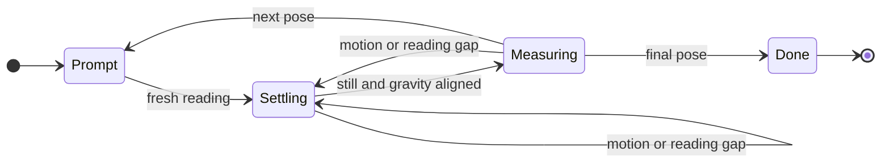

# Input and Sensors

Part of the [platform notes](README.md). Apps consume `input_t`; the input
layer owns sensor polling, calibration and edge delivery.

## Touch input

`launcher/main/input/touch.c` handles both board revisions through the BSP.
An idle controller can NACK register reads, logging `i2c transaction failed`
and `FT5x06 ... I2C read error!`; use these as console search terms. Do not
poll blindly. GPIO 21 is active-low data-ready, not a finger-down level.
The CST820 pulses it;
the interrupt handler latches the report and wakes the polling task. A held
contact continues to be read even without another pulse.

The task polls at `TOUCH_POLL_HZ` and latches press/release edges, so a tap
entirely between rendered frames can still reach the next frame. Release
requires the quiet interval `TOUCH_RELEASE_QUIET_US` in
`launcher/main/input/touch_fsm.h`; an INT deassertion is not a release.

microui needs a hover frame before a press can take focus. The UI bridge
defers DOWN until the hover root is settled; preserve this for all controls,
not only buttons. See
[Firmware-Architecture.md](../Firmware-Architecture.md#two-things-to-know-before-touching-it).

### Calibration and targets

`touch.c` holds the panel fit. `launcher/main/input/touch_calib.c` applies its
inverse before consumers receive coordinates. A development build can bypass
it with `autana tune touch.calibrate 0` for comparison. Calibration corrects
systematic distortion, not fingertip scatter; use large touch targets and
clear `DISPLAY_PANEL_CORNER_RADIUS` and `DISPLAY_PANEL_SAFE_INSET`.

The development touch probe records target and reported coordinates for
fitting `PANEL_FIT` in `touch.c`. Refit from targeted captures rather than
treating a single tap's miss as a coefficient error.

## The IMU's axes do not match the screen's

`launcher/main/input/imu.c` configures the QMI8658 and reads all six axes in
one burst. Keep the burst intact: separate reads can straddle sample updates.
The configured ranges determine the counts-per-g and counts-per-dps scales.

| Screen direction | Sensor axis |
|---|---|
| down (+y) | `+ax` |
| right (+x) | `-ay` |

Use `imu_gravity_screen()` in `launcher/main/input/imu_sample.h`, including
its orientation handling, rather than mapping sensor X directly to screen X.
The accelerometer measures gravity plus linear acceleration; the gyroscope
measures angular velocity, not tilt angle.

Apps read both through `input_read_motion()` (`launcher/main/input/input.h`),
one I2C read per call, into `input_motion_t`:

| Field | Meaning |
|---|---|
| `acceleration` | raw accelerometer, unfiltered: screen axes (x right, y down, z out of the screen), pointing the way down at rest, in Q12 g (`INPUT_ACCEL_ONE_G`). Upright reads +1 g on y, flat and screen up -1 g on z |
| `rotation` | signed raw gyro counts, Q6 deg/s (`INPUT_ROTATION_ONE_DPS`), in the same panel axes: x = -gy, y = gx, z = gz |
| `turn_speed` | deg/s, the sum of the gyroscope's absolute rates over all three axes: a speed, no sign or axis |

### Calibration round

A tap on the development Motion page starts a calibration round when idle
or showing results. Taps during a round are ignored. BOOT abandons the round
and selects another page. Its prompts name the face and edges as
seen on the pinned `DISPLAY_DEFAULT_QUARTER` page; measurements stay in panel
axes. No measured correction is applied to input readings.

Settling uses recent per-axis accelerometer and gyro means. Thresholds and
durations are owned by `imu_probe.h`; constant gyro bias does not prevent
settling. Align each pose carefully: the gravity gate rejects wrong poses
but does not establish precision alignment.

For each axis, the positive and negative gravity windows give
`offset = (up + down) / 2` and
`scale = (up - down) / (2 * INPUT_ACCEL_ONE_G)`, the diagonal six-position
calibration model described by STMicroelectronics AN4508
[[67]](../Citations.md#67). This measures offset and sensitivity, not cross-axis
misalignment. The gyro zero-rate estimate averages samples across all pose
windows. `pose` lines contain rounded Q12 g and Q6 deg/s means and sample
counts; `calib` reports offsets in mg, sensitivity in ppm (unity is 1000000),
and gyro offsets in mdps.

`python motion_fit.py boot.log warm.log
--window-seconds 10` prints fits and consecutive-round differences, first and
last elapsed-time-window gyro means, and quarter transitions with tilt and
raw acceleration. Supply one boot per capture and hold the board still in
both endpoint windows. The first window starts at the first Motion log, so
it represents boot only when recording starts near boot. The 10 Hz Motion
log records the shell quarter even though the page remains pinned.

## The two buttons are not the same kind of device

| Button | Signal | Interpretation |
|---|---|---|
| BOOT | active-low GPIO 0 | level debounced into edges by `button_fsm.c`; also selects the ROM bootloader |
| PWR | AXP2101 latched interrupt status over I2C | completed event, not a readable finger-down level |

`launcher/main/input/buttons.c` enables the PMU's short-press interrupt and
polls independently of rendering. Its `POLL_HZ` controls shared-bus traffic.

| PMU register | Rule |
|---|---|
| `0x41`, bit 3 | enables the short-press interrupt |
| `0x49`, bit 3 | latched short-press status; write one to clear only the consumed bit |
| `0x27` | independent long-press IRQ, power-off and power-on thresholds |
| `0x22`, bit 1 | enables button power-off; bit 0 selects power-off or restart |

Do not clear all interrupt bits: other latched power events may have consumers.
Firmware leaves power-off settings at their board defaults and logs the
decoded values at startup. A long PWR hold can cut power; that is configurable
PMU behaviour, not a GPIO event. Recovery is in
[Flashing-and-Toolchain.md](Flashing-and-Toolchain.md#flashing-and-recovery).

## Tilt filtering and acceleration

`launcher/main/input/tilt.c` filters direction with elapsed-time-based
smoothing. Its time constants and magnitude thresholds live in
`launcher/main/input/tilt.h`. Use a time constant rather than a fixed fraction
per rendered frame, so frame-rate changes do not change the filter's response.
Gyroscope rotation adapts the response: still readings get more smoothing,
turning readings less.

A magnitude far from one g identifies a contaminated gravity sample; the
filter holds the previous direction. A magnitude near one g cannot prove
that the sample is gravity alone. Rotation can also introduce linear
acceleration, so gyro activity does not bypass the magnitude gate.

Shake strength comes from the accelerometer magnitude's departure from one g,
not angular velocity. Smooth it independently of direction-filter priming:
a shaking sample may be rejected for direction while still needing a shake
update. A rotation test must preserve vector magnitude; a linear interpolation
between perpendicular unit vectors does not describe a constant-magnitude
rotation.

A consumer that quantizes direction into coarse steps needs its own treatment
of that quantization. Smoothing the input alone cannot restore discarded
angular resolution.

## Related

- [Board-and-Memory.md](Board-and-Memory.md): hardware inventory and buses.
- [Debugging.md](Debugging.md#orientation-or-the-imu-seems-wrong): raw readings
  and orientation snapshots.
