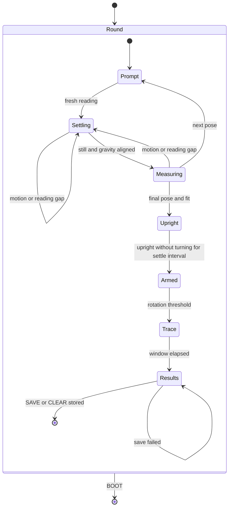

# Input and Sensors

Part of the [platform notes](README.md). Apps consume `input_t`; the input
layer owns sensor polling, calibration and edge delivery.

## Touch input

`launcher/main/input/touch.c` handles both board revisions through the BSP.
An idle controller can NACK register reads, logging `i2c transaction failed`
and `FT5x06 ... I2C read error!`; use these as console search terms. Do not
poll blindly. GPIO 21 is active-low data-ready, not a finger-down level.
The CST820 pulses it;
the interrupt handler latches the report and wakes the polling task. A held
contact continues to be read even without another pulse.

The task polls at `TOUCH_POLL_HZ` and latches press/release edges, so a tap
entirely between rendered frames can still reach the next frame. Release
requires the quiet interval `TOUCH_RELEASE_QUIET_US` in
`launcher/main/input/touch_fsm.h`; an INT deassertion is not a release.

microui needs a hover frame before a press can take focus. The UI bridge
defers DOWN until the hover root is settled; preserve this for all controls,
not only buttons. See
[Firmware-Architecture.md](../Firmware-Architecture.md#two-things-to-know-before-touching-it).

### Calibration and targets

`touch.c` holds the panel fit. `launcher/main/input/touch_calib.c` applies its
inverse before consumers receive coordinates. A development build can bypass
it with `autana tune touch.calibrate 0` for comparison. Calibration corrects
systematic distortion, not fingertip scatter; use large touch targets and
clear `DISPLAY_PANEL_CORNER_RADIUS` and `DISPLAY_PANEL_SAFE_INSET`.

The development touch probe records target and reported coordinates for
fitting `PANEL_FIT` in `touch.c`. Refit from targeted captures rather than
treating a single tap's miss as a coefficient error.

## The IMU's axes do not match the screen's

`launcher/main/input/imu.c` configures the QMI8658 and reads all six axes in
one burst. Keep the burst intact: separate reads can straddle sample updates.
The configured ranges determine the counts-per-g and counts-per-dps scales.

| Screen direction | Sensor axis |
|---|---|
| down (+y) | `+ax` |
| right (+x) | `-ay` |

Use `imu_gravity_screen()` in `launcher/main/input/imu_sample.h`, including
its orientation handling, rather than mapping sensor X directly to screen X.
The accelerometer measures gravity plus linear acceleration; the gyroscope
measures angular velocity, not tilt angle.

Apps read both through `input_read_motion()` (`launcher/main/input/input.h`),
one I2C read per call, into `input_motion_t`:

| Field | Meaning |
|---|---|
| `acceleration` | offset-calibrated accelerometer, unfiltered: screen axes (x right, y down, z out of the screen), pointing the way down at rest, in Q12 g (`INPUT_ACCEL_ONE_G`). Upright reads +1 g on y, flat and screen up -1 g on z |
| `rotation` | signed raw gyro counts, Q6 deg/s (`INPUT_ROTATION_ONE_DPS`), in the same panel axes: x = -gy, y = gx, z = gz |
| `turn_speed` | deg/s, the sum of the gyroscope's absolute rates over all three axes: a speed, no sign or axis |

Measured rotation follows the right-hand rule on the screen axes: +z is clockwise from
the front, +x tips the bottom edge toward the viewer, +y turns the right edge away.

### Calibration round

A tap on the development Motion page starts a calibration round when idle.
Taps during a round are ignored. Prompts name the face and edges as seen on the pinned
`DISPLAY_DEFAULT_QUARTER` page; measurements stay in panel axes.

For an unplugged round, open the Motion page, disconnect USB while running on
battery, and tap to start. Follow each pose prompt and hold still until the
full-screen white flash confirms its reading. At the turn prompt, hold the
display upright, screen facing you and bottom edge down, until `ARMED: TURN NOW`, then turn
90 degrees clockwise quickly. A longer cyan flash means the round is complete.
Keep this app open, reconnect USB, and run `autana labdump > imu-round.log`
on the PC. The command prints the kept lines between `LABDUMP_BEGIN` and
`LABDUMP_END`, then frees them. `autana` sets DTR/RTS low before opening on
Windows. On POSIX hosts (including Linux), it opens with both raised, then
lowers RTS before DTR. Results live in RAM: a reset, a new round, or leaving
the app discards them; SAVE and CLEAR keep them available for replay.

Each pose records `GRAV` down (unit vector) and gyro bias (deg/s) alongside
the calibration reading; see [Gravity.md](../input/Gravity.md) for these
estimates. After the upright hold, rotation above
`IMU_PROBE_TURN_THRESHOLD` starts the `turn` trace at time zero. Each line
contains estimated unit `down` and the same sample's unit `accel` direction
(zero during zero acceleration), so their angular separation exposes lag.
`imu_probe.h` owns its duration and sampling bound; timestamps are elapsed
milliseconds from the trigger. Missing readings are not synthesized.
Every kept line starts with `LABDUMP` so its payload can be told apart from
the console's log lines; the calibration tools accept both live lines and
replayed dumps.

`input_read_motion()` subtracts the stored accelerometer offset before any
consumer filters or reads acceleration. The settings service stores Q12 g
screen-axis counts in space `imu`, keys `accel_x`, `accel_y`, `accel_z`.
A save writes `accel_valid` as 0, then the axes, then `accel_valid` as 1.
A missing marker, a marker other than 1, missing axes or any offset beyond
`IMU_CALIB_OFFSET_MAX` select zero offset. A failed write leaves the live offset unchanged.
Scale is reported but never applied; gyro readings remain raw.

The Motion page shows the stored offset. Its raw acceleration display, bubble
and `motion raw` log reconstruct sensor counts by adding that offset back.
The round measures calibrated samples, so the fitted offset is a residual.
SAVE stores the current offset plus this residual; CLEAR stores zero. The results
HUD labels the residual, while `calib` logs the absolute sensor offset in mg.
`imu_calib saved` logs Q12 counts;
`imu_calib cleared` confirms zero offset.



Settling uses recent per-axis accelerometer and gyro means. Thresholds and
durations are owned by `imu_probe.h`; constant gyro bias does not prevent
settling. Align each pose carefully: the gravity gate rejects wrong poses
but does not establish precision alignment. Upright arming instead accepts
acceleration within the bottom-down cone `IMU_PROBE_UPRIGHT_MIN` and rotation
at or below `IMU_PROBE_TURN_THRESHOLD` for `IMU_PROBE_SETTLE_MS`; it does not
require pose-grade stillness. Missing readings, gaps and departures reset
that interval. The cone follows the pinned page quarter.

For each axis, the positive and negative gravity windows give
`offset = (up + down) / 2` and
`scale = (up - down) / (2 * INPUT_ACCEL_ONE_G)`, the diagonal six-position
calibration model described by STMicroelectronics AN4508
[[67]](../Citations.md#67). This measures offset and sensitivity, not cross-axis
misalignment. `input/imu_calib.c` owns the offset and sensitivity fit. The gyro
zero-rate estimate averages samples across all pose windows. `pose` lines contain
rounded Q12 g and Q6 deg/s means and sample counts; `calib` reports offsets in
mg, sensitivity in ppm (unity is 1000000), and gyro offsets in mdps.

The Motion log records the shell quarter even though the page remains pinned.
The tool reports calibration fits and consecutive-round differences, the longest
still stretch before the first calibration round, and flat face-up quarter shares.
Stillness requires turn speed at most 15 deg/s and tilt within 2 degrees of the
stretch's start; a gap above 250 ms ends the stretch. The first and last windows
default to 60 seconds and may overlap. Flat samples require tilt below 10 degrees,
negative z and the same turn limit; transitions require consecutive flat-still
samples. Turn traces report the maximum and final angle between estimated
down and acceleration per round, excluding samples without a direction.
Thresholds are named in `motion_fit.py`.

#### Measured on the board

The captures are kept outside the repository. Supply their locations to
the tool; the command below uses plain capture names:

```sh
python motion_fit.py cjsd1-round1.log cjsd1-round2.log
```

Gyro figures in these captures are twice the true rate (a range misconfiguration since fixed); halve them.

All vectors below are x,y,z; gyro values and noise are mdps, offsets mg and
scales ppm. The incomplete calibration round is excluded from the fit comparison.

| Measurement | Capture 1 | Capture 2 (after power cycle) |
|---|---|---|
| Accel offset | 104,22,-107 | 109,22,-106 |
| Accel scale | 1008886,996951,993883 | 1009651,997281,994040 |
| Round-mean gyro | -6585,2606,-665 | -6642,1525,-628 |
| Pre-round still uptime s | 70.487-76.937 | 58.510-408.115 |
| First 60 s gyro / samples | -6017,2366,-755 / 65 | -7637,1593,-702 / 596 |
| Last 60 s gyro / samples | -6017,2366,-755 / 65 | -7584,1064,-632 / 597 |
| Still gyro noise sigma | 910,1077,1010 | 918,1008,1035 |
| Flat-still samples | 1296 | 6940 |
| Quarter shares q0,q1,q2,q3 % | 0.2,0.0,0.0,99.8 | 0.0,0.0,0.0,100.0 |
| Median flat bearing degrees | 16 | 17 |
| Flat-still transitions | 2: 95.544 s 3 -> 0; 95.655 s 0 -> 3 | 0 |

- Accel error is mostly offset: x +104 to +109 mg, y +22 mg, z -107 to -106 mg; scale errors are x +0.8886 to +0.9651%, y -0.3049 to -0.2719%, z -0.6117 to -0.5960%.
- Across the power cycle, offset differences are 5,0,1 mg and scale differences 0.0765,0.0330,0.0157 percentage points.
- At rest, x stays -7.637 to -7.584 dps, y drifts +1.593 to +1.064 dps, and z is -0.702 to -0.632 dps, with sigma about 1 dps per axis; round means are -6.585,+2.606,-0.665 and -6.642,+1.525,-0.628 dps, motivating M2 bias tracking rather than a stored constant.
- Flat face up settles on q3 in 99.8% and 100.0% of still samples across held quarters: the +x offset supplies about 0.1 g in-plane at bearing 16-17 degrees; display.c has no flat gate, motivating M3 flat hold and z lockout.

Rotation sense is measured across both captures: gravity change agrees with
`dg/dt = -(omega x g)` (fitted gain -0.4 at 10 Hz; sign agreement about 2:1 over roughly 550 tipping samples).

## The two buttons are not the same kind of device

| Button | Signal | Interpretation |
|---|---|---|
| BOOT | active-low GPIO 0 | level debounced into edges by `button_fsm.c`; also selects the ROM bootloader |
| PWR | AXP2101 latched interrupt status over I2C | completed event, not a readable finger-down level |

`launcher/main/input/buttons.c` enables the PMU's short-press interrupt and
polls independently of rendering. Its `POLL_HZ` controls shared-bus traffic.

| PMU register | Rule |
|---|---|
| `0x41`, bit 3 | enables the short-press interrupt |
| `0x49`, bit 3 | latched short-press status; write one to clear only the consumed bit |
| `0x27` | independent long-press IRQ, power-off and power-on thresholds |
| `0x22`, bit 1 | enables button power-off; bit 0 selects power-off or restart |

Do not clear all interrupt bits: other latched power events may have consumers.
Firmware leaves power-off settings at their board defaults and logs the
decoded values at startup. A long PWR hold can cut power; that is configurable
PMU behaviour, not a GPIO event. Recovery is in
[Flashing-and-Toolchain.md](Flashing-and-Toolchain.md#flashing-and-recovery).

## Tilt filtering and acceleration

`launcher/main/input/tilt.c` filters direction with elapsed-time-based
smoothing. Its time constants and magnitude thresholds live in
`launcher/main/input/tilt.h`. Use a time constant rather than a fixed fraction
per rendered frame, so frame-rate changes do not change the filter's response.
Gyroscope rotation adapts the response: still readings get more smoothing,
turning readings less.

A magnitude far from one g identifies a contaminated gravity sample; the
filter holds the previous direction. A magnitude near one g cannot prove
that the sample is gravity alone. Rotation can also introduce linear
acceleration, so gyro activity does not bypass the magnitude gate.

Shake strength comes from the accelerometer magnitude's departure from one g,
not angular velocity. Smooth it independently of direction-filter priming:
a shaking sample may be rejected for direction while still needing a shake
update. A rotation test must preserve vector magnitude; a linear interpolation
between perpendicular unit vectors does not describe a constant-magnitude
rotation.

A consumer that quantizes direction into coarse steps needs its own treatment
of that quantization. Smoothing the input alone cannot restore discarded
angular resolution.

## Gravity estimation

`gravity_t` exposes a unit down vector, linear acceleration and learned gyro
bias; [Gravity.md](../input/Gravity.md) describes its update, recovery and bias learning.
The shell reads tilt today; gravity is not in `input_t`.

## Related

- [Board-and-Memory.md](Board-and-Memory.md): hardware inventory and buses.
- [Debugging.md](Debugging.md#orientation-or-the-imu-seems-wrong): raw readings
  and orientation snapshots.
