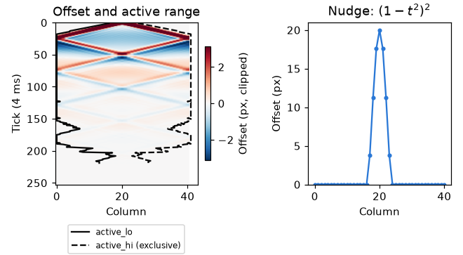

# Spring

Integer springs with caller-owned state, advanced on a fixed tick. [Physics index](README.md).

## spring_line.h

A row of points on springs carries a wave along caller-owned Q16 pixel offsets and velocities.

| Function | Purpose |
|---|---|
| `spring_line_t` | Caller-owned arrays, active half-open range, tension, stiffness, damping and carried time |
| `spring_line_init` | Initializes the line with caller-owned arrays |
| `spring_line_at_rest` | Tests whether the active range is empty |
| `spring_line_scale` | Scales by a share out of 256 |
| `spring_line_wake` | Includes columns in the active half-open range |
| `spring_line_add_bump` | Adds a smooth bump falling to zero at its half-width |
| `spring_line_poke` | Flicks with Q16 pixels per tick; negative is up |
| `spring_line_nudge` | Moves the line by Q16 pixels and lets go |
| `spring_line_quiet` | Tests rest offset and velocity thresholds |
| `spring_line_trim` | Puts quiet columns at each end of the active range to rest |
| `spring_line_tick` | Advances velocities then offsets by one tick, with free ends |
| `spring_line_advance` | Runs ticks for the elapsed milliseconds, carrying the remainder; returns ticks run |
| `spring_line_apply` | Writes rest plus offset, reports changed columns, and returns furthest movement in whole pixels rounded up |

| Constant | Purpose |
|---|---|
| `SPRING_LINE_TICK_MS` | Simulated time per tick |
| `SPRING_LINE_MAX_TICKS` | Tick cap per frame; drops excess time |
| `SPRING_LINE_REST_OFFSET`, `SPRING_LINE_REST_VELOCITY` | Thresholds for putting the line to rest |
| `SPRING_LINE_MAX_OFFSET` | Maximum offset magnitude |
| `SPRING_LINE_OUT_SHIFT`, `SPRING_LINE_OUT_ONE` | Fractional bits and units per output pixel |

### Wave tick and bump

For offsets $`u_i`$ and velocities $`v_i`$ in Q16 units, tension $`T`$,
stiffness $`K`$ and damping $`D`$ are shares out of 256. A tick first computes
all velocities from the old offsets:

```math
a_i=v_i+\mathrm{trunc}\!\left(\frac{T(u_{i-1}-2u_i+u_{i+1})}{256}\right)
-\mathrm{trunc}\!\left(\frac{Ku_i}{256}\right)
```

```math
v_i' = a_i-\mathrm{trunc}\!\left(\frac{Da_i}{256}\right), \qquad
u_i' = \mathrm{clamp}(u_i+v_i',-U_{\max},U_{\max})
```

The free ends mirror their own offset for the missing neighbour. Without
stiffness or damping, the long-wavelength speed is $`\sqrt{T/256}`$ columns per
tick. `SPRING_LINE_TICK_MS` sets the tick duration.


The active range expands at most one column per tick and trims quiet ends.
A nudge or poke uses the compact bump $`(1-t^2)^2`$ for $`\lvert t\rvert<1`$,
with $`t`$ the distance from the centre divided by the half-width; outside it is zero.


