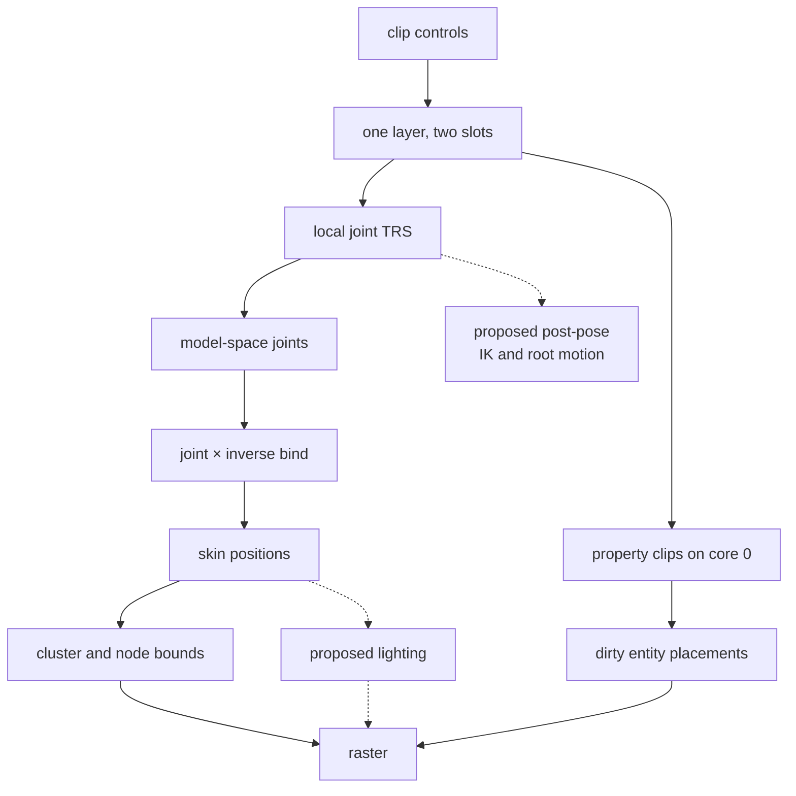

# Animation system: design sketch

**Status:** TRCK, SKEL, SKIN, pose, transition blend, CPU skinning and the scene
animator and skinned-renderer components are implemented; lighting, SCNE v2 and
the clip picker are proposed. `[A]` marks a proposal of this sketch.

Two systems share one sampler and one binding resolver:

- **Property animation**: a timeline drives any field a component declares
  (a transform, a lens, later a light or a material colour). The bindings
  sketch (`Animation-Bindings-Design-Sketch.md`, approved) defines it.
- **Character animation**: a skeleton, clips sampled into poses, poses
  blended, and the pose skinning a mesh every frame. Later: a state machine
  with transitions, blend trees, layers and masks, events, root motion, IK.

## 1. The frame



It runs in the scene's advance (`scene_render()`, after the clocks, before the
draw), so an app never skins. The raster reads an `r3d_lit_mesh_t` view. A skinned renderer's view points `positions`, `clusters` and `nodes` at its
mutable buffers, retaining the bind mesh's colours.

## 2. Two cores

The animation frame is batches with no shared writes, so it splits the way
the raster does through `job_run_split()` (`core/job.h`): half the batch goes to
core 1 through `job_try_core1()`, core 0 runs the other half, and
`job_wait()` is the sync point before the next stage reads.

| Stage | Batch split by | Each core writes | Read after the sync by |
|---|---|---|---|
| animators | entity (half the entity ids each) | its animators' poses and skin palettes | skin |
| skin | cluster (half the clusters each) | its clusters' vertex range of `positions` and its clusters' bounds | node refit, raster |
| node refit | none: one pass, under a few dozen nodes | `nodes` | raster |

- **Why clusters, not vertices:** a cluster owns a contiguous vertex range,
  so a core skins, lights and bounds its own clusters with no second pass,
  and the halves never touch the same cache line except at one boundary.
- **One buffer is enough** while skinning finishes before the same frame's
  draw starts, which `scene_render()` already orders. A double buffer is only
  needed if skinning frame N+1 overlaps the raster of frame N; the view
  points at the buffers, so that is one pointer swap per frame and no
  layout change [A].
- **Present on core 1:** the present task sends the last frame's strips from
  IRAM while `scene_render()` runs, at a higher priority than the job
  worker. When the worker is busy `job_try_core1()` returns false and core 0
  runs both halves, so a frame is never wrong, only slower. The skin
  buffers sit in internal RAM, so the job does not contend with
  present for PSRAM; the bind data is read through the flash cache.
- **The job context** (`JOB_CTX_MAX`) holds a range and pointers:
  `{scene, first, count, dt_ms}`.
- **Both range stages dispatch through `job_run_split()`;** the second
  range runs inline when core 1 is unavailable. Every kernel takes a range
  (`first`, `count`).

## 3. Pack entries

The implemented SKEL v1 and SKIN v1 layouts, checks, model-space constraint,
LMSH position matching, influence quantization and ids are owned by
[Skeleton and skin entries](../render/Skeleton-and-Skin.md). The uncached
pack step reads the finished LMSH rather
than adding work to the mesh bake. `max_influences` is its parameter until
the import setting lands with the next rebake of the meshes. The skin is
planned to move into the mesh bake at that rebake.

TRCK v2 is defined by [Animation tracks](../Animation-Tracks.md#the-pack-entry).
Skeleton clips use joint paths from each root joint. SKIN normals hold the
bind normals; LMSH colors for skinned meshes are unlit albedo (`COLOR_0`).

**Planned SCNE v2** adds rows, read like the current entry:

| Part | Layout |
|---|---|
| skinned renderers | `u16 entity`, `u16 pad`, `char mesh_id[32]`, `char skin_id[32]`, `char skeleton_id[32]` |
| animators (the animator row) | `u16 entity`, `u16 clip_count`, `u32 first_clip` (index into the clip rows) |
| clip rows | `char clip_id[32]` |
| lights | `u8 kind` (`SCENE_LIGHT_DIRECTIONAL` = 0, the only kind yet), 3 zero bytes, `f32 direction[3]` (unit, scene space, pointing toward the light), `f32 colour[3]` (linear RGB, 0 to 1), `f32 intensity` (the scene file's, unscaled) |
| header additions | `u16` counts and `u32` offsets of the four parts; `f32 ambient_colour[3]` (linear RGB), `f32 ambient_intensity`, `f32 tonemap_white` |

The lights, ambient and tone map are read by one runtime system: the skinned
renderers' lighting (`r3d_skin_light_t`, built per skinned renderer from the
scene's lights in its object space), so a skinned mesh is lit by the same
numbers the static bake used. SCNE v1 is the scene format. The proposed version adds authored
animator and lighting rows; runtime attachment uses asset ids without these
rows. TRCK v1 is refused (`ASSET_ERR_VERSION`).

## 4. Runtime types and functions

The implemented internal types and signatures live in
[`anim/pose/anim_pose.h`](../../launcher/main/anim/pose/anim_pose.h),
[`anim/playback/anim_layer.h`](../../launcher/main/anim/playback/anim_layer.h),
[`anim/playback/anim_playhead.h`](../../launcher/main/anim/playback/anim_playhead.h),
and [`render/skin/r3d_skinning.h`](../../launcher/main/render/skin/r3d_skinning.h).
Pose sampling preserves unkeyed rest channels.
Pose blending is in [Animation tracks](../Animation-Tracks.md#scene-playback).
CPU skinning uses linear blend skinning<sup>[[57]](../Citations.md#57)</sup>,
separate influence-count kernels and cluster ranges.

The frame order is in [Skeleton and skin](../render/Skeleton-and-Skin.md#runtime-pose-and-skinning).

Proposed lighting uses a 16×16 bilinear table rebuilt when lights or entity
rotation change, or direct N.L, selected by device measurements. Its lights,
ambient and tone map match the static bake.

**Scene side**: a `skinned_renderer` component (mesh, skin, skeleton) and
an `animator` component (clip ids, one layer). Runtime asset-id attachment configures skeleton animators and skin components.
SCNE camera rows create property animators. Authored animator rows are
planned. Public playback controls are declared in `scene/scene.h`; apps hold
entity handles and clip indices. The playback query API includes:

```c
bool scene_animator_play(scene_t* scene, scene_entity_t entity, int clip, uint32_t blend_ms);
int scene_animator_clip_count(const scene_t* scene, scene_entity_t entity);
const char* scene_animator_clip_name(const scene_t* scene, scene_entity_t entity, int clip);
```

An animated scene: a dropdown of clip names (`ui_dropdown`) and a
blend-time slider (`ui_slider_int`, 0 to 1000 ms), both existing widgets.

## 5. Where the later pieces plug in

| Later piece | Plugs into | Runtime provides |
|---|---|---|
| Property timelines on any field | `anim_bind` against scene fields (bindings sketch) | the same TRCK v2 rows and sampler |
| State machine and transitions | parameter-driven transitions select clips through the layer; a transition is the layer's transition blend | the transition blend, slots keeping time |
| Blend trees (1D, 2D) | a state's output becomes N weighted samples; `anim_pose_blend` becomes an accumulate over N | weighted sample into a pose |
| Sync groups | slot time as normalized phase | `t_ms` per slot |
| Layers and masks | several `anim_layer_t`, each with a per-joint weight mask, override or additive | the pose as the one currency |
| Events | a TRCK v2 row type of named times, fired when a slot crosses them | per-slot time |
| Root motion | the post-pose step moves the root joint's delta into the entity's transform | the post-pose slot in the frame |
| IK | the post-pose step, in model space, before the palette | `anim_pose_model` |
| Other skinning (dual quaternion, a GPU) | another `r3d_skin_clusters` | the palette |

## Decided (maintainer)

1. TRCK v2 and `anim_bind` implement the shared sampler and binding resolver;
   their formats are defined in the animation and skeleton references.
2. A character clip resolves relative to its skeleton, reusable on any
   entity with that rig; a property clip resolves at scene level by object
   name.
3. Skinning and animators live in scene/. Runtime attachment is
   implemented; authored animator, directional-light and ambient SCNE rows
   are planned.
4. Influences per vertex: an import setting, default 2, 4 allowed; the
   entry records it and the runtime skins either.
5. The range stages use two cores (section 2) with an inline fallback.
