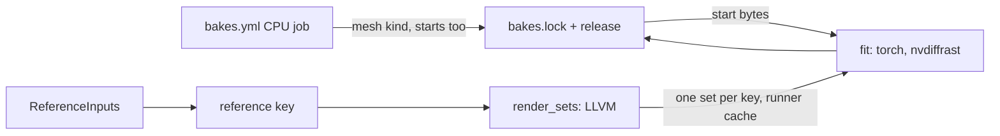

# Baker scalability: design sketch

**Status:** steps 1 and 2 approved and built; steps 3 to 5 are a sketch. `[A]` marks an assumption or a
proposal nobody asked for. This page says where the time goes and what changes.

A fit is three stages (see [Cached-Bakes-Design-Sketch.md](Cached-Bakes-Design-Sketch.md)): its start, a mesh
bake made by the CPU Bakes job; its reference set, one per `ReferenceInputs` in the GPU runner's cache; and the
fit.

## 1. Where the time goes

| Stage | Where it runs | What dominates | Why |
|---|---|---|---|
| Reference set | GPU runner's CPU: Mitsuba LLVM, as mesh bakes trace | the bounced light: Mitsuba's path integrator at every primary hit | one set per reference key |
| Start (mesh bake) | hosted runner, CPU | the camera-path visibility pass: single-threaded NumPy bookkeeping around `RayQuery.hit_rounds`; rays stop at their first drawn hit plus the tie distance | the same pass as every mesh |
| Fit | GPU (torch, nvdiffrast) | the optimiser steps | already on the GPU |
| Mesh bake (CI) | hosted runner, CPU | the same Mitsuba and NumPy work, minutes per mesh | not a problem today |

The visibility pass is single-threaded NumPy.

## 2. Design



```python
# r3d/fitted_variant.py: ReferenceInputs (every field a reference set reads), reference_inputs(job, scene)
# r3d/reference_render.py
def render_sets(inputs: ReferenceInputs, sets: list[tuple[Path, Path]], samples=4) -> None
    # loads the source and builds PathLight once on ray_query.VARIANT, "llvm_ad_rgb" (isa-pinned), as mesh
    # bakes do, renders each (poses file, folder); OptiX builds a different tree each time, so not the GPU

# bake/bake.py
def stage_keys(job, scene, tools, start_sha256=None) -> dict
    # start     = digest(["mesh", mesh_recipe, tools["mesh"]])               unchanged
    # reference = digest(["reference", ReferenceInputs, tools["reference"]]) no longer chains on the start
    # fit       = digest(["fit", reference, start_sha256, fit_recipe, tools["fit"]])
    #             start_sha256 comes from the start's lock row (a run's upload while locking); None until then
```

`render_sets` takes only `ReferenceInputs`, so the key and the render read the same value: a field the
renderer needs and the key lacks cannot be added without adding it to the key. A fit's key needs its start's
lock row, so a branch locks its CPU run's starts before it dispatches the GPU run, the order the two
workflows already run in.

| Caller | Calls | Change |
|---|---|---|
| `bakes.yml` CPU job | `produce_mesh` for every missing mesh, a fit's start included | the start is an ordinary locked, published mesh bake [A] |
| `produce.produce_fit` (GPU runner) | `fetch` of the start, `references()`, then `fit()` | no start bake on the runner |
| `produce.references` | `render_sets` once per reference key | three Sponza fits share one set |
| `fitted_variant.prepare`, `sweep_references` | `render_sets` | one source load per set, not one per pose file |
| `bake.py bake --kind fit` | the fits it is asked for | a set is made once per reference key in the runner's cache, so fits that share it render it once |
| `bake.py lock --from-run N` | the rows run N made | writes them even while a fit still waits for its start, then names what is left |

## 3. Per-stage plan, in order

| Step | Change | Keys | Bytes | Lock |
|---|---|---|---|---|
| 1 | Reference keyed on `ReferenceInputs`; start becomes a locked mesh bake made by CI; fit keyed on the start's bytes | every reference and fit key changes, once | starts: same as a runner-made start on the same CPU vendor; fits: reproducible on the same GPU model in the pinned environment; other GPUs may differ | the CPU job adds start rows; one GPU run, shared with the other fit re-keys waiting for it, re-makes the fits; `lock --from-run` both |
| 2 | Reference traced on `ray_query.VARIANT`, as mesh bakes trace | `reference_render.py` and `reference_set.py` are in the reference closure only, so the fits re-key and no mesh does | none: a set repeats byte for byte on one kind of CPU | references are never locked; fits are pinned by bytes, so the change reaches a pack at the next refit |
| 3 | Visibility pass stops each ray at its first drawn hit plus the tie distance instead of collecting every hit | `mesh_import.py` is in every closure: every mesh, start, reference and fit key changes | identical visible sets, so identical mesh and start bytes (a test asserts the set) | CPU run re-makes meshes with the locked bytes under new keys; a fit re-keys only through the reference closure |
| 4 | Parallel across cores: `bake.py bake` runs independent bakes as a stage graph, CPU stages beside GPU ones | none | none | none |
| 5 | Native code only if the profile after steps 2 and 3 shows NumPy dominating: candidates are the reference's per-hit albedo and normals, and the visibility bookkeeping | the stage's closure (C sources count) | must be identical, asserted | as step 3 |

Not planned: pose-level worker processes. Mitsuba's LLVM backend already spreads one pose over every core,
and forked workers each held a copy of the scene and ran the machine out of memory (`render_poses`).

## Assumptions and open points

- Reference sets trace on the CPU, so torch has the runner's GPU to itself; `render_sets` drops the bounced-light
  tracer, which holds the source's textures a second time, before the fit starts.
- [A] Starts move to CI, where the hosted runners are AMD, so start bytes match the other CI meshes; nothing
  checks the vendor.
