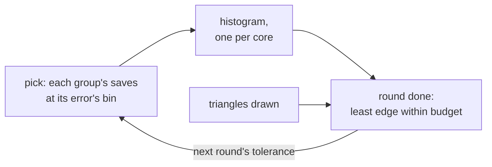

# Cluster level of detail

**Status:** approved; the host replay, the baked levels, the pick at a fixed tolerance and the triangle budget are built.

The fitted mesh's welded positions are split into clusters, which are
grouped, simplified with each group's border locked, and split again until a
group no longer simplifies<sup>[[54]](../Citations.md#karis-2021)</sup>
(meshoptimizer's<sup>[[11]](../Citations.md#meshoptimizer)</sup> `clusterlod`). The finest
level holds the fitted mesh's triangles in `clusterlod`'s own clusters, and the
bake draws those as its level 0. A fit starts from a mesh without levels. A CPU levels stage builds the
hierarchy from its fitted bytes. Positions only, so a strip of one colour is not
simplified on its own; each coarser cluster samples its colours from the
nearest level-0 surface facing its way.

**The bake.** [`lod/bake_levels.py`](../../launcher/tools/r3d/lod/bake_levels.py)
builds one hierarchy per sidedness, with the positions the two share locked. It
pushes each coarse vertex inside a group's border outward, up to the group's
error, so a coarse level never sits inside the finer surface it replaces.
Group spheres and errors are rounded outward into position ticks; the LLOD
format ([LLOD.md](../assets/formats/LLOD.md)) states their ordering rules.
The cluster tree's root has two children: an octree over level 0 alone,
built as a mesh without levels builds its own, and a run of the coarse
clusters in the order of the group simplified into each. The cull walks
level 0's octree, then takes the cut's coarse clusters from each coarse
group's run, so a frame never visits a coarse cluster it does not draw. The
`[geometry] lod` import setting turns levels off; level 0 is then the baked
meshlets.

**The pick.** A cluster is drawn when its own error, projected at its sphere,
is at most the tolerance in pixels and its group's error is above it. Every
cluster of a group shares the group's sphere and error, so neighbours change
level together and leave no crack. The rest mesh is one hierarchy, its groups
spanning objects where they weld; each copy shape has its own, shared by its
copies.

**The budget.** One tolerance for the whole frame keeps the cut crack-free.
It is also the cut that meets a triangle budget at the least error: the
allocation Wimmer and Schmalstieg derive per object<sup>[[110]](../Citations.md#wimmer-1998)</sup>,
here over clusters. The host replay finds it from a histogram over the
device's bin edges ([`pick.py`](../../launcher/tools/r3d/lod/pick.py)):
each cluster in view adds its triangles at the bin where it starts to be drawn
and removes them at the bin where its group takes over, and the prefix sum is
the triangle count at every bin edge.

The device does the same per group, not per cluster. With `lod.triangle_budget_k`
set, each pick adds a group's `saves` (LLOD) at the half-octave bin its error
projects to, and the instance's finest triangles once. When a round of picks
has seen every instance, the finest less the saves below each edge is the
count there, scaled by what the round drew over what it predicted, which takes
in culling. The steer takes the least edge within budget, from
`lod.tolerance_px` up. It rises at once and falls a bin a round, so a held
view settles.

Errors bin, and the tolerance is kept, in `lod.tolerance_px`'s pixels, so a
picture drawn at another size steers the same. With partial redraw, a still
view keeps picking until a round leaves the tolerance where it was.

A rise can overshoot by a bin or more. The round after it still draws some
instances at the old cut, so it draws more than its prediction. Falling one
bin a round then brings the tolerance back down.



Refining by screen-space error is
Hoppe's<sup>[[111]](../Citations.md#hoppe-1997)</sup>; the floor is `lod.tolerance_px`.

| Piece | Where | State |
|---|---|---|
| Levels of a mesh | [`lod/levels.py`](../../launcher/tools/r3d/lod/levels.py), [`lod/clusterlod.cpp`](../../launcher/tools/r3d/lod/clusterlod.cpp) | host |
| Pick, histogram, exact tolerance | [`lod/pick.py`](../../launcher/tools/r3d/lod/pick.py) | host |
| Replay over a camera path | [`lod/lod_replay.py`](../../launcher/tools/r3d/lod/lod_replay.py) | host |
| Levels in the baked mesh | [`lod/bake_levels.py`](../../launcher/tools/r3d/lod/bake_levels.py), [`r3d_lit_mesh.h`](../../launcher/main/render/r3d_lit_mesh.h) | built |
| Pick at a tolerance, with hysteresis and a coverage cap, in output pixels, each instance every `lod.pick_every` frames and all of them on a scene's first frame | [`r3d_lod_pick()`](../../launcher/main/render/lod/r3d_lod.h), run by the main view's cull just before each instance (`raster_t.picks_levels`); its coarse bits live per scene renderer, and the cluster walk only reads them | built |
| Histogram over a round of picks, steering the tolerance to `lod.triangle_budget_k` | [`r3d_lod_steer_frame()`](../../launcher/main/render/lod/r3d_lod.h), its state per scene renderer (`raster_t.steer`) | built |
| Tolerance per pose baked for the path; the fit trained on it | bake stage | not built |

```sh
python launcher/tools/r3d/lod/lod_replay.py SCENE.scene.toml --object NAME --out DIR [--budgets N,...] [--segment T0 T1]
```

It writes poses.csv, summary.md and lod.png to DIR; the numbers come from
running it on a bake. It reports, per pose and over the path, the finest level's triangles in view,
what fixed tolerances draw, and for each budget:
- the histogram's tolerance against the exact one;
- the triangles drawn at each;
- the terminal share: drawn triangles whose group cannot be simplified
  further, which no budget removes.

**Decided for the runtime:** level 0 is `clusterlod`'s clusters, so every
mesh is rebaked; the histogram is built per group over a round of picks, and
steers the next round.

**The pick's hysteresis.** A group turns coarse once its projected error falls
the [`lod.hysteresis_px`](../render/Render-Settings.md#lod) setting below the tolerance and turns fine again once it
rises that far above, so a still camera never flickers between levels. A
coarse group's parent bounds hold its own, so its finer groups are always
coarse too; a closing pass sets coarse any source float rounding left fine
far off, so the cut stays crack-free whatever the floats do.

**The coverage cap.** A group whose radius, projected where its error is,
spans more than the settings' `lod.coverage_permille` thousandths of the picture's
height stays fine, whatever its error. A large coarse group shows its
simplified surface over much of the screen, and its colours, sampled from the
nearest level-0 surface, shimmer under a slow camera drift where the
geometric error alone says nothing changed. A parent's bounds hold its
sources', so it never covers less than one of them, and the cap keeps a
coarse parent's sources coarse. The table renders each cap along the paths
and scores it against cap 0, the finest level. Blocks popping is
frame-to-frame change beyond the finest level's own (render_temporal.py's
measure); triangles are those submitted, against the finest level's.

<!-- generated: lod-coverage sha256=c00f806b82117544844c4f01a5e0640694835f3ce1b4d93ef43b030d5b99d876 -->
| Path | Cap | Blocks popping | Mean difference /255 | Triangles, mean | Triangles, p95 |
|---|---|---|---|---|---|
| Sponza | none | 0.0516% | 0.041 | -6.6% | -6.8% |
| Sponza | 50% | 0.0516% | 0.041 | -6.6% | -6.8% |
| Sponza | 25% | 0.0516% | 0.041 | -6.6% | -6.8% |
| Sponza | 10% | 0.0495% | 0.037 | -5.7% | -6.8% |
| Bistro | none | 0.1663% | 0.155 | -10.7% | -11.5% |
| Bistro | 50% | 0.1268% | 0.104 | -8.6% | -10.6% |
| Bistro | 25% | 0.0952% | 0.062 | -6.6% | -7.6% |
| Bistro | 10% | 0.0437% | 0.028 | -4.6% | -4.5% |
<!-- /generated: lod-coverage -->

```sh
python launcher/tools/r3d/lod/coverage_table.py --script launcher/main/apps/render_lab/tools/render_lab_render_host.sh \
    --render Sponza "--scene sponza-fitted-full --no-hud --frames 1101 --dt 33" \
    --render Bistro "--scene bistro-fitted-full --no-hud --frames 900 --dt 33" --doc docs/plans/Cluster-LOD.md
```

**Gate before the runtime ships:** with the levels a pose picks, no more of
the rest's hidden surface may show than at the finest level, and
[`test_sky_through_walls.py`](../../launcher/main/apps/render_lab/tools/tests/test_sky_through_walls.py)
must find no more holed frames than at the finest level.
